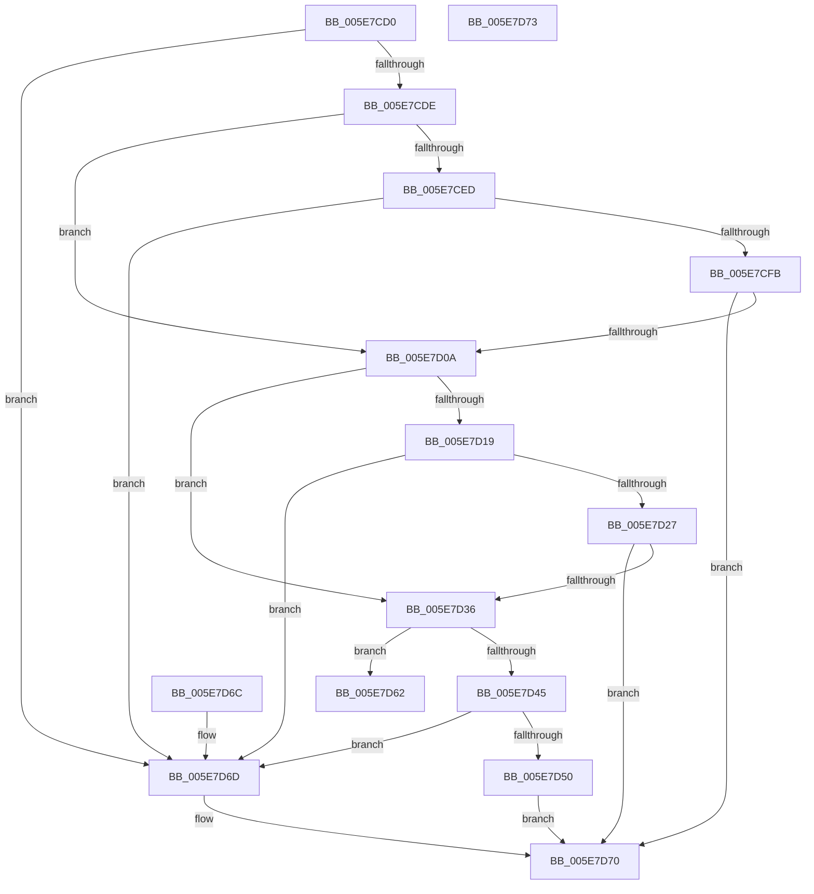

# RtlFindClosestEncodableLength

- RVA: `0x005E7CD0`–`0x005E7D74` (길이 `164` bytes)
- VA: `0x00000001405E7CD0`
- 실행 섹션: `.text`
- PDB 이름 있음: `예`; PDB Function 태그: `아니요`
- unwind 정보 RVA: `0x000DB714`
- 디코드: `44`개 명령, `164/164` bytes 표시
- 미해석 바이트: `0` (있으면 어셈블리에 `.byte`로 보존)

> 이 문서는 커널 이미지의 기계어와 PDB 기호를 분석해 생성했습니다. 4번과 5번은 함수 원형과 자료형을 바이너리 사용 방식에서 추정한 C 해석이며 원본 소스 복구 결과는 아닙니다.

## 1. Dependencies

- 직접 호출 지점: **0**; 고유 호출 대상: **0**
- 직접 호출자로 확인된 함수: **0**
- RIP 상대 이미지 참조: **0**

### Outgoing calls
- 직접 디코드된 call 명령이 없습니다.

### Direct callers
- 이 함수 시작 RVA로 연결되는 직접 call은 확인되지 않았습니다. 간접 호출은 완전히 역산할 수 없습니다.

### Static image references
- 디코드된 RIP-relative 메모리 참조가 없습니다.

## 2. Other-region calls and transfers

- 다른 실행 섹션으로 향하는 call: **0**
- 별도 외부 분기/꼬리 이동을 확인하지 못했습니다.

## 3. Assembly (complete function range)

```asm
005E7CD0  B8 FF FF FF FF                  mov eax, 0xffffffff
005E7CD5  48 3B C8                        cmp rcx, rax
005E7CD8  0F 86 8F 00 00 00               jbe 0x1405e7d6d
005E7CDE  49 B8 00 FF FF FF FF 00 00 00   movabs r8, 0xffffffff00
005E7CE8  49 3B C8                        cmp rcx, r8
005E7CEB  77 1D                           ja 0x1405e7d0a
005E7CED  48 8B C1                        mov rax, rcx
005E7CF0  48 25 00 FF FF FF               and rax, 0xffffffffffffff00
005E7CF6  48 3B C8                        cmp rcx, rax
005E7CF9  74 72                           je 0x1405e7d6d
005E7CFB  48 8D 88 00 01 00 00            lea rcx, [rax + 0x100]
005E7D02  48 89 0A                        mov qword ptr [rdx], rcx
005E7D05  49 3B C8                        cmp rcx, r8
005E7D08  76 66                           jbe 0x1405e7d70
005E7D0A  49 B8 00 00 FF FF FF FF 00 00   movabs r8, 0xffffffff0000
005E7D14  49 3B C8                        cmp rcx, r8
005E7D17  77 1D                           ja 0x1405e7d36
005E7D19  48 8B C1                        mov rax, rcx
005E7D1C  48 25 00 00 FF FF               and rax, 0xffffffffffff0000
005E7D22  48 3B C8                        cmp rcx, rax
005E7D25  74 46                           je 0x1405e7d6d
005E7D27  48 8D 88 00 00 01 00            lea rcx, [rax + 0x10000]
005E7D2E  48 89 0A                        mov qword ptr [rdx], rcx
005E7D31  49 3B C8                        cmp rcx, r8
005E7D34  76 3A                           jbe 0x1405e7d70
005E7D36  49 B8 00 00 00 00 FF FF FF FF   movabs r8, 0xffffffff00000000
005E7D40  49 3B C8                        cmp rcx, r8
005E7D43  77 1D                           ja 0x1405e7d62
005E7D45  48 8B C1                        mov rax, rcx
005E7D48  49 23 C0                        and rax, r8
005E7D4B  48 3B C8                        cmp rcx, rax
005E7D4E  74 1D                           je 0x1405e7d6d
005E7D50  48 B9 00 00 00 00 01 00 00 00   movabs rcx, 0x100000000
005E7D5A  48 03 C1                        add rax, rcx
005E7D5D  48 89 02                        mov qword ptr [rdx], rax
005E7D60  EB 0E                           jmp 0x1405e7d70
005E7D62  48 83 22 00                     and qword ptr [rdx], 0
005E7D66  B8 01 00 00 C0                  mov eax, 0xc0000001
005E7D6B  C3                              ret
005E7D6C  CC                              int3
005E7D6D  48 89 0A                        mov qword ptr [rdx], rcx
005E7D70  33 C0                           xor eax, eax
005E7D72  C3                              ret
005E7D73  CC                              int3
```

## 4. C-style interpretation (structured pseudocode)

```c
__int64 __fastcall RtlFindClosestEncodableLength(__int64 a1, __int64 a2)
{
    __int64 result;

    if (a1 <= ((unsigned int)(0xFFFFFFFFULL))) goto loc_005E7D6D;
    if (a1 > a3) goto loc_005E7D0A;
    result = (a1) & (-256);
    if (a1 == result) goto loc_005E7D6D;
    *(unsigned __int64 *)(a2) = result + 256;
    if ((result + 256) <= a3) goto loc_005E7D70;
loc_005E7D0A:
    if ((result + 256) > a3) goto loc_005E7D36;
    result = (result + 256) & (0xFFFFFFFFFFFF0000ULL);
    if ((result + 256) == result) goto loc_005E7D6D;
    *(unsigned __int64 *)(a2) = result + 65536;
    if ((result + 65536) <= a3) goto loc_005E7D70;
loc_005E7D36:
    if ((result + 65536) > a3) goto loc_005E7D62;
    result = (result + 65536) & (a3);
    if ((result + 65536) == result) goto loc_005E7D6D;
    result = (result) + (result + 65536);
    *(unsigned __int64 *)(a2) = result;
    goto loc_005E7D70;
loc_005E7D62:
    return (unsigned int)(0xC0000001ULL);
loc_005E7D6D:
    *(unsigned __int64 *)(a2) = result + 65536;
loc_005E7D70:
    result = 0;
    return result;
}
```

## 5. (Beta) C Style

```c
int64_t RtlFindClosestEncodableLength(int64_t Arg1, void *Arg2)
{
    uint8_t *arg2 = (uint8_t *)Arg2;

    int64_t result;

    if (Arg1 <= ((uint32_t)(0xFFFFFFFFULL))) goto loc_005E7D6D;
    if (Arg1 > a3) goto loc_005E7D0A;
    result = (Arg1) & (-256);
    if (Arg1 == result) goto loc_005E7D6D;
    *(uint64_t *)(arg2) = result + 256;
    if ((result + 256) <= a3) goto loc_005E7D70;
loc_005E7D0A:
    if ((result + 256) > a3) goto loc_005E7D36;
    result = (result + 256) & (0xFFFFFFFFFFFF0000ULL);
    if ((result + 256) == result) goto loc_005E7D6D;
    *(uint64_t *)(arg2) = result + 65536;
    if ((result + 65536) <= a3) goto loc_005E7D70;
loc_005E7D36:
    if ((result + 65536) > a3) goto loc_005E7D62;
    result = (result + 65536) & (a3);
    if ((result + 65536) == result) goto loc_005E7D6D;
    result = (result) + (result + 65536);
    *(uint64_t *)(arg2) = result;
    goto loc_005E7D70;
loc_005E7D62:
    return (uint32_t)(0xC0000001ULL);
loc_005E7D6D:
    *(uint64_t *)(arg2) = result + 65536;
loc_005E7D70:
    result = 0;
    return result;
}
```

### 관측된 메모리 오프셋

구조체 형식이 확인되지 않은 접근은 인자 기준의 오프셋으로만 기록했습니다.

| 기준 인자 | 오프셋 표현 | 폭 (bit) | 접근 |
|---|---:|---:|---|
| `Arg2` | `+ 0x0` | `64` | `R/W` |
| `Arg2` | `+ 0x0` | `64` | `W` |

## 6. Execution-region graph

[열기: 2D/3D 그래프와 함수 탐색 컨트롤 패널](../../../control-panel.html?section=text&rva=0x005E7CD0&view=graph)

- 2D 그래프는 위에서 아래로 흐르고, 3D 그래프는 빈 공간을 드래그해 회전합니다. Shift+드래그는 이동, 휠은 확대·축소, 함수 노드 선택은 대상 보고서 이동입니다.

### Static fallback


