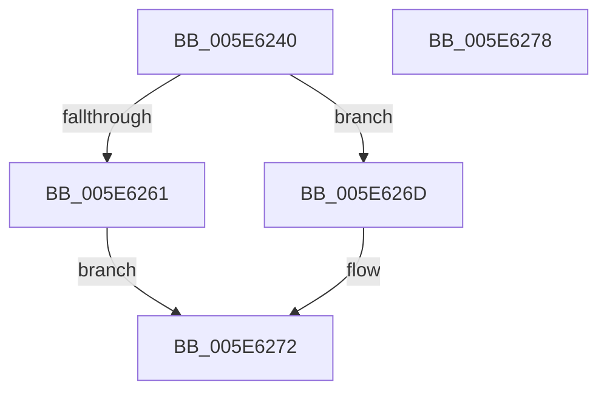

# RtlFindLongestRunClear

- RVA: `0x005E6240`–`0x005E6279` (길이 `57` bytes)
- VA: `0x00000001405E6240`
- 실행 섹션: `.text`
- PDB 이름 있음: `예`; PDB Function 태그: `아니요`
- unwind 정보 RVA: `0x0005CF00`
- 디코드: `19`개 명령, `57/57` bytes 표시
- 미해석 바이트: `0` (있으면 어셈블리에 `.byte`로 보존)

> 이 문서는 커널 이미지의 기계어와 PDB 기호를 분석해 생성했습니다. 4번과 5번은 함수 원형과 자료형을 바이너리 사용 방식에서 추정한 C 해석이며 원본 소스 복구 결과는 아닙니다.

## 1. Dependencies

- 직접 호출 지점: **1**; 고유 호출 대상: **1**
- 직접 호출자로 확인된 함수: **0**
- RIP 상대 이미지 참조: **0**

### Outgoing calls
- `0x005E6257` → [RtlFindClearRuns](../3E/RtlFindClearRuns_function_003ECD40.md) (function, `0x003ECD40`)

### Direct callers
- 이 함수 시작 RVA로 연결되는 직접 call은 확인되지 않았습니다. 간접 호출은 완전히 역산할 수 없습니다.

### Static image references
- 디코드된 RIP-relative 메모리 참조가 없습니다.

## 2. Other-region calls and transfers

- 다른 실행 섹션으로 향하는 call: **0**
- 별도 외부 분기/꼬리 이동을 확인하지 못했습니다.

## 3. Assembly (complete function range)

```asm
005E6240  40 53                           push rbx
005E6242  48 83 EC 20                     sub rsp, 0x20
005E6246  48 8B DA                        mov rbx, rdx
005E6249  41 B1 01                        mov r9b, 1
005E624C  48 8D 54 24 40                  lea rdx, [rsp + 0x40]
005E6251  41 B8 01 00 00 00               mov r8d, 1
005E6257  E8 E4 6A E0 FF                  call 0x1403ecd40
005E625C  83 F8 01                        cmp eax, 1
005E625F  75 0C                           jne 0x1405e626d
005E6261  8B 44 24 40                     mov eax, dword ptr [rsp + 0x40]
005E6265  89 03                           mov dword ptr [rbx], eax
005E6267  8B 44 24 44                     mov eax, dword ptr [rsp + 0x44]
005E626B  EB 05                           jmp 0x1405e6272
005E626D  83 23 00                        and dword ptr [rbx], 0
005E6270  33 C0                           xor eax, eax
005E6272  48 83 C4 20                     add rsp, 0x20
005E6276  5B                              pop rbx
005E6277  C3                              ret
005E6278  CC                              int3
```

## 4. C-style interpretation (structured pseudocode)

```c
__int64 __fastcall RtlFindLongestRunClear(__int64 a1, __int64 a2)
{
    __int64 result;
    __int64 v_rsp;
    unsigned __int64 v_stack_p18;
    unsigned int v_stack_p1C;

    v_rsp = (v_rsp) - (32);
    result = RtlFindClearRuns(a1, v_stack_p18, 1, 1);
    if (((unsigned int)(result)) != 1) goto loc_005E626D;
    *(unsigned int *)(a2) = (unsigned int)((unsigned int)(v_stack_p18));
    goto loc_005E6272;
loc_005E626D:
    result = 0;
loc_005E6272:
    v_rsp = (v_rsp) + (32);
    return result;
}
```

## 5. (Beta) C Style

```c
int64_t RtlFindLongestRunClear(int64_t Arg1, void *Arg2)
{
    uint8_t *arg2 = (uint8_t *)Arg2;

    int64_t result;
    int64_t local_rsp;
    uint64_t v_stack_p18;
    uint32_t v_stack_p1C;

    local_rsp = (local_rsp) - (32);
    result = RtlFindClearRuns(Arg1, v_stack_p18, 1, 1);
    if (((uint32_t)(result)) != 1) goto loc_005E626D;
    *(uint32_t *)(arg2) = (uint32_t)((uint32_t)(v_stack_p18));
    goto loc_005E6272;
loc_005E626D:
    result = 0;
loc_005E6272:
    local_rsp = (local_rsp) + (32);
    return result;
}
```

### 관측된 메모리 오프셋

구조체 형식이 확인되지 않은 접근은 인자 기준의 오프셋으로만 기록했습니다.

| 기준 인자 | 오프셋 표현 | 폭 (bit) | 접근 |
|---|---:|---:|---|
| `Arg2` | `+ 0x0` | `32` | `R/W` |
| `Arg2` | `+ 0x0` | `32` | `W` |

## 6. Execution-region graph

[열기: 2D/3D 그래프와 함수 탐색 컨트롤 패널](../../../control-panel.html?section=text&rva=0x005E6240&view=graph)

- 2D 그래프는 위에서 아래로 흐르고, 3D 그래프는 빈 공간을 드래그해 회전합니다. Shift+드래그는 이동, 휠은 확대·축소, 함수 노드 선택은 대상 보고서 이동입니다.

### Static fallback


