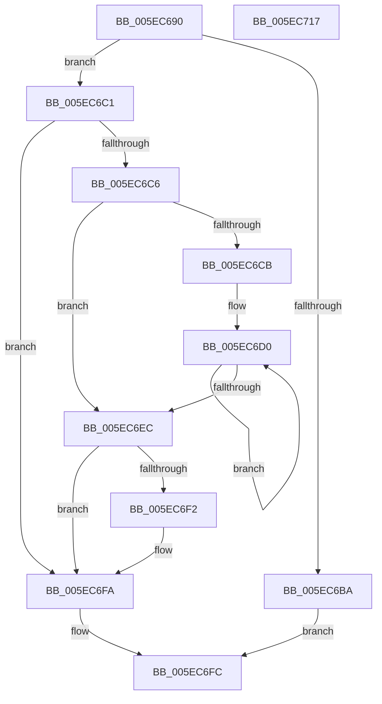

# RtlFlushNonVolatileMemoryRanges

- RVA: `0x005EC690`–`0x005EC718` (길이 `136` bytes)
- VA: `0x00000001405EC690`
- 실행 섹션: `.text`
- PDB 이름 있음: `예`; PDB Function 태그: `아니요`
- unwind 정보 RVA: `0x0005E6B4`
- 디코드: `42`개 명령, `136/136` bytes 표시
- 미해석 바이트: `0` (있으면 어셈블리에 `.byte`로 보존)

> 이 문서는 커널 이미지의 기계어와 PDB 기호를 분석해 생성했습니다. 4번과 5번은 함수 원형과 자료형을 바이너리 사용 방식에서 추정한 C 해석이며 원본 소스 복구 결과는 아닙니다.

## 1. Dependencies

- 직접 호출 지점: **2**; 고유 호출 대상: **2**
- 직접 호출자로 확인된 함수: **0**
- RIP 상대 이미지 참조: **0**

### Outgoing calls
- `0x005EC6DD` → [RtlFlushNonVolatileMemory](../4F/RtlFlushNonVolatileMemory_function_004FCBF0.md) (function, `0x004FCBF0`)
- `0x005EC6F5` → [RtlDrainNonVolatileFlush](RtlDrainNonVolatileFlush_function_005E6060.md) (function, `0x005E6060`)

### Direct callers
- 이 함수 시작 RVA로 연결되는 직접 call은 확인되지 않았습니다. 간접 호출은 완전히 역산할 수 없습니다.

### Static image references
- 디코드된 RIP-relative 메모리 참조가 없습니다.

## 2. Other-region calls and transfers

- 다른 실행 섹션으로 향하는 call: **0**
- 별도 외부 분기/꼬리 이동을 확인하지 못했습니다.

## 3. Assembly (complete function range)

```asm
005EC690  48 8B C4                        mov rax, rsp
005EC693  48 89 58 08                     mov qword ptr [rax + 8], rbx
005EC697  48 89 68 10                     mov qword ptr [rax + 0x10], rbp
005EC69B  48 89 70 18                     mov qword ptr [rax + 0x18], rsi
005EC69F  48 89 78 20                     mov qword ptr [rax + 0x20], rdi
005EC6A3  41 56                           push r14
005EC6A5  48 83 EC 20                     sub rsp, 0x20
005EC6A9  41 8B E9                        mov ebp, r9d
005EC6AC  49 8B F8                        mov rdi, r8
005EC6AF  4C 8B F2                        mov r14, rdx
005EC6B2  48 8B D9                        mov rbx, rcx
005EC6B5  F6 C1 01                        test cl, 1
005EC6B8  75 07                           jne 0x1405ec6c1
005EC6BA  B8 0D 00 00 C0                  mov eax, 0xc000000d
005EC6BF  EB 3B                           jmp 0x1405ec6fc
005EC6C1  F6 C3 02                        test bl, 2
005EC6C4  74 34                           je 0x1405ec6fa
005EC6C6  4D 85 C0                        test r8, r8
005EC6C9  74 21                           je 0x1405ec6ec
005EC6CB  8B F5                           mov esi, ebp
005EC6CD  83 CE 01                        or esi, 1
005EC6D0  4D 8B 46 08                     mov r8, qword ptr [r14 + 8]
005EC6D4  44 8B CE                        mov r9d, esi
005EC6D7  49 8B 16                        mov rdx, qword ptr [r14]
005EC6DA  48 8B CB                        mov rcx, rbx
005EC6DD  E8 0E 05 F1 FF                  call 0x1404fcbf0
005EC6E2  4D 8D 76 10                     lea r14, [r14 + 0x10]
005EC6E6  48 83 EF 01                     sub rdi, 1
005EC6EA  75 E4                           jne 0x1405ec6d0
005EC6EC  40 F6 C5 01                     test bpl, 1
005EC6F0  75 08                           jne 0x1405ec6fa
005EC6F2  48 8B CB                        mov rcx, rbx
005EC6F5  E8 66 99 FF FF                  call 0x1405e6060
005EC6FA  33 C0                           xor eax, eax
005EC6FC  48 8B 5C 24 30                  mov rbx, qword ptr [rsp + 0x30]
005EC701  48 8B 6C 24 38                  mov rbp, qword ptr [rsp + 0x38]
005EC706  48 8B 74 24 40                  mov rsi, qword ptr [rsp + 0x40]
005EC70B  48 8B 7C 24 48                  mov rdi, qword ptr [rsp + 0x48]
005EC710  48 83 C4 20                     add rsp, 0x20
005EC714  41 5E                           pop r14
005EC716  C3                              ret
005EC717  CC                              int3
```

## 4. C-style interpretation (structured pseudocode)

```c
__int64 __fastcall RtlFlushNonVolatileMemoryRanges(__int64 a1, __int64 a2, __int64 a3, int a4)
{
    __int64 result;
    __int64 v_rdi;
    __int64 v_rsi;
    __int64 v_rsp;
    unsigned __int64 v_stack_p10;
    unsigned __int64 v_stack_p18;
    unsigned __int64 v_stack_p20;
    unsigned __int64 v_stack_p8;

    *(unsigned __int64 *)(v_rsp + 8) = v_rbx;
    *(unsigned __int64 *)(v_rsp + 16) = v_rbp;
    *(unsigned __int64 *)(v_rsp + 24) = v_rsi;
    *(unsigned __int64 *)(v_rsp + 32) = v_rdi;
    v_rsp = (v_rsp) - (32);
    if ((((unsigned __int8)(a1)) & (1)) != 0) goto loc_005EC6C1;
    goto loc_005EC6FC;
loc_005EC6C1:
    if ((((unsigned __int8)(a1)) & (2)) == 0) goto loc_005EC6FA;
    if (a3 == 0) goto loc_005EC6EC;
    v_rsi = (unsigned int)(((unsigned int)((unsigned int)((unsigned int)(a4)))) | (1));
loc_005EC6D0:
    result = RtlFlushNonVolatileMemory(a1, *(unsigned __int64 *)(a2), *(unsigned __int64 *)(a2 + 8), (unsigned int)((unsigned int)(v_rsi)));
    v_rdi = (a3) - (1);
    if (condition_is_not_equal) goto loc_005EC6D0;
loc_005EC6EC:
    if ((((unsigned __int8)((unsigned int)(a4))) & (1)) == 0) {
        a1 = a1;
        result = RtlDrainNonVolatileFlush(a1, *(unsigned __int64 *)(a2), *(unsigned __int64 *)(a2 + 8), (unsigned int)((unsigned int)(v_rsi)));
    }
    result = 0;
loc_005EC6FC:
    v_rsp = (v_rsp) + (32);
    return result;
}
```

## 5. (Beta) C Style

```c
int64_t RtlFlushNonVolatileMemoryRanges(int64_t Arg1, void *Arg2, int64_t Arg3, int32_t Arg4)
{
    uint8_t *arg2 = (uint8_t *)Arg2;

    int64_t result;
    int64_t local_rdi;
    int64_t local_rsi;
    int64_t local_rsp;
    uint64_t v_stack_p10;
    uint64_t v_stack_p18;
    uint64_t v_stack_p20;
    uint64_t v_stack_p8;

    *(uint64_t *)(local_rsp + 0x8) = local_rbx;
    *(uint64_t *)(local_rsp + 0x10) = local_rbp;
    *(uint64_t *)(local_rsp + 0x18) = local_rsi;
    *(uint64_t *)(local_rsp + 0x20) = local_rdi;
    local_rsp = (local_rsp) - (32);
    if ((((uint8_t)(Arg1)) & (1)) != 0) goto loc_005EC6C1;
    goto loc_005EC6FC;
loc_005EC6C1:
    if ((((uint8_t)(Arg1)) & (2)) == 0) goto loc_005EC6FA;
    if (Arg3 == 0) goto loc_005EC6EC;
    local_rsi = (uint32_t)(((uint32_t)((uint32_t)((uint32_t)(Arg4)))) | (1));
loc_005EC6D0:
    result = RtlFlushNonVolatileMemory(Arg1, *(uint64_t *)(arg2), *(uint64_t *)(arg2 + 0x8), (uint32_t)((uint32_t)(local_rsi)));
    local_rdi = (Arg3) - (1);
    if (condition_is_not_equal) goto loc_005EC6D0;
loc_005EC6EC:
    if ((((uint8_t)((uint32_t)(Arg4))) & (1)) == 0) {
        Arg1 = Arg1;
        result = RtlDrainNonVolatileFlush(Arg1, *(uint64_t *)(arg2), *(uint64_t *)(arg2 + 0x8), (uint32_t)((uint32_t)(local_rsi)));
    }
    result = 0;
loc_005EC6FC:
    local_rsp = (local_rsp) + (32);
    return result;
}
```

### 관측된 메모리 오프셋

구조체 형식이 확인되지 않은 접근은 인자 기준의 오프셋으로만 기록했습니다.

| 기준 인자 | 오프셋 표현 | 폭 (bit) | 접근 |
|---|---:|---:|---|
| `Arg2` | `+ 0x0` | `64` | `R` |
| `Arg2` | `+ 0x8` | `64` | `R` |
| `Arg2` | `+ 0x10` | `64` | `R` |

## 6. Execution-region graph

[열기: 2D/3D 그래프와 함수 탐색 컨트롤 패널](../../../control-panel.html?section=text&rva=0x005EC690&view=graph)

- 2D 그래프는 위에서 아래로 흐르고, 3D 그래프는 빈 공간을 드래그해 회전합니다. Shift+드래그는 이동, 휠은 확대·축소, 함수 노드 선택은 대상 보고서 이동입니다.

### Static fallback


