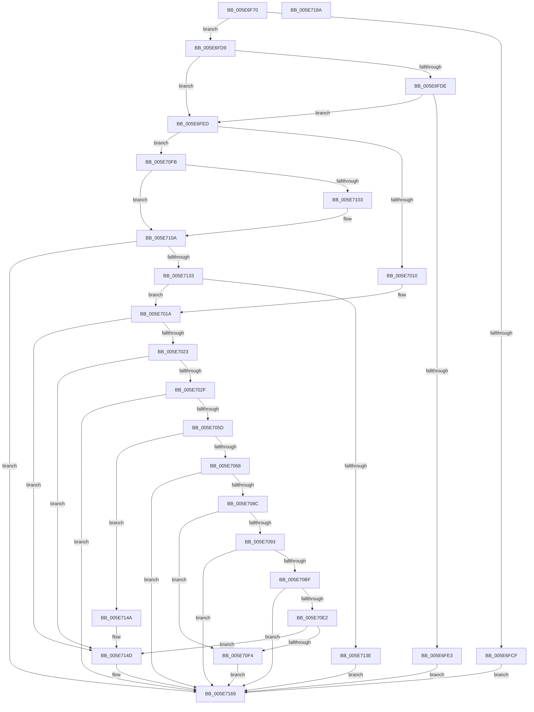

# RtlGetAppContainerNamedObjectPath

- RVA: `0x005E6F70`–`0x005E718B` (길이 `539` bytes)
- VA: `0x00000001405E6F70`
- 실행 섹션: `.text`
- PDB 이름 있음: `예`; PDB Function 태그: `아니요`
- unwind 정보 RVA: `0x000CF978`
- 디코드: `143`개 명령, `539/539` bytes 표시
- 미해석 바이트: `0` (있으면 어셈블리에 `.byte`로 보존)

> 이 문서는 커널 이미지의 기계어와 PDB 기호를 분석해 생성했습니다. 4번과 5번은 함수 원형과 자료형을 바이너리 사용 방식에서 추정한 C 해석이며 원본 소스 복구 결과는 아닙니다.

## 1. Dependencies

- 직접 호출 지점: **9**; 고유 호출 대상: **4**
- 직접 호출자로 확인된 함수: **0**
- RIP 상대 이미지 참조: **0**

### Outgoing calls
- `0x005E6FB7` → [memset](../6C/memset_function_006C6C40.md) (function, `0x006C6C40`)
- `0x005E6FC5` → [memset](../6C/memset_function_006C6C40.md) (function, `0x006C6C40`)
- `0x005E7050` → [NtQueryInformationToken](../../page/AE/NtQueryInformationToken_function_00AECDD0.md) (function, `0x00AECDD0`)
- `0x005E707F` → [NtQueryInformationToken](../../page/AE/NtQueryInformationToken_function_00AECDD0.md) (function, `0x00AECDD0`)
- `0x005E70B2` → [NtQueryInformationToken](../../page/AE/NtQueryInformationToken_function_00AECDD0.md) (function, `0x00AECDD0`)
- `0x005E70D5` → [NtQueryInformationToken](../../page/AE/NtQueryInformationToken_function_00AECDD0.md) (function, `0x00AECDD0`)
- `0x005E70EB` → [RtlEqualSid](../40/RtlEqualSid_function_00400AD0.md) (function, `0x00400AD0`)
- `0x005E712A` → [NtQueryInformationToken](../../page/AE/NtQueryInformationToken_function_00AECDD0.md) (function, `0x00AECDD0`)
- `0x005E7164` → [RtlpGetTokenNamedObjectPath](../../page/78/RtlpGetTokenNamedObjectPath_function_0078ED40.md) (function, `0x0078ED40`)

### Direct callers
- 이 함수 시작 RVA로 연결되는 직접 call은 확인되지 않았습니다. 간접 호출은 완전히 역산할 수 없습니다.

### Static image references
- 디코드된 RIP-relative 메모리 참조가 없습니다.

## 2. Other-region calls and transfers

- 다른 실행 섹션으로 향하는 call: **6**
  - `0x005E7050` → [NtQueryInformationToken](../../page/AE/NtQueryInformationToken_function_00AECDD0.md) (`.text` → `PAGE`)
  - `0x005E707F` → [NtQueryInformationToken](../../page/AE/NtQueryInformationToken_function_00AECDD0.md) (`.text` → `PAGE`)
  - `0x005E70B2` → [NtQueryInformationToken](../../page/AE/NtQueryInformationToken_function_00AECDD0.md) (`.text` → `PAGE`)
  - `0x005E70D5` → [NtQueryInformationToken](../../page/AE/NtQueryInformationToken_function_00AECDD0.md) (`.text` → `PAGE`)
  - `0x005E712A` → [NtQueryInformationToken](../../page/AE/NtQueryInformationToken_function_00AECDD0.md) (`.text` → `PAGE`)
  - `0x005E7164` → [RtlpGetTokenNamedObjectPath](../../page/78/RtlpGetTokenNamedObjectPath_function_0078ED40.md) (`.text` → `PAGE`)
- 별도 외부 분기/꼬리 이동을 확인하지 못했습니다.

## 3. Assembly (complete function range)

```asm
005E6F70  48 8B C4                        mov rax, rsp
005E6F73  48 89 58 08                     mov qword ptr [rax + 8], rbx
005E6F77  48 89 70 10                     mov qword ptr [rax + 0x10], rsi
005E6F7B  48 89 78 18                     mov qword ptr [rax + 0x18], rdi
005E6F7F  55                              push rbp
005E6F80  41 54                           push r12
005E6F82  41 55                           push r13
005E6F84  41 56                           push r14
005E6F86  41 57                           push r15
005E6F88  48 8D 68 A1                     lea rbp, [rax - 0x5f]
005E6F8C  48 81 EC 00 01 00 00            sub rsp, 0x100
005E6F93  83 64 24 30 00                  and dword ptr [rsp + 0x30], 0
005E6F98  45 8A F8                        mov r15b, r8b
005E6F9B  83 65 7F 00                     and dword ptr [rbp + 0x7f], 0
005E6F9F  4C 8B E2                        mov r12, rdx
005E6FA2  48 8B D9                        mov rbx, rcx
005E6FA5  BF 58 00 00 00                  mov edi, 0x58
005E6FAA  44 8B C7                        mov r8d, edi
005E6FAD  48 8D 4C 24 40                  lea rcx, [rsp + 0x40]
005E6FB2  33 D2                           xor edx, edx
005E6FB4  4D 8B E9                        mov r13, r9
005E6FB7  E8 84 FC 0D 00                  call 0x1406c6c40
005E6FBC  44 8B C7                        mov r8d, edi
005E6FBF  48 8D 4D D7                     lea rcx, [rbp - 0x29]
005E6FC3  33 D2                           xor edx, edx
005E6FC5  E8 76 FC 0D 00                  call 0x1406c6c40
005E6FCA  4D 85 ED                        test r13, r13
005E6FCD  75 0A                           jne 0x1405e6fd9
005E6FCF  B8 0D 00 00 C0                  mov eax, 0xc000000d
005E6FD4  E9 90 01 00 00                  jmp 0x1405e7169
005E6FD9  48 85 DB                        test rbx, rbx
005E6FDC  74 0F                           je 0x1405e6fed
005E6FDE  4D 85 E4                        test r12, r12
005E6FE1  74 0A                           je 0x1405e6fed
005E6FE3  B8 30 00 00 C0                  mov eax, 0xc0000030
005E6FE8  E9 7C 01 00 00                  jmp 0x1405e7169
005E6FED  83 64 24 38 00                  and dword ptr [rsp + 0x38], 0
005E6FF2  45 32 F6                        xor r14b, r14b
005E6FF5  83 64 24 34 00                  and dword ptr [rsp + 0x34], 0
005E6FFA  41 8A C7                        mov al, r15b
005E6FFD  F6 D8                           neg al
005E6FFF  1B FF                           sbb edi, edi
005E7001  83 E7 05                        and edi, 5
005E7004  83 C7 08                        add edi, 8
005E7007  4D 85 E4                        test r12, r12
005E700A  0F 84 EB 00 00 00               je 0x1405e70fb
005E7010  48 C7 C3 FC FF FF FF            mov rbx, 0xfffffffffffffffc
005E7017  40 32 F6                        xor sil, sil
005E701A  45 84 FF                        test r15b, r15b
005E701D  0F 84 2A 01 00 00               je 0x1405e714d
005E7023  41 B6 01                        mov r14b, 1
005E7026  40 84 F6                        test sil, sil
005E7029  0F 84 1E 01 00 00               je 0x1405e714d
005E702F  41 B9 04 00 00 00               mov r9d, 4
005E7035  48 8D 45 7F                     lea rax, [rbp + 0x7f]
005E7039  4C 8D 44 24 34                  lea r8, [rsp + 0x34]
005E703E  48 89 44 24 20                  mov qword ptr [rsp + 0x20], rax
005E7043  48 C7 C1 FC FF FF FF            mov rcx, 0xfffffffffffffffc
005E704A  41 8D 71 26                     lea esi, [r9 + 0x26]
005E704E  8B D6                           mov edx, esi
005E7050  E8 7B 5D 50 00                  call 0x140aecdd0
005E7055  85 C0                           test eax, eax
005E7057  0F 88 0C 01 00 00               js 0x1405e7169
005E705D  83 7C 24 34 00                  cmp dword ptr [rsp + 0x34], 0
005E7062  0F 84 E2 00 00 00               je 0x1405e714a
005E7068  48 8D 45 7F                     lea rax, [rbp + 0x7f]
005E706C  8B D6                           mov edx, esi
005E706E  44 8D 4E DA                     lea r9d, [rsi - 0x26]
005E7072  48 89 44 24 20                  mov qword ptr [rsp + 0x20], rax
005E7077  4C 8D 44 24 38                  lea r8, [rsp + 0x38]
005E707C  48 8B CB                        mov rcx, rbx
005E707F  E8 4C 5D 50 00                  call 0x140aecdd0
005E7084  85 C0                           test eax, eax
005E7086  0F 88 DD 00 00 00               js 0x1405e7169
005E708C  83 7C 24 38 00                  cmp dword ptr [rsp + 0x38], 0
005E7091  74 61                           je 0x1405e70f4
005E7093  44 8D 4E 2E                     lea r9d, [rsi + 0x2e]
005E7097  48 C7 C1 FC FF FF FF            mov rcx, 0xfffffffffffffffc
005E709E  41 8D 71 A9                     lea esi, [r9 - 0x57]
005E70A2  48 8D 45 7F                     lea rax, [rbp + 0x7f]
005E70A6  8B D6                           mov edx, esi
005E70A8  4C 8D 44 24 40                  lea r8, [rsp + 0x40]
005E70AD  48 89 44 24 20                  mov qword ptr [rsp + 0x20], rax
005E70B2  E8 19 5D 50 00                  call 0x140aecdd0
005E70B7  85 C0                           test eax, eax
005E70B9  0F 88 AA 00 00 00               js 0x1405e7169
005E70BF  48 8D 45 7F                     lea rax, [rbp + 0x7f]
005E70C3  8B D6                           mov edx, esi
005E70C5  44 8D 4E 57                     lea r9d, [rsi + 0x57]
005E70C9  48 89 44 24 20                  mov qword ptr [rsp + 0x20], rax
005E70CE  4C 8D 45 D7                     lea r8, [rbp - 0x29]
005E70D2  48 8B CB                        mov rcx, rbx
005E70D5  E8 F6 5C 50 00                  call 0x140aecdd0
005E70DA  85 C0                           test eax, eax
005E70DC  0F 88 87 00 00 00               js 0x1405e7169
005E70E2  48 8B 54 24 40                  mov rdx, qword ptr [rsp + 0x40]
005E70E7  48 8B 4D D7                     mov rcx, qword ptr [rbp - 0x29]
005E70EB  E8 E0 99 E1 FF                  call 0x140400ad0
005E70F0  84 C0                           test al, al
005E70F2  75 59                           jne 0x1405e714d
005E70F4  B8 BB 00 00 C0                  mov eax, 0xc00000bb
005E70F9  EB 6E                           jmp 0x1405e7169
005E70FB  40 B6 01                        mov sil, 1
005E70FE  48 85 DB                        test rbx, rbx
005E7101  75 07                           jne 0x1405e710a
005E7103  48 C7 C3 FA FF FF FF            mov rbx, 0xfffffffffffffffa
005E710A  83 64 24 30 00                  and dword ptr [rsp + 0x30], 0
005E710F  48 8D 45 7F                     lea rax, [rbp + 0x7f]
005E7113  41 B9 04 00 00 00               mov r9d, 4
005E7119  48 89 44 24 20                  mov qword ptr [rsp + 0x20], rax
005E711E  4C 8D 44 24 30                  lea r8, [rsp + 0x30]
005E7123  48 8B CB                        mov rcx, rbx
005E7126  41 8D 51 19                     lea edx, [r9 + 0x19]
005E712A  E8 A1 5C 50 00                  call 0x140aecdd0
005E712F  85 C0                           test eax, eax
005E7131  78 36                           js 0x1405e7169
005E7133  83 7C 24 30 00                  cmp dword ptr [rsp + 0x30], 0
005E7138  0F 85 DC FE FF FF               jne 0x1405e701a
005E713E  0F 57 C0                        xorps xmm0, xmm0
005E7141  33 C0                           xor eax, eax
005E7143  41 0F 11 45 00                  movups xmmword ptr [r13], xmm0
005E7148  EB 1F                           jmp 0x1405e7169
005E714A  45 32 F6                        xor r14b, r14b
005E714D  44 8B C7                        mov r8d, edi
005E7150  4D 8B CD                        mov r9, r13
005E7153  41 83 C8 02                     or r8d, 2
005E7157  49 8B D4                        mov rdx, r12
005E715A  45 84 F6                        test r14b, r14b
005E715D  48 8B CB                        mov rcx, rbx
005E7160  44 0F 44 C7                     cmove r8d, edi
005E7164  E8 D7 7B 1A 00                  call 0x14078ed40
005E7169  4C 8D 9C 24 00 01 00 00         lea r11, [rsp + 0x100]
005E7171  49 8B 5B 30                     mov rbx, qword ptr [r11 + 0x30]
005E7175  49 8B 73 38                     mov rsi, qword ptr [r11 + 0x38]
005E7179  49 8B 7B 40                     mov rdi, qword ptr [r11 + 0x40]
005E717D  49 8B E3                        mov rsp, r11
005E7180  41 5F                           pop r15
005E7182  41 5E                           pop r14
005E7184  41 5D                           pop r13
005E7186  41 5C                           pop r12
005E7188  5D                              pop rbp
005E7189  C3                              ret
005E718A  CC                              int3
```

## 4. C-style interpretation (structured pseudocode)

```c
__int64 __fastcall RtlGetAppContainerNamedObjectPath(__int64 a1, __int64 a2, unsigned __int8 a3, __int64 a4)
{
    __int64 result;
    __int64 v_r14;
    __int64 v_rbx;
    __int64 v_rdi;
    __int64 v_rsi;
    __int64 v_rsp;
    unsigned __int64 v_stack_m108;
    unsigned __int64 v_stack_m28;
    unsigned __int64 v_stack_mE8;
    unsigned int v_stack_mF0;
    unsigned int v_stack_mF4;
    unsigned int v_stack_mF8;

    *(unsigned __int64 *)(v_rsp + 8) = v_rbx;
    *(unsigned __int64 *)(v_rsp + 16) = v_rsi;
    *(unsigned __int64 *)(v_rsp + 24) = v_rdi;
    v_rsp = (v_rsp) - (256);
    a2 = 0;
    result = memset(v_stack_mE8, a2, 88, a4);
    a2 = 0;
    result = memset(v_rsp - 95 - 41, a2, 88, a4);
    if (a4 != 0) goto loc_005E6FD9;
    goto loc_005E7169;
loc_005E6FD9:
    if (a1 == 0) goto loc_005E6FED;
    if (0 == 0) goto loc_005E6FED;
    goto loc_005E7169;
loc_005E6FED:
    v_r14 = 0;
    result = (unsigned __int8)(-(a3));
    v_rdi = (unsigned int)((88) & (5));
    v_rdi = (unsigned int)((v_rdi) + (8));
    if (0 == 0) goto loc_005E70FB;
    v_rsi = 0;
loc_005E701A:
    if (a3 == 0) goto loc_005E714D;
    if (0 == 0) goto loc_005E714D;
    v_stack_m108 = v_rsp - 95 + 127;
    result = NtQueryInformationToken(-4, (unsigned int)((unsigned int)(4 + 38)), v_stack_mF4, 4);
    if (sign_flag) goto loc_005E7169;
    if (v_stack_mF4 == 0) goto loc_005E714A;
    v_stack_m108 = v_rsp - 95 + 127;
    result = NtQueryInformationToken(-4, (unsigned int)((unsigned int)(4 + 38)), v_stack_mF0, 4 + 38 - 38);
    if (sign_flag) goto loc_005E7169;
    if (v_stack_mF0 == 0) goto loc_005E70F4;
    v_stack_m108 = v_rsp - 95 + 127;
    result = NtQueryInformationToken(-4, (unsigned int)((unsigned int)(4 + 38 + 46 - 87)), v_stack_mE8, 4 + 38 + 46);
    if (sign_flag) goto loc_005E7169;
    v_stack_m108 = v_rsp - 95 + 127;
    result = NtQueryInformationToken(-4, (unsigned int)((unsigned int)(4 + 38 + 46 - 87)), v_rsp - 95 - 41, 4 + 38 + 46 - 87 + 87);
    if (sign_flag) goto loc_005E7169;
    result = RtlEqualSid(*(unsigned __int64 *)(v_rsp - 95 - 41), v_stack_mE8, v_rsp - 95 - 41, 4 + 38 + 46 - 87 + 87);
    if ((unsigned __int8)(result) != 0) goto loc_005E714D;
loc_005E70F4:
    goto loc_005E7169;
loc_005E70FB:
    v_rbx = -4;
    if (-4 == 0) {
        v_rbx = -6;
    }
    v_stack_m108 = v_rsp - 95 + 127;
    result = NtQueryInformationToken(v_rbx, 4 + 25, v_stack_mF8, 4);
    if (sign_flag) goto loc_005E7169;
    if (v_stack_mF8 != 0) goto loc_005E701A;
    result = 0;
    *(unsigned __int64 *)(a4) = v_xmm0;
    goto loc_005E7169;
loc_005E714A:
    v_r14 = 0;
loc_005E714D:
    a3 = (unsigned int)(((unsigned int)((unsigned int)(v_rdi))) | (2));
    if (0 == 0) { a3 = (unsigned int)(v_rdi); }
    result = RtlpGetTokenNamedObjectPath(v_rbx, 0, a3, a4);
loc_005E7169:
    return result;
}
```

## 5. (Beta) C Style

```c
int64_t RtlGetAppContainerNamedObjectPath(int64_t Arg1, int64_t Arg2, uint8_t Arg3, int64_t Arg4)
{
    int64_t result;
    int64_t local_r14;
    int64_t local_rbx;
    int64_t local_rdi;
    int64_t local_rsi;
    int64_t local_rsp;
    uint64_t v_stack_m108;
    uint64_t v_stack_m28;
    uint64_t v_stack_mE8;
    uint32_t v_stack_mF0;
    uint32_t v_stack_mF4;
    uint32_t v_stack_mF8;

    *(uint64_t *)(local_rsp + 0x8) = local_rbx;
    *(uint64_t *)(local_rsp + 0x10) = local_rsi;
    *(uint64_t *)(local_rsp + 0x18) = local_rdi;
    local_rsp = (local_rsp) - (256);
    Arg2 = 0;
    result = memset(v_stack_mE8, Arg2, 88, Arg4);
    Arg2 = 0;
    result = memset(local_rsp - 95 - 41, Arg2, 88, Arg4);
    if (Arg4 != 0) goto loc_005E6FD9;
    goto loc_005E7169;
loc_005E6FD9:
    if (Arg1 == 0) goto loc_005E6FED;
    if (0 == 0) goto loc_005E6FED;
    goto loc_005E7169;
loc_005E6FED:
    local_r14 = 0;
    result = (uint8_t)(-(Arg3));
    local_rdi = (uint32_t)((88) & (5));
    local_rdi = (uint32_t)((local_rdi) + (8));
    if (0 == 0) goto loc_005E70FB;
    local_rsi = 0;
loc_005E701A:
    if (Arg3 == 0) goto loc_005E714D;
    if (0 == 0) goto loc_005E714D;
    v_stack_m108 = local_rsp - 95 + 127;
    result = NtQueryInformationToken(-4, (uint32_t)((uint32_t)(4 + 38)), v_stack_mF4, 4);
    if (sign_flag) goto loc_005E7169;
    if (v_stack_mF4 == 0) goto loc_005E714A;
    v_stack_m108 = local_rsp - 95 + 127;
    result = NtQueryInformationToken(-4, (uint32_t)((uint32_t)(4 + 38)), v_stack_mF0, 4 + 38 - 38);
    if (sign_flag) goto loc_005E7169;
    if (v_stack_mF0 == 0) goto loc_005E70F4;
    v_stack_m108 = local_rsp - 95 + 127;
    result = NtQueryInformationToken(-4, (uint32_t)((uint32_t)(4 + 38 + 46 - 87)), v_stack_mE8, 4 + 38 + 46);
    if (sign_flag) goto loc_005E7169;
    v_stack_m108 = local_rsp - 95 + 127;
    result = NtQueryInformationToken(-4, (uint32_t)((uint32_t)(4 + 38 + 46 - 87)), local_rsp - 95 - 41, 4 + 38 + 46 - 87 + 87);
    if (sign_flag) goto loc_005E7169;
    result = RtlEqualSid(*(uint64_t *)(local_rsp - 0x5F - 0x29), v_stack_mE8, local_rsp - 95 - 41, 4 + 38 + 46 - 87 + 87);
    if ((uint8_t)(result) != 0) goto loc_005E714D;
loc_005E70F4:
    goto loc_005E7169;
loc_005E70FB:
    local_rbx = -4;
    if (-4 == 0) {
        local_rbx = -6;
    }
    v_stack_m108 = local_rsp - 95 + 127;
    result = NtQueryInformationToken(local_rbx, 4 + 25, v_stack_mF8, 4);
    if (sign_flag) goto loc_005E7169;
    if (v_stack_mF8 != 0) goto loc_005E701A;
    result = 0;
    *(uint64_t *)(Arg4) = v_xmm0;
    goto loc_005E7169;
loc_005E714A:
    local_r14 = 0;
loc_005E714D:
    Arg3 = (uint32_t)(((uint32_t)((uint32_t)(local_rdi))) | (2));
    if (0 == 0) { Arg3 = (uint32_t)(local_rdi); }
    result = RtlpGetTokenNamedObjectPath(local_rbx, 0, Arg3, Arg4);
loc_005E7169:
    return result;
}
```

## 6. Execution-region graph

[열기: 2D/3D 그래프와 함수 탐색 컨트롤 패널](../../../control-panel.html?section=text&rva=0x005E6F70&view=graph)

- 2D 그래프는 위에서 아래로 흐르고, 3D 그래프는 빈 공간을 드래그해 회전합니다. Shift+드래그는 이동, 휠은 확대·축소, 함수 노드 선택은 대상 보고서 이동입니다.

### Static fallback


