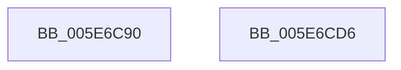

# RtlGetEnabledExtendedFeatures

- RVA: `0x005E6C90`–`0x005E6CD7` (길이 `71` bytes)
- VA: `0x00000001405E6C90`
- 실행 섹션: `.text`
- PDB 이름 있음: `예`; PDB Function 태그: `아니요`
- unwind 정보 RVA: `0x0005C788`
- 디코드: `16`개 명령, `71/71` bytes 표시
- 미해석 바이트: `0` (있으면 어셈블리에 `.byte`로 보존)

> 이 문서는 커널 이미지의 기계어와 PDB 기호를 분석해 생성했습니다. 4번과 5번은 함수 원형과 자료형을 바이너리 사용 방식에서 추정한 C 해석이며 원본 소스 복구 결과는 아닙니다.

## 1. Dependencies

- 직접 호출 지점: **2**; 고유 호출 대상: **2**
- 직접 호출자로 확인된 함수: **2**
- RIP 상대 이미지 참조: **0**

### Outgoing calls
- `0x005E6CBB` → [RtlpArchContextFlagFromMachine](../../page/8C/RtlpArchContextFlagFromMachine_function_008CDF68.md) (function, `0x008CDF68`)
- `0x005E6CC7` → [RtlpRemoveArchDisallowedXStateFeatures](../2F/RtlpRemoveArchDisallowedXStateFeatures_function_002F32FC.md) (function, `0x002F32FC`)

### Direct callers
- [SymCryptInitEnvWindowsKernelmodeWin8_1nLater](../51/SymCryptInitEnvWindowsKernelmodeWin8_1nLater_function_0051C948.md) at `0x0051C9B7`
- [sub_00BF16D0](../../init/BF/Unknown_function_00BF16D0.md) at `0x00C09505`

### Static image references
- 디코드된 RIP-relative 메모리 참조가 없습니다.

## 2. Other-region calls and transfers

- 다른 실행 섹션으로 향하는 call: **1**
  - `0x005E6CBB` → [RtlpArchContextFlagFromMachine](../../page/8C/RtlpArchContextFlagFromMachine_function_008CDF68.md) (`.text` → `PAGE`)
- 별도 외부 분기/꼬리 이동을 확인하지 못했습니다.

## 3. Assembly (complete function range)

```asm
005E6C90  48 83 EC 28                     sub rsp, 0x28
005E6C94  48 B8 D8 03 00 00 80 F7 FF FF   movabs rax, 0xfffff780000003d8
005E6C9E  48 BA 08 07 00 00 80 F7 FF FF   movabs rdx, 0xfffff78000000708
005E6CA8  48 8B 12                        mov rdx, qword ptr [rdx]
005E6CAB  48 0B 10                        or rdx, qword ptr [rax]
005E6CAE  48 23 D1                        and rdx, rcx
005E6CB1  B9 64 86 00 00                  mov ecx, 0x8664
005E6CB6  48 89 54 24 30                  mov qword ptr [rsp + 0x30], rdx
005E6CBB  E8 A8 72 2E 00                  call 0x1408cdf68
005E6CC0  8B C8                           mov ecx, eax
005E6CC2  48 8D 54 24 30                  lea rdx, [rsp + 0x30]
005E6CC7  E8 30 C6 D0 FF                  call 0x1402f32fc
005E6CCC  48 8B 44 24 30                  mov rax, qword ptr [rsp + 0x30]
005E6CD1  48 83 C4 28                     add rsp, 0x28
005E6CD5  C3                              ret
005E6CD6  CC                              int3
```

## 4. C-style interpretation (structured pseudocode)

```c
__int64 __fastcall RtlGetEnabledExtendedFeatures(__int64 a1)
{
    __int64 result;
    __int64 v_rsp;
    unsigned __int64 v_stack_p8;

    v_rsp = (v_rsp) - (40);
    a2 = (*(unsigned __int64 *)(a2)) | (*(unsigned __int64 *)(result));
    a2 = (a2) & (a1);
    v_stack_p8 = a2;
    result = RtlpArchContextFlagFromMachine((unsigned int)(0x8664ULL), a2, a3, a4);
    result = RtlpRemoveArchDisallowedXStateFeatures((unsigned int)((unsigned int)(result)), v_stack_p8, a3, a4);
    v_rsp = (v_rsp) + (40);
    return v_stack_p8;
}
```

## 5. (Beta) C Style

```c
int64_t RtlGetEnabledExtendedFeatures(int64_t Arg1)
{
    int64_t result;
    int64_t local_rsp;
    uint64_t v_stack_p8;

    local_rsp = (local_rsp) - (40);
    a2 = (*(uint64_t *)(a2)) | (*(uint64_t *)(result));
    a2 = (a2) & (Arg1);
    v_stack_p8 = a2;
    result = RtlpArchContextFlagFromMachine((uint32_t)(0x8664ULL), a2, a3, a4);
    result = RtlpRemoveArchDisallowedXStateFeatures((uint32_t)((uint32_t)(result)), v_stack_p8, a3, a4);
    local_rsp = (local_rsp) + (40);
    return v_stack_p8;
}
```

## 6. Execution-region graph

[열기: 2D/3D 그래프와 함수 탐색 컨트롤 패널](../../../control-panel.html?section=text&rva=0x005E6C90&view=graph)

- 2D 그래프는 위에서 아래로 흐르고, 3D 그래프는 빈 공간을 드래그해 회전합니다. Shift+드래그는 이동, 휠은 확대·축소, 함수 노드 선택은 대상 보고서 이동입니다.

### Static fallback


