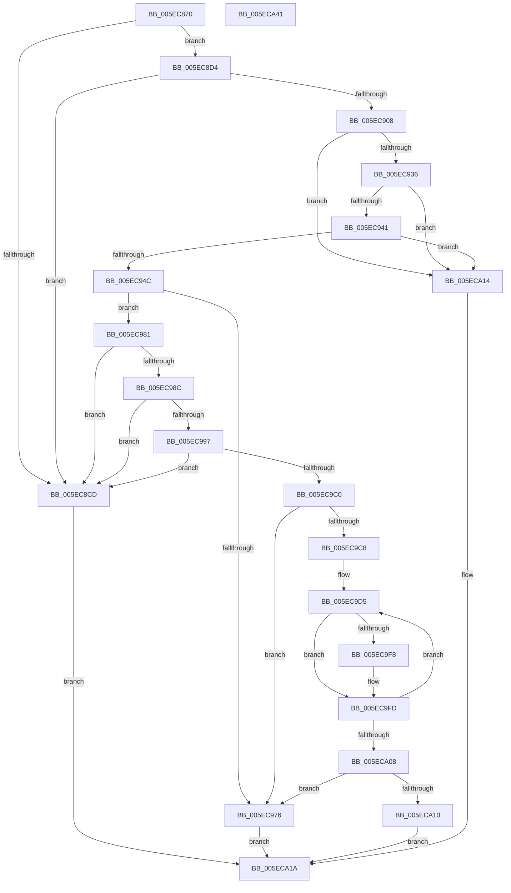

# RtlGetProductInfo

- RVA: `0x005EC870`–`0x005ECA42` (길이 `466` bytes)
- VA: `0x00000001405EC870`
- 실행 섹션: `.text`
- PDB 이름 있음: `예`; PDB Function 태그: `아니요`
- unwind 정보 RVA: `0x000CFD5C`
- 디코드: `110`개 명령, `466/466` bytes 표시
- 미해석 바이트: `0` (있으면 어셈블리에 `.byte`로 보존)

> 이 문서는 커널 이미지의 기계어와 PDB 기호를 분석해 생성했습니다. 4번과 5번은 함수 원형과 자료형을 바이너리 사용 방식에서 추정한 C 해석이며 원본 소스 복구 결과는 아닙니다.

## 1. Dependencies

- 직접 호출 지점: **5**; 고유 호출 대상: **3**
- 직접 호출자로 확인된 함수: **2**
- RIP 상대 이미지 참조: **4**

### Outgoing calls
- `0x005EC8FF` → [CompareVersions](CompareVersions_function_005EC830.md) (function, `0x005EC830`)
- `0x005EC929` → [ZwQueryLicenseValue](../6A/ZwQueryLicenseValue_function_006AFCF0.md) (function, `0x006AFCF0`)
- `0x005EC96D` → [ZwQueryLicenseValue](../6A/ZwQueryLicenseValue_function_006AFCF0.md) (function, `0x006AFCF0`)
- `0x005EC9EF` → [CompareVersions](CompareVersions_function_005EC830.md) (function, `0x005EC830`)
- `0x005ECA23` → [_security_check_cookie](../6A/_security_check_cookie_function_006AC640.md) (function, `0x006AC640`)

### Direct callers
- [ExGetSuiteMask](../../page/7C/ExGetSuiteMask_function_007C68D0.md) at `0x007C6905`
- [ExpInitSystemPhase1](../../init/C5/ExpInitSystemPhase1_function_00C51508.md) at `0x00C5173B`

### Static image references
- `0x005EC88B` → RVA `0x00E0A740` (`.data`; read)
- `0x005EC8D4` → RVA `0x00031500` (`.rdata`; read)
- `0x005EC922` → RVA `0x0000B680` (`.rdata`; read)
- `0x005EC966` → RVA `0x0000B690` (`.rdata`; read)

## 2. Other-region calls and transfers

- 다른 실행 섹션으로 향하는 call: **0**
- 별도 외부 분기/꼬리 이동을 확인하지 못했습니다.

## 3. Assembly (complete function range)

```asm
005EC870  48 8B C4                        mov rax, rsp
005EC873  48 89 58 08                     mov qword ptr [rax + 8], rbx
005EC877  48 89 70 10                     mov qword ptr [rax + 0x10], rsi
005EC87B  48 89 78 18                     mov qword ptr [rax + 0x18], rdi
005EC87F  55                              push rbp
005EC880  48 8D 68 A8                     lea rbp, [rax - 0x58]
005EC884  48 81 EC 50 01 00 00            sub rsp, 0x150
005EC88B  48 8B 05 AE DE 81 00            mov rax, qword ptr [rip + 0x81deae]
005EC892  48 33 C4                        xor rax, rsp
005EC895  48 89 45 40                     mov qword ptr [rbp + 0x40], rax
005EC899  48 8B BD 80 00 00 00            mov rdi, qword ptr [rbp + 0x80]
005EC8A0  33 F6                           xor esi, esi
005EC8A2  83 64 24 34 00                  and dword ptr [rsp + 0x34], 0
005EC8A7  BB 01 00 00 00                  mov ebx, 1
005EC8AC  83 64 24 30 00                  and dword ptr [rsp + 0x30], 0
005EC8B1  83 64 24 38 00                  and dword ptr [rsp + 0x38], 0
005EC8B6  89 4C 24 40                     mov dword ptr [rsp + 0x40], ecx
005EC8BA  89 54 24 44                     mov dword ptr [rsp + 0x44], edx
005EC8BE  44 89 44 24 48                  mov dword ptr [rsp + 0x48], r8d
005EC8C3  44 89 4C 24 4C                  mov dword ptr [rsp + 0x4c], r9d
005EC8C8  48 85 FF                        test rdi, rdi
005EC8CB  75 07                           jne 0x1405ec8d4
005EC8CD  32 DB                           xor bl, bl
005EC8CF  E9 46 01 00 00                  jmp 0x1405eca1a
005EC8D4  0F 10 05 25 4C A4 FF            movups xmm0, xmmword ptr [rip - 0x5bb3db]
005EC8DB  21 37                           and dword ptr [rdi], esi
005EC8DD  89 4C 24 50                     mov dword ptr [rsp + 0x50], ecx
005EC8E1  48 8D 4C 24 50                  lea rcx, [rsp + 0x50]
005EC8E6  89 54 24 54                     mov dword ptr [rsp + 0x54], edx
005EC8EA  48 8D 54 24 60                  lea rdx, [rsp + 0x60]
005EC8EF  F3 0F 7F 44 24 60               movdqu xmmword ptr [rsp + 0x60], xmm0
005EC8F5  44 89 44 24 58                  mov dword ptr [rsp + 0x58], r8d
005EC8FA  44 89 4C 24 5C                  mov dword ptr [rsp + 0x5c], r9d
005EC8FF  E8 2C FF FF FF                  call 0x1405ec830
005EC904  85 C0                           test eax, eax
005EC906  78 C5                           js 0x1405ec8cd
005EC908  48 8D 44 24 30                  lea rax, [rsp + 0x30]
005EC90D  41 B9 04 00 00 00               mov r9d, 4
005EC913  4C 8D 44 24 38                  lea r8, [rsp + 0x38]
005EC918  48 89 44 24 20                  mov qword ptr [rsp + 0x20], rax
005EC91D  48 8D 54 24 34                  lea rdx, [rsp + 0x34]
005EC922  48 8D 0D 57 ED A1 FF            lea rcx, [rip - 0x5e12a9]
005EC929  E8 C2 33 0C 00                  call 0x1406afcf0
005EC92E  85 C0                           test eax, eax
005EC930  0F 88 DE 00 00 00               js 0x1405eca14
005EC936  83 7C 24 34 04                  cmp dword ptr [rsp + 0x34], 4
005EC93B  0F 85 D3 00 00 00               jne 0x1405eca14
005EC941  83 7C 24 30 04                  cmp dword ptr [rsp + 0x30], 4
005EC946  0F 85 C8 00 00 00               jne 0x1405eca14
005EC94C  48 8D 44 24 30                  lea rax, [rsp + 0x30]
005EC951  41 B9 C8 00 00 00               mov r9d, 0xc8
005EC957  4C 8D 44 24 70                  lea r8, [rsp + 0x70]
005EC95C  48 89 44 24 20                  mov qword ptr [rsp + 0x20], rax
005EC961  48 8D 54 24 34                  lea rdx, [rsp + 0x34]
005EC966  48 8D 0D 23 ED A1 FF            lea rcx, [rip - 0x5e12dd]
005EC96D  E8 7E 33 0C 00                  call 0x1406afcf0
005EC972  85 C0                           test eax, eax
005EC974  79 0B                           jns 0x1405ec981
005EC976  8B 44 24 38                     mov eax, dword ptr [rsp + 0x38]
005EC97A  89 07                           mov dword ptr [rdi], eax
005EC97C  E9 99 00 00 00                  jmp 0x1405eca1a
005EC981  83 7C 24 34 03                  cmp dword ptr [rsp + 0x34], 3
005EC986  0F 85 41 FF FF FF               jne 0x1405ec8cd
005EC98C  83 7C 24 30 14                  cmp dword ptr [rsp + 0x30], 0x14
005EC991  0F 82 36 FF FF FF               jb 0x1405ec8cd
005EC997  8B 4C 24 30                     mov ecx, dword ptr [rsp + 0x30]
005EC99B  48 B8 CD CC CC CC CC CC CC CC   movabs rax, 0xcccccccccccccccd
005EC9A5  48 F7 E1                        mul rcx
005EC9A8  4C 8B C2                        mov r8, rdx
005EC9AB  49 C1 E8 04                     shr r8, 4
005EC9AF  4B 8D 04 80                     lea rax, [r8 + r8*4]
005EC9B3  48 C1 E0 02                     shl rax, 2
005EC9B7  48 3B C8                        cmp rcx, rax
005EC9BA  0F 85 0D FF FF FF               jne 0x1405ec8cd
005EC9C0  45 33 C9                        xor r9d, r9d
005EC9C3  4D 85 C0                        test r8, r8
005EC9C6  74 AE                           je 0x1405ec976
005EC9C8  0F 28 44 24 40                  movaps xmm0, xmmword ptr [rsp + 0x40]
005EC9CD  33 C0                           xor eax, eax
005EC9CF  66 0F 7F 44 24 40               movdqa xmmword ptr [rsp + 0x40], xmm0
005EC9D5  4C 8D 14 80                     lea r10, [rax + rax*4]
005EC9D9  42 0F 10 44 94 70               movups xmm0, xmmword ptr [rsp + r10*4 + 0x70]
005EC9DF  48 8D 54 24 60                  lea rdx, [rsp + 0x60]
005EC9E4  48 8D 4C 24 40                  lea rcx, [rsp + 0x40]
005EC9E9  F3 0F 7F 44 24 60               movdqu xmmword ptr [rsp + 0x60], xmm0
005EC9EF  E8 3C FE FF FF                  call 0x1405ec830
005EC9F4  85 C0                           test eax, eax
005EC9F6  79 05                           jns 0x1405ec9fd
005EC9F8  42 8B 74 95 80                  mov esi, dword ptr [rbp + r10*4 - 0x80]
005EC9FD  44 03 CB                        add r9d, ebx
005ECA00  41 8B C1                        mov eax, r9d
005ECA03  49 3B C0                        cmp rax, r8
005ECA06  72 CD                           jb 0x1405ec9d5
005ECA08  85 F6                           test esi, esi
005ECA0A  0F 84 66 FF FF FF               je 0x1405ec976
005ECA10  89 37                           mov dword ptr [rdi], esi
005ECA12  EB 06                           jmp 0x1405eca1a
005ECA14  C7 07 CD AB CD AB               mov dword ptr [rdi], 0xabcdabcd
005ECA1A  8A C3                           mov al, bl
005ECA1C  48 8B 4D 40                     mov rcx, qword ptr [rbp + 0x40]
005ECA20  48 33 CC                        xor rcx, rsp
005ECA23  E8 18 FC 0B 00                  call 0x1406ac640
005ECA28  4C 8D 9C 24 50 01 00 00         lea r11, [rsp + 0x150]
005ECA30  49 8B 5B 10                     mov rbx, qword ptr [r11 + 0x10]
005ECA34  49 8B 73 18                     mov rsi, qword ptr [r11 + 0x18]
005ECA38  49 8B 7B 20                     mov rdi, qword ptr [r11 + 0x20]
005ECA3C  49 8B E3                        mov rsp, r11
005ECA3F  5D                              pop rbp
005ECA40  C3                              ret
005ECA41  CC                              int3
```

## 4. C-style interpretation (structured pseudocode)

```c
__int64 __fastcall RtlGetProductInfo(int a1, int a2, int a3, int a4)
{
    __int64 result;
    __int64 v_rbx;
    __int64 v_rsi;
    __int64 v_rsp;
    unsigned int v_stack_m100;
    unsigned int v_stack_m104;
    unsigned int v_stack_m108;
    unsigned int v_stack_m10C;
    unsigned int v_stack_m110;
    unsigned int v_stack_m114;
    unsigned int v_stack_m118;
    unsigned int v_stack_m120;
    unsigned int v_stack_m124;
    unsigned int v_stack_m128;
    unsigned __int64 v_stack_m138;
    unsigned __int64 v_stack_m8;
    unsigned __int64 v_stack_mE8;
    unsigned __int64 v_stack_mF8;
    unsigned int v_stack_mFC;

    *(unsigned __int64 *)(v_rsp + 8) = v_rbx;
    *(unsigned __int64 *)(v_rsp + 16) = v_rsi;
    *(unsigned __int64 *)(v_rsp + 24) = v_rdi;
    v_rsp = (v_rsp) - (336);
    result = (*(unsigned __int64 *)(v_rip + 8511150)) ^ (v_rsp);
    *(unsigned __int64 *)(v_rsp - 88 + 64) = result;
    v_rsi = 0;
    v_stack_m118 = a1;
    v_stack_m114 = a2;
    v_stack_m110 = a3;
    v_stack_m10C = a4;
    if (*(unsigned __int64 *)(v_rsp - 88 + 128) != 0) goto loc_005EC8D4;
loc_005EC8CD:
    v_rbx = 0;
    goto loc_005ECA1A;
loc_005EC8D4:
    v_stack_m108 = a1;
    v_stack_m104 = a2;
    v_stack_mF8 = v_xmm0;
    v_stack_m100 = a3;
    v_stack_mFC = a4;
    result = CompareVersions(v_stack_m108, v_stack_mF8, a3, a4);
    if (sign_flag) goto loc_005EC8CD;
    v_stack_m138 = v_stack_m128;
    result = ZwQueryLicenseValue(v_rip - 6165161, v_stack_m124, v_stack_m120, 4);
    if (sign_flag) goto loc_005ECA14;
    if (v_stack_m124 != 4) goto loc_005ECA14;
    if (v_stack_m128 != 4) goto loc_005ECA14;
    v_stack_m138 = v_stack_m128;
    result = ZwQueryLicenseValue(v_rip - 6165213, v_stack_m124, v_stack_mE8, 200);
    if (!sign_flag) goto loc_005EC981;
loc_005EC976:
    *(unsigned int *)(*(unsigned __int64 *)(v_rsp - 88 + 128)) = (unsigned int)((unsigned int)(v_stack_m120));
    goto loc_005ECA1A;
loc_005EC981:
    if (v_stack_m124 != 3) goto loc_005EC8CD;
    if (v_stack_m128 < 20) goto loc_005EC8CD;
    a3 = (v_stack_m124) >> (4);
    result = (a3 + a3 * 4) << (2);
    if (((unsigned int)(v_stack_m128)) != result) goto loc_005EC8CD;
    a4 = 0;
    if (a3 == 0) goto loc_005EC976;
    result = 0;
    v_stack_m118 = v_xmm0;
loc_005EC9D5:
    v_stack_mF8 = v_xmm0;
    result = CompareVersions(v_stack_m118, v_stack_mF8, a3, a4);
    if (sign_flag) {
        v_rsi = *(unsigned int *)(v_rsp - 88 + result + result * 4 * 4 - 128);
    }
    a4 = (unsigned int)((a4) + (0));
    if (((unsigned int)(a4)) < a3) goto loc_005EC9D5;
    if ((unsigned int)(v_rsi) == 0) goto loc_005EC976;
    *(unsigned int *)(*(unsigned __int64 *)(v_rsp - 88 + 128)) = (unsigned int)(v_rsi);
    goto loc_005ECA1A;
loc_005ECA14:
    *(unsigned int *)(*(unsigned __int64 *)(v_rsp - 88 + 128)) = 0xABCDABCDULL;
loc_005ECA1A:
    a1 = (*(unsigned __int64 *)(v_rsp - 88 + 64)) ^ (v_rsp);
    result = _security_check_cookie(a1, v_stack_mF8, a3, a4);
    return result;
}
```

## 5. (Beta) C Style

```c
int64_t RtlGetProductInfo(int32_t Arg1, int32_t Arg2, int32_t Arg3, int32_t Arg4)
{
    int64_t result;
    int64_t local_rbx;
    int64_t local_rsi;
    int64_t local_rsp;
    uint32_t v_stack_m100;
    uint32_t v_stack_m104;
    uint32_t v_stack_m108;
    uint32_t v_stack_m10C;
    uint32_t v_stack_m110;
    uint32_t v_stack_m114;
    uint32_t v_stack_m118;
    uint32_t v_stack_m120;
    uint32_t v_stack_m124;
    uint32_t v_stack_m128;
    uint64_t v_stack_m138;
    uint64_t v_stack_m8;
    uint64_t v_stack_mE8;
    uint64_t v_stack_mF8;
    uint32_t v_stack_mFC;

    *(uint64_t *)(local_rsp + 0x8) = local_rbx;
    *(uint64_t *)(local_rsp + 0x10) = local_rsi;
    *(uint64_t *)(local_rsp + 0x18) = local_rdi;
    local_rsp = (local_rsp) - (336);
    result = (*(uint64_t *)(v_rip + 0x81DEAE)) ^ (local_rsp);
    *(uint64_t *)(local_rsp - 0x58 + 0x40) = result;
    local_rsi = 0;
    v_stack_m118 = Arg1;
    v_stack_m114 = Arg2;
    v_stack_m110 = Arg3;
    v_stack_m10C = Arg4;
    if (*(uint64_t *)(local_rsp - 0x58 + 0x80) != 0) goto loc_005EC8D4;
loc_005EC8CD:
    local_rbx = 0;
    goto loc_005ECA1A;
loc_005EC8D4:
    v_stack_m108 = Arg1;
    v_stack_m104 = Arg2;
    v_stack_mF8 = v_xmm0;
    v_stack_m100 = Arg3;
    v_stack_mFC = Arg4;
    result = CompareVersions(v_stack_m108, v_stack_mF8, Arg3, Arg4);
    if (sign_flag) goto loc_005EC8CD;
    v_stack_m138 = v_stack_m128;
    result = ZwQueryLicenseValue(v_rip - 6165161, v_stack_m124, v_stack_m120, 4);
    if (sign_flag) goto loc_005ECA14;
    if (v_stack_m124 != 4) goto loc_005ECA14;
    if (v_stack_m128 != 4) goto loc_005ECA14;
    v_stack_m138 = v_stack_m128;
    result = ZwQueryLicenseValue(v_rip - 6165213, v_stack_m124, v_stack_mE8, 200);
    if (!sign_flag) goto loc_005EC981;
loc_005EC976:
    *(uint32_t *)(*(uint64_t *)(local_rsp - 0x58 + 0x80)) = (uint32_t)((uint32_t)(v_stack_m120));
    goto loc_005ECA1A;
loc_005EC981:
    if (v_stack_m124 != 3) goto loc_005EC8CD;
    if (v_stack_m128 < 20) goto loc_005EC8CD;
    Arg3 = (v_stack_m124) >> (4);
    result = (Arg3 + Arg3 * 4) << (2);
    if (((uint32_t)(v_stack_m128)) != result) goto loc_005EC8CD;
    Arg4 = 0;
    if (Arg3 == 0) goto loc_005EC976;
    result = 0;
    v_stack_m118 = v_xmm0;
loc_005EC9D5:
    v_stack_mF8 = v_xmm0;
    result = CompareVersions(v_stack_m118, v_stack_mF8, Arg3, Arg4);
    if (sign_flag) {
        local_rsi = *(uint32_t *)(local_rsp - 0x58 + result + result * 4 * 4 - 0x80);
    }
    Arg4 = (uint32_t)((Arg4) + (0));
    if (((uint32_t)(Arg4)) < Arg3) goto loc_005EC9D5;
    if ((uint32_t)(local_rsi) == 0) goto loc_005EC976;
    *(uint32_t *)(*(uint64_t *)(local_rsp - 0x58 + 0x80)) = (uint32_t)(local_rsi);
    goto loc_005ECA1A;
loc_005ECA14:
    *(uint32_t *)(*(uint64_t *)(local_rsp - 0x58 + 0x80)) = 0xABCDABCDULL;
loc_005ECA1A:
    Arg1 = (*(uint64_t *)(local_rsp - 0x58 + 0x40)) ^ (local_rsp);
    result = _security_check_cookie(Arg1, v_stack_mF8, Arg3, Arg4);
    return result;
}
```

## 6. Execution-region graph

[열기: 2D/3D 그래프와 함수 탐색 컨트롤 패널](../../../control-panel.html?section=text&rva=0x005EC870&view=graph)

- 2D 그래프는 위에서 아래로 흐르고, 3D 그래프는 빈 공간을 드래그해 회전합니다. Shift+드래그는 이동, 휠은 확대·축소, 함수 노드 선택은 대상 보고서 이동입니다.

### Static fallback


