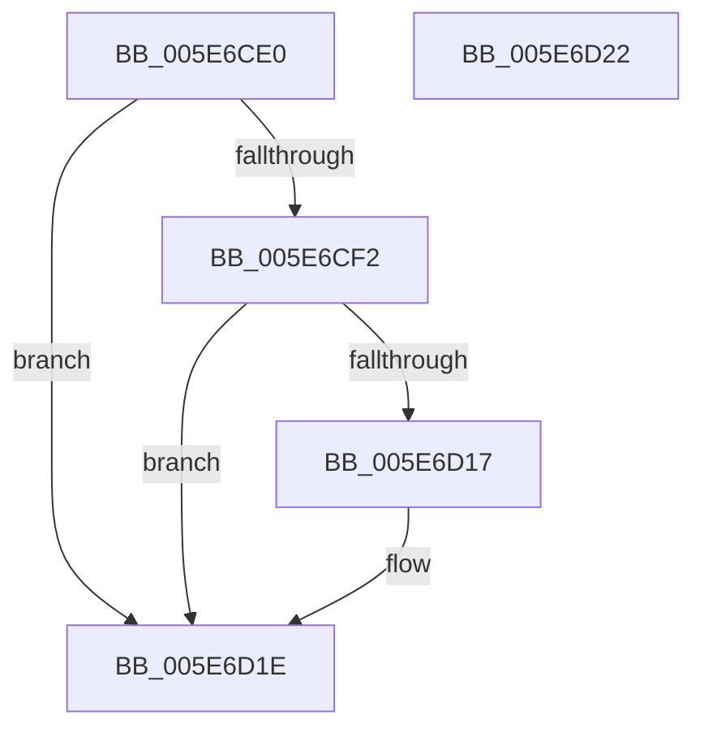

# RtlGetXSaveFeatureFlags

- RVA: `0x005E6CE0`–`0x005E6D23` (길이 `67` bytes)
- VA: `0x00000001405E6CE0`
- 실행 섹션: `.text`
- PDB 이름 있음: `예`; PDB Function 태그: `아니요`
- unwind 정보 RVA: `0x000DB714`
- 디코드: `20`개 명령, `67/67` bytes 표시
- 미해석 바이트: `0` (있으면 어셈블리에 `.byte`로 보존)

> 이 문서는 커널 이미지의 기계어와 PDB 기호를 분석해 생성했습니다. 4번과 5번은 함수 원형과 자료형을 바이너리 사용 방식에서 추정한 C 해석이며 원본 소스 복구 결과는 아닙니다.

## 1. Dependencies

- 직접 호출 지점: **0**; 고유 호출 대상: **0**
- 직접 호출자로 확인된 함수: **1**
- RIP 상대 이미지 참조: **0**

### Outgoing calls
- 직접 디코드된 call 명령이 없습니다.

### Direct callers
- [KiInitializeKernel](../../pagelk/B6/KiInitializeKernel_function_00B68D20.md) at `0x00B6900F`

### Static image references
- 디코드된 RIP-relative 메모리 참조가 없습니다.

## 2. Other-region calls and transfers

- 다른 실행 섹션으로 향하는 call: **0**
- 별도 외부 분기/꼬리 이동을 확인하지 못했습니다.

## 3. Assembly (complete function range)

```asm
005E6CE0  48 B8 D8 03 00 00 80 F7 FF FF   movabs rax, 0xfffff780000003d8
005E6CEA  45 33 C9                        xor r9d, r9d
005E6CED  4C 39 08                        cmp qword ptr [rax], r9
005E6CF0  74 2C                           je 0x1405e6d1e
005E6CF2  A1 EC 03 00 00 80 F7 FF FF      movabs eax, dword ptr [0xfffff780000003ec]
005E6CFB  8B C8                           mov ecx, eax
005E6CFD  83 E1 01                        and ecx, 1
005E6D00  C1 E1 03                        shl ecx, 3
005E6D03  44 8B C1                        mov r8d, ecx
005E6D06  41 83 C8 10                     or r8d, 0x10
005E6D0A  A8 02                           test al, 2
005E6D0C  44 0F 44 C1                     cmove r8d, ecx
005E6D10  45 8B C8                        mov r9d, r8d
005E6D13  A8 04                           test al, 4
005E6D15  74 07                           je 0x1405e6d1e
005E6D17  41 83 C8 40                     or r8d, 0x40
005E6D1B  45 8B C8                        mov r9d, r8d
005E6D1E  41 8B C1                        mov eax, r9d
005E6D21  C3                              ret
005E6D22  CC                              int3
```

## 4. C-style interpretation (structured pseudocode)

```c
__int64 __fastcall RtlGetXSaveFeatureFlags(__int64 a1, __int64 a2, __int64 a3, int a4)
{
    a4 = 0;
    if ((*(unsigned __int64 *)(result)) == 0) goto loc_005E6D1E;
    a1 = (unsigned int)(((unsigned int)((unsigned int)(result))) & (1));
    a1 = (unsigned int)((a1) << (3));
    a3 = (unsigned int)(((unsigned int)((unsigned int)(a1))) | (16));
    if ((((unsigned __int8)(result)) & (2)) == 0) { a3 = (unsigned int)(a1); }
    if ((((unsigned __int8)(result)) & (4)) != 0) {
        a3 = (unsigned int)((a3) | (64));
        a4 = (unsigned int)(a3);
    }
    return (unsigned int)(a4);
}
```

## 5. (Beta) C Style

```c
int64_t RtlGetXSaveFeatureFlags(int64_t Arg1, int64_t Arg2, int64_t Arg3, int32_t Arg4)
{
    Arg4 = 0;
    if ((*(uint64_t *)(result)) == 0) goto loc_005E6D1E;
    Arg1 = (uint32_t)(((uint32_t)((uint32_t)(result))) & (1));
    Arg1 = (uint32_t)((Arg1) << (3));
    Arg3 = (uint32_t)(((uint32_t)((uint32_t)(Arg1))) | (16));
    if ((((uint8_t)(result)) & (2)) == 0) { Arg3 = (uint32_t)(Arg1); }
    if ((((uint8_t)(result)) & (4)) != 0) {
        Arg3 = (uint32_t)((Arg3) | (64));
        Arg4 = (uint32_t)(Arg3);
    }
    return (uint32_t)(Arg4);
}
```

## 6. Execution-region graph

[열기: 2D/3D 그래프와 함수 탐색 컨트롤 패널](../../../control-panel.html?section=text&rva=0x005E6CE0&view=graph)

- 2D 그래프는 위에서 아래로 흐르고, 3D 그래프는 빈 공간을 드래그해 회전합니다. Shift+드래그는 이동, 휠은 확대·축소, 함수 노드 선택은 대상 보고서 이동입니다.

### Static fallback


