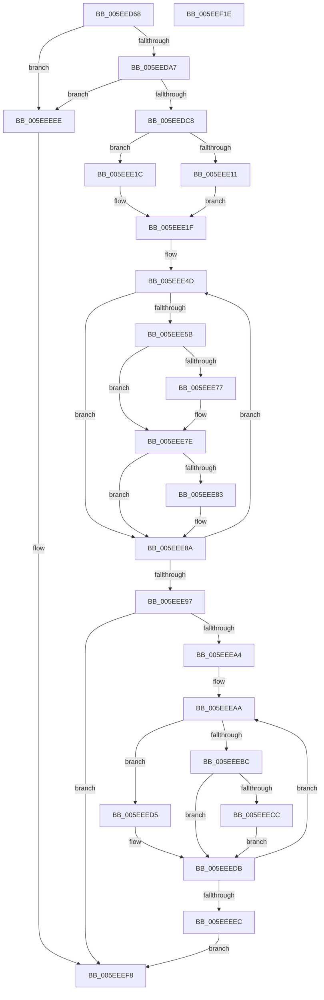

# RtlGetXSaveSupportedFeatures

- RVA: `0x005EED68`–`0x005EEF1F` (길이 `439` bytes)
- VA: `0x00000001405EED68`
- 실행 섹션: `.text`
- PDB 이름 있음: `예`; PDB Function 태그: `아니요`
- unwind 정보 RVA: `0x000CFF70`
- 디코드: `130`개 명령, `439/439` bytes 표시
- 미해석 바이트: `0` (있으면 어셈블리에 `.byte`로 보존)

> 이 문서는 커널 이미지의 기계어와 PDB 기호를 분석해 생성했습니다. 4번과 5번은 함수 원형과 자료형을 바이너리 사용 방식에서 추정한 C 해석이며 원본 소스 복구 결과는 아닙니다.

## 1. Dependencies

- 직접 호출 지점: **1**; 고유 호출 대상: **1**
- 직접 호출자로 확인된 함수: **1**
- RIP 상대 이미지 참조: **1**

### Outgoing calls
- `0x005EEF00` → [_security_check_cookie](../6A/_security_check_cookie_function_006AC640.md) (function, `0x006AC640`)

### Direct callers
- [KiInitializeXSaveConfiguration](../../pagelk/B6/KiInitializeXSaveConfiguration_function_00B66F10.md) at `0x00B66F67`

### Static image references
- `0x005EED80` → RVA `0x00E0A740` (`.data`; read)

## 2. Other-region calls and transfers

- 다른 실행 섹션으로 향하는 call: **0**
- 별도 외부 분기/꼬리 이동을 확인하지 못했습니다.

## 3. Assembly (complete function range)

```asm
005EED68  48 89 5C 24 10                  mov qword ptr [rsp + 0x10], rbx
005EED6D  48 89 6C 24 18                  mov qword ptr [rsp + 0x18], rbp
005EED72  48 89 74 24 20                  mov qword ptr [rsp + 0x20], rsi
005EED77  57                              push rdi
005EED78  41 56                           push r14
005EED7A  41 57                           push r15
005EED7C  48 83 EC 20                     sub rsp, 0x20
005EED80  48 8B 05 B9 B9 81 00            mov rax, qword ptr [rip + 0x81b9b9]
005EED87  48 33 C4                        xor rax, rsp
005EED8A  48 89 44 24 10                  mov qword ptr [rsp + 0x10], rax
005EED8F  4C 8B D1                        mov r10, rcx
005EED92  BD 01 00 00 00                  mov ebp, 1
005EED97  33 C9                           xor ecx, ecx
005EED99  8B C5                           mov eax, ebp
005EED9B  0F A2                           cpuid
005EED9D  0F BA E1 1A                     bt ecx, 0x1a
005EEDA1  0F 83 47 01 00 00               jae 0x1405eeeee
005EEDA7  33 C9                           xor ecx, ecx
005EEDA9  8D 45 0C                        lea eax, [rbp + 0xc]
005EEDAC  0F A2                           cpuid
005EEDAE  8B CA                           mov ecx, edx
005EEDB0  48 C1 E1 20                     shl rcx, 0x20
005EEDB4  8B C0                           mov eax, eax
005EEDB6  48 0B C8                        or rcx, rax
005EEDB9  49 89 0A                        mov qword ptr [r10], rcx
005EEDBC  80 E1 03                        and cl, 3
005EEDBF  80 F9 03                        cmp cl, 3
005EEDC2  0F 85 26 01 00 00               jne 0x1405eeeee
005EEDC8  45 33 DB                        xor r11d, r11d
005EEDCB  44 8D 7D 01                     lea r15d, [rbp + 1]
005EEDCF  8D 45 0C                        lea eax, [rbp + 0xc]
005EEDD2  8B CD                           mov ecx, ebp
005EEDD4  0F A2                           cpuid
005EEDD6  8B D8                           mov ebx, eax
005EEDD8  8B F9                           mov edi, ecx
005EEDDA  44 8B C8                        mov r9d, eax
005EEDDD  83 E3 0A                        and ebx, 0xa
005EEDE0  80 FB 0A                        cmp bl, 0xa
005EEDE3  45 8B C3                        mov r8d, r11d
005EEDE6  45 0F 44 C7                     cmove r8d, r15d
005EEDEA  23 C5                           and eax, ebp
005EEDEC  44 0B C0                        or r8d, eax
005EEDEF  41 C1 E9 02                     shr r9d, 2
005EEDF3  41 8B 42 14                     mov eax, dword ptr [r10 + 0x14]
005EEDF7  41 83 E1 04                     and r9d, 4
005EEDFB  83 E0 FC                        and eax, 0xfffffffc
005EEDFE  44 0B C0                        or r8d, eax
005EEE01  41 83 E0 FB                     and r8d, 0xfffffffb
005EEE05  45 0B C1                        or r8d, r9d
005EEE08  45 89 42 14                     mov dword ptr [r10 + 0x14], r8d
005EEE0C  45 84 C7                        test r15b, r8b
005EEE0F  74 0B                           je 0x1405eee1c
005EEE11  8B CA                           mov ecx, edx
005EEE13  48 C1 E1 20                     shl rcx, 0x20
005EEE17  48 0B CF                        or rcx, rdi
005EEE1A  EB 03                           jmp 0x1405eee1f
005EEE1C  49 8B CB                        mov rcx, r11
005EEE1F  49 89 8A 18 02 00 00            mov qword ptr [r10 + 0x218], rcx
005EEE26  49 8D 7A 1C                     lea rdi, [r10 + 0x1c]
005EEE2A  B8 A0 00 00 00                  mov eax, 0xa0
005EEE2F  45 89 5A 18                     mov dword ptr [r10 + 0x18], r11d
005EEE33  89 07                           mov dword ptr [rdi], eax
005EEE35  4D 8D 72 2C                     lea r14, [r10 + 0x2c]
005EEE39  41 89 42 20                     mov dword ptr [r10 + 0x20], eax
005EEE3D  BE 40 02 00 00                  mov esi, 0x240
005EEE42  41 C7 42 24 00 01 00 00         mov dword ptr [r10 + 0x24], 0x100
005EEE4A  45 8B CF                        mov r9d, r15d
005EEE4D  41 8B C9                        mov ecx, r9d
005EEE50  4C 8B C5                        mov r8, rbp
005EEE53  49 D3 E0                        shl r8, cl
005EEE56  4D 85 02                        test qword ptr [r10], r8
005EEE59  74 2F                           je 0x1405eee8a
005EEE5B  B8 0D 00 00 00                  mov eax, 0xd
005EEE60  0F A2                           cpuid
005EEE62  41 89 06                        mov dword ptr [r14], eax
005EEE65  03 C3                           add eax, ebx
005EEE67  3B F0                           cmp esi, eax
005EEE69  41 89 5E FC                     mov dword ptr [r14 - 4], ebx
005EEE6D  0F 43 C6                        cmovae eax, esi
005EEE70  8B F0                           mov esi, eax
005EEE72  41 84 CF                        test r15b, cl
005EEE75  74 07                           je 0x1405eee7e
005EEE77  4D 09 82 20 02 00 00            or qword ptr [r10 + 0x220], r8
005EEE7E  F6 C1 04                        test cl, 4
005EEE81  74 07                           je 0x1405eee8a
005EEE83  4D 09 82 38 03 00 00            or qword ptr [r10 + 0x338], r8
005EEE8A  44 03 CD                        add r9d, ebp
005EEE8D  49 83 C6 08                     add r14, 8
005EEE91  41 83 F9 40                     cmp r9d, 0x40
005EEE95  72 B6                           jb 0x1405eee4d
005EEE97  41 8B 42 14                     mov eax, dword ptr [r10 + 0x14]
005EEE9B  41 89 72 10                     mov dword ptr [r10 + 0x10], esi
005EEE9F  41 84 C7                        test r15b, al
005EEEA2  74 54                           je 0x1405eeef8
005EEEA4  41 B8 2C 02 00 00               mov r8d, 0x22c
005EEEAA  41 8B CB                        mov ecx, r11d
005EEEAD  4C 8B CD                        mov r9, rbp
005EEEB0  49 D3 E1                        shl r9, cl
005EEEB3  4D 85 8A 18 02 00 00            test qword ptr [r10 + 0x218], r9
005EEEBA  74 19                           je 0x1405eeed5
005EEEBC  B8 0D 00 00 00                  mov eax, 0xd
005EEEC1  0F A2                           cpuid
005EEEC3  43 89 04 10                     mov dword ptr [r8 + r10], eax
005EEEC7  41 84 CF                        test r15b, cl
005EEECA  74 0F                           je 0x1405eeedb
005EEECC  4D 09 8A 20 02 00 00            or qword ptr [r10 + 0x220], r9
005EEED3  EB 06                           jmp 0x1405eeedb
005EEED5  8B 07                           mov eax, dword ptr [rdi]
005EEED7  43 89 04 10                     mov dword ptr [r8 + r10], eax
005EEEDB  44 03 DD                        add r11d, ebp
005EEEDE  49 83 C0 04                     add r8, 4
005EEEE2  48 83 C7 08                     add rdi, 8
005EEEE6  41 83 FB 40                     cmp r11d, 0x40
005EEEEA  72 BE                           jb 0x1405eeeaa
005EEEEC  EB 0A                           jmp 0x1405eeef8
005EEEEE  45 33 DB                        xor r11d, r11d
005EEEF1  4D 89 1A                        mov qword ptr [r10], r11
005EEEF4  45 89 5A 10                     mov dword ptr [r10 + 0x10], r11d
005EEEF8  48 8B 4C 24 10                  mov rcx, qword ptr [rsp + 0x10]
005EEEFD  48 33 CC                        xor rcx, rsp
005EEF00  E8 3B D7 0B 00                  call 0x1406ac640
005EEF05  48 8B 5C 24 48                  mov rbx, qword ptr [rsp + 0x48]
005EEF0A  48 8B 6C 24 50                  mov rbp, qword ptr [rsp + 0x50]
005EEF0F  48 8B 74 24 58                  mov rsi, qword ptr [rsp + 0x58]
005EEF14  48 83 C4 20                     add rsp, 0x20
005EEF18  41 5F                           pop r15
005EEF1A  41 5E                           pop r14
005EEF1C  5F                              pop rdi
005EEF1D  C3                              ret
005EEF1E  CC                              int3
```

## 4. C-style interpretation (structured pseudocode)

```c
__int64 __fastcall RtlGetXSaveSupportedFeatures(__int64 a1, int a2)
{
    __int64 result;
    __int64 v_r11;
    __int64 v_r14;
    __int64 v_rbx;
    __int64 v_rdi;
    __int64 v_rsp;
    unsigned __int64 v_stack_m28;
    unsigned __int64 v_stack_p10;
    unsigned __int64 v_stack_p18;
    unsigned __int64 v_stack_p20;

    v_stack_p10 = v_rbx;
    v_stack_p18 = v_rbp;
    v_stack_p20 = v_rsi;
    v_rsp = (v_rsp) - (32);
    result = (*(unsigned __int64 *)(v_rip + 8501689)) ^ (v_rsp);
    v_stack_m28 = result;
    a1 = 0;
    if (condition_is_above_or_equal) goto loc_005EEEEE;
    a1 = 0;
    a1 = ((unsigned int)(a2)) << (32);
    a1 = (a1) | ((unsigned int)((unsigned int)(1 + 12)));
    *(unsigned __int64 *)(a1) = a1;
    a1 = (unsigned __int8)((a1) & (3));
    if (((unsigned __int8)(a1)) != 3) goto loc_005EEEEE;
    v_r11 = 0;
    v_rbx = (unsigned int)(((unsigned int)((unsigned int)(1 + 12))) & (10));
    a3 = 0;
    if (((unsigned __int8)(v_rbx)) == 10) { a3 = (unsigned int)(1 + 1); }
    result = (unsigned int)((1 + 12) & (1));
    a3 = (unsigned int)((a3) | ((unsigned int)(result)));
    a4 = (unsigned int)(((unsigned int)((unsigned int)(1 + 12))) >> (2));
    a4 = (unsigned int)((a4) & (4));
    result = (unsigned int)(((unsigned int)(*(unsigned int *)(a1 + 20))) & (0xFFFFFFFCULL));
    a3 = (unsigned int)((a3) | ((unsigned int)(result)));
    a3 = (unsigned int)((a3) & (0xFFFFFFFBULL));
    a3 = (unsigned int)((a3) | ((unsigned int)(a4)));
    *(unsigned int *)(a1 + 20) = (unsigned int)(a3);
    if ((((unsigned __int8)(1 + 1)) & ((unsigned __int8)(a3))) == 0) goto loc_005EEE1C;
    a1 = ((unsigned int)(a2)) << (32);
    a1 = (a1) | (1);
    goto loc_005EEE1F;
loc_005EEE1C:
loc_005EEE1F:
    *(unsigned __int64 *)(a1 + 536) = 0;
    *(unsigned int *)(a1 + 24) = 0;
    *(unsigned int *)(a1 + 28) = 160;
    *(unsigned int *)(a1 + 32) = 160;
    *(unsigned int *)(a1 + 36) = 256;
loc_005EEE4D:
    a3 = (1) << ((unsigned __int8)((unsigned int)((unsigned int)((unsigned int)((unsigned int)(1 + 1))))));
    if (((*(unsigned __int64 *)(a1)) & (a3)) == 0) goto loc_005EEE8A;
    *(unsigned int *)(a1 + 44) = 13;
    result = (unsigned int)((13) + ((unsigned int)(v_rbx)));
    *(unsigned int *)(a1 + 44 - 4) = (unsigned int)(v_rbx);
    if (576 >= ((unsigned int)(result))) { result = 576; }
    if ((((unsigned __int8)(1 + 1)) & ((unsigned __int8)((unsigned int)((unsigned int)((unsigned int)((unsigned int)(1 + 1))))))) != 0) {
    }
    if ((((unsigned __int8)((unsigned int)((unsigned int)((unsigned int)((unsigned int)(1 + 1)))))) & (4)) != 0) {
    }
    a4 = (unsigned int)(((unsigned int)((unsigned int)(1 + 1))) + (1));
    v_r14 = (a1 + 44) + (8);
    if (((unsigned int)(a4)) < 64) goto loc_005EEE4D;
    *(unsigned int *)(a1 + 16) = (unsigned int)((unsigned int)((unsigned int)(result)));
    if ((((unsigned __int8)(1 + 1)) & ((unsigned __int8)((unsigned int)(*(unsigned int *)(a1 + 20))))) == 0) goto loc_005EEEF8;
loc_005EEEAA:
    a4 = (1) << (0);
    if (((*(unsigned __int64 *)(a1 + 536)) & (a4)) == 0) goto loc_005EEED5;
    *(unsigned int *)(556 + a1 * 1) = 13;
    if ((((unsigned __int8)(1 + 1)) & (0)) == 0) goto loc_005EEEDB;
    goto loc_005EEEDB;
loc_005EEED5:
    *(unsigned int *)(556 + a1 * 1) = (unsigned int)((unsigned int)(*(unsigned int *)(a1 + 28)));
loc_005EEEDB:
    v_r11 = (unsigned int)((v_r11) + (1));
    a3 = (556) + (4);
    v_rdi = (a1 + 28) + (8);
    if (((unsigned int)(v_r11)) < 64) goto loc_005EEEAA;
    goto loc_005EEEF8;
loc_005EEEEE:
    v_r11 = 0;
    *(unsigned __int64 *)(a1) = 0;
    *(unsigned int *)(a1 + 16) = 0;
loc_005EEEF8:
    a1 = (v_stack_m28) ^ (v_rsp);
    result = _security_check_cookie(a1, a2, a3, a4);
    v_rsp = (v_rsp) + (32);
    return result;
}
```

## 5. (Beta) C Style

```c
int64_t RtlGetXSaveSupportedFeatures(void *Arg1, int32_t Arg2)
{
    uint8_t *arg1 = (uint8_t *)Arg1;

    int64_t result;
    int64_t local_r11;
    int64_t local_r14;
    int64_t local_rbx;
    int64_t local_rdi;
    int64_t local_rsp;
    uint64_t v_stack_m28;
    uint64_t v_stack_p10;
    uint64_t v_stack_p18;
    uint64_t v_stack_p20;

    v_stack_p10 = local_rbx;
    v_stack_p18 = local_rbp;
    v_stack_p20 = local_rsi;
    local_rsp = (local_rsp) - (32);
    result = (*(uint64_t *)(v_rip + 0x81B9B9)) ^ (local_rsp);
    v_stack_m28 = result;
    Arg1 = 0;
    if (condition_is_above_or_equal) goto loc_005EEEEE;
    Arg1 = 0;
    Arg1 = ((uint32_t)(Arg2)) << (32);
    Arg1 = (Arg1) | ((uint32_t)((uint32_t)(1 + 12)));
    *(void **)(arg1) = Arg1;
    Arg1 = (uint8_t)((Arg1) & (3));
    if (((uint8_t)(Arg1)) != 3) goto loc_005EEEEE;
    local_r11 = 0;
    local_rbx = (uint32_t)(((uint32_t)((uint32_t)(1 + 12))) & (10));
    a3 = 0;
    if (((uint8_t)(local_rbx)) == 10) { a3 = (uint32_t)(1 + 1); }
    result = (uint32_t)((1 + 12) & (1));
    a3 = (uint32_t)((a3) | ((uint32_t)(result)));
    a4 = (uint32_t)(((uint32_t)((uint32_t)(1 + 12))) >> (2));
    a4 = (uint32_t)((a4) & (4));
    result = (uint32_t)(((uint32_t)(*(uint32_t *)(arg1 + 0x14))) & (0xFFFFFFFCULL));
    a3 = (uint32_t)((a3) | ((uint32_t)(result)));
    a3 = (uint32_t)((a3) & (0xFFFFFFFBULL));
    a3 = (uint32_t)((a3) | ((uint32_t)(a4)));
    *(uint32_t *)(arg1 + 0x14) = (uint32_t)(a3);
    if ((((uint8_t)(1 + 1)) & ((uint8_t)(a3))) == 0) goto loc_005EEE1C;
    Arg1 = ((uint32_t)(Arg2)) << (32);
    Arg1 = (Arg1) | (1);
    goto loc_005EEE1F;
loc_005EEE1C:
loc_005EEE1F:
    *(uint64_t *)(arg1 + 0x218) = 0;
    *(uint32_t *)(arg1 + 0x18) = 0;
    *(uint32_t *)(arg1 + 0x1C) = 160;
    *(uint32_t *)(arg1 + 0x20) = 160;
    *(uint32_t *)(arg1 + 0x24) = 256;
loc_005EEE4D:
    a3 = (1) << ((uint8_t)((uint32_t)((uint32_t)((uint32_t)((uint32_t)(1 + 1))))));
    if (((*(uint64_t *)(arg1)) & (a3)) == 0) goto loc_005EEE8A;
    *(uint32_t *)(arg1 + 0x2C) = 13;
    result = (uint32_t)((13) + ((uint32_t)(local_rbx)));
    *(uint32_t *)(arg1 + 0x2C - 0x4) = (uint32_t)(local_rbx);
    if (576 >= ((uint32_t)(result))) { result = 576; }
    if ((((uint8_t)(1 + 1)) & ((uint8_t)((uint32_t)((uint32_t)((uint32_t)((uint32_t)(1 + 1))))))) != 0) {
    }
    if ((((uint8_t)((uint32_t)((uint32_t)((uint32_t)((uint32_t)(1 + 1)))))) & (4)) != 0) {
    }
    a4 = (uint32_t)(((uint32_t)((uint32_t)(1 + 1))) + (1));
    local_r14 = (Arg1 + 44) + (8);
    if (((uint32_t)(a4)) < 64) goto loc_005EEE4D;
    *(uint32_t *)(arg1 + 0x10) = (uint32_t)((uint32_t)((uint32_t)(result)));
    if ((((uint8_t)(1 + 1)) & ((uint8_t)((uint32_t)(*(uint32_t *)(arg1 + 0x14))))) == 0) goto loc_005EEEF8;
loc_005EEEAA:
    a4 = (1) << (0);
    if (((*(uint64_t *)(arg1 + 0x218)) & (a4)) == 0) goto loc_005EEED5;
    *(uint32_t *)(556 + arg1 * 1) = 13;
    if ((((uint8_t)(1 + 1)) & (0)) == 0) goto loc_005EEEDB;
    goto loc_005EEEDB;
loc_005EEED5:
    *(uint32_t *)(556 + arg1 * 1) = (uint32_t)((uint32_t)(*(uint32_t *)(arg1 + 0x1C)));
loc_005EEEDB:
    local_r11 = (uint32_t)((local_r11) + (1));
    a3 = (556) + (4);
    local_rdi = (Arg1 + 28) + (8);
    if (((uint32_t)(local_r11)) < 64) goto loc_005EEEAA;
    goto loc_005EEEF8;
loc_005EEEEE:
    local_r11 = 0;
    *(uint64_t *)(arg1) = 0;
    *(uint32_t *)(arg1 + 0x10) = 0;
loc_005EEEF8:
    Arg1 = (v_stack_m28) ^ (local_rsp);
    result = _security_check_cookie(Arg1, Arg2, a3, a4);
    local_rsp = (local_rsp) + (32);
    return result;
}
```

### 관측된 메모리 오프셋

구조체 형식이 확인되지 않은 접근은 인자 기준의 오프셋으로만 기록했습니다.

| 기준 인자 | 오프셋 표현 | 폭 (bit) | 접근 |
|---|---:|---:|---|
| `Arg1` | `- 0x4` | `32` | `W` |
| `Arg1` | `+ 0x0` | `32` | `R` |
| `Arg1` | `+ 0x0` | `32` | `W` |
| `Arg1` | `+ 0x0` | `64` | `R` |
| `Arg1` | `+ 0x0` | `64` | `W` |
| `Arg1` | `+ 0x10` | `32` | `W` |
| `Arg1` | `+ 0x14` | `32` | `R` |
| `Arg1` | `+ 0x14` | `32` | `W` |
| `Arg1` | `+ 0x18` | `32` | `W` |
| `Arg1` | `+ 0x1C` | `64` | `R` |
| `Arg1` | `+ 0x20` | `32` | `W` |
| `Arg1` | `+ 0x24` | `32` | `W` |
| `Arg1` | `+ 0x2C` | `64` | `R` |
| `Arg1` | `+ 0x218` | `64` | `R` |
| `Arg1` | `+ 0x218` | `64` | `W` |
| `Arg1` | `+ 0x220` | `64` | `R/W` |
| `Arg1` | `+ 0x338` | `64` | `R/W` |

## 6. Execution-region graph

[열기: 2D/3D 그래프와 함수 탐색 컨트롤 패널](../../../control-panel.html?section=text&rva=0x005EED68&view=graph)

- 2D 그래프는 위에서 아래로 흐르고, 3D 그래프는 빈 공간을 드래그해 회전합니다. Shift+드래그는 이동, 휠은 확대·축소, 함수 노드 선택은 대상 보고서 이동입니다.

### Static fallback


