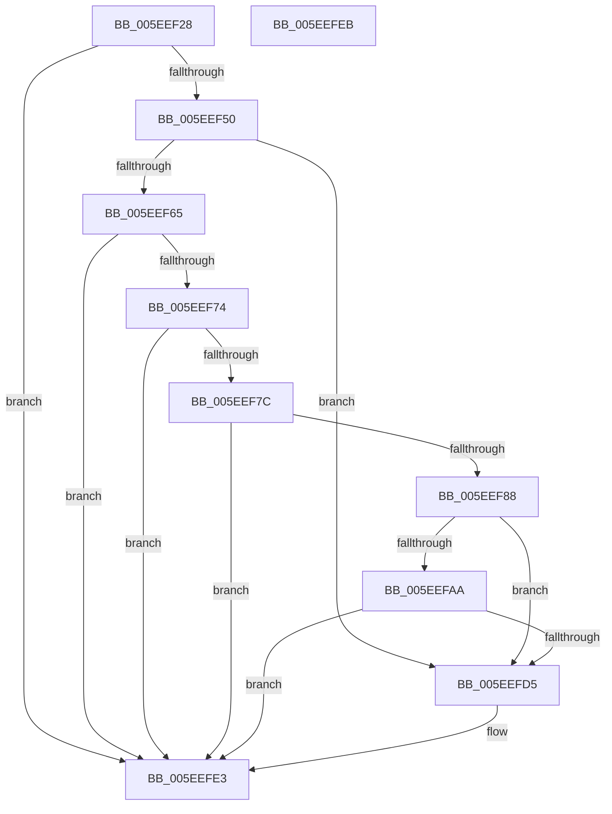

# RtlGuardCheckLongJumpTarget

- RVA: `0x005EEF28`–`0x005EEFEC` (길이 `196` bytes)
- VA: `0x00000001405EEF28`
- 실행 섹션: `.text`
- PDB 이름 있음: `예`; PDB Function 태그: `아니요`
- unwind 정보 RVA: `0x000CFF94`
- 디코드: `51`개 명령, `196/196` bytes 표시
- 미해석 바이트: `0` (있으면 어셈블리에 `.byte`로 보존)

> 이 문서는 커널 이미지의 기계어와 PDB 기호를 분석해 생성했습니다. 4번과 5번은 함수 원형과 자료형을 바이너리 사용 방식에서 추정한 C 해석이며 원본 소스 복구 결과는 아닙니다.

## 1. Dependencies

- 직접 호출 지점: **5**; 고유 호출 대상: **5**
- 직접 호출자로 확인된 함수: **1**
- RIP 상대 이미지 참조: **1**

### Outgoing calls
- `0x005EEF43` → [RtlpControlFlowGuardEnforced](../2F/RtlpControlFlowGuardEnforced_function_002F2144.md) (function, `0x002F2144`)
- `0x005EEF58` → [RtlPcToFileHeader](../2F/RtlPcToFileHeader_function_002F1C50.md) (function, `0x002F1C50`)
- `0x005EEF6A` → [LdrImageDirectoryEntryToLoadConfig](../../page/A8/LdrImageDirectoryEntryToLoadConfig_function_00A8F564.md) (function, `0x00A8F564`)
- `0x005EEFCB` → [bsearch_s](../50/bsearch_s_function_00500540.md) (function, `0x00500540`)
- `0x005EEFDD` → [RtlFailFast2](../4F/RtlFailFast2_function_004FEDC0.md) (function, `0x004FEDC0`)

### Direct callers
- [RtlUnwindEx](../2F/RtlUnwindEx_function_002F2830.md) at `0x002F2EF9`

### Static image references
- `0x005EEFBA` → RVA `0x00463790` (`RtlpTargetCompare`; read)

## 2. Other-region calls and transfers

- 다른 실행 섹션으로 향하는 call: **1**
  - `0x005EEF6A` → [LdrImageDirectoryEntryToLoadConfig](../../page/A8/LdrImageDirectoryEntryToLoadConfig_function_00A8F564.md) (`.text` → `PAGE`)
- 별도 외부 분기/꼬리 이동을 확인하지 못했습니다.

## 3. Assembly (complete function range)

```asm
005EEF28  48 8B C4                        mov rax, rsp
005EEF2B  4C 89 40 18                     mov qword ptr [rax + 0x18], r8
005EEF2F  88 50 10                        mov byte ptr [rax + 0x10], dl
005EEF32  57                              push rdi
005EEF33  48 83 EC 30                     sub rsp, 0x30
005EEF37  83 60 10 00                     and dword ptr [rax + 0x10], 0
005EEF3B  48 8B F9                        mov rdi, rcx
005EEF3E  48 83 60 18 00                  and qword ptr [rax + 0x18], 0
005EEF43  E8 FC 31 D0 FF                  call 0x1402f2144
005EEF48  85 C0                           test eax, eax
005EEF4A  0F 84 93 00 00 00               je 0x1405eefe3
005EEF50  48 8D 54 24 50                  lea rdx, [rsp + 0x50]
005EEF55  48 8B CF                        mov rcx, rdi
005EEF58  E8 F3 2C D0 FF                  call 0x1402f1c50
005EEF5D  48 83 7C 24 50 00               cmp qword ptr [rsp + 0x50], 0
005EEF63  74 70                           je 0x1405eefd5
005EEF65  48 8B 4C 24 50                  mov rcx, qword ptr [rsp + 0x50]
005EEF6A  E8 F5 05 4A 00                  call 0x140a8f564
005EEF6F  48 85 C0                        test rax, rax
005EEF72  74 6F                           je 0x1405eefe3
005EEF74  81 38 C0 00 00 00               cmp dword ptr [rax], 0xc0
005EEF7A  72 67                           jb 0x1405eefe3
005EEF7C  F7 80 90 00 00 00 00 00 01 00   test dword ptr [rax + 0x90], 0x10000
005EEF86  74 5B                           je 0x1405eefe3
005EEF88  8B CF                           mov ecx, edi
005EEF8A  2B 4C 24 50                     sub ecx, dword ptr [rsp + 0x50]
005EEF8E  89 4C 24 48                     mov dword ptr [rsp + 0x48], ecx
005EEF92  8B 88 90 00 00 00               mov ecx, dword ptr [rax + 0x90]
005EEF98  4C 8B 80 B8 00 00 00            mov r8, qword ptr [rax + 0xb8]
005EEF9F  C1 E9 1C                        shr ecx, 0x1c
005EEFA2  83 C1 04                        add ecx, 4
005EEFA5  4D 85 C0                        test r8, r8
005EEFA8  74 2B                           je 0x1405eefd5
005EEFAA  48 83 64 24 28 00               and qword ptr [rsp + 0x28], 0
005EEFB0  48 8B 90 B0 00 00 00            mov rdx, qword ptr [rax + 0xb0]
005EEFB7  44 8B C9                        mov r9d, ecx
005EEFBA  48 8D 0D CF 47 E7 FF            lea rcx, [rip - 0x18b831]
005EEFC1  48 89 4C 24 20                  mov qword ptr [rsp + 0x20], rcx
005EEFC6  48 8D 4C 24 48                  lea rcx, [rsp + 0x48]
005EEFCB  E8 70 15 F1 FF                  call 0x140500540
005EEFD0  48 85 C0                        test rax, rax
005EEFD3  75 0E                           jne 0x1405eefe3
005EEFD5  48 8B D7                        mov rdx, rdi
005EEFD8  B9 26 00 00 00                  mov ecx, 0x26
005EEFDD  E8 DE FD F0 FF                  call 0x1404fedc0
005EEFE2  CC                              int3
005EEFE3  33 C0                           xor eax, eax
005EEFE5  48 83 C4 30                     add rsp, 0x30
005EEFE9  5F                              pop rdi
005EEFEA  C3                              ret
005EEFEB  CC                              int3
```

## 4. C-style interpretation (structured pseudocode)

```c
__int64 __fastcall RtlGuardCheckLongJumpTarget(__int64 a1, unsigned __int8 a2, __int64 a3)
{
    __int64 result;
    __int64 v_rsp;
    unsigned __int64 v_stack_m10;
    unsigned __int64 v_stack_m18;
    unsigned int v_stack_p10;
    unsigned __int64 v_stack_p18;

    *(unsigned __int64 *)(v_rsp + 24) = a3;
    *(unsigned __int8 *)(v_rsp + 16) = a2;
    v_rsp = (v_rsp) - (48);
    result = RtlpControlFlowGuardEnforced(a1, a2, a3, a4);
    if ((unsigned int)(result) == 0) goto loc_005EEFE3;
    result = RtlPcToFileHeader(a1, v_stack_p18, a3, a4);
    if (v_stack_p18 == 0) goto loc_005EEFD5;
    result = LdrImageDirectoryEntryToLoadConfig(v_stack_p18, v_stack_p18, a3, a4);
    if (result == 0) goto loc_005EEFE3;
    if ((*(unsigned int *)(result)) < 192) goto loc_005EEFE3;
    if (((*(unsigned int *)(result + 144)) & (0x10000ULL)) == 0) goto loc_005EEFE3;
    a1 = (unsigned int)(((unsigned int)((unsigned int)(a1))) - (v_stack_p18));
    v_stack_p10 = (unsigned int)(a1);
    a1 = (unsigned int)(((unsigned int)(*(unsigned int *)(result + 144))) >> (28));
    a1 = (unsigned int)((a1) + (4));
    if (*(unsigned __int64 *)(result + 184) == 0) goto loc_005EEFD5;
    v_stack_m18 = v_rip - 1620017;
    result = bsearch_s(v_stack_p10, *(unsigned __int64 *)(result + 176), *(unsigned __int64 *)(result + 184), (unsigned int)((unsigned int)(a1)));
    if (result == 0) {
        a2 = a1;
        a1 = 38;
        result = RtlFailFast2(a1, a2, *(unsigned __int64 *)(result + 184), (unsigned int)((unsigned int)(a1)));
    }
    result = 0;
    v_rsp = (v_rsp) + (48);
    return result;
}
```

## 5. (Beta) C Style

```c
int64_t RtlGuardCheckLongJumpTarget(int64_t Arg1, uint8_t Arg2, int64_t Arg3)
{
    int64_t result;
    int64_t local_rsp;
    uint64_t v_stack_m10;
    uint64_t v_stack_m18;
    uint32_t v_stack_p10;
    uint64_t v_stack_p18;

    *(uint64_t *)(local_rsp + 0x18) = Arg3;
    *(uint8_t *)(local_rsp + 0x10) = Arg2;
    local_rsp = (local_rsp) - (48);
    result = RtlpControlFlowGuardEnforced(Arg1, Arg2, Arg3, a4);
    if ((uint32_t)(result) == 0) goto loc_005EEFE3;
    result = RtlPcToFileHeader(Arg1, v_stack_p18, Arg3, a4);
    if (v_stack_p18 == 0) goto loc_005EEFD5;
    result = LdrImageDirectoryEntryToLoadConfig(v_stack_p18, v_stack_p18, Arg3, a4);
    if (result == 0) goto loc_005EEFE3;
    if ((*(uint32_t *)(result)) < 192) goto loc_005EEFE3;
    if (((*(uint32_t *)(result + 0x90)) & (0x10000ULL)) == 0) goto loc_005EEFE3;
    Arg1 = (uint32_t)(((uint32_t)((uint32_t)(Arg1))) - (v_stack_p18));
    v_stack_p10 = (uint32_t)(Arg1);
    Arg1 = (uint32_t)(((uint32_t)(*(uint32_t *)(result + 0x90))) >> (28));
    Arg1 = (uint32_t)((Arg1) + (4));
    if (*(uint64_t *)(result + 0xB8) == 0) goto loc_005EEFD5;
    v_stack_m18 = v_rip - 1620017;
    result = bsearch_s(v_stack_p10, *(uint64_t *)(result + 0xB0), *(uint64_t *)(result + 0xB8), (uint32_t)((uint32_t)(Arg1)));
    if (result == 0) {
        Arg2 = Arg1;
        Arg1 = 38;
        result = RtlFailFast2(Arg1, Arg2, *(uint64_t *)(result + 0xB8), (uint32_t)((uint32_t)(Arg1)));
    }
    result = 0;
    local_rsp = (local_rsp) + (48);
    return result;
}
```

## 6. Execution-region graph

[열기: 2D/3D 그래프와 함수 탐색 컨트롤 패널](../../../control-panel.html?section=text&rva=0x005EEF28&view=graph)

- 2D 그래프는 위에서 아래로 흐르고, 3D 그래프는 빈 공간을 드래그해 회전합니다. Shift+드래그는 이동, 휠은 확대·축소, 함수 노드 선택은 대상 보고서 이동입니다.

### Static fallback


