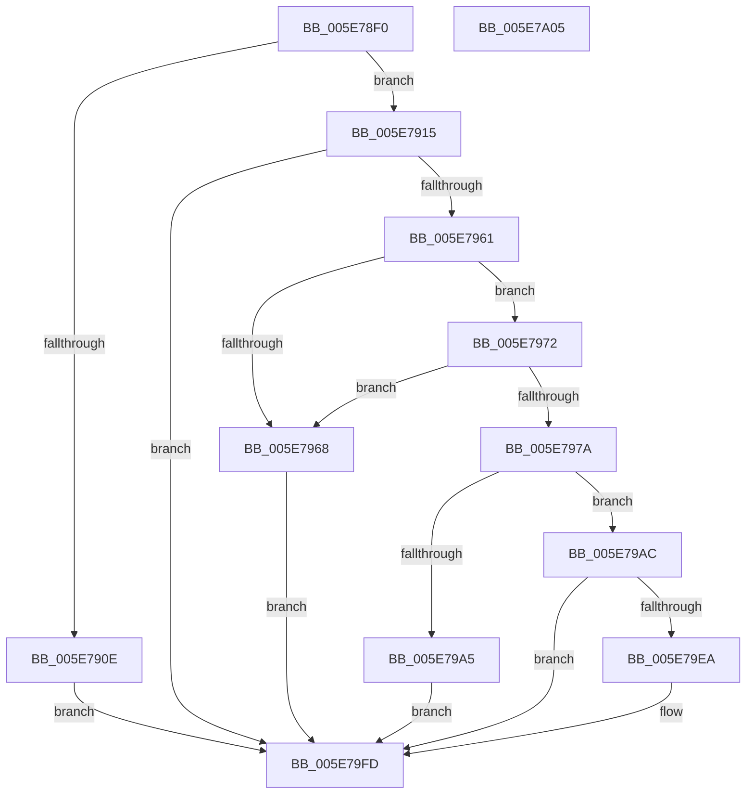

# RtlInitializeBootStatDataCache

- RVA: `0x005E78F0`–`0x005E7A06` (길이 `278` bytes)
- VA: `0x00000001405E78F0`
- 실행 섹션: `.text`
- PDB 이름 있음: `예`; PDB Function 태그: `아니요`
- unwind 정보 RVA: `0x0008A308`
- 디코드: `74`개 명령, `278/278` bytes 표시
- 미해석 바이트: `0` (있으면 어셈블리에 `.byte`로 보존)

> 이 문서는 커널 이미지의 기계어와 PDB 기호를 분석해 생성했습니다. 4번과 5번은 함수 원형과 자료형을 바이너리 사용 방식에서 추정한 C 해석이며 원본 소스 복구 결과는 아닙니다.

## 1. Dependencies

- 직접 호출 지점: **3**; 고유 호출 대상: **2**
- 직접 호출자로 확인된 함수: **4**
- RIP 상대 이미지 참조: **3**

### Outgoing calls
- `0x005E7952` → [ZwReadFile](../6A/ZwReadFile_function_006AD190.md) (function, `0x006AD190`)
- `0x005E7991` → [ExAllocatePool2](../../poolcode/B8/ExAllocatePool2_function_00B820F0.md) (function, `0x00B820F0`)
- `0x005E79DF` → [ZwReadFile](../6A/ZwReadFile_function_006AD190.md) (function, `0x006AD190`)

### Direct callers
- [PopBootStatRestoreDefaults](../../page/AC/PopBootStatRestoreDefaults_function_00AC38E8.md) at `0x00AC3A29`
- [sub_00B3B9F4](../../page/B3/Unknown_function_00B3B9F4.md) at `0x00B3BB34`
- [sub_00B3BB7A](../../page/B3/Unknown_function_00B3BB7A.md) at `0x00B3BCBF`
- [sub_00B47492](../../page/B4/Unknown_function_00B47492.md) at `0x00B4750F`

### Static image references
- `0x005E7900` → RVA `0x00F05C38` (`.data`; read)
- `0x005E791F` → RVA `0x00F05C28` (`.data`; read)
- `0x005E7996` → RVA `0x00F05C38` (`.data`; write)

## 2. Other-region calls and transfers

- 다른 실행 섹션으로 향하는 call: **1**
  - `0x005E7991` → [ExAllocatePool2](../../poolcode/B8/ExAllocatePool2_function_00B820F0.md) (`.text` → `POOLCODE`)
- 별도 외부 분기/꼬리 이동을 확인하지 못했습니다.

## 3. Assembly (complete function range)

```asm
005E78F0  40 55                           push rbp
005E78F2  48 8B EC                        mov rbp, rsp
005E78F5  48 83 EC 60                     sub rsp, 0x60
005E78F9  83 65 10 00                     and dword ptr [rbp + 0x10], 0
005E78FD  0F 57 C0                        xorps xmm0, xmm0
005E7900  48 83 3D 30 E3 91 00 00         cmp qword ptr [rip + 0x91e330], 0
005E7908  0F 11 45 F0                     movups xmmword ptr [rbp - 0x10], xmm0
005E790C  74 07                           je 0x1405e7915
005E790E  33 D2                           xor edx, edx
005E7910  E9 E8 00 00 00                  jmp 0x1405e79fd
005E7915  48 83 64 24 40 00               and qword ptr [rsp + 0x40], 0
005E791B  48 8D 45 18                     lea rax, [rbp + 0x18]
005E791F  48 8B 0D 02 E3 91 00            mov rcx, qword ptr [rip + 0x91e302]
005E7926  45 33 C9                        xor r9d, r9d
005E7929  48 83 65 18 00                  and qword ptr [rbp + 0x18], 0
005E792E  45 33 C0                        xor r8d, r8d
005E7931  48 89 44 24 38                  mov qword ptr [rsp + 0x38], rax
005E7936  33 D2                           xor edx, edx
005E7938  48 8D 45 10                     lea rax, [rbp + 0x10]
005E793C  C7 44 24 30 04 00 00 00         mov dword ptr [rsp + 0x30], 4
005E7944  48 89 44 24 28                  mov qword ptr [rsp + 0x28], rax
005E7949  48 8D 45 F0                     lea rax, [rbp - 0x10]
005E794D  48 89 44 24 20                  mov qword ptr [rsp + 0x20], rax
005E7952  E8 39 58 0C 00                  call 0x1406ad190
005E7957  8B D0                           mov edx, eax
005E7959  85 C0                           test eax, eax
005E795B  0F 88 9C 00 00 00               js 0x1405e79fd
005E7961  8B 4D 10                        mov ecx, dword ptr [rbp + 0x10]
005E7964  85 C9                           test ecx, ecx
005E7966  75 0A                           jne 0x1405e7972
005E7968  BA 01 00 00 C0                  mov edx, 0xc0000001
005E796D  E9 8B 00 00 00                  jmp 0x1405e79fd
005E7972  81 F9 00 08 00 00               cmp ecx, 0x800
005E7978  77 EE                           ja 0x1405e7968
005E797A  B8 C8 00 00 00                  mov eax, 0xc8
005E797F  41 B8 62 73 64 66               mov r8d, 0x66647362
005E7985  3B C8                           cmp ecx, eax
005E7987  0F 47 C1                        cmova eax, ecx
005E798A  B9 00 01 00 00                  mov ecx, 0x100
005E798F  8B D0                           mov edx, eax
005E7991  E8 5A A7 59 00                  call 0x140b820f0
005E7996  48 89 05 9B E2 91 00            mov qword ptr [rip + 0x91e29b], rax
005E799D  48 8B C8                        mov rcx, rax
005E79A0  48 85 C0                        test rax, rax
005E79A3  75 07                           jne 0x1405e79ac
005E79A5  BA 17 00 00 C0                  mov edx, 0xc0000017
005E79AA  EB 51                           jmp 0x1405e79fd
005E79AC  48 83 64 24 40 00               and qword ptr [rsp + 0x40], 0
005E79B2  48 8D 45 18                     lea rax, [rbp + 0x18]
005E79B6  48 89 44 24 38                  mov qword ptr [rsp + 0x38], rax
005E79BB  45 33 C9                        xor r9d, r9d
005E79BE  8B 45 10                        mov eax, dword ptr [rbp + 0x10]
005E79C1  45 33 C0                        xor r8d, r8d
005E79C4  89 44 24 30                     mov dword ptr [rsp + 0x30], eax
005E79C8  33 D2                           xor edx, edx
005E79CA  48 89 4C 24 28                  mov qword ptr [rsp + 0x28], rcx
005E79CF  48 8D 45 F0                     lea rax, [rbp - 0x10]
005E79D3  48 8B 0D 4E E2 91 00            mov rcx, qword ptr [rip + 0x91e24e]
005E79DA  48 89 44 24 20                  mov qword ptr [rsp + 0x20], rax
005E79DF  E8 AC 57 0C 00                  call 0x1406ad190
005E79E4  8B D0                           mov edx, eax
005E79E6  85 C0                           test eax, eax
005E79E8  78 13                           js 0x1405e79fd
005E79EA  8B 45 10                        mov eax, dword ptr [rbp + 0x10]
005E79ED  8B CA                           mov ecx, edx
005E79EF  48 39 45 F8                     cmp qword ptr [rbp - 8], rax
005E79F3  BA 01 00 00 C0                  mov edx, 0xc0000001
005E79F8  0F 45 CA                        cmovne ecx, edx
005E79FB  8B D1                           mov edx, ecx
005E79FD  8B C2                           mov eax, edx
005E79FF  48 83 C4 60                     add rsp, 0x60
005E7A03  5D                              pop rbp
005E7A04  C3                              ret
005E7A05  CC                              int3
```

## 4. C-style interpretation (structured pseudocode)

```c
__int64 __fastcall RtlInitializeBootStatDataCache(__int64 a1, int a2, int a3, int a4)
{
    __int64 result;
    __int64 v_rsp;
    unsigned __int64 v_stack_m10;
    unsigned __int64 v_stack_m18;
    unsigned __int64 v_stack_m28;
    unsigned __int64 v_stack_m30;
    unsigned int v_stack_m38;
    unsigned __int64 v_stack_m40;
    unsigned __int64 v_stack_m48;
    unsigned __int64 v_stack_p10;
    unsigned int v_stack_p8;

    v_rsp = (v_rsp) - (96);
    v_stack_m18 = v_xmm0;
    if ((*(unsigned __int64 *)(v_rip + 9560880)) == 0) goto loc_005E7915;
    a2 = 0;
    goto loc_005E79FD;
loc_005E7915:
    a4 = 0;
    a3 = 0;
    v_stack_m30 = v_stack_p10;
    a2 = 0;
    v_stack_m38 = 4;
    v_stack_m40 = v_stack_p8;
    v_stack_m48 = v_stack_m18;
    result = ZwReadFile(*(unsigned __int64 *)(v_rip + 9560834), a2, a3, a4);
    if (sign_flag) goto loc_005E79FD;
    if ((unsigned int)((unsigned int)(v_stack_p8)) != 0) goto loc_005E7972;
loc_005E7968:
    goto loc_005E79FD;
loc_005E7972:
    if (((unsigned int)((unsigned int)(v_stack_p8))) > 0x800ULL) goto loc_005E7968;
    result = 200;
    if (((unsigned int)((unsigned int)(v_stack_p8))) > 200) { result = (unsigned int)((unsigned int)(v_stack_p8)); }
    result = ExAllocatePool2(256, (unsigned int)((unsigned int)(result)), (unsigned int)(0x66647362ULL), a4);
    *(unsigned __int64 *)(v_rip + 9560731) = result;
    if (result != 0) goto loc_005E79AC;
    goto loc_005E79FD;
loc_005E79AC:
    v_stack_m30 = v_stack_p10;
    a4 = 0;
    a3 = 0;
    v_stack_m38 = (unsigned int)((unsigned int)(v_stack_p8));
    a2 = 0;
    v_stack_m40 = result;
    v_stack_m48 = v_stack_m18;
    result = ZwReadFile(*(unsigned __int64 *)(v_rip + 9560654), a2, a3, a4);
    if (!(sign_flag)) {
        result = v_stack_p8;
        a1 = (unsigned int)((unsigned int)((unsigned int)(result)));
        a2 = 0xC0000001ULL;
        if (v_stack_m10 != result) { a1 = a2; }
        a2 = (unsigned int)(a1);
    }
    v_rsp = (v_rsp) + (96);
    return (unsigned int)(a2);
}
```

## 5. (Beta) C Style

```c
int64_t RtlInitializeBootStatDataCache(int64_t Arg1, int32_t Arg2, int32_t Arg3, int32_t Arg4)
{
    int64_t result;
    int64_t local_rsp;
    uint64_t v_stack_m10;
    uint64_t v_stack_m18;
    uint64_t v_stack_m28;
    uint64_t v_stack_m30;
    uint32_t v_stack_m38;
    uint64_t v_stack_m40;
    uint64_t v_stack_m48;
    uint64_t v_stack_p10;
    uint32_t v_stack_p8;

    local_rsp = (local_rsp) - (96);
    v_stack_m18 = v_xmm0;
    if ((*(uint64_t *)(v_rip + 0x91E330)) == 0) goto loc_005E7915;
    Arg2 = 0;
    goto loc_005E79FD;
loc_005E7915:
    Arg4 = 0;
    Arg3 = 0;
    v_stack_m30 = v_stack_p10;
    Arg2 = 0;
    v_stack_m38 = 4;
    v_stack_m40 = v_stack_p8;
    v_stack_m48 = v_stack_m18;
    result = ZwReadFile(*(uint64_t *)(v_rip + 0x91E302), Arg2, Arg3, Arg4);
    if (sign_flag) goto loc_005E79FD;
    if ((uint32_t)((uint32_t)(v_stack_p8)) != 0) goto loc_005E7972;
loc_005E7968:
    goto loc_005E79FD;
loc_005E7972:
    if (((uint32_t)((uint32_t)(v_stack_p8))) > 0x800ULL) goto loc_005E7968;
    result = 200;
    if (((uint32_t)((uint32_t)(v_stack_p8))) > 200) { result = (uint32_t)((uint32_t)(v_stack_p8)); }
    result = ExAllocatePool2(256, (uint32_t)((uint32_t)(result)), (uint32_t)(0x66647362ULL), Arg4);
    *(uint64_t *)(v_rip + 0x91E29B) = result;
    if (result != 0) goto loc_005E79AC;
    goto loc_005E79FD;
loc_005E79AC:
    v_stack_m30 = v_stack_p10;
    Arg4 = 0;
    Arg3 = 0;
    v_stack_m38 = (uint32_t)((uint32_t)(v_stack_p8));
    Arg2 = 0;
    v_stack_m40 = result;
    v_stack_m48 = v_stack_m18;
    result = ZwReadFile(*(uint64_t *)(v_rip + 0x91E24E), Arg2, Arg3, Arg4);
    if (!(sign_flag)) {
        result = v_stack_p8;
        Arg1 = (uint32_t)((uint32_t)((uint32_t)(result)));
        Arg2 = 0xC0000001ULL;
        if (v_stack_m10 != result) { Arg1 = Arg2; }
        Arg2 = (uint32_t)(Arg1);
    }
    local_rsp = (local_rsp) + (96);
    return (uint32_t)(Arg2);
}
```

## 6. Execution-region graph

[열기: 2D/3D 그래프와 함수 탐색 컨트롤 패널](../../../control-panel.html?section=text&rva=0x005E78F0&view=graph)

- 2D 그래프는 위에서 아래로 흐르고, 3D 그래프는 빈 공간을 드래그해 회전합니다. Shift+드래그는 이동, 휠은 확대·축소, 함수 노드 선택은 대상 보고서 이동입니다.

### Static fallback


