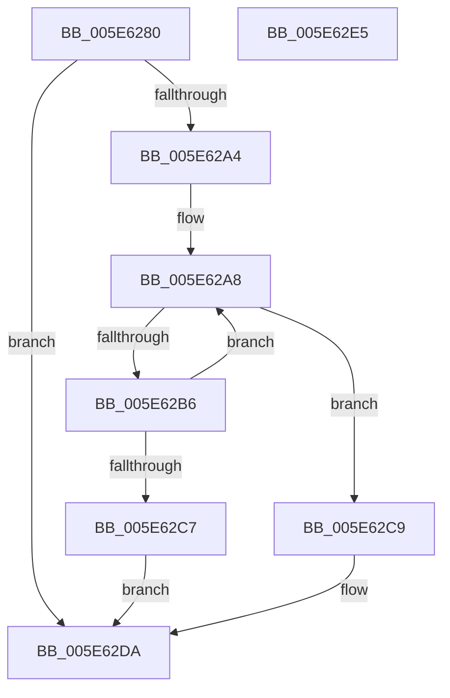

# RtlIntersectBitMaps

- RVA: `0x005E6280`–`0x005E62E6` (길이 `102` bytes)
- VA: `0x00000001405E6280`
- 실행 섹션: `.text`
- PDB 이름 있음: `예`; PDB Function 태그: `아니요`
- unwind 정보 RVA: `0x000950EC`
- 디코드: `31`개 명령, `102/102` bytes 표시
- 미해석 바이트: `0` (있으면 어셈블리에 `.byte`로 보존)

> 이 문서는 커널 이미지의 기계어와 PDB 기호를 분석해 생성했습니다. 4번과 5번은 함수 원형과 자료형을 바이너리 사용 방식에서 추정한 C 해석이며 원본 소스 복구 결과는 아닙니다.

## 1. Dependencies

- 직접 호출 지점: **0**; 고유 호출 대상: **0**
- 직접 호출자로 확인된 함수: **1**
- RIP 상대 이미지 참조: **0**

### Outgoing calls
- 직접 디코드된 call 명령이 없습니다.

### Direct callers
- [PopHiberWriteBootFreePageMap](../../pagelk/B6/PopHiberWriteBootFreePageMap_function_00B6DFAC.md) at `0x00B6DFD8`

### Static image references
- 디코드된 RIP-relative 메모리 참조가 없습니다.

## 2. Other-region calls and transfers

- 다른 실행 섹션으로 향하는 call: **0**
- 별도 외부 분기/꼬리 이동을 확인하지 못했습니다.

## 3. Assembly (complete function range)

```asm
005E6280  48 89 5C 24 08                  mov qword ptr [rsp + 8], rbx
005E6285  48 89 7C 24 10                  mov qword ptr [rsp + 0x10], rdi
005E628A  44 8B 01                        mov r8d, dword ptr [rcx]
005E628D  48 8B DA                        mov rbx, rdx
005E6290  8B 02                           mov eax, dword ptr [rdx]
005E6292  48 8B F9                        mov rdi, rcx
005E6295  44 3B C0                        cmp r8d, eax
005E6298  44 0F 43 C0                     cmovae r8d, eax
005E629C  45 33 DB                        xor r11d, r11d
005E629F  45 85 C0                        test r8d, r8d
005E62A2  74 36                           je 0x1405e62da
005E62A4  45 8D 53 01                     lea r10d, [r11 + 1]
005E62A8  48 8B 57 08                     mov rdx, qword ptr [rdi + 8]
005E62AC  48 8B 43 08                     mov rax, qword ptr [rbx + 8]
005E62B0  41 83 F8 20                     cmp r8d, 0x20
005E62B4  72 13                           jb 0x1405e62c9
005E62B6  42 8B 0C 98                     mov ecx, dword ptr [rax + r11*4]
005E62BA  42 21 0C 9A                     and dword ptr [rdx + r11*4], ecx
005E62BE  45 03 DA                        add r11d, r10d
005E62C1  41 83 C0 E0                     add r8d, -0x20
005E62C5  75 E1                           jne 0x1405e62a8
005E62C7  EB 11                           jmp 0x1405e62da
005E62C9  41 8B C8                        mov ecx, r8d
005E62CC  49 D3 E2                        shl r10, cl
005E62CF  41 F7 DA                        neg r10d
005E62D2  46 0B 14 98                     or r10d, dword ptr [rax + r11*4]
005E62D6  46 21 14 9A                     and dword ptr [rdx + r11*4], r10d
005E62DA  48 8B 5C 24 08                  mov rbx, qword ptr [rsp + 8]
005E62DF  48 8B 7C 24 10                  mov rdi, qword ptr [rsp + 0x10]
005E62E4  C3                              ret
005E62E5  CC                              int3
```

## 4. C-style interpretation (structured pseudocode)

```c
__int64 __fastcall RtlIntersectBitMaps(__int64 a1, __int64 a2)
{
    __int64 v_r10;
    __int64 v_r11;
    unsigned __int64 v_stack_p10;
    unsigned __int64 v_stack_p8;

    v_stack_p8 = v_rbx;
    v_stack_p10 = v_rdi;
    a3 = (unsigned int)(*(unsigned int *)(a1));
    if (((unsigned int)((unsigned int)(*(unsigned int *)(a1)))) >= ((unsigned int)((unsigned int)(*(unsigned int *)(a2))))) { a3 = (unsigned int)((unsigned int)(*(unsigned int *)(a2))); }
    v_r11 = 0;
    if ((unsigned int)(a3) == 0) goto loc_005E62DA;
loc_005E62A8:
    if (((unsigned int)(a3)) < 32) goto loc_005E62C9;
    v_r11 = (unsigned int)((v_r11) + ((unsigned int)(v_r11 + 1)));
    a3 = (unsigned int)((a3) + (-32));
    if (condition_is_not_equal) goto loc_005E62A8;
    goto loc_005E62DA;
loc_005E62C9:
    v_r10 = (v_r11 + 1) << ((unsigned __int8)((unsigned int)((unsigned int)(a3))));
    v_r10 = (unsigned int)(-(v_r10));
    v_r10 = (unsigned int)((v_r10) | (*(unsigned int *)(*(unsigned __int64 *)(a2 + 8) + v_r11 * 4)));
loc_005E62DA:
    return *(unsigned __int64 *)(a2 + 8);
}
```

## 5. (Beta) C Style

```c
int64_t RtlIntersectBitMaps(void *Arg1, void *Arg2)
{
    uint8_t *arg1 = (uint8_t *)Arg1;
    uint8_t *arg2 = (uint8_t *)Arg2;

    int64_t local_r10;
    int64_t local_r11;
    uint64_t v_stack_p10;
    uint64_t v_stack_p8;

    v_stack_p8 = local_rbx;
    v_stack_p10 = local_rdi;
    a3 = (uint32_t)(*(uint32_t *)(arg1));
    if (((uint32_t)((uint32_t)(*(uint32_t *)(arg1)))) >= ((uint32_t)((uint32_t)(*(uint32_t *)(arg2))))) { a3 = (uint32_t)((uint32_t)(*(uint32_t *)(arg2))); }
    local_r11 = 0;
    if ((uint32_t)(a3) == 0) goto loc_005E62DA;
loc_005E62A8:
    if (((uint32_t)(a3)) < 32) goto loc_005E62C9;
    local_r11 = (uint32_t)((local_r11) + ((uint32_t)(local_r11 + 1)));
    a3 = (uint32_t)((a3) + (-32));
    if (condition_is_not_equal) goto loc_005E62A8;
    goto loc_005E62DA;
loc_005E62C9:
    local_r10 = (local_r11 + 1) << ((uint8_t)((uint32_t)((uint32_t)(a3))));
    local_r10 = (uint32_t)(-(local_r10));
    local_r10 = (uint32_t)((local_r10) | (*(uint32_t *)(*(uint64_t *)(arg2 + 0x8) + local_r11 * 4)));
loc_005E62DA:
    return *(uint64_t *)(arg2 + 0x8);
}
```

### 관측된 메모리 오프셋

구조체 형식이 확인되지 않은 접근은 인자 기준의 오프셋으로만 기록했습니다.

| 기준 인자 | 오프셋 표현 | 폭 (bit) | 접근 |
|---|---:|---:|---|
| `Arg1` | `+ 0x0` | `32` | `R` |
| `Arg1` | `+ 0x8` | `64` | `R` |
| `Arg2` | `+ 0x0` | `32` | `R` |
| `Arg2` | `+ 0x8` | `64` | `R` |

## 6. Execution-region graph

[열기: 2D/3D 그래프와 함수 탐색 컨트롤 패널](../../../control-panel.html?section=text&rva=0x005E6280&view=graph)

- 2D 그래프는 위에서 아래로 흐르고, 3D 그래프는 빈 공간을 드래그해 회전합니다. Shift+드래그는 이동, 휠은 확대·축소, 함수 노드 선택은 대상 보고서 이동입니다.

### Static fallback


