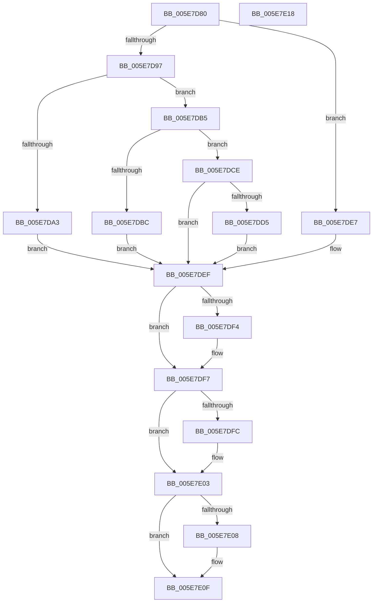

# RtlIoDecodeMemIoResource

- RVA: `0x005E7D80`–`0x005E7E19` (길이 `153` bytes)
- VA: `0x00000001405E7D80`
- 실행 섹션: `.text`
- PDB 이름 있음: `예`; PDB Function 태그: `아니요`
- unwind 정보 RVA: `0x00071750`
- 디코드: `47`개 명령, `153/153` bytes 표시
- 미해석 바이트: `0` (있으면 어셈블리에 `.byte`로 보존)

> 이 문서는 커널 이미지의 기계어와 PDB 기호를 분석해 생성했습니다. 4번과 5번은 함수 원형과 자료형을 바이너리 사용 방식에서 추정한 C 해석이며 원본 소스 복구 결과는 아닙니다.

## 1. Dependencies

- 직접 호출 지점: **0**; 고유 호출 대상: **0**
- 직접 호출자로 확인된 함수: **3**
- RIP 상대 이미지 참조: **0**

### Outgoing calls
- 직접 디코드된 call 명령이 없습니다.

### Direct callers
- [IopGenericScoreRequirement](../../page/72/IopGenericScoreRequirement_function_0072ED70.md) at `0x0072ED92`
- [IopGenericUnpackRequirement](../../page/72/IopGenericUnpackRequirement_function_0072EEA0.md) at `0x0072EECC`
- [PnpFilterResourceRequirementsList](../../page/AD/PnpFilterResourceRequirementsList_function_00AD0D7C.md) at `0x00AD108F`

### Static image references
- 디코드된 RIP-relative 메모리 참조가 없습니다.

## 2. Other-region calls and transfers

- 다른 실행 섹션으로 향하는 call: **0**
- 별도 외부 분기/꼬리 이동을 확인하지 못했습니다.

## 3. Assembly (complete function range)

```asm
005E7D80  48 89 5C 24 08                  mov qword ptr [rsp + 8], rbx
005E7D85  4C 8B D1                        mov r10, rcx
005E7D88  45 33 DB                        xor r11d, r11d
005E7D8B  33 C9                           xor ecx, ecx
005E7D8D  41 8A 42 01                     mov al, byte ptr [r10 + 1]
005E7D91  FE C8                           dec al
005E7D93  A8 FD                           test al, 0xfd
005E7D95  74 50                           je 0x1405e7de7
005E7D97  41 0F B7 42 04                  movzx eax, word ptr [r10 + 4]
005E7D9C  66 0F BA E0 09                  bt ax, 9
005E7DA1  73 12                           jae 0x1405e7db5
005E7DA3  45 8B 5A 08                     mov r11d, dword ptr [r10 + 8]
005E7DA7  41 8B 4A 0C                     mov ecx, dword ptr [r10 + 0xc]
005E7DAB  49 C1 E3 08                     shl r11, 8
005E7DAF  48 C1 E1 08                     shl rcx, 8
005E7DB3  EB 3A                           jmp 0x1405e7def
005E7DB5  66 0F BA E0 0A                  bt ax, 0xa
005E7DBA  73 12                           jae 0x1405e7dce
005E7DBC  45 8B 5A 08                     mov r11d, dword ptr [r10 + 8]
005E7DC0  41 8B 4A 0C                     mov ecx, dword ptr [r10 + 0xc]
005E7DC4  49 C1 E3 10                     shl r11, 0x10
005E7DC8  48 C1 E1 10                     shl rcx, 0x10
005E7DCC  EB 21                           jmp 0x1405e7def
005E7DCE  66 0F BA E0 0B                  bt ax, 0xb
005E7DD3  73 1A                           jae 0x1405e7def
005E7DD5  45 8B 5A 08                     mov r11d, dword ptr [r10 + 8]
005E7DD9  41 8B 4A 0C                     mov ecx, dword ptr [r10 + 0xc]
005E7DDD  49 C1 E3 20                     shl r11, 0x20
005E7DE1  48 C1 E1 20                     shl rcx, 0x20
005E7DE5  EB 08                           jmp 0x1405e7def
005E7DE7  45 8B 5A 08                     mov r11d, dword ptr [r10 + 8]
005E7DEB  41 8B 4A 0C                     mov ecx, dword ptr [r10 + 0xc]
005E7DEF  48 85 D2                        test rdx, rdx
005E7DF2  74 03                           je 0x1405e7df7
005E7DF4  48 89 0A                        mov qword ptr [rdx], rcx
005E7DF7  4D 85 C0                        test r8, r8
005E7DFA  74 07                           je 0x1405e7e03
005E7DFC  49 8B 4A 10                     mov rcx, qword ptr [r10 + 0x10]
005E7E00  49 89 08                        mov qword ptr [r8], rcx
005E7E03  4D 85 C9                        test r9, r9
005E7E06  74 07                           je 0x1405e7e0f
005E7E08  49 8B 4A 18                     mov rcx, qword ptr [r10 + 0x18]
005E7E0C  49 89 09                        mov qword ptr [r9], rcx
005E7E0F  48 8B 5C 24 08                  mov rbx, qword ptr [rsp + 8]
005E7E14  49 8B C3                        mov rax, r11
005E7E17  C3                              ret
005E7E18  CC                              int3
```

## 4. C-style interpretation (structured pseudocode)

```c
__int64 __fastcall RtlIoDecodeMemIoResource(__int64 a1, __int64 a2, __int64 a3, __int64 a4)
{
    __int64 result;
    __int64 v_r11;
    unsigned __int64 v_stack_p8;

    v_stack_p8 = v_rbx;
    v_r11 = 0;
    a1 = 0;
    result = (unsigned __int8)((*(unsigned __int8 *)(a1 + 1)) - 1);
    if ((((unsigned __int8)(result)) & (253)) == 0) goto loc_005E7DE7;
    if (condition_is_above_or_equal) goto loc_005E7DB5;
    v_r11 = ((unsigned int)(*(unsigned int *)(a1 + 8))) << (8);
    a1 = ((unsigned int)(*(unsigned int *)(a1 + 12))) << (8);
    goto loc_005E7DEF;
loc_005E7DB5:
    if (condition_is_above_or_equal) goto loc_005E7DCE;
    v_r11 = ((unsigned int)(*(unsigned int *)(a1 + 8))) << (16);
    a1 = ((unsigned int)(*(unsigned int *)(a1 + 12))) << (16);
    goto loc_005E7DEF;
loc_005E7DCE:
    if (condition_is_above_or_equal) goto loc_005E7DEF;
    v_r11 = ((unsigned int)(*(unsigned int *)(a1 + 8))) << (32);
    a1 = ((unsigned int)(*(unsigned int *)(a1 + 12))) << (32);
    goto loc_005E7DEF;
loc_005E7DE7:
loc_005E7DEF:
    if (a2 != 0) {
        *(unsigned __int64 *)(a2) = (unsigned int)(*(unsigned int *)(a1 + 12));
    }
    if (a3 != 0) {
        a1 = *(unsigned __int64 *)(a1 + 16);
        *(unsigned __int64 *)(a3) = a1;
    }
    if (a4 != 0) {
        a1 = *(unsigned __int64 *)(a1 + 24);
        *(unsigned __int64 *)(a4) = a1;
    }
    return (unsigned int)(*(unsigned int *)(a1 + 8));
}
```

## 5. (Beta) C Style

```c
int64_t RtlIoDecodeMemIoResource(void *Arg1, int64_t Arg2, int64_t Arg3, int64_t Arg4)
{
    uint8_t *arg1 = (uint8_t *)Arg1;

    int64_t result;
    int64_t local_r11;
    uint64_t v_stack_p8;

    v_stack_p8 = local_rbx;
    local_r11 = 0;
    Arg1 = 0;
    result = (uint8_t)((*(uint8_t *)(arg1 + 0x1)) - 1);
    if ((((uint8_t)(result)) & (253)) == 0) goto loc_005E7DE7;
    if (condition_is_above_or_equal) goto loc_005E7DB5;
    local_r11 = ((uint32_t)(*(uint32_t *)(arg1 + 0x8))) << (8);
    Arg1 = ((uint32_t)(*(uint32_t *)(arg1 + 0xC))) << (8);
    goto loc_005E7DEF;
loc_005E7DB5:
    if (condition_is_above_or_equal) goto loc_005E7DCE;
    local_r11 = ((uint32_t)(*(uint32_t *)(arg1 + 0x8))) << (16);
    Arg1 = ((uint32_t)(*(uint32_t *)(arg1 + 0xC))) << (16);
    goto loc_005E7DEF;
loc_005E7DCE:
    if (condition_is_above_or_equal) goto loc_005E7DEF;
    local_r11 = ((uint32_t)(*(uint32_t *)(arg1 + 0x8))) << (32);
    Arg1 = ((uint32_t)(*(uint32_t *)(arg1 + 0xC))) << (32);
    goto loc_005E7DEF;
loc_005E7DE7:
loc_005E7DEF:
    if (Arg2 != 0) {
        *(uint64_t *)(Arg2) = (uint32_t)(*(uint32_t *)(arg1 + 0xC));
    }
    if (Arg3 != 0) {
        Arg1 = *(uint64_t *)(arg1 + 0x10);
        *(void **)(Arg3) = Arg1;
    }
    if (Arg4 != 0) {
        Arg1 = *(uint64_t *)(arg1 + 0x18);
        *(void **)(Arg4) = Arg1;
    }
    return (uint32_t)(*(uint32_t *)(arg1 + 0x8));
}
```

### 관측된 메모리 오프셋

구조체 형식이 확인되지 않은 접근은 인자 기준의 오프셋으로만 기록했습니다.

| 기준 인자 | 오프셋 표현 | 폭 (bit) | 접근 |
|---|---:|---:|---|
| `Arg1` | `+ 0x1` | `8` | `R` |
| `Arg1` | `+ 0x4` | `16` | `R` |
| `Arg1` | `+ 0x8` | `32` | `R` |
| `Arg1` | `+ 0xC` | `32` | `R` |
| `Arg1` | `+ 0x10` | `64` | `R` |
| `Arg1` | `+ 0x18` | `64` | `R` |

## 6. Execution-region graph

[열기: 2D/3D 그래프와 함수 탐색 컨트롤 패널](../../../control-panel.html?section=text&rva=0x005E7D80&view=graph)

- 2D 그래프는 위에서 아래로 흐르고, 3D 그래프는 빈 공간을 드래그해 회전합니다. Shift+드래그는 이동, 휠은 확대·축소, 함수 노드 선택은 대상 보고서 이동입니다.

### Static fallback


