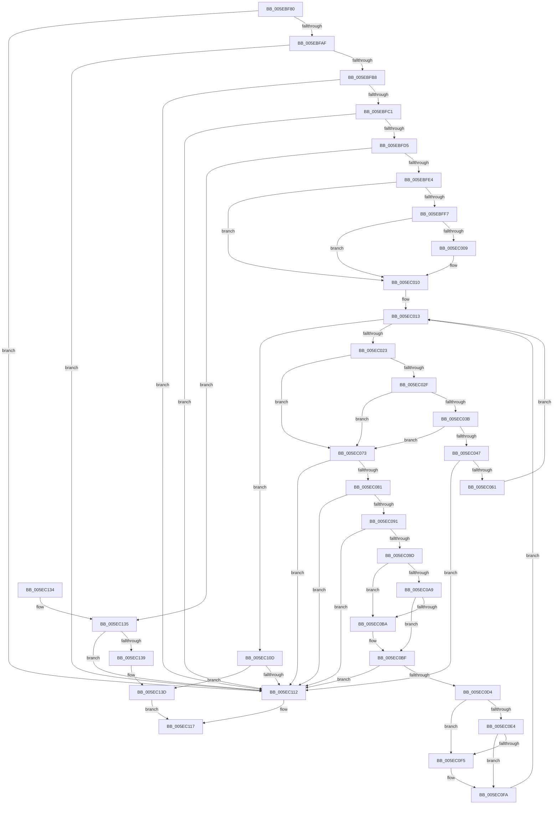

# RtlIpv4StringToAddressExA

- RVA: `0x005EBF80`–`0x005EC149` (길이 `457` bytes)
- VA: `0x00000001405EBF80`
- 실행 섹션: `.text`
- PDB 이름 있음: `예`; PDB Function 태그: `아니요`
- unwind 정보 RVA: `0x000CFD18`
- 디코드: `138`개 명령, `457/457` bytes 표시
- 미해석 바이트: `0` (있으면 어셈블리에 `.byte`로 보존)

> 이 문서는 커널 이미지의 기계어와 PDB 기호를 분석해 생성했습니다. 4번과 5번은 함수 원형과 자료형을 바이너리 사용 방식에서 추정한 C 해석이며 원본 소스 복구 결과는 아닙니다.

## 1. Dependencies

- 직접 호출 지점: **9**; 고유 호출 대상: **5**
- 직접 호출자로 확인된 함수: **0**
- RIP 상대 이미지 참조: **0**

### Outgoing calls
- `0x005EBFC8` → [RtlIpv4StringToAddressA](../49/RtlIpv4StringToAddressA_function_004978D0.md) (function, `0x004978D0`)
- `0x005EC026` → [_isascii](../50/_isascii_function_00500660.md) (function, `0x00500660`)
- `0x005EC032` → [isdigit](../50/isdigit_function_00500680.md) (function, `0x00500680`)
- `0x005EC084` → [_isascii](../50/_isascii_function_00500660.md) (function, `0x00500660`)
- `0x005EC094` → [isxdigit](../50/isxdigit_function_00500770.md) (function, `0x00500770`)
- `0x005EC0A0` → [_isascii](../50/_isascii_function_00500660.md) (function, `0x00500660`)
- `0x005EC0AC` → [islower](../50/islower_function_005006B0.md) (function, `0x005006B0`)
- `0x005EC0DB` → [_isascii](../50/_isascii_function_00500660.md) (function, `0x00500660`)
- `0x005EC0E7` → [islower](../50/islower_function_005006B0.md) (function, `0x005006B0`)

### Direct callers
- 이 함수 시작 RVA로 연결되는 직접 call은 확인되지 않았습니다. 간접 호출은 완전히 역산할 수 없습니다.

### Static image references
- 디코드된 RIP-relative 메모리 참조가 없습니다.

## 2. Other-region calls and transfers

- 다른 실행 섹션으로 향하는 call: **0**
- 별도 외부 분기/꼬리 이동을 확인하지 못했습니다.

## 3. Assembly (complete function range)

```asm
005EBF80  48 8B C4                        mov rax, rsp
005EBF83  48 89 58 10                     mov qword ptr [rax + 0x10], rbx
005EBF87  48 89 68 18                     mov qword ptr [rax + 0x18], rbp
005EBF8B  48 89 70 20                     mov qword ptr [rax + 0x20], rsi
005EBF8F  57                              push rdi
005EBF90  41 54                           push r12
005EBF92  41 55                           push r13
005EBF94  41 56                           push r14
005EBF96  41 57                           push r15
005EBF98  48 83 EC 20                     sub rsp, 0x20
005EBF9C  45 33 ED                        xor r13d, r13d
005EBF9F  4D 8B F9                        mov r15, r9
005EBFA2  4C 89 68 08                     mov qword ptr [rax + 8], r13
005EBFA6  48 85 C9                        test rcx, rcx
005EBFA9  0F 84 63 01 00 00               je 0x1405ec112
005EBFAF  4D 85 C0                        test r8, r8
005EBFB2  0F 84 5A 01 00 00               je 0x1405ec112
005EBFB8  4D 85 C9                        test r9, r9
005EBFBB  0F 84 51 01 00 00               je 0x1405ec112
005EBFC1  4D 8B C8                        mov r9, r8
005EBFC4  4C 8D 40 08                     lea r8, [rax + 8]
005EBFC8  E8 03 B9 EA FF                  call 0x1404978d0
005EBFCD  85 C0                           test eax, eax
005EBFCF  0F 88 3D 01 00 00               js 0x1405ec112
005EBFD5  48 8B 7C 24 50                  mov rdi, qword ptr [rsp + 0x50]
005EBFDA  8A 07                           mov al, byte ptr [rdi]
005EBFDC  3C 3A                           cmp al, 0x3a
005EBFDE  0F 85 51 01 00 00               jne 0x1405ec135
005EBFE4  48 FF C7                        inc rdi
005EBFE7  41 8D 6D 0A                     lea ebp, [r13 + 0xa]
005EBFEB  41 0F B7 DD                     movzx ebx, r13w
005EBFEF  8D 55 06                        lea edx, [rbp + 6]
005EBFF2  80 3F 30                        cmp byte ptr [rdi], 0x30
005EBFF5  75 19                           jne 0x1405ec010
005EBFF7  48 8D 4F 01                     lea rcx, [rdi + 1]
005EBFFB  8A 01                           mov al, byte ptr [rcx]
005EBFFD  8D 6A F8                        lea ebp, [rdx - 8]
005EC000  2C 58                           sub al, 0x58
005EC002  48 8B F9                        mov rdi, rcx
005EC005  A8 DF                           test al, 0xdf
005EC007  75 07                           jne 0x1405ec010
005EC009  0F B7 EA                        movzx ebp, dx
005EC00C  48 8D 79 01                     lea rdi, [rcx + 1]
005EC010  44 8A 27                        mov r12b, byte ptr [rdi]
005EC013  44 0F BE 37                     movsx r14d, byte ptr [rdi]
005EC017  48 FF C7                        inc rdi
005EC01A  45 84 F6                        test r14b, r14b
005EC01D  0F 84 EA 00 00 00               je 0x1405ec10d
005EC023  41 8B CE                        mov ecx, r14d
005EC026  E8 35 46 F1 FF                  call 0x140500660
005EC02B  85 C0                           test eax, eax
005EC02D  74 44                           je 0x1405ec073
005EC02F  41 8B CE                        mov ecx, r14d
005EC032  E8 49 46 F1 FF                  call 0x140500680
005EC037  85 C0                           test eax, eax
005EC039  74 38                           je 0x1405ec073
005EC03B  41 0F B7 D6                     movzx edx, r14w
005EC03F  8D 42 D0                        lea eax, [rdx - 0x30]
005EC042  66 3B C5                        cmp ax, bp
005EC045  73 2C                           jae 0x1405ec073
005EC047  0F B7 CD                        movzx ecx, bp
005EC04A  0F B7 C3                        movzx eax, bx
005EC04D  0F AF C1                        imul eax, ecx
005EC050  83 C0 D0                        add eax, -0x30
005EC053  41 03 C6                        add eax, r14d
005EC056  3D FF FF 00 00                  cmp eax, 0xffff
005EC05B  0F 87 B1 00 00 00               ja 0x1405ec112
005EC061  0F B7 C3                        movzx eax, bx
005EC064  0F B7 DD                        movzx ebx, bp
005EC067  0F AF D8                        imul ebx, eax
005EC06A  66 83 EB 30                     sub bx, 0x30
005EC06E  66 03 DA                        add bx, dx
005EC071  EB A0                           jmp 0x1405ec013
005EC073  B8 10 00 00 00                  mov eax, 0x10
005EC078  66 3B E8                        cmp bp, ax
005EC07B  0F 85 91 00 00 00               jne 0x1405ec112
005EC081  41 8B CE                        mov ecx, r14d
005EC084  E8 D7 45 F1 FF                  call 0x140500660
005EC089  85 C0                           test eax, eax
005EC08B  0F 84 81 00 00 00               je 0x1405ec112
005EC091  41 8B CE                        mov ecx, r14d
005EC094  E8 D7 46 F1 FF                  call 0x140500770
005EC099  85 C0                           test eax, eax
005EC09B  74 75                           je 0x1405ec112
005EC09D  41 8B CE                        mov ecx, r14d
005EC0A0  E8 BB 45 F1 FF                  call 0x140500660
005EC0A5  85 C0                           test eax, eax
005EC0A7  74 11                           je 0x1405ec0ba
005EC0A9  41 8B CE                        mov ecx, r14d
005EC0AC  E8 FF 45 F1 FF                  call 0x1405006b0
005EC0B1  B9 61 00 00 00                  mov ecx, 0x61
005EC0B6  85 C0                           test eax, eax
005EC0B8  75 05                           jne 0x1405ec0bf
005EC0BA  B9 41 00 00 00                  mov ecx, 0x41
005EC0BF  0F B7 C3                        movzx eax, bx
005EC0C2  C1 E0 04                        shl eax, 4
005EC0C5  2B C1                           sub eax, ecx
005EC0C7  83 C0 0A                        add eax, 0xa
005EC0CA  41 03 C6                        add eax, r14d
005EC0CD  3D FF FF 00 00                  cmp eax, 0xffff
005EC0D2  77 3E                           ja 0x1405ec112
005EC0D4  41 8B CE                        mov ecx, r14d
005EC0D7  66 C1 E3 04                     shl bx, 4
005EC0DB  E8 80 45 F1 FF                  call 0x140500660
005EC0E0  85 C0                           test eax, eax
005EC0E2  74 11                           je 0x1405ec0f5
005EC0E4  41 8B CE                        mov ecx, r14d
005EC0E7  E8 C4 45 F1 FF                  call 0x1405006b0
005EC0EC  B9 61 00 00 00                  mov ecx, 0x61
005EC0F1  85 C0                           test eax, eax
005EC0F3  75 05                           jne 0x1405ec0fa
005EC0F5  B9 41 00 00 00                  mov ecx, 0x41
005EC0FA  41 0F B7 C6                     movzx eax, r14w
005EC0FE  66 2B C1                        sub ax, cx
005EC101  66 83 C0 0A                     add ax, 0xa
005EC105  66 03 D8                        add bx, ax
005EC108  E9 06 FF FF FF                  jmp 0x1405ec013
005EC10D  45 84 E4                        test r12b, r12b
005EC110  75 2B                           jne 0x1405ec13d
005EC112  B8 0D 00 00 C0                  mov eax, 0xc000000d
005EC117  48 8B 5C 24 58                  mov rbx, qword ptr [rsp + 0x58]
005EC11C  48 8B 6C 24 60                  mov rbp, qword ptr [rsp + 0x60]
005EC121  48 8B 74 24 68                  mov rsi, qword ptr [rsp + 0x68]
005EC126  48 83 C4 20                     add rsp, 0x20
005EC12A  41 5F                           pop r15
005EC12C  41 5E                           pop r14
005EC12E  41 5D                           pop r13
005EC130  41 5C                           pop r12
005EC132  5F                              pop rdi
005EC133  C3                              ret
005EC134  CC                              int3
005EC135  84 C0                           test al, al
005EC137  75 D9                           jne 0x1405ec112
005EC139  41 0F B7 DD                     movzx ebx, r13w
005EC13D  66 C1 CB 08                     ror bx, 8
005EC141  66 41 89 1F                     mov word ptr [r15], bx
005EC145  33 C0                           xor eax, eax
005EC147  EB CE                           jmp 0x1405ec117
```

## 4. C-style interpretation (structured pseudocode)

```c
__int64 __fastcall RtlIpv4StringToAddressExA(__int64 a1, __int64 a2, __int64 a3, __int64 a4)
{
    __int64 result;
    __int64 v_r13;
    __int64 v_rbp;
    __int64 v_rbx;
    __int64 v_rdi;
    __int64 v_rsp;
    unsigned __int64 v_stack_p10;
    unsigned __int64 v_stack_p18;
    unsigned __int64 v_stack_p20;
    unsigned __int64 v_stack_p8;

    *(unsigned __int64 *)(v_rsp + 16) = v_rbx;
    *(unsigned __int64 *)(v_rsp + 24) = v_rbp;
    *(unsigned __int64 *)(v_rsp + 32) = v_rsi;
    v_rsp = (v_rsp) - (32);
    v_r13 = 0;
    *(unsigned __int64 *)(v_rsp + 8) = 0;
    if (a1 == 0) goto loc_005EC112;
    if (a3 == 0) goto loc_005EC112;
    if (a4 == 0) goto loc_005EC112;
    result = RtlIpv4StringToAddressA(a1, a2, v_rsp + 8, a3);
    if (sign_flag) goto loc_005EC112;
    if (((unsigned __int8)(*(unsigned __int8 *)(v_stack_p8))) != 58) goto loc_005EC135;
    v_rdi = (v_stack_p8) + 1;
    if ((*(unsigned __int8 *)(v_rdi)) != 48) goto loc_005EC010;
    result = (unsigned __int8)((*(unsigned __int8 *)(v_rdi + 1)) - (88));
    v_rdi = v_rdi + 1;
    v_rbp = v_r13 + 10 + 6 - 8;
    if ((((unsigned __int8)(result)) & (223)) == 0) {
        v_rbp = (unsigned __int16)(v_r13 + 10 + 6);
        v_rdi = v_rdi + 1 + 1;
    }
loc_005EC013:
    v_rdi = (v_rdi) + 1;
    if ((unsigned __int8)((__int8)(*(unsigned __int8 *)(v_rdi))) == 0) goto loc_005EC10D;
    result = _isascii((unsigned int)((unsigned int)((__int8)(*(unsigned __int8 *)(v_rdi)))), v_r13 + 10 + 6, v_rsp + 8, a3);
    if ((unsigned int)(result) == 0) goto loc_005EC073;
    result = isdigit((unsigned int)((unsigned int)((__int8)(*(unsigned __int8 *)(v_rdi)))), v_r13 + 10 + 6, v_rsp + 8, a3);
    if ((unsigned int)(result) == 0) goto loc_005EC073;
    if (((unsigned __int16)((unsigned __int16)((__int8)(*(unsigned __int8 *)(v_rdi))) - 48)) >= ((unsigned __int16)(v_rbp))) goto loc_005EC073;
    result = (unsigned int)((0) * ((unsigned int)((unsigned __int16)(v_rbp))));
    result = (unsigned int)((result) + (-48));
    result = (unsigned int)((result) + ((unsigned int)((__int8)(*(unsigned __int8 *)(v_rdi)))));
    if (((unsigned int)(result)) > 0xFFFFULL) goto loc_005EC112;
    v_rbx = (unsigned int)(((unsigned __int16)(v_rbp)) * (0));
    v_rbx = (unsigned __int16)((v_rbx) - (48));
    v_rbx = (unsigned __int16)((v_rbx) + ((unsigned __int16)((unsigned __int16)((__int8)(*(unsigned __int8 *)(v_rdi))))));
    goto loc_005EC013;
loc_005EC073:
    if (((unsigned __int16)(v_rbp)) != 16) goto loc_005EC112;
    result = _isascii((unsigned int)((unsigned int)((__int8)(*(unsigned __int8 *)(v_rdi)))), (unsigned __int16)((__int8)(*(unsigned __int8 *)(v_rdi))), v_rsp + 8, a3);
    if ((unsigned int)(result) == 0) goto loc_005EC112;
    result = isxdigit((unsigned int)((unsigned int)((__int8)(*(unsigned __int8 *)(v_rdi)))), (unsigned __int16)((__int8)(*(unsigned __int8 *)(v_rdi))), v_rsp + 8, a3);
    if ((unsigned int)(result) == 0) goto loc_005EC112;
    result = _isascii((unsigned int)((unsigned int)((__int8)(*(unsigned __int8 *)(v_rdi)))), (unsigned __int16)((__int8)(*(unsigned __int8 *)(v_rdi))), v_rsp + 8, a3);
    if ((unsigned int)(result) == 0) goto loc_005EC0BA;
    result = islower((unsigned int)((unsigned int)((__int8)(*(unsigned __int8 *)(v_rdi)))), (unsigned __int16)((__int8)(*(unsigned __int8 *)(v_rdi))), v_rsp + 8, a3);
    if ((unsigned int)(result) == 0) {
        a1 = 65;
    }
    result = (unsigned int)(((unsigned __int16)(v_rbx)) << (4));
    result = (unsigned int)((result) - ((unsigned int)(a1)));
    result = (unsigned int)((result) + (10));
    result = (unsigned int)((result) + ((unsigned int)((__int8)(*(unsigned __int8 *)(v_rdi)))));
    if (((unsigned int)(result)) > 0xFFFFULL) goto loc_005EC112;
    v_rbx = (unsigned __int16)((v_rbx) << (4));
    result = _isascii((unsigned int)((unsigned int)((__int8)(*(unsigned __int8 *)(v_rdi)))), (unsigned __int16)((__int8)(*(unsigned __int8 *)(v_rdi))), v_rsp + 8, a3);
    if ((unsigned int)(result) == 0) goto loc_005EC0F5;
    result = islower((unsigned int)((unsigned int)((__int8)(*(unsigned __int8 *)(v_rdi)))), (unsigned __int16)((__int8)(*(unsigned __int8 *)(v_rdi))), v_rsp + 8, a3);
    if ((unsigned int)(result) == 0) {
        a1 = 65;
    }
    result = (unsigned __int16)(((unsigned __int16)((__int8)(*(unsigned __int8 *)(v_rdi)))) - ((unsigned __int16)(a1)));
    result = (unsigned __int16)((result) + (10));
    v_rbx = (unsigned __int16)((v_rbx) + ((unsigned __int16)(result)));
    goto loc_005EC013;
loc_005EC10D:
    if ((unsigned __int8)(*(unsigned __int8 *)(v_rdi)) != 0) goto loc_005EC13D;
loc_005EC112:
loc_005EC117:
    v_rsp = (v_rsp) + (32);
    return (unsigned int)(0xC000000DULL);
loc_005EC135:
    if ((unsigned __int8)((unsigned int)(0xC000000DULL)) != 0) goto loc_005EC112;
loc_005EC13D:
    *(unsigned __int16 *)(a4) = 0;
    result = 0;
    goto loc_005EC117;
}
```

## 5. (Beta) C Style

```c
int64_t RtlIpv4StringToAddressExA(int64_t Arg1, int64_t Arg2, int64_t Arg3, void *Arg4)
{
    uint8_t *arg4 = (uint8_t *)Arg4;

    int64_t result;
    int64_t local_r13;
    int64_t local_rbp;
    int64_t local_rbx;
    int64_t local_rdi;
    int64_t local_rsp;
    uint64_t v_stack_p10;
    uint64_t v_stack_p18;
    uint64_t v_stack_p20;
    uint64_t v_stack_p8;

    *(uint64_t *)(local_rsp + 0x10) = local_rbx;
    *(uint64_t *)(local_rsp + 0x18) = local_rbp;
    *(uint64_t *)(local_rsp + 0x20) = local_rsi;
    local_rsp = (local_rsp) - (32);
    local_r13 = 0;
    *(uint64_t *)(local_rsp + 0x8) = 0;
    if (Arg1 == 0) goto loc_005EC112;
    if (Arg3 == 0) goto loc_005EC112;
    if (Arg4 == NULL) goto loc_005EC112;
    result = RtlIpv4StringToAddressA(Arg1, Arg2, local_rsp + 8, Arg3);
    if (sign_flag) goto loc_005EC112;
    if (((uint8_t)(*(uint8_t *)(v_stack_p8))) != 58) goto loc_005EC135;
    local_rdi = (v_stack_p8) + 1;
    if ((*(uint8_t *)(local_rdi)) != 48) goto loc_005EC010;
    result = (uint8_t)((*(uint8_t *)(local_rdi + 0x1)) - (88));
    local_rdi = local_rdi + 1;
    local_rbp = local_r13 + 10 + 6 - 8;
    if ((((uint8_t)(result)) & (223)) == 0) {
        local_rbp = (uint16_t)(local_r13 + 10 + 6);
        local_rdi = local_rdi + 1 + 1;
    }
loc_005EC013:
    local_rdi = (local_rdi) + 1;
    if ((uint8_t)((int8_t)(*(uint8_t *)(local_rdi))) == 0) goto loc_005EC10D;
    result = _isascii((uint32_t)((uint32_t)((int8_t)(*(uint8_t *)(local_rdi)))), local_r13 + 10 + 6, local_rsp + 8, Arg3);
    if ((uint32_t)(result) == 0) goto loc_005EC073;
    result = isdigit((uint32_t)((uint32_t)((int8_t)(*(uint8_t *)(local_rdi)))), local_r13 + 10 + 6, local_rsp + 8, Arg3);
    if ((uint32_t)(result) == 0) goto loc_005EC073;
    if (((uint16_t)((uint16_t)((int8_t)(*(uint8_t *)(local_rdi))) - 48)) >= ((uint16_t)(local_rbp))) goto loc_005EC073;
    result = (uint32_t)((0) * ((uint32_t)((uint16_t)(local_rbp))));
    result = (uint32_t)((result) + (-48));
    result = (uint32_t)((result) + ((uint32_t)((int8_t)(*(uint8_t *)(local_rdi)))));
    if (((uint32_t)(result)) > 0xFFFFULL) goto loc_005EC112;
    local_rbx = (uint32_t)(((uint16_t)(local_rbp)) * (0));
    local_rbx = (uint16_t)((local_rbx) - (48));
    local_rbx = (uint16_t)((local_rbx) + ((uint16_t)((uint16_t)((int8_t)(*(uint8_t *)(local_rdi))))));
    goto loc_005EC013;
loc_005EC073:
    if (((uint16_t)(local_rbp)) != 16) goto loc_005EC112;
    result = _isascii((uint32_t)((uint32_t)((int8_t)(*(uint8_t *)(local_rdi)))), (uint16_t)((int8_t)(*(uint8_t *)(local_rdi))), local_rsp + 8, Arg3);
    if ((uint32_t)(result) == 0) goto loc_005EC112;
    result = isxdigit((uint32_t)((uint32_t)((int8_t)(*(uint8_t *)(local_rdi)))), (uint16_t)((int8_t)(*(uint8_t *)(local_rdi))), local_rsp + 8, Arg3);
    if ((uint32_t)(result) == 0) goto loc_005EC112;
    result = _isascii((uint32_t)((uint32_t)((int8_t)(*(uint8_t *)(local_rdi)))), (uint16_t)((int8_t)(*(uint8_t *)(local_rdi))), local_rsp + 8, Arg3);
    if ((uint32_t)(result) == 0) goto loc_005EC0BA;
    result = islower((uint32_t)((uint32_t)((int8_t)(*(uint8_t *)(local_rdi)))), (uint16_t)((int8_t)(*(uint8_t *)(local_rdi))), local_rsp + 8, Arg3);
    if ((uint32_t)(result) == 0) {
        Arg1 = 65;
    }
    result = (uint32_t)(((uint16_t)(local_rbx)) << (4));
    result = (uint32_t)((result) - ((uint32_t)(Arg1)));
    result = (uint32_t)((result) + (10));
    result = (uint32_t)((result) + ((uint32_t)((int8_t)(*(uint8_t *)(local_rdi)))));
    if (((uint32_t)(result)) > 0xFFFFULL) goto loc_005EC112;
    local_rbx = (uint16_t)((local_rbx) << (4));
    result = _isascii((uint32_t)((uint32_t)((int8_t)(*(uint8_t *)(local_rdi)))), (uint16_t)((int8_t)(*(uint8_t *)(local_rdi))), local_rsp + 8, Arg3);
    if ((uint32_t)(result) == 0) goto loc_005EC0F5;
    result = islower((uint32_t)((uint32_t)((int8_t)(*(uint8_t *)(local_rdi)))), (uint16_t)((int8_t)(*(uint8_t *)(local_rdi))), local_rsp + 8, Arg3);
    if ((uint32_t)(result) == 0) {
        Arg1 = 65;
    }
    result = (uint16_t)(((uint16_t)((int8_t)(*(uint8_t *)(local_rdi)))) - ((uint16_t)(Arg1)));
    result = (uint16_t)((result) + (10));
    local_rbx = (uint16_t)((local_rbx) + ((uint16_t)(result)));
    goto loc_005EC013;
loc_005EC10D:
    if ((uint8_t)(*(uint8_t *)(local_rdi)) != 0) goto loc_005EC13D;
loc_005EC112:
loc_005EC117:
    local_rsp = (local_rsp) + (32);
    return (uint32_t)(0xC000000DULL);
loc_005EC135:
    if ((uint8_t)((uint32_t)(0xC000000DULL)) != 0) goto loc_005EC112;
loc_005EC13D:
    *(uint16_t *)(arg4) = 0;
    result = 0;
    goto loc_005EC117;
}
```

### 관측된 메모리 오프셋

구조체 형식이 확인되지 않은 접근은 인자 기준의 오프셋으로만 기록했습니다.

| 기준 인자 | 오프셋 표현 | 폭 (bit) | 접근 |
|---|---:|---:|---|
| `Arg4` | `+ 0x0` | `16` | `W` |

## 6. Execution-region graph

[열기: 2D/3D 그래프와 함수 탐색 컨트롤 패널](../../../control-panel.html?section=text&rva=0x005EBF80&view=graph)

- 2D 그래프는 위에서 아래로 흐르고, 3D 그래프는 빈 공간을 드래그해 회전합니다. Shift+드래그는 이동, 휠은 확대·축소, 함수 노드 선택은 대상 보고서 이동입니다.

### Static fallback


