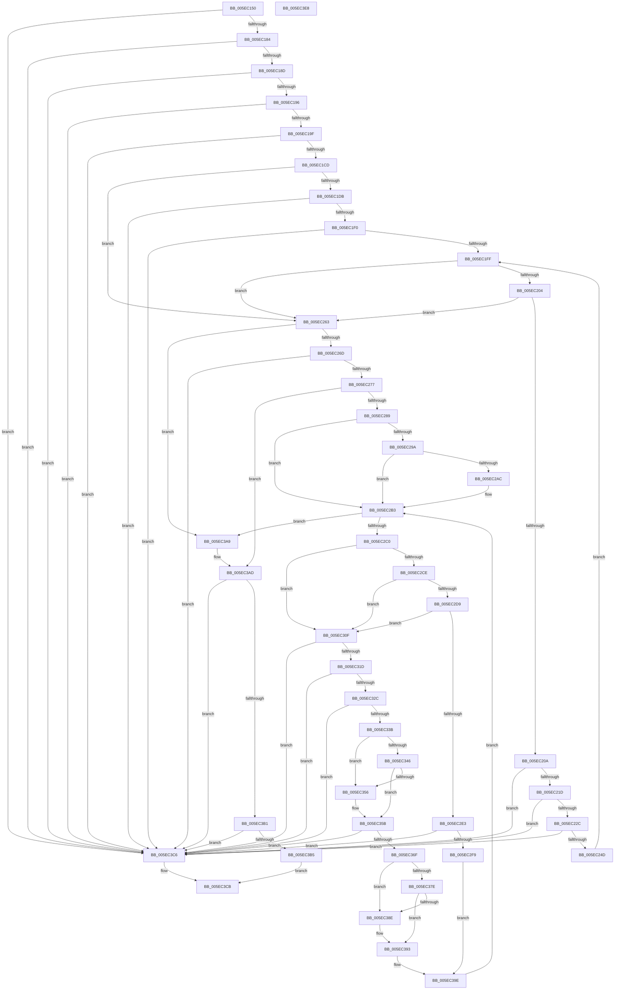

# RtlIpv6StringToAddressExA

- RVA: `0x005EC150`–`0x005EC3E9` (길이 `665` bytes)
- VA: `0x00000001405EC150`
- 실행 섹션: `.text`
- PDB 이름 있음: `예`; PDB Function 태그: `아니요`
- unwind 정보 RVA: `0x0008C2BC`
- 디코드: `196`개 명령, `665/665` bytes 표시
- 미해석 바이트: `0` (있으면 어셈블리에 `.byte`로 보존)

> 이 문서는 커널 이미지의 기계어와 PDB 기호를 분석해 생성했습니다. 4번과 5번은 함수 원형과 자료형을 바이너리 사용 방식에서 추정한 C 해석이며 원본 소스 복구 결과는 아닙니다.

## 1. Dependencies

- 직접 호출 지점: **13**; 고유 호출 대상: **5**
- 직접 호출자로 확인된 함수: **0**
- RIP 상대 이미지 참조: **0**

### Outgoing calls
- `0x005EC1C0` → [RtlIpv6StringToAddressA](../4A/RtlIpv6StringToAddressA_function_004A6BD0.md) (function, `0x004A6BD0`)
- `0x005EC1E3` → [_isascii](../50/_isascii_function_00500660.md) (function, `0x00500660`)
- `0x005EC1F2` → [isdigit](../50/isdigit_function_00500680.md) (function, `0x00500680`)
- `0x005EC210` → [_isascii](../50/_isascii_function_00500660.md) (function, `0x00500660`)
- `0x005EC21F` → [isdigit](../50/isdigit_function_00500680.md) (function, `0x00500680`)
- `0x005EC2C5` → [_isascii](../50/_isascii_function_00500660.md) (function, `0x00500660`)
- `0x005EC2D0` → [isdigit](../50/isdigit_function_00500680.md) (function, `0x00500680`)
- `0x005EC31F` → [_isascii](../50/_isascii_function_00500660.md) (function, `0x00500660`)
- `0x005EC32E` → [isxdigit](../50/isxdigit_function_00500770.md) (function, `0x00500770`)
- `0x005EC33D` → [_isascii](../50/_isascii_function_00500660.md) (function, `0x00500660`)
- `0x005EC348` → [islower](../50/islower_function_005006B0.md) (function, `0x005006B0`)
- `0x005EC375` → [_isascii](../50/_isascii_function_00500660.md) (function, `0x00500660`)
- `0x005EC380` → [islower](../50/islower_function_005006B0.md) (function, `0x005006B0`)

### Direct callers
- 이 함수 시작 RVA로 연결되는 직접 call은 확인되지 않았습니다. 간접 호출은 완전히 역산할 수 없습니다.

### Static image references
- 디코드된 RIP-relative 메모리 참조가 없습니다.

## 2. Other-region calls and transfers

- 다른 실행 섹션으로 향하는 call: **0**
- 별도 외부 분기/꼬리 이동을 확인하지 못했습니다.

## 3. Assembly (complete function range)

```asm
005EC150  4C 8B DC                        mov r11, rsp
005EC153  49 89 5B 10                     mov qword ptr [r11 + 0x10], rbx
005EC157  49 89 6B 18                     mov qword ptr [r11 + 0x18], rbp
005EC15B  49 89 73 20                     mov qword ptr [r11 + 0x20], rsi
005EC15F  57                              push rdi
005EC160  41 54                           push r12
005EC162  41 55                           push r13
005EC164  41 56                           push r14
005EC166  41 57                           push r15
005EC168  48 83 EC 30                     sub rsp, 0x30
005EC16C  33 ED                           xor ebp, ebp
005EC16E  4D 8B E1                        mov r12, r9
005EC171  49 89 6B C8                     mov qword ptr [r11 - 0x38], rbp
005EC175  4D 8B E8                        mov r13, r8
005EC178  48 8B C1                        mov rax, rcx
005EC17B  48 85 C9                        test rcx, rcx
005EC17E  0F 84 42 02 00 00               je 0x1405ec3c6
005EC184  48 85 D2                        test rdx, rdx
005EC187  0F 84 39 02 00 00               je 0x1405ec3c6
005EC18D  4D 85 C0                        test r8, r8
005EC190  0F 84 30 02 00 00               je 0x1405ec3c6
005EC196  4D 85 C9                        test r9, r9
005EC199  0F 84 27 02 00 00               je 0x1405ec3c6
005EC19F  44 8A 31                        mov r14b, byte ptr [rcx]
005EC1A2  4C 8B C2                        mov r8, rdx
005EC1A5  41 80 FE 5B                     cmp r14b, 0x5b
005EC1A9  48 8D 49 01                     lea rcx, [rcx + 1]
005EC1AD  49 8D 53 C8                     lea rdx, [r11 - 0x38]
005EC1B1  0F B7 F5                        movzx esi, bp
005EC1B4  48 0F 45 C8                     cmovne rcx, rax
005EC1B8  44 8B FD                        mov r15d, ebp
005EC1BB  0F 94 44 24 60                  sete byte ptr [rsp + 0x60]
005EC1C0  E8 0B AA EB FF                  call 0x1404a6bd0
005EC1C5  85 C0                           test eax, eax
005EC1C7  0F 88 F9 01 00 00               js 0x1405ec3c6
005EC1CD  48 8B 5C 24 20                  mov rbx, qword ptr [rsp + 0x20]
005EC1D2  80 3B 25                        cmp byte ptr [rbx], 0x25
005EC1D5  0F 85 88 00 00 00               jne 0x1405ec263
005EC1DB  48 FF C3                        inc rbx
005EC1DE  0F BE 3B                        movsx edi, byte ptr [rbx]
005EC1E1  8B CF                           mov ecx, edi
005EC1E3  E8 78 44 F1 FF                  call 0x140500660
005EC1E8  85 C0                           test eax, eax
005EC1EA  0F 84 D6 01 00 00               je 0x1405ec3c6
005EC1F0  8B CF                           mov ecx, edi
005EC1F2  E8 89 44 F1 FF                  call 0x140500680
005EC1F7  85 C0                           test eax, eax
005EC1F9  0F 84 C7 01 00 00               je 0x1405ec3c6
005EC1FF  40 84 FF                        test dil, dil
005EC202  74 5F                           je 0x1405ec263
005EC204  40 80 FF 5D                     cmp dil, 0x5d
005EC208  74 59                           je 0x1405ec263
005EC20A  40 0F BE EF                     movsx ebp, dil
005EC20E  8B CD                           mov ecx, ebp
005EC210  E8 4B 44 F1 FF                  call 0x140500660
005EC215  85 C0                           test eax, eax
005EC217  0F 84 A9 01 00 00               je 0x1405ec3c6
005EC21D  8B CD                           mov ecx, ebp
005EC21F  E8 5C 44 F1 FF                  call 0x140500680
005EC224  85 C0                           test eax, eax
005EC226  0F 84 9A 01 00 00               je 0x1405ec3c6
005EC22C  41 8B C7                        mov eax, r15d
005EC22F  48 8D 14 80                     lea rdx, [rax + rax*4]
005EC233  48 0F BE C7                     movsx rax, dil
005EC237  48 8D 52 E8                     lea rdx, [rdx - 0x18]
005EC23B  48 8D 14 50                     lea rdx, [rax + rdx*2]
005EC23F  B8 FF FF FF FF                  mov eax, 0xffffffff
005EC244  48 3B D0                        cmp rdx, rax
005EC247  0F 87 79 01 00 00               ja 0x1405ec3c6
005EC24D  48 FF C3                        inc rbx
005EC250  43 8D 04 BF                     lea eax, [r15 + r15*4]
005EC254  44 8D 7D D0                     lea r15d, [rbp - 0x30]
005EC258  33 ED                           xor ebp, ebp
005EC25A  45 8D 3C 47                     lea r15d, [r15 + rax*2]
005EC25E  40 8A 3B                        mov dil, byte ptr [rbx]
005EC261  EB 9C                           jmp 0x1405ec1ff
005EC263  8A 03                           mov al, byte ptr [rbx]
005EC265  3C 5D                           cmp al, 0x5d
005EC267  0F 85 3C 01 00 00               jne 0x1405ec3a9
005EC26D  41 80 FE 5B                     cmp r14b, 0x5b
005EC271  0F 85 4F 01 00 00               jne 0x1405ec3c6
005EC277  8A 43 01                        mov al, byte ptr [rbx + 1]
005EC27A  40 8A D5                        mov dl, bpl
005EC27D  88 54 24 60                     mov byte ptr [rsp + 0x60], dl
005EC281  3C 3A                           cmp al, 0x3a
005EC283  0F 85 24 01 00 00               jne 0x1405ec3ad
005EC289  BD 0A 00 00 00                  mov ebp, 0xa
005EC28E  48 8D 7B 02                     lea rdi, [rbx + 2]
005EC292  80 3F 30                        cmp byte ptr [rdi], 0x30
005EC295  8D 55 06                        lea edx, [rbp + 6]
005EC298  75 19                           jne 0x1405ec2b3
005EC29A  48 8D 4F 01                     lea rcx, [rdi + 1]
005EC29E  8A 01                           mov al, byte ptr [rcx]
005EC2A0  8D 6A F8                        lea ebp, [rdx - 8]
005EC2A3  2C 58                           sub al, 0x58
005EC2A5  48 8B F9                        mov rdi, rcx
005EC2A8  A8 DF                           test al, 0xdf
005EC2AA  75 07                           jne 0x1405ec2b3
005EC2AC  0F B7 EA                        movzx ebp, dx
005EC2AF  48 8D 79 01                     lea rdi, [rcx + 1]
005EC2B3  8A 07                           mov al, byte ptr [rdi]
005EC2B5  44 8A F0                        mov r14b, al
005EC2B8  84 C0                           test al, al
005EC2BA  0F 84 E9 00 00 00               je 0x1405ec3a9
005EC2C0  0F BE D8                        movsx ebx, al
005EC2C3  8B CB                           mov ecx, ebx
005EC2C5  E8 96 43 F1 FF                  call 0x140500660
005EC2CA  85 C0                           test eax, eax
005EC2CC  74 41                           je 0x1405ec30f
005EC2CE  8B CB                           mov ecx, ebx
005EC2D0  E8 AB 43 F1 FF                  call 0x140500680
005EC2D5  85 C0                           test eax, eax
005EC2D7  74 36                           je 0x1405ec30f
005EC2D9  0F B7 CD                        movzx ecx, bp
005EC2DC  8D 43 D0                        lea eax, [rbx - 0x30]
005EC2DF  3B C1                           cmp eax, ecx
005EC2E1  7D 2C                           jge 0x1405ec30f
005EC2E3  0F B7 C6                        movzx eax, si
005EC2E6  0F AF C1                        imul eax, ecx
005EC2E9  83 C0 D0                        add eax, -0x30
005EC2EC  03 C3                           add eax, ebx
005EC2EE  3D FF FF 00 00                  cmp eax, 0xffff
005EC2F3  0F 87 CD 00 00 00               ja 0x1405ec3c6
005EC2F9  0F B7 C6                        movzx eax, si
005EC2FC  0F B7 F5                        movzx esi, bp
005EC2FF  0F AF F0                        imul esi, eax
005EC302  41 0F BE C6                     movsx eax, r14b
005EC306  66 83 EE 30                     sub si, 0x30
005EC30A  E9 8F 00 00 00                  jmp 0x1405ec39e
005EC30F  B8 10 00 00 00                  mov eax, 0x10
005EC314  66 3B E8                        cmp bp, ax
005EC317  0F 85 A9 00 00 00               jne 0x1405ec3c6
005EC31D  8B CB                           mov ecx, ebx
005EC31F  E8 3C 43 F1 FF                  call 0x140500660
005EC324  85 C0                           test eax, eax
005EC326  0F 84 9A 00 00 00               je 0x1405ec3c6
005EC32C  8B CB                           mov ecx, ebx
005EC32E  E8 3D 44 F1 FF                  call 0x140500770
005EC333  85 C0                           test eax, eax
005EC335  0F 84 8B 00 00 00               je 0x1405ec3c6
005EC33B  8B CB                           mov ecx, ebx
005EC33D  E8 1E 43 F1 FF                  call 0x140500660
005EC342  85 C0                           test eax, eax
005EC344  74 10                           je 0x1405ec356
005EC346  8B CB                           mov ecx, ebx
005EC348  E8 63 43 F1 FF                  call 0x1405006b0
005EC34D  B9 61 00 00 00                  mov ecx, 0x61
005EC352  85 C0                           test eax, eax
005EC354  75 05                           jne 0x1405ec35b
005EC356  B9 41 00 00 00                  mov ecx, 0x41
005EC35B  0F B7 C6                        movzx eax, si
005EC35E  C1 E0 04                        shl eax, 4
005EC361  2B C1                           sub eax, ecx
005EC363  83 C0 0A                        add eax, 0xa
005EC366  03 C3                           add eax, ebx
005EC368  3D FF FF 00 00                  cmp eax, 0xffff
005EC36D  77 57                           ja 0x1405ec3c6
005EC36F  8B CB                           mov ecx, ebx
005EC371  66 C1 E6 04                     shl si, 4
005EC375  E8 E6 42 F1 FF                  call 0x140500660
005EC37A  85 C0                           test eax, eax
005EC37C  74 10                           je 0x1405ec38e
005EC37E  8B CB                           mov ecx, ebx
005EC380  E8 2B 43 F1 FF                  call 0x1405006b0
005EC385  B9 61 00 00 00                  mov ecx, 0x61
005EC38A  85 C0                           test eax, eax
005EC38C  75 05                           jne 0x1405ec393
005EC38E  B9 41 00 00 00                  mov ecx, 0x41
005EC393  41 0F BE C6                     movsx eax, r14b
005EC397  66 2B C1                        sub ax, cx
005EC39A  66 83 C0 0A                     add ax, 0xa
005EC39E  66 03 F0                        add si, ax
005EC3A1  48 FF C7                        inc rdi
005EC3A4  E9 0A FF FF FF                  jmp 0x1405ec2b3
005EC3A9  8A 54 24 60                     mov dl, byte ptr [rsp + 0x60]
005EC3AD  84 C0                           test al, al
005EC3AF  75 15                           jne 0x1405ec3c6
005EC3B1  84 D2                           test dl, dl
005EC3B3  75 11                           jne 0x1405ec3c6
005EC3B5  66 C1 CE 08                     ror si, 8
005EC3B9  66 41 89 34 24                  mov word ptr [r12], si
005EC3BE  33 C0                           xor eax, eax
005EC3C0  45 89 7D 00                     mov dword ptr [r13], r15d
005EC3C4  EB 05                           jmp 0x1405ec3cb
005EC3C6  B8 0D 00 00 C0                  mov eax, 0xc000000d
005EC3CB  48 8B 5C 24 68                  mov rbx, qword ptr [rsp + 0x68]
005EC3D0  48 8B 6C 24 70                  mov rbp, qword ptr [rsp + 0x70]
005EC3D5  48 8B 74 24 78                  mov rsi, qword ptr [rsp + 0x78]
005EC3DA  48 83 C4 30                     add rsp, 0x30
005EC3DE  41 5F                           pop r15
005EC3E0  41 5E                           pop r14
005EC3E2  41 5D                           pop r13
005EC3E4  41 5C                           pop r12
005EC3E6  5F                              pop rdi
005EC3E7  C3                              ret
005EC3E8  CC                              int3
```

## 4. C-style interpretation (structured pseudocode)

```c
__int64 __fastcall RtlIpv6StringToAddressExA(__int64 a1, __int64 a2, __int64 a3, __int64 a4)
{
    __int64 result;
    __int64 v_rbp;
    __int64 v_rbx;
    __int64 v_rdi;
    __int64 v_rsi;
    __int64 v_rsp;
    unsigned __int64 v_stack_m38;
    unsigned __int64 v_stack_p10;
    unsigned __int64 v_stack_p18;
    unsigned __int64 v_stack_p20;
    unsigned __int8 v_stack_p8;

    *(unsigned __int64 *)(v_rsp + 16) = v_rbx;
    *(unsigned __int64 *)(v_rsp + 24) = v_rbp;
    *(unsigned __int64 *)(v_rsp + 32) = v_rsi;
    v_rsp = (v_rsp) - (48);
    v_rbp = 0;
    *(unsigned __int64 *)(v_rsp - 56) = 0;
    if (a1 == 0) goto loc_005EC3C6;
    if (a2 == 0) goto loc_005EC3C6;
    if (a3 == 0) goto loc_005EC3C6;
    if (a4 == 0) goto loc_005EC3C6;
    a1 = a1 + 1;
    if (((unsigned __int8)(*(unsigned __int8 *)(a1))) != 91) { a1 = a1; }
    result = RtlIpv6StringToAddressA(a1, v_rsp - 56, a2, a4);
    if (sign_flag) goto loc_005EC3C6;
    if ((*(unsigned __int8 *)(v_stack_m38)) != 37) goto loc_005EC263;
    v_rbx = (v_stack_m38) + 1;
    result = _isascii((unsigned int)((unsigned int)((__int8)(*(unsigned __int8 *)(v_rbx)))), v_rsp - 56, a2, a4);
    if ((unsigned int)(result) == 0) goto loc_005EC3C6;
    result = isdigit((unsigned int)((unsigned int)((__int8)(*(unsigned __int8 *)(v_rbx)))), v_rsp - 56, a2, a4);
    if ((unsigned int)(result) == 0) goto loc_005EC3C6;
loc_005EC1FF:
    if ((unsigned __int8)((__int8)(*(unsigned __int8 *)(v_rbx))) == 0) goto loc_005EC263;
    if (((unsigned __int8)((__int8)(*(unsigned __int8 *)(v_rbx)))) == 93) goto loc_005EC263;
    result = _isascii((unsigned int)((unsigned int)((__int8)((unsigned __int8)((__int8)(*(unsigned __int8 *)(v_rbx)))))), v_rsp - 56, a2, a4);
    if ((unsigned int)(result) == 0) goto loc_005EC3C6;
    result = isdigit((unsigned int)((unsigned int)((__int8)((unsigned __int8)((__int8)(*(unsigned __int8 *)(v_rbx)))))), v_rsp - 56, a2, a4);
    if ((unsigned int)(result) == 0) goto loc_005EC3C6;
    if (((__int8)((unsigned __int8)((__int8)(*(unsigned __int8 *)(v_rbx)))) + 0 + 0 * 4 - 24 * 2) > ((unsigned int)(0xFFFFFFFFULL))) goto loc_005EC3C6;
    v_rbx = (v_rbx) + 1;
    v_rbp = 0;
    goto loc_005EC1FF;
loc_005EC263:
    if (((unsigned __int8)(*(unsigned __int8 *)(v_rbx))) != 93) goto loc_005EC3A9;
    if (((unsigned __int8)(*(unsigned __int8 *)(a1))) != 91) goto loc_005EC3C6;
    v_stack_p8 = 0;
    if (((unsigned __int8)(*(unsigned __int8 *)(v_rbx + 1))) != 58) goto loc_005EC3AD;
    if ((*(unsigned __int8 *)(v_rbx + 2)) != 48) goto loc_005EC2B3;
    result = (unsigned __int8)((*(unsigned __int8 *)(v_rbx + 2 + 1)) - (88));
    v_rdi = v_rbx + 2 + 1;
    v_rbp = 10 + 6 - 8;
    if ((((unsigned __int8)(result)) & (223)) == 0) {
        v_rbp = (unsigned __int16)(10 + 6);
        v_rdi = v_rbx + 2 + 1 + 1;
    }
    if ((unsigned __int8)(*(unsigned __int8 *)(v_rdi)) == 0) goto loc_005EC3A9;
    result = _isascii((unsigned int)((unsigned int)((__int8)((unsigned __int8)(*(unsigned __int8 *)(v_rdi))))), 10 + 6, a2, a4);
    if ((unsigned int)(result) == 0) goto loc_005EC30F;
    result = isdigit((unsigned int)((unsigned int)((__int8)((unsigned __int8)(*(unsigned __int8 *)(v_rdi))))), 10 + 6, a2, a4);
    if ((unsigned int)(result) == 0) goto loc_005EC30F;
    if (((unsigned int)((__int8)((unsigned __int8)(*(unsigned __int8 *)(v_rdi))) - 48)) >= ((unsigned int)((unsigned __int16)(v_rbp)))) goto loc_005EC30F;
    result = (unsigned int)((0) * ((unsigned int)((unsigned __int16)(v_rbp))));
    result = (unsigned int)((result) + (-48));
    result = (unsigned int)((result) + ((unsigned int)((__int8)((unsigned __int8)(*(unsigned __int8 *)(v_rdi))))));
    if (((unsigned int)(result)) > 0xFFFFULL) goto loc_005EC3C6;
    v_rsi = (unsigned int)(((unsigned __int16)(v_rbp)) * (0));
    v_rsi = (unsigned __int16)((v_rsi) - (48));
    goto loc_005EC39E;
loc_005EC30F:
    if (((unsigned __int16)(v_rbp)) != 16) goto loc_005EC3C6;
    result = _isascii((unsigned int)((unsigned int)((__int8)((unsigned __int8)(*(unsigned __int8 *)(v_rdi))))), 10 + 6, a2, a4);
    if ((unsigned int)(result) == 0) goto loc_005EC3C6;
    result = isxdigit((unsigned int)((unsigned int)((__int8)((unsigned __int8)(*(unsigned __int8 *)(v_rdi))))), 10 + 6, a2, a4);
    if ((unsigned int)(result) == 0) goto loc_005EC3C6;
    result = _isascii((unsigned int)((unsigned int)((__int8)((unsigned __int8)(*(unsigned __int8 *)(v_rdi))))), 10 + 6, a2, a4);
    if ((unsigned int)(result) == 0) goto loc_005EC356;
    result = islower((unsigned int)((unsigned int)((__int8)((unsigned __int8)(*(unsigned __int8 *)(v_rdi))))), 10 + 6, a2, a4);
    if ((unsigned int)(result) == 0) {
        a1 = 65;
    }
    result = (unsigned int)(((unsigned __int16)(v_rsi)) << (4));
    result = (unsigned int)((result) - ((unsigned int)(a1)));
    result = (unsigned int)((result) + (10));
    result = (unsigned int)((result) + ((unsigned int)((__int8)((unsigned __int8)(*(unsigned __int8 *)(v_rdi))))));
    if (((unsigned int)(result)) > 0xFFFFULL) goto loc_005EC3C6;
    v_rsi = (unsigned __int16)((v_rsi) << (4));
    result = _isascii((unsigned int)((unsigned int)((__int8)((unsigned __int8)(*(unsigned __int8 *)(v_rdi))))), 10 + 6, a2, a4);
    if ((unsigned int)(result) == 0) goto loc_005EC38E;
    result = islower((unsigned int)((unsigned int)((__int8)((unsigned __int8)(*(unsigned __int8 *)(v_rdi))))), 10 + 6, a2, a4);
    if ((unsigned int)(result) == 0) {
        a1 = 65;
    }
    result = (unsigned __int16)(((__int8)((unsigned __int8)((unsigned __int8)(*(unsigned __int8 *)(v_rdi))))) - ((unsigned __int16)(a1)));
    result = (unsigned __int16)((result) + (10));
loc_005EC39E:
    v_rsi = (unsigned __int16)((v_rsi) + ((unsigned __int16)(result)));
    v_rdi = (v_rdi) + 1;
    goto loc_005EC2B3;
loc_005EC3A9:
loc_005EC3AD:
    if ((unsigned __int8)(result) != 0) goto loc_005EC3C6;
    if ((unsigned __int8)(v_stack_p8) != 0) goto loc_005EC3C6;
    *(unsigned __int16 *)(a4) = (unsigned __int16)(v_rsi);
    result = 0;
    *(unsigned int *)(a3) = (unsigned int)((__int8)((unsigned __int8)((__int8)(*(unsigned __int8 *)(v_rbx)))) - 48 + 0 + 0 * 4 * 2);
    goto loc_005EC3CB;
loc_005EC3C6:
loc_005EC3CB:
    v_rsp = (v_rsp) + (48);
    return (unsigned int)(0xC000000DULL);
}
```

## 5. (Beta) C Style

```c
int64_t RtlIpv6StringToAddressExA(int64_t Arg1, int64_t Arg2, void *Arg3, void *Arg4)
{
    uint8_t *arg3 = (uint8_t *)Arg3;
    uint8_t *arg4 = (uint8_t *)Arg4;

    int64_t result;
    int64_t local_rbp;
    int64_t local_rbx;
    int64_t local_rdi;
    int64_t local_rsi;
    int64_t local_rsp;
    uint64_t v_stack_m38;
    uint64_t v_stack_p10;
    uint64_t v_stack_p18;
    uint64_t v_stack_p20;
    uint8_t v_stack_p8;

    *(uint64_t *)(local_rsp + 0x10) = local_rbx;
    *(uint64_t *)(local_rsp + 0x18) = local_rbp;
    *(uint64_t *)(local_rsp + 0x20) = local_rsi;
    local_rsp = (local_rsp) - (48);
    local_rbp = 0;
    *(uint64_t *)(local_rsp - 0x38) = 0;
    if (Arg1 == 0) goto loc_005EC3C6;
    if (Arg2 == 0) goto loc_005EC3C6;
    if (Arg3 == NULL) goto loc_005EC3C6;
    if (Arg4 == NULL) goto loc_005EC3C6;
    Arg1 = Arg1 + 1;
    if (((uint8_t)(*(uint8_t *)(Arg1))) != 91) { Arg1 = Arg1; }
    result = RtlIpv6StringToAddressA(Arg1, local_rsp - 56, Arg2, Arg4);
    if (sign_flag) goto loc_005EC3C6;
    if ((*(uint8_t *)(v_stack_m38)) != 37) goto loc_005EC263;
    local_rbx = (v_stack_m38) + 1;
    result = _isascii((uint32_t)((uint32_t)((int8_t)(*(uint8_t *)(local_rbx)))), local_rsp - 56, Arg2, Arg4);
    if ((uint32_t)(result) == 0) goto loc_005EC3C6;
    result = isdigit((uint32_t)((uint32_t)((int8_t)(*(uint8_t *)(local_rbx)))), local_rsp - 56, Arg2, Arg4);
    if ((uint32_t)(result) == 0) goto loc_005EC3C6;
loc_005EC1FF:
    if ((uint8_t)((int8_t)(*(uint8_t *)(local_rbx))) == 0) goto loc_005EC263;
    if (((uint8_t)((int8_t)(*(uint8_t *)(local_rbx)))) == 93) goto loc_005EC263;
    result = _isascii((uint32_t)((uint32_t)((int8_t)((uint8_t)((int8_t)(*(uint8_t *)(local_rbx)))))), local_rsp - 56, Arg2, Arg4);
    if ((uint32_t)(result) == 0) goto loc_005EC3C6;
    result = isdigit((uint32_t)((uint32_t)((int8_t)((uint8_t)((int8_t)(*(uint8_t *)(local_rbx)))))), local_rsp - 56, Arg2, Arg4);
    if ((uint32_t)(result) == 0) goto loc_005EC3C6;
    if (((int8_t)((uint8_t)((int8_t)(*(uint8_t *)(local_rbx)))) + 0 + 0 * 4 - 24 * 2) > ((uint32_t)(0xFFFFFFFFULL))) goto loc_005EC3C6;
    local_rbx = (local_rbx) + 1;
    local_rbp = 0;
    goto loc_005EC1FF;
loc_005EC263:
    if (((uint8_t)(*(uint8_t *)(local_rbx))) != 93) goto loc_005EC3A9;
    if (((uint8_t)(*(uint8_t *)(Arg1))) != 91) goto loc_005EC3C6;
    v_stack_p8 = 0;
    if (((uint8_t)(*(uint8_t *)(local_rbx + 0x1))) != 58) goto loc_005EC3AD;
    if ((*(uint8_t *)(local_rbx + 0x2)) != 48) goto loc_005EC2B3;
    result = (uint8_t)((*(uint8_t *)(local_rbx + 0x2 + 0x1)) - (88));
    local_rdi = local_rbx + 2 + 1;
    local_rbp = 10 + 6 - 8;
    if ((((uint8_t)(result)) & (223)) == 0) {
        local_rbp = (uint16_t)(10 + 6);
        local_rdi = local_rbx + 2 + 1 + 1;
    }
    if ((uint8_t)(*(uint8_t *)(local_rdi)) == 0) goto loc_005EC3A9;
    result = _isascii((uint32_t)((uint32_t)((int8_t)((uint8_t)(*(uint8_t *)(local_rdi))))), 10 + 6, Arg2, Arg4);
    if ((uint32_t)(result) == 0) goto loc_005EC30F;
    result = isdigit((uint32_t)((uint32_t)((int8_t)((uint8_t)(*(uint8_t *)(local_rdi))))), 10 + 6, Arg2, Arg4);
    if ((uint32_t)(result) == 0) goto loc_005EC30F;
    if (((uint32_t)((int8_t)((uint8_t)(*(uint8_t *)(local_rdi))) - 48)) >= ((uint32_t)((uint16_t)(local_rbp)))) goto loc_005EC30F;
    result = (uint32_t)((0) * ((uint32_t)((uint16_t)(local_rbp))));
    result = (uint32_t)((result) + (-48));
    result = (uint32_t)((result) + ((uint32_t)((int8_t)((uint8_t)(*(uint8_t *)(local_rdi))))));
    if (((uint32_t)(result)) > 0xFFFFULL) goto loc_005EC3C6;
    local_rsi = (uint32_t)(((uint16_t)(local_rbp)) * (0));
    local_rsi = (uint16_t)((local_rsi) - (48));
    goto loc_005EC39E;
loc_005EC30F:
    if (((uint16_t)(local_rbp)) != 16) goto loc_005EC3C6;
    result = _isascii((uint32_t)((uint32_t)((int8_t)((uint8_t)(*(uint8_t *)(local_rdi))))), 10 + 6, Arg2, Arg4);
    if ((uint32_t)(result) == 0) goto loc_005EC3C6;
    result = isxdigit((uint32_t)((uint32_t)((int8_t)((uint8_t)(*(uint8_t *)(local_rdi))))), 10 + 6, Arg2, Arg4);
    if ((uint32_t)(result) == 0) goto loc_005EC3C6;
    result = _isascii((uint32_t)((uint32_t)((int8_t)((uint8_t)(*(uint8_t *)(local_rdi))))), 10 + 6, Arg2, Arg4);
    if ((uint32_t)(result) == 0) goto loc_005EC356;
    result = islower((uint32_t)((uint32_t)((int8_t)((uint8_t)(*(uint8_t *)(local_rdi))))), 10 + 6, Arg2, Arg4);
    if ((uint32_t)(result) == 0) {
        Arg1 = 65;
    }
    result = (uint32_t)(((uint16_t)(local_rsi)) << (4));
    result = (uint32_t)((result) - ((uint32_t)(Arg1)));
    result = (uint32_t)((result) + (10));
    result = (uint32_t)((result) + ((uint32_t)((int8_t)((uint8_t)(*(uint8_t *)(local_rdi))))));
    if (((uint32_t)(result)) > 0xFFFFULL) goto loc_005EC3C6;
    local_rsi = (uint16_t)((local_rsi) << (4));
    result = _isascii((uint32_t)((uint32_t)((int8_t)((uint8_t)(*(uint8_t *)(local_rdi))))), 10 + 6, Arg2, Arg4);
    if ((uint32_t)(result) == 0) goto loc_005EC38E;
    result = islower((uint32_t)((uint32_t)((int8_t)((uint8_t)(*(uint8_t *)(local_rdi))))), 10 + 6, Arg2, Arg4);
    if ((uint32_t)(result) == 0) {
        Arg1 = 65;
    }
    result = (uint16_t)(((int8_t)((uint8_t)((uint8_t)(*(uint8_t *)(local_rdi))))) - ((uint16_t)(Arg1)));
    result = (uint16_t)((result) + (10));
loc_005EC39E:
    local_rsi = (uint16_t)((local_rsi) + ((uint16_t)(result)));
    local_rdi = (local_rdi) + 1;
    goto loc_005EC2B3;
loc_005EC3A9:
loc_005EC3AD:
    if ((uint8_t)(result) != 0) goto loc_005EC3C6;
    if ((uint8_t)(v_stack_p8) != 0) goto loc_005EC3C6;
    *(uint16_t *)(arg4) = (uint16_t)(local_rsi);
    result = 0;
    *(uint32_t *)(arg3) = (uint32_t)((int8_t)((uint8_t)((int8_t)(*(uint8_t *)(local_rbx)))) - 48 + 0 + 0 * 4 * 2);
    goto loc_005EC3CB;
loc_005EC3C6:
loc_005EC3CB:
    local_rsp = (local_rsp) + (48);
    return (uint32_t)(0xC000000DULL);
}
```

### 관측된 메모리 오프셋

구조체 형식이 확인되지 않은 접근은 인자 기준의 오프셋으로만 기록했습니다.

| 기준 인자 | 오프셋 표현 | 폭 (bit) | 접근 |
|---|---:|---:|---|
| `Arg3` | `+ 0x0` | `32` | `W` |
| `Arg4` | `+ 0x0` | `16` | `W` |

## 6. Execution-region graph

[열기: 2D/3D 그래프와 함수 탐색 컨트롤 패널](../../../control-panel.html?section=text&rva=0x005EC150&view=graph)

- 2D 그래프는 위에서 아래로 흐르고, 3D 그래프는 빈 공간을 드래그해 회전합니다. Shift+드래그는 이동, 휠은 확대·축소, 함수 노드 선택은 대상 보고서 이동입니다.

### Static fallback


