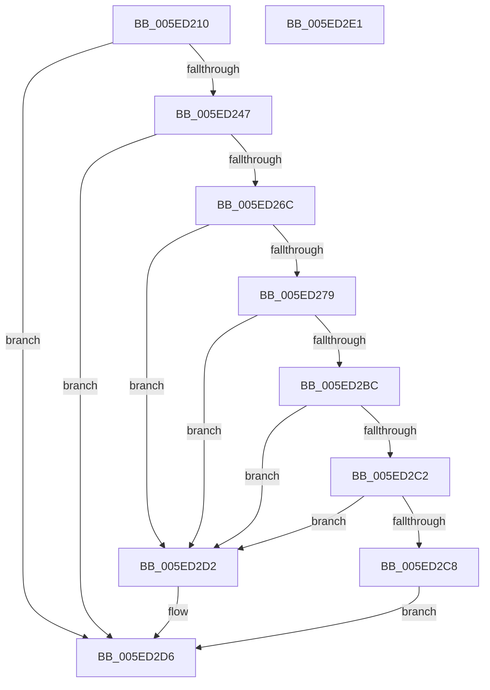

# RtlIsFeatureEnabledForEnterprise

- RVA: `0x005ED210`–`0x005ED2E2` (길이 `210` bytes)
- VA: `0x00000001405ED210`
- 실행 섹션: `.text`
- PDB 이름 있음: `예`; PDB Function 태그: `아니요`
- unwind 정보 RVA: `0x000CFDF4`
- 디코드: `59`개 명령, `210/210` bytes 표시
- 미해석 바이트: `0` (있으면 어셈블리에 `.byte`로 보존)

> 이 문서는 커널 이미지의 기계어와 PDB 기호를 분석해 생성했습니다. 4번과 5번은 함수 원형과 자료형을 바이너리 사용 방식에서 추정한 C 해석이며 원본 소스 복구 결과는 아닙니다.

## 1. Dependencies

- 직접 호출 지점: **4**; 고유 호출 대상: **4**
- 직접 호출자로 확인된 함수: **0**
- RIP 상대 이미지 참조: **3**

### Outgoing calls
- `0x005ED23A` → [RtlpEtcGetDwordFromRegistry](RtlpEtcGetDwordFromRegistry_function_005ED458.md) (function, `0x005ED458`)
- `0x005ED263` → [RtlpEtcIsValidFeatureId](RtlpEtcIsValidFeatureId_function_005ED4D4.md) (function, `0x005ED4D4`)
- `0x005ED270` → [RtlpEcReadPolicyState](RtlpEcReadPolicyState_function_005ED2E8.md) (function, `0x005ED2E8`)
- `0x005ED2B3` → [ZwQueryLicenseValue](../6A/ZwQueryLicenseValue_function_006AFCF0.md) (function, `0x006AFCF0`)

### Direct callers
- 이 함수 시작 RVA로 연결되는 직접 call은 확인되지 않았습니다. 간접 호출은 완전히 역산할 수 없습니다.

### Static image references
- `0x005ED225` → RVA `0x006CCF60` (` ?? ::FNODOBFM::`string'`; read)
- `0x005ED22F` → RVA `0x006CCF80` (` ?? ::FNODOBFM::`string'`; read)
- `0x005ED27D` → RVA `0x006CD080` (` ?? ::FNODOBFM::`string'`; read)

## 2. Other-region calls and transfers

- 다른 실행 섹션으로 향하는 call: **0**
- 별도 외부 분기/꼬리 이동을 확인하지 못했습니다.

## 3. Assembly (complete function range)

```asm
005ED210  40 55                           push rbp
005ED212  53                              push rbx
005ED213  57                              push rdi
005ED214  48 8B EC                        mov rbp, rsp
005ED217  48 83 EC 50                     sub rsp, 0x50
005ED21B  83 65 30 00                     and dword ptr [rbp + 0x30], 0
005ED21F  4C 8D 45 30                     lea r8, [rbp + 0x30]
005ED223  8B D9                           mov ebx, ecx
005ED225  48 8D 15 34 FD 0D 00            lea rdx, [rip + 0xdfd34]
005ED22C  40 B7 01                        mov dil, 1
005ED22F  48 8D 0D 4A FD 0D 00            lea rcx, [rip + 0xdfd4a]
005ED236  40 88 7D 28                     mov byte ptr [rbp + 0x28], dil
005ED23A  E8 19 02 00 00                  call 0x1405ed458
005ED23F  85 C0                           test eax, eax
005ED241  0F 88 8F 00 00 00               js 0x1405ed2d6
005ED247  8B 55 30                        mov edx, dword ptr [rbp + 0x30]
005ED24A  81 F3 4E 1A 16 74               xor ebx, 0x74161a4e
005ED250  0F CB                           bswap ebx
005ED252  81 F3 4F 3D B2 8F               xor ebx, 0x8fb23d4f
005ED258  C1 CB FF                        ror ebx, 0xff
005ED25B  81 F3 FF A8 3E 83               xor ebx, 0x833ea8ff
005ED261  8B CB                           mov ecx, ebx
005ED263  E8 6C 02 00 00                  call 0x1405ed4d4
005ED268  84 C0                           test al, al
005ED26A  74 6A                           je 0x1405ed2d6
005ED26C  48 8D 4D 28                     lea rcx, [rbp + 0x28]
005ED270  E8 73 00 00 00                  call 0x1405ed2e8
005ED275  85 C0                           test eax, eax
005ED277  79 59                           jns 0x1405ed2d2
005ED279  83 65 E0 00                     and dword ptr [rbp - 0x20], 0
005ED27D  48 8D 05 FC FD 0D 00            lea rax, [rip + 0xdfdfc]
005ED284  83 65 38 00                     and dword ptr [rbp + 0x38], 0
005ED288  4C 8D 45 E0                     lea r8, [rbp - 0x20]
005ED28C  83 65 30 00                     and dword ptr [rbp + 0x30], 0
005ED290  48 8D 55 38                     lea rdx, [rbp + 0x38]
005ED294  48 89 45 F0                     mov qword ptr [rbp - 0x10], rax
005ED298  48 8D 4D E8                     lea rcx, [rbp - 0x18]
005ED29C  48 8D 45 30                     lea rax, [rbp + 0x30]
005ED2A0  48 C7 45 E8 44 00 46 00         mov qword ptr [rbp - 0x18], 0x460044
005ED2A8  41 B9 04 00 00 00               mov r9d, 4
005ED2AE  48 89 44 24 20                  mov qword ptr [rsp + 0x20], rax
005ED2B3  E8 38 2A 0C 00                  call 0x1406afcf0
005ED2B8  85 C0                           test eax, eax
005ED2BA  78 16                           js 0x1405ed2d2
005ED2BC  83 7D 30 04                     cmp dword ptr [rbp + 0x30], 4
005ED2C0  75 10                           jne 0x1405ed2d2
005ED2C2  83 7D 38 04                     cmp dword ptr [rbp + 0x38], 4
005ED2C6  75 0A                           jne 0x1405ed2d2
005ED2C8  83 7D E0 00                     cmp dword ptr [rbp - 0x20], 0
005ED2CC  40 0F 94 C7                     sete dil
005ED2D0  EB 04                           jmp 0x1405ed2d6
005ED2D2  40 8A 7D 28                     mov dil, byte ptr [rbp + 0x28]
005ED2D6  40 8A C7                        mov al, dil
005ED2D9  48 83 C4 50                     add rsp, 0x50
005ED2DD  5F                              pop rdi
005ED2DE  5B                              pop rbx
005ED2DF  5D                              pop rbp
005ED2E0  C3                              ret
005ED2E1  CC                              int3
```

## 4. C-style interpretation (structured pseudocode)

```c
__int64 __fastcall RtlIsFeatureEnabledForEnterprise(int a1)
{
    __int64 result;
    __int64 v_rbx;
    __int64 v_rdi;
    __int64 v_rsp;
    unsigned __int64 v_stack_m28;
    unsigned __int64 v_stack_m30;
    unsigned int v_stack_m38;
    unsigned __int64 v_stack_m48;
    unsigned __int8 v_stack_p10;
    unsigned int v_stack_p18;
    unsigned int v_stack_p20;

    v_rsp = (v_rsp) - (80);
    v_stack_p10 = 1;
    result = RtlpEtcGetDwordFromRegistry(v_rip + 916810, v_rip + 916788, v_stack_p18, a4);
    if (sign_flag) goto loc_005ED2D6;
    v_rbx = (unsigned int)(((unsigned int)(a1)) ^ (0x74161A4EULL));
    v_rbx = (unsigned int)((v_rbx) ^ (0x8FB23D4FULL));
    v_rbx = (unsigned int)((v_rbx) ^ (0x833EA8FFULL));
    result = RtlpEtcIsValidFeatureId((unsigned int)((unsigned int)(v_rbx)), (unsigned int)(v_stack_p18), v_stack_p18, a4);
    if ((unsigned __int8)(result) == 0) goto loc_005ED2D6;
    result = RtlpEcReadPolicyState(v_stack_p10, (unsigned int)(v_stack_p18), v_stack_p18, a4);
    if (!sign_flag) goto loc_005ED2D2;
    v_stack_m28 = v_rip + 916988;
    v_stack_m30 = 0x460044ULL;
    v_stack_m48 = v_stack_p18;
    result = ZwQueryLicenseValue(v_stack_m30, v_stack_p20, v_stack_m38, 4);
    if (sign_flag) goto loc_005ED2D2;
    if (v_stack_p18 != 4) goto loc_005ED2D2;
    if (v_stack_p20 != 4) goto loc_005ED2D2;
    v_rdi = (v_stack_m38 == 0) ? 1 : 0;
    goto loc_005ED2D6;
loc_005ED2D2:
loc_005ED2D6:
    v_rsp = (v_rsp) + (80);
    return (unsigned __int8)(v_stack_p10);
}
```

## 5. (Beta) C Style

```c
int64_t RtlIsFeatureEnabledForEnterprise(int32_t Arg1)
{
    int64_t result;
    int64_t local_rbx;
    int64_t local_rdi;
    int64_t local_rsp;
    uint64_t v_stack_m28;
    uint64_t v_stack_m30;
    uint32_t v_stack_m38;
    uint64_t v_stack_m48;
    uint8_t v_stack_p10;
    uint32_t v_stack_p18;
    uint32_t v_stack_p20;

    local_rsp = (local_rsp) - (80);
    v_stack_p10 = 1;
    result = RtlpEtcGetDwordFromRegistry(v_rip + 916810, v_rip + 916788, v_stack_p18, a4);
    if (sign_flag) goto loc_005ED2D6;
    local_rbx = (uint32_t)(((uint32_t)(Arg1)) ^ (0x74161A4EULL));
    local_rbx = (uint32_t)((local_rbx) ^ (0x8FB23D4FULL));
    local_rbx = (uint32_t)((local_rbx) ^ (0x833EA8FFULL));
    result = RtlpEtcIsValidFeatureId((uint32_t)((uint32_t)(local_rbx)), (uint32_t)(v_stack_p18), v_stack_p18, a4);
    if ((uint8_t)(result) == 0) goto loc_005ED2D6;
    result = RtlpEcReadPolicyState(v_stack_p10, (uint32_t)(v_stack_p18), v_stack_p18, a4);
    if (!sign_flag) goto loc_005ED2D2;
    v_stack_m28 = v_rip + 916988;
    v_stack_m30 = 0x460044ULL;
    v_stack_m48 = v_stack_p18;
    result = ZwQueryLicenseValue(v_stack_m30, v_stack_p20, v_stack_m38, 4);
    if (sign_flag) goto loc_005ED2D2;
    if (v_stack_p18 != 4) goto loc_005ED2D2;
    if (v_stack_p20 != 4) goto loc_005ED2D2;
    local_rdi = (v_stack_m38 == 0) ? 1 : 0;
    goto loc_005ED2D6;
loc_005ED2D2:
loc_005ED2D6:
    local_rsp = (local_rsp) + (80);
    return (uint8_t)(v_stack_p10);
}
```

## 6. Execution-region graph

[열기: 2D/3D 그래프와 함수 탐색 컨트롤 패널](../../../control-panel.html?section=text&rva=0x005ED210&view=graph)

- 2D 그래프는 위에서 아래로 흐르고, 3D 그래프는 빈 공간을 드래그해 회전합니다. Shift+드래그는 이동, 휠은 확대·축소, 함수 노드 선택은 대상 보고서 이동입니다.

### Static fallback


