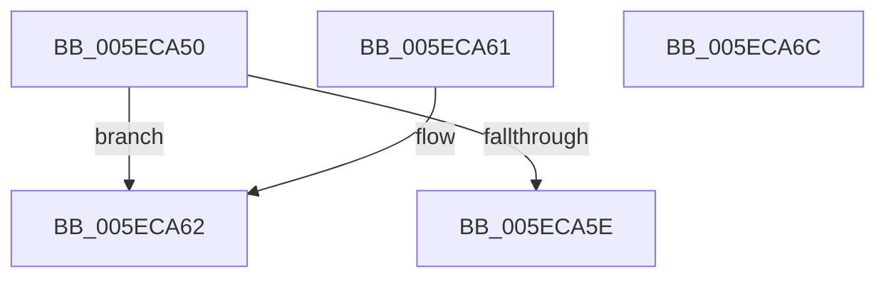

# RtlIsServicePackVersionInstalled

- RVA: `0x005ECA50`–`0x005ECA6D` (길이 `29` bytes)
- VA: `0x00000001405ECA50`
- 실행 섹션: `.text`
- PDB 이름 있음: `예`; PDB Function 태그: `아니요`
- unwind 정보 RVA: `0x000DB714`
- 디코드: `11`개 명령, `29/29` bytes 표시
- 미해석 바이트: `0` (있으면 어셈블리에 `.byte`로 보존)

> 이 문서는 커널 이미지의 기계어와 PDB 기호를 분석해 생성했습니다. 4번과 5번은 함수 원형과 자료형을 바이너리 사용 방식에서 추정한 C 해석이며 원본 소스 복구 결과는 아닙니다.

## 1. Dependencies

- 직접 호출 지점: **0**; 고유 호출 대상: **0**
- 직접 호출자로 확인된 함수: **0**
- RIP 상대 이미지 참조: **0**

### Outgoing calls
- 직접 디코드된 call 명령이 없습니다.

### Direct callers
- 이 함수 시작 RVA로 연결되는 직접 call은 확인되지 않았습니다. 간접 호출은 완전히 역산할 수 없습니다.

### Static image references
- 디코드된 RIP-relative 메모리 참조가 없습니다.

## 2. Other-region calls and transfers

- 다른 실행 섹션으로 향하는 call: **0**
- 별도 외부 분기/꼬리 이동을 확인하지 못했습니다.

## 3. Assembly (complete function range)

```asm
005ECA50  8B C1                           mov eax, ecx
005ECA52  25 00 00 FF FF                  and eax, 0xffff0000
005ECA57  3D 00 00 00 0A                  cmp eax, 0xa000000
005ECA5C  74 04                           je 0x1405eca62
005ECA5E  32 C0                           xor al, al
005ECA60  C3                              ret
005ECA61  CC                              int3
005ECA62  F7 C1 00 FF 00 00               test ecx, 0xff00
005ECA68  0F 96 C0                        setbe al
005ECA6B  C3                              ret
005ECA6C  CC                              int3
```

## 4. C-style interpretation (structured pseudocode)

```c
__int64 __fastcall RtlIsServicePackVersionInstalled(int a1)
{
    __int64 result;

    result = (unsigned int)(((unsigned int)(a1)) & (0xFFFF0000ULL));
    if (((unsigned int)(result)) == 0xA000000ULL) goto loc_005ECA62;
    result = 0;
    return result;
loc_005ECA62:
    result = (condition_is_below_or_equal) ? 1 : 0;
    return result;
}
```

## 5. (Beta) C Style

```c
int64_t RtlIsServicePackVersionInstalled(int32_t Arg1)
{
    int64_t result;

    result = (uint32_t)(((uint32_t)(Arg1)) & (0xFFFF0000ULL));
    if (((uint32_t)(result)) == 0xA000000ULL) goto loc_005ECA62;
    result = 0;
    return result;
loc_005ECA62:
    result = (condition_is_below_or_equal) ? 1 : 0;
    return result;
}
```

## 6. Execution-region graph

[열기: 2D/3D 그래프와 함수 탐색 컨트롤 패널](../../../control-panel.html?section=text&rva=0x005ECA50&view=graph)

- 2D 그래프는 위에서 아래로 흐르고, 3D 그래프는 빈 공간을 드래그해 회전합니다. Shift+드래그는 이동, 휠은 확대·축소, 함수 노드 선택은 대상 보고서 이동입니다.

### Static fallback


