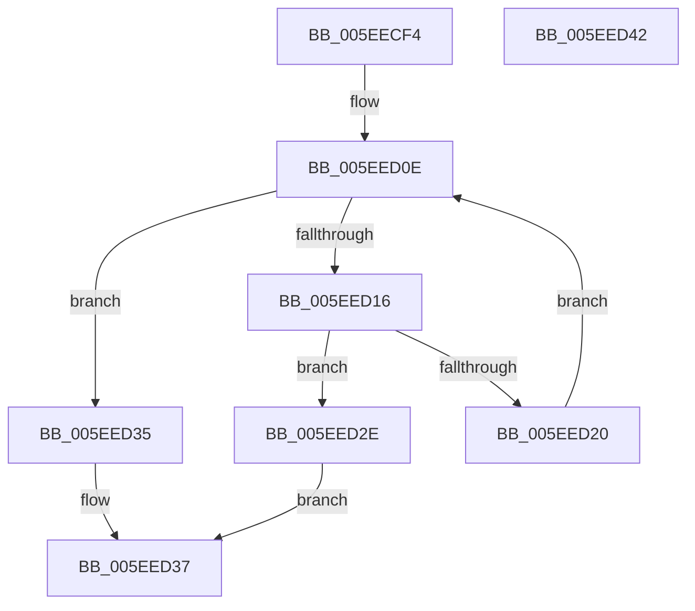

# RtlIsSpecialUnwind

- RVA: `0x005EECF4`–`0x005EED43` (길이 `79` bytes)
- VA: `0x00000001405EECF4`
- 실행 섹션: `.text`
- PDB 이름 있음: `예`; PDB Function 태그: `아니요`
- unwind 정보 RVA: `0x0005CAAC`
- 디코드: `27`개 명령, `79/79` bytes 표시
- 미해석 바이트: `0` (있으면 어셈블리에 `.byte`로 보존)

> 이 문서는 커널 이미지의 기계어와 PDB 기호를 분석해 생성했습니다. 4번과 5번은 함수 원형과 자료형을 바이너리 사용 방식에서 추정한 C 해석이며 원본 소스 복구 결과는 아닙니다.

## 1. Dependencies

- 직접 호출 지점: **2**; 고유 호출 대상: **2**
- 직접 호출자로 확인된 함수: **1**
- RIP 상대 이미지 참조: **0**

### Outgoing calls
- `0x005EED01` → [RtlpConvertFunctionEntry](../41/RtlpConvertFunctionEntry_function_00416CA0.md) (function, `0x00416CA0`)
- `0x005EED25` → [RtlpUnwindOpSlots](../3F/RtlpUnwindOpSlots_function_003F9270.md) (function, `0x003F9270`)

### Direct callers
- [KiTpBuildExcludedKernelTracepointBitmap](../../page/74/KiTpBuildExcludedKernelTracepointBitmap_function_007485B0.md) at `0x0074872E`

### Static image references
- 디코드된 RIP-relative 메모리 참조가 없습니다.

## 2. Other-region calls and transfers

- 다른 실행 섹션으로 향하는 call: **0**
- 별도 외부 분기/꼬리 이동을 확인하지 못했습니다.

## 3. Assembly (complete function range)

```asm
005EECF4  48 89 5C 24 08                  mov qword ptr [rsp + 8], rbx
005EECF9  57                              push rdi
005EECFA  48 83 EC 20                     sub rsp, 0x20
005EECFE  48 8B DA                        mov rbx, rdx
005EED01  E8 9A 7F E2 FF                  call 0x140416ca0
005EED06  8B 78 08                        mov edi, dword ptr [rax + 8]
005EED09  48 03 FB                        add rdi, rbx
005EED0C  33 DB                           xor ebx, ebx
005EED0E  0F B6 47 02                     movzx eax, byte ptr [rdi + 2]
005EED12  3B D8                           cmp ebx, eax
005EED14  73 1F                           jae 0x1405eed35
005EED16  8A 44 5F 05                     mov al, byte ptr [rdi + rbx*2 + 5]
005EED1A  24 0F                           and al, 0xf
005EED1C  3C 0A                           cmp al, 0xa
005EED1E  74 0E                           je 0x1405eed2e
005EED20  0F B7 4C 5F 04                  movzx ecx, word ptr [rdi + rbx*2 + 4]
005EED25  E8 46 A5 E0 FF                  call 0x1403f9270
005EED2A  03 D8                           add ebx, eax
005EED2C  EB E0                           jmp 0x1405eed0e
005EED2E  B8 01 00 00 00                  mov eax, 1
005EED33  EB 02                           jmp 0x1405eed37
005EED35  33 C0                           xor eax, eax
005EED37  48 8B 5C 24 30                  mov rbx, qword ptr [rsp + 0x30]
005EED3C  48 83 C4 20                     add rsp, 0x20
005EED40  5F                              pop rdi
005EED41  C3                              ret
005EED42  CC                              int3
```

## 4. C-style interpretation (structured pseudocode)

```c
__int64 __fastcall RtlIsSpecialUnwind(__int64 a1, __int64 a2)
{
    __int64 result;
    __int64 v_rbx;
    __int64 v_rdi;
    __int64 v_rsp;
    unsigned __int64 v_stack_p8;

    v_stack_p8 = v_rbx;
    v_rsp = (v_rsp) - (32);
    result = RtlpConvertFunctionEntry(a1, a2, a3, a4);
    v_rdi = ((unsigned int)(*(unsigned int *)(result + 8))) + (a2);
    v_rbx = 0;
loc_005EED0E:
    if (0 >= ((unsigned int)(*(unsigned __int8 *)(v_rdi + 2)))) goto loc_005EED35;
    result = (unsigned __int8)((*(unsigned __int8 *)(v_rdi + v_rbx * 2 + 5)) & (15));
    if (((unsigned __int8)(result)) == 10) goto loc_005EED2E;
    result = RtlpUnwindOpSlots(*(unsigned __int16 *)(v_rdi + v_rbx * 2 + 4), a2, a3, a4);
    v_rbx = (unsigned int)((v_rbx) + ((unsigned int)(result)));
    goto loc_005EED0E;
loc_005EED2E:
    goto loc_005EED37;
loc_005EED35:
    result = 0;
loc_005EED37:
    v_rsp = (v_rsp) + (32);
    return result;
}
```

## 5. (Beta) C Style

```c
int64_t RtlIsSpecialUnwind(int64_t Arg1, int64_t Arg2)
{
    int64_t result;
    int64_t local_rbx;
    int64_t local_rdi;
    int64_t local_rsp;
    uint64_t v_stack_p8;

    v_stack_p8 = local_rbx;
    local_rsp = (local_rsp) - (32);
    result = RtlpConvertFunctionEntry(Arg1, Arg2, a3, a4);
    local_rdi = ((uint32_t)(*(uint32_t *)(result + 0x8))) + (Arg2);
    local_rbx = 0;
loc_005EED0E:
    if (0 >= ((uint32_t)(*(uint8_t *)(local_rdi + 0x2)))) goto loc_005EED35;
    result = (uint8_t)((*(uint8_t *)(local_rdi + local_rbx * 2 + 0x5)) & (15));
    if (((uint8_t)(result)) == 10) goto loc_005EED2E;
    result = RtlpUnwindOpSlots(*(uint16_t *)(local_rdi + local_rbx * 2 + 0x4), Arg2, a3, a4);
    local_rbx = (uint32_t)((local_rbx) + ((uint32_t)(result)));
    goto loc_005EED0E;
loc_005EED2E:
    goto loc_005EED37;
loc_005EED35:
    result = 0;
loc_005EED37:
    local_rsp = (local_rsp) + (32);
    return result;
}
```

## 6. Execution-region graph

[열기: 2D/3D 그래프와 함수 탐색 컨트롤 패널](../../../control-panel.html?section=text&rva=0x005EECF4&view=graph)

- 2D 그래프는 위에서 아래로 흐르고, 3D 그래프는 빈 공간을 드래그해 회전합니다. Shift+드래그는 이동, 휠은 확대·축소, 함수 노드 선택은 대상 보고서 이동입니다.

### Static fallback


