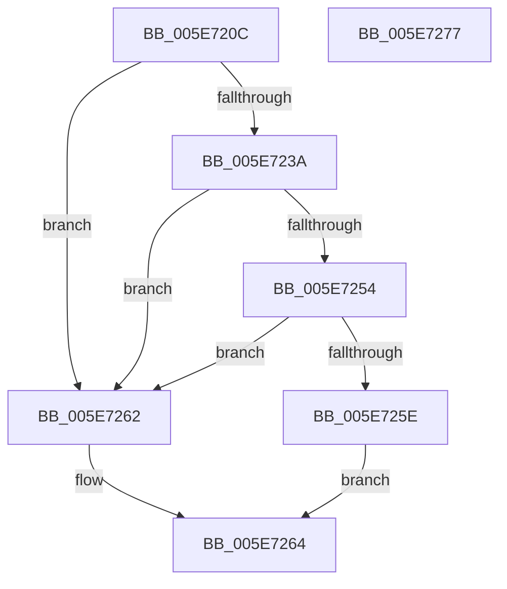

# RtlIsValidAntiTamperSid

- RVA: `0x005E720C`–`0x005E7278` (길이 `108` bytes)
- VA: `0x00000001405E720C`
- 실행 섹션: `.text`
- PDB 이름 있음: `예`; PDB Function 태그: `아니요`
- unwind 정보 RVA: `0x000BD6E0`
- 디코드: `33`개 명령, `108/108` bytes 표시
- 미해석 바이트: `0` (있으면 어셈블리에 `.byte`로 보존)

> 이 문서는 커널 이미지의 기계어와 PDB 기호를 분석해 생성했습니다. 4번과 5번은 함수 원형과 자료형을 바이너리 사용 방식에서 추정한 C 해석이며 원본 소스 복구 결과는 아닙니다.

## 1. Dependencies

- 직접 호출 지점: **2**; 고유 호출 대상: **2**
- 직접 호출자로 확인된 함수: **3**
- RIP 상대 이미지 참조: **1**

### Outgoing calls
- `0x005E7249` → [RtlCompareMemory](../6B/RtlCompareMemory_function_006BA670.md) (function, `0x006BA670`)
- `0x005E726C` → [_security_check_cookie](../6A/_security_check_cookie_function_006AC640.md) (function, `0x006AC640`)

### Direct callers
- [SepApplyMandatoryAccess](../60/SepApplyMandatoryAccess_function_00607FF4.md) at `0x00608057`
- [SepApplyMandatoryAppAccess](../60/SepApplyMandatoryAppAccess_function_006080D4.md) at `0x00608121`
- [SeSetTokenTamperProtection](../60/SeSetTokenTamperProtection_function_00609644.md) at `0x00609806`
- [SeSetTokenTamperProtection](../60/SeSetTokenTamperProtection_function_00609644.md) at `0x00609816`
- [SeSetTokenTamperProtection](../60/SeSetTokenTamperProtection_function_00609644.md) at `0x0060983D`

### Static image references
- `0x005E7212` → RVA `0x00E0A740` (`.data`; read)

## 2. Other-region calls and transfers

- 다른 실행 섹션으로 향하는 call: **0**
- 별도 외부 분기/꼬리 이동을 확인하지 못했습니다.

## 3. Assembly (complete function range)

```asm
005E720C  40 53                           push rbx
005E720E  48 83 EC 30                     sub rsp, 0x30
005E7212  48 8B 05 27 35 82 00            mov rax, qword ptr [rip + 0x823527]
005E7219  48 33 C4                        xor rax, rsp
005E721C  48 89 44 24 28                  mov qword ptr [rsp + 0x28], rax
005E7221  33 C0                           xor eax, eax
005E7223  66 C7 44 24 24 00 14            mov word ptr [rsp + 0x24], 0x1400
005E722A  89 44 24 20                     mov dword ptr [rsp + 0x20], eax
005E722E  48 8B D9                        mov rbx, rcx
005E7231  8A 41 01                        mov al, byte ptr [rcx + 1]
005E7234  2C 03                           sub al, 3
005E7236  3C 05                           cmp al, 5
005E7238  77 28                           ja 0x1405e7262
005E723A  48 83 C1 02                     add rcx, 2
005E723E  48 8D 54 24 20                  lea rdx, [rsp + 0x20]
005E7243  41 B8 06 00 00 00               mov r8d, 6
005E7249  E8 22 34 0D 00                  call 0x1406ba670
005E724E  48 83 F8 06                     cmp rax, 6
005E7252  75 0E                           jne 0x1405e7262
005E7254  8B 4B 08                        mov ecx, dword ptr [rbx + 8]
005E7257  FF C9                           dec ecx
005E7259  83 F9 04                        cmp ecx, 4
005E725C  77 04                           ja 0x1405e7262
005E725E  B0 01                           mov al, 1
005E7260  EB 02                           jmp 0x1405e7264
005E7262  32 C0                           xor al, al
005E7264  48 8B 4C 24 28                  mov rcx, qword ptr [rsp + 0x28]
005E7269  48 33 CC                        xor rcx, rsp
005E726C  E8 CF 53 0C 00                  call 0x1406ac640
005E7271  48 83 C4 30                     add rsp, 0x30
005E7275  5B                              pop rbx
005E7276  C3                              ret
005E7277  CC                              int3
```

## 4. C-style interpretation (structured pseudocode)

```c
__int64 __fastcall RtlIsValidAntiTamperSid(__int64 a1)
{
    __int64 result;
    __int64 v_rsp;
    unsigned __int64 v_stack_m10;
    unsigned __int16 v_stack_m14;
    unsigned int v_stack_m18;

    v_rsp = (v_rsp) - (48);
    result = (*(unsigned __int64 *)(v_rip + 8533287)) ^ (v_rsp);
    v_stack_m10 = result;
    result = 0;
    v_stack_m14 = 0x1400ULL;
    v_stack_m18 = 0;
    result = (unsigned __int8)((*(unsigned __int8 *)(a1 + 1)) - (3));
    if (((unsigned __int8)(result)) > 5) goto loc_005E7262;
    a1 = (a1) + (2);
    result = RtlCompareMemory(a1, v_stack_m18, 6, a4);
    if (result != 6) goto loc_005E7262;
    a1 = (unsigned int)(((unsigned int)(*(unsigned int *)(a1 + 8))) - 1);
    if (((unsigned int)(a1)) > 4) goto loc_005E7262;
    goto loc_005E7264;
loc_005E7262:
    result = 0;
loc_005E7264:
    a1 = (v_stack_m10) ^ (v_rsp);
    result = _security_check_cookie(a1, v_stack_m18, 6, a4);
    v_rsp = (v_rsp) + (48);
    return result;
}
```

## 5. (Beta) C Style

```c
int64_t RtlIsValidAntiTamperSid(void *Arg1)
{
    uint8_t *arg1 = (uint8_t *)Arg1;

    int64_t result;
    int64_t local_rsp;
    uint64_t v_stack_m10;
    uint16_t v_stack_m14;
    uint32_t v_stack_m18;

    local_rsp = (local_rsp) - (48);
    result = (*(uint64_t *)(v_rip + 0x823527)) ^ (local_rsp);
    v_stack_m10 = result;
    result = 0;
    v_stack_m14 = 0x1400ULL;
    v_stack_m18 = 0;
    result = (uint8_t)((*(uint8_t *)(arg1 + 0x1)) - (3));
    if (((uint8_t)(result)) > 5) goto loc_005E7262;
    Arg1 = (Arg1) + (2);
    result = RtlCompareMemory(Arg1, v_stack_m18, 6, a4);
    if (result != 6) goto loc_005E7262;
    Arg1 = (uint32_t)(((uint32_t)(*(uint32_t *)(arg1 + 0x8))) - 1);
    if (((uint32_t)(Arg1)) > 4) goto loc_005E7262;
    goto loc_005E7264;
loc_005E7262:
    result = 0;
loc_005E7264:
    Arg1 = (v_stack_m10) ^ (local_rsp);
    result = _security_check_cookie(Arg1, v_stack_m18, 6, a4);
    local_rsp = (local_rsp) + (48);
    return result;
}
```

### 관측된 메모리 오프셋

구조체 형식이 확인되지 않은 접근은 인자 기준의 오프셋으로만 기록했습니다.

| 기준 인자 | 오프셋 표현 | 폭 (bit) | 접근 |
|---|---:|---:|---|
| `Arg1` | `+ 0x1` | `8` | `R` |
| `Arg1` | `+ 0x8` | `32` | `R` |

## 6. Execution-region graph

[열기: 2D/3D 그래프와 함수 탐색 컨트롤 패널](../../../control-panel.html?section=text&rva=0x005E720C&view=graph)

- 2D 그래프는 위에서 아래로 흐르고, 3D 그래프는 빈 공간을 드래그해 회전합니다. Shift+드래그는 이동, 휠은 확대·축소, 함수 노드 선택은 대상 보고서 이동입니다.

### Static fallback


