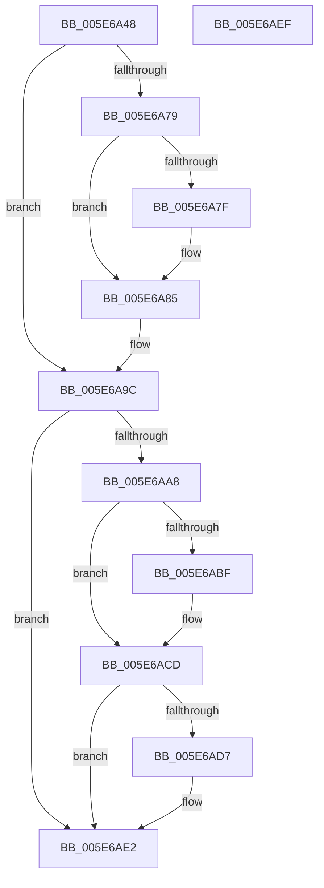

# RtlLookupExceptionHandler

- RVA: `0x005E6A48`–`0x005E6AF0` (길이 `168` bytes)
- VA: `0x00000001405E6A48`
- 실행 섹션: `.text`
- PDB 이름 있음: `예`; PDB Function 태그: `아니요`
- unwind 정보 RVA: `0x0005CAAC`
- 디코드: `50`개 명령, `168/168` bytes 표시
- 미해석 바이트: `0` (있으면 어셈블리에 `.byte`로 보존)

> 이 문서는 커널 이미지의 기계어와 PDB 기호를 분석해 생성했습니다. 4번과 5번은 함수 원형과 자료형을 바이너리 사용 방식에서 추정한 C 해석이며 원본 소스 복구 결과는 아닙니다.

## 1. Dependencies

- 직접 호출 지점: **2**; 고유 호출 대상: **2**
- 직접 호출자로 확인된 함수: **3**
- RIP 상대 이미지 참조: **0**

### Outgoing calls
- `0x005E6A5E` → [RtlpLookupPrimaryFunctionEntry](../48/RtlpLookupPrimaryFunctionEntry_function_0048E8D0.md) (function, `0x0048E8D0`)
- `0x005E6A7F` → [ExRaiseDatatypeMisalignment](../../page/89/ExRaiseDatatypeMisalignment_function_00899FD0.md) (function, `0x00899FD0`)

### Direct callers
- [KiLockServiceTable](../69/KiLockServiceTable_function_0069BC98.md) at `0x0069BDF4`
- [sub_006DF0C8](../6D/Unknown_function_006DF0C8.md) at `0x006DF17E`
- [KiFatalExceptionFilter](../../init/C6/KiFatalExceptionFilter_function_00C6CFB4.md) at `0x00C6D0A2`

### Static image references
- 디코드된 RIP-relative 메모리 참조가 없습니다.

## 2. Other-region calls and transfers

- 다른 실행 섹션으로 향하는 call: **1**
  - `0x005E6A7F` → [ExRaiseDatatypeMisalignment](../../page/89/ExRaiseDatatypeMisalignment_function_00899FD0.md) (`.text` → `PAGE`)
- 별도 외부 분기/꼬리 이동을 확인하지 못했습니다.

## 3. Assembly (complete function range)

```asm
005E6A48  48 89 5C 24 08                  mov qword ptr [rsp + 8], rbx
005E6A4D  57                              push rdi
005E6A4E  48 83 EC 20                     sub rsp, 0x20
005E6A52  41 8B F8                        mov edi, r8d
005E6A55  48 8B DA                        mov rbx, rdx
005E6A58  44 8B 01                        mov r8d, dword ptr [rcx]
005E6A5B  4C 03 C2                        add r8, rdx
005E6A5E  E8 6D 7E EA FF                  call 0x14048e8d0
005E6A63  44 8B 48 08                     mov r9d, dword ptr [rax + 8]
005E6A67  48 B8 FF FF FE FF FF 7F 00 00   movabs rax, 0x7ffffffeffff
005E6A71  4C 03 CB                        add r9, rbx
005E6A74  48 3B D8                        cmp rbx, rax
005E6A77  77 23                           ja 0x1405e6a9c
005E6A79  41 F6 C1 03                     test r9b, 3
005E6A7D  74 06                           je 0x1405e6a85
005E6A7F  E8 4C 35 2B 00                  call 0x140899fd0
005E6A84  CC                              int3
005E6A85  48 B9 00 00 FF FF FF 7F 00 00   movabs rcx, 0x7fffffff0000
005E6A8F  49 8B C1                        mov rax, r9
005E6A92  4C 3B C9                        cmp r9, rcx
005E6A95  90                              nop
005E6A96  48 0F 43 C1                     cmovae rax, rcx
005E6A9A  8A 00                           mov al, byte ptr [rax]
005E6A9C  41 0F B6 01                     movzx eax, byte ptr [r9]
005E6AA0  C1 E8 03                        shr eax, 3
005E6AA3  40 84 C7                        test dil, al
005E6AA6  74 3A                           je 0x1405e6ae2
005E6AA8  41 0F B6 41 02                  movzx eax, byte ptr [r9 + 2]
005E6AAD  4C 8B 44 24 58                  mov r8, qword ptr [rsp + 0x58]
005E6AB2  A8 01                           test al, 1
005E6AB4  8D 50 01                        lea edx, [rax + 1]
005E6AB7  0F 44 D0                        cmove edx, eax
005E6ABA  4D 85 C0                        test r8, r8
005E6ABD  74 0E                           je 0x1405e6acd
005E6ABF  8D 42 02                        lea eax, [rdx + 2]
005E6AC2  48 8D 40 02                     lea rax, [rax + 2]
005E6AC6  49 8D 04 41                     lea rax, [r9 + rax*2]
005E6ACA  49 89 00                        mov qword ptr [r8], rax
005E6ACD  4C 8B 44 24 50                  mov r8, qword ptr [rsp + 0x50]
005E6AD2  4D 85 C0                        test r8, r8
005E6AD5  74 0B                           je 0x1405e6ae2
005E6AD7  41 8B 4C 51 04                  mov ecx, dword ptr [r9 + rdx*2 + 4]
005E6ADC  48 03 CB                        add rcx, rbx
005E6ADF  49 89 08                        mov qword ptr [r8], rcx
005E6AE2  48 8B 5C 24 30                  mov rbx, qword ptr [rsp + 0x30]
005E6AE7  33 C0                           xor eax, eax
005E6AE9  48 83 C4 20                     add rsp, 0x20
005E6AED  5F                              pop rdi
005E6AEE  C3                              ret
005E6AEF  CC                              int3
```

## 4. C-style interpretation (structured pseudocode)

```c
__int64 __fastcall RtlLookupExceptionHandler(__int64 a1, __int64 a2, int a3, __int64 a4, __int64 a5, __int64 a6)
{
    __int64 result;
    __int64 v_rsp;
    unsigned __int64 v_stack_p8;

    v_stack_p8 = v_rbx;
    v_rsp = (v_rsp) - (32);
    a3 = ((unsigned int)(*(unsigned int *)(a1))) + (a2);
    result = RtlpLookupPrimaryFunctionEntry(a1, a2, a3, a4);
    a4 = ((unsigned int)(*(unsigned int *)(result + 8))) + (a2);
    if (a2 > result) goto loc_005E6A9C;
    if ((((unsigned __int8)(a4)) & (3)) != 0) {
        result = ExRaiseDatatypeMisalignment(a1, a2, a3, a4);
    }
    if (a4 >= a1) { a4 = a1; }
loc_005E6A9C:
    result = (unsigned int)((*(unsigned __int8 *)(a4)) >> (3));
    if ((((unsigned __int8)((unsigned int)(a3))) & ((unsigned __int8)(result))) == 0) goto loc_005E6AE2;
    a2 = *(unsigned __int8 *)(a4 + 2) + 1;
    if ((((unsigned __int8)(*(unsigned __int8 *)(a4 + 2))) & (1)) == 0) { a2 = (unsigned int)(*(unsigned __int8 *)(a4 + 2)); }
    result = *(unsigned __int8 *)(a4 + 2);
    if (a6 != 0) {
        result = a2 + 2;
        result = result + 2;
        result = a4 + result * 2;
        *(unsigned __int64 *)(a6) = result;
    }
    if (a5 != 0) {
        a1 = *(unsigned int *)(a4 + a2 * 2 + 4);
        a1 = (a1) + (a2);
        *(unsigned __int64 *)(a5) = a1;
    }
    result = 0;
    v_rsp = (v_rsp) + (32);
    return result;
}
```

## 5. (Beta) C Style

```c
int64_t RtlLookupExceptionHandler(void *Arg1, int64_t Arg2, int32_t Arg3, int64_t Arg4, int64_t Arg5, int64_t Arg6)
{
    uint8_t *arg1 = (uint8_t *)Arg1;

    int64_t result;
    int64_t local_rsp;
    uint64_t v_stack_p8;

    v_stack_p8 = local_rbx;
    local_rsp = (local_rsp) - (32);
    Arg3 = ((uint32_t)(*(uint32_t *)(arg1))) + (Arg2);
    result = RtlpLookupPrimaryFunctionEntry(Arg1, Arg2, Arg3, Arg4);
    Arg4 = ((uint32_t)(*(uint32_t *)(result + 0x8))) + (Arg2);
    if (Arg2 > result) goto loc_005E6A9C;
    if ((((uint8_t)(Arg4)) & (3)) != 0) {
        result = ExRaiseDatatypeMisalignment(Arg1, Arg2, Arg3, Arg4);
    }
    if (Arg4 >= Arg1) { Arg4 = Arg1; }
loc_005E6A9C:
    result = (uint32_t)((*(uint8_t *)(Arg4)) >> (3));
    if ((((uint8_t)((uint32_t)(Arg3))) & ((uint8_t)(result))) == 0) goto loc_005E6AE2;
    Arg2 = *(uint8_t *)(Arg4 + 0x2) + 1;
    if ((((uint8_t)(*(uint8_t *)(Arg4 + 0x2))) & (1)) == 0) { Arg2 = (uint32_t)(*(uint8_t *)(Arg4 + 0x2)); }
    result = *(uint8_t *)(Arg4 + 0x2);
    if (Arg6 != 0) {
        result = Arg2 + 2;
        result = result + 2;
        result = Arg4 + result * 2;
        *(uint64_t *)(Arg6) = result;
    }
    if (Arg5 != 0) {
        Arg1 = *(uint32_t *)(Arg4 + Arg2 * 2 + 0x4);
        Arg1 = (Arg1) + (Arg2);
        *(void **)(Arg5) = Arg1;
    }
    result = 0;
    local_rsp = (local_rsp) + (32);
    return result;
}
```

### 관측된 메모리 오프셋

구조체 형식이 확인되지 않은 접근은 인자 기준의 오프셋으로만 기록했습니다.

| 기준 인자 | 오프셋 표현 | 폭 (bit) | 접근 |
|---|---:|---:|---|
| `Arg1` | `+ 0x0` | `32` | `R` |

## 6. Execution-region graph

[열기: 2D/3D 그래프와 함수 탐색 컨트롤 패널](../../../control-panel.html?section=text&rva=0x005E6A48&view=graph)

- 2D 그래프는 위에서 아래로 흐르고, 3D 그래프는 빈 공간을 드래그해 회전합니다. Shift+드래그는 이동, 휠은 확대·축소, 함수 노드 선택은 대상 보고서 이동입니다.

### Static fallback


