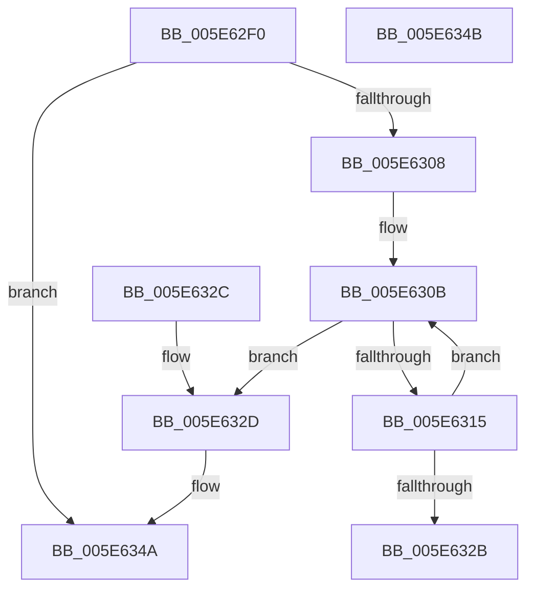

# RtlMergeBitMapsEx

- RVA: `0x005E62F0`–`0x005E634C` (길이 `92` bytes)
- VA: `0x00000001405E62F0`
- 실행 섹션: `.text`
- PDB 이름 있음: `예`; PDB Function 태그: `아니요`
- unwind 정보 RVA: `0x000DB714`
- 디코드: `30`개 명령, `92/92` bytes 표시
- 미해석 바이트: `0` (있으면 어셈블리에 `.byte`로 보존)

> 이 문서는 커널 이미지의 기계어와 PDB 기호를 분석해 생성했습니다. 4번과 5번은 함수 원형과 자료형을 바이너리 사용 방식에서 추정한 C 해석이며 원본 소스 복구 결과는 아닙니다.

## 1. Dependencies

- 직접 호출 지점: **0**; 고유 호출 대상: **0**
- 직접 호출자로 확인된 함수: **4**
- RIP 상대 이미지 참조: **0**

### Outgoing calls
- 직접 디코드된 call 명령이 없습니다.

### Direct callers
- [IopLiveDumpWriteDumpFileWithExtraPages](../59/IopLiveDumpWriteDumpFileWithExtraPages_function_0059F910.md) at `0x005A004B`
- [IopLiveDumpWriteDumpFileWithExtraPages](../59/IopLiveDumpWriteDumpFileWithExtraPages_function_0059F910.md) at `0x005A006E`
- [MiMergePageNodes](../69/MiMergePageNodes_function_006916A0.md) at `0x00691799`
- [sub_00B2B51A](../../page/B2/Unknown_function_00B2B51A.md) at `0x00B2B5F6`
- [sub_00B3ADEC](../../page/B3/Unknown_function_00B3ADEC.md) at `0x00B3AE59`

### Static image references
- 디코드된 RIP-relative 메모리 참조가 없습니다.

## 2. Other-region calls and transfers

- 다른 실행 섹션으로 향하는 call: **0**
- 별도 외부 분기/꼬리 이동을 확인하지 못했습니다.

## 3. Assembly (complete function range)

```asm
005E62F0  4C 8B 09                        mov r9, qword ptr [rcx]
005E62F3  4C 8B DA                        mov r11, rdx
005E62F6  48 8B 02                        mov rax, qword ptr [rdx]
005E62F9  4C 8B C1                        mov r8, rcx
005E62FC  4C 3B C8                        cmp r9, rax
005E62FF  4C 0F 43 C8                     cmovae r9, rax
005E6303  4D 85 C9                        test r9, r9
005E6306  74 42                           je 0x1405e634a
005E6308  45 33 D2                        xor r10d, r10d
005E630B  49 8B 43 08                     mov rax, qword ptr [r11 + 8]
005E630F  49 83 F9 40                     cmp r9, 0x40
005E6313  72 18                           jb 0x1405e632d
005E6315  4A 8B 0C 10                     mov rcx, qword ptr [rax + r10]
005E6319  49 8B 50 08                     mov rdx, qword ptr [r8 + 8]
005E631D  4A 09 0C 12                     or qword ptr [rdx + r10], rcx
005E6321  49 83 C2 08                     add r10, 8
005E6325  49 83 E9 40                     sub r9, 0x40
005E6329  75 E0                           jne 0x1405e630b
005E632B  C3                              ret
005E632C  CC                              int3
005E632D  49 8B 04 02                     mov rax, qword ptr [r10 + rax]
005E6331  49 8B C9                        mov rcx, r9
005E6334  4D 8B 40 08                     mov r8, qword ptr [r8 + 8]
005E6338  BA 01 00 00 00                  mov edx, 1
005E633D  48 D3 E2                        shl rdx, cl
005E6340  48 FF CA                        dec rdx
005E6343  48 23 C2                        and rax, rdx
005E6346  4B 09 04 10                     or qword ptr [r8 + r10], rax
005E634A  C3                              ret
005E634B  CC                              int3
```

## 4. C-style interpretation (structured pseudocode)

```c
__int64 __fastcall RtlMergeBitMapsEx(__int64 a1, __int64 a2)
{
    __int64 result;
    __int64 v_r10;

    a4 = *(unsigned __int64 *)(a1);
    if ((*(unsigned __int64 *)(a1)) >= (*(unsigned __int64 *)(a2))) { a4 = *(unsigned __int64 *)(a2); }
    if (a4 == 0) goto loc_005E634A;
    v_r10 = 0;
loc_005E630B:
    if (a4 < 64) goto loc_005E632D;
    v_r10 = (v_r10) + (8);
    a4 = (a4) - (64);
    if (condition_is_not_equal) goto loc_005E630B;
    return *(unsigned __int64 *)(a2 + 8);
loc_005E632D:
    a2 = (1) << ((unsigned __int8)(a4));
    a2 = (a2) - 1;
    result = (*(unsigned __int64 *)(v_r10 + *(unsigned __int64 *)(a2 + 8) * 1)) & (a2);
loc_005E634A:
    return result;
}
```

## 5. (Beta) C Style

```c
int64_t RtlMergeBitMapsEx(void *Arg1, void *Arg2)
{
    uint8_t *arg1 = (uint8_t *)Arg1;
    uint8_t *arg2 = (uint8_t *)Arg2;

    int64_t result;
    int64_t local_r10;

    a4 = *(uint64_t *)(arg1);
    if ((*(uint64_t *)(arg1)) >= (*(uint64_t *)(arg2))) { a4 = *(uint64_t *)(arg2); }
    if (a4 == 0) goto loc_005E634A;
    local_r10 = 0;
loc_005E630B:
    if (a4 < 64) goto loc_005E632D;
    local_r10 = (local_r10) + (8);
    a4 = (a4) - (64);
    if (condition_is_not_equal) goto loc_005E630B;
    return *(uint64_t *)(arg2 + 0x8);
loc_005E632D:
    Arg2 = (1) << ((uint8_t)(a4));
    Arg2 = (Arg2) - 1;
    result = (*(uint64_t *)(local_r10 + *(uint64_t *)(arg2 + 0x8) * 1)) & (Arg2);
loc_005E634A:
    return result;
}
```

### 관측된 메모리 오프셋

구조체 형식이 확인되지 않은 접근은 인자 기준의 오프셋으로만 기록했습니다.

| 기준 인자 | 오프셋 표현 | 폭 (bit) | 접근 |
|---|---:|---:|---|
| `Arg1` | `+ 0x0` | `64` | `R` |
| `Arg1` | `+ 0x8` | `64` | `R` |
| `Arg2` | `+ 0x0` | `64` | `R` |
| `Arg2` | `+ 0x8` | `64` | `R` |

## 6. Execution-region graph

[열기: 2D/3D 그래프와 함수 탐색 컨트롤 패널](../../../control-panel.html?section=text&rva=0x005E62F0&view=graph)

- 2D 그래프는 위에서 아래로 흐르고, 3D 그래프는 빈 공간을 드래그해 회전합니다. Shift+드래그는 이동, 휠은 확대·축소, 함수 노드 선택은 대상 보고서 이동입니다.

### Static fallback


