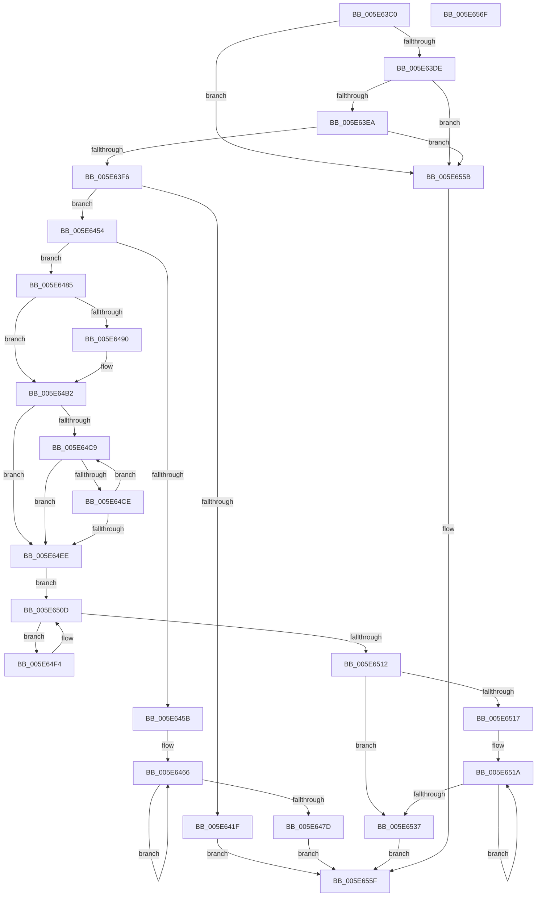

# RtlNumberOfSetBitsInRangeEx

- RVA: `0x005E63C0`–`0x005E6570` (길이 `432` bytes)
- VA: `0x00000001405E63C0`
- 실행 섹션: `.text`
- PDB 이름 있음: `예`; PDB Function 태그: `아니요`
- unwind 정보 RVA: `0x00069588`
- 디코드: `117`개 명령, `432/432` bytes 표시
- 미해석 바이트: `0` (있으면 어셈블리에 `.byte`로 보존)

> 이 문서는 커널 이미지의 기계어와 PDB 기호를 분석해 생성했습니다. 4번과 5번은 함수 원형과 자료형을 바이너리 사용 방식에서 추정한 C 해석이며 원본 소스 복구 결과는 아닙니다.

## 1. Dependencies

- 직접 호출 지점: **0**; 고유 호출 대상: **0**
- 직접 호출자로 확인된 함수: **0**
- RIP 상대 이미지 참조: **1**

### Outgoing calls
- 직접 디코드된 call 명령이 없습니다.

### Direct callers
- 이 함수 시작 RVA로 연결되는 직접 call은 확인되지 않았습니다. 간접 호출은 완전히 역산할 수 없습니다.

### Static image references
- `0x005E6426` → RVA `0x00000000` (`image boundary/outside`; read)

## 2. Other-region calls and transfers

- 다른 실행 섹션으로 향하는 call: **0**
- 별도 외부 분기/꼬리 이동을 확인하지 못했습니다.

## 3. Assembly (complete function range)

```asm
005E63C0  48 89 5C 24 08                  mov qword ptr [rsp + 8], rbx
005E63C5  48 89 74 24 10                  mov qword ptr [rsp + 0x10], rsi
005E63CA  48 89 7C 24 18                  mov qword ptr [rsp + 0x18], rdi
005E63CF  48 8B 01                        mov rax, qword ptr [rcx]
005E63D2  49 8B D8                        mov rbx, r8
005E63D5  48 3B D0                        cmp rdx, rax
005E63D8  0F 83 7D 01 00 00               jae 0x1405e655b
005E63DE  48 2B C2                        sub rax, rdx
005E63E1  48 3B C3                        cmp rax, rbx
005E63E4  0F 82 71 01 00 00               jb 0x1405e655b
005E63EA  45 33 C9                        xor r9d, r9d
005E63ED  48 85 DB                        test rbx, rbx
005E63F0  0F 84 65 01 00 00               je 0x1405e655b
005E63F6  4C 8B 41 08                     mov r8, qword ptr [rcx + 8]
005E63FA  48 8D 72 FF                     lea rsi, [rdx - 1]
005E63FE  48 03 F3                        add rsi, rbx
005E6401  4C 8B D2                        mov r10, rdx
005E6404  4C 8B DE                        mov r11, rsi
005E6407  49 C1 EA 03                     shr r10, 3
005E640B  8B FA                           mov edi, edx
005E640D  49 C1 EB 03                     shr r11, 3
005E6411  83 E7 07                        and edi, 7
005E6414  83 E6 07                        and esi, 7
005E6417  4D 03 C2                        add r8, r10
005E641A  4D 3B D3                        cmp r10, r11
005E641D  75 35                           jne 0x1405e6454
005E641F  45 0F B6 00                     movzx r8d, byte ptr [r8]
005E6423  8D 46 01                        lea eax, [rsi + 1]
005E6426  48 8D 1D D3 9B A1 FF            lea rbx, [rip - 0x5e642d]
005E642D  0F B6 94 18 90 C8 02 00         movzx edx, byte ptr [rax + rbx + 0x2c890]
005E6435  0F B6 84 1F 20 2D 01 00         movzx eax, byte ptr [rdi + rbx + 0x12d20]
005E643D  23 D0                           and edx, eax
005E643F  41 23 D0                        and edx, r8d
005E6442  F7 D2                           not edx
005E6444  0F B6 C2                        movzx eax, dl
005E6447  0F B6 84 18 40 41 03 00         movzx eax, byte ptr [rax + rbx + 0x34140]
005E644F  E9 0B 01 00 00                  jmp 0x1405e655f
005E6454  0A D3                           or dl, bl
005E6456  F6 C2 3F                        test dl, 0x3f
005E6459  75 2A                           jne 0x1405e6485
005E645B  48 8D 43 FF                     lea rax, [rbx - 1]
005E645F  48 C1 E8 06                     shr rax, 6
005E6463  48 FF C0                        inc rax
005E6466  49 8B 08                        mov rcx, qword ptr [r8]
005E6469  4D 8D 40 08                     lea r8, [r8 + 8]
005E646D  F3 48 0F B8 D1                  popcnt rdx, rcx
005E6472  8B D2                           mov edx, edx
005E6474  4C 03 CA                        add r9, rdx
005E6477  48 83 E8 01                     sub rax, 1
005E647B  75 E9                           jne 0x1405e6466
005E647D  49 8B C1                        mov rax, r9
005E6480  E9 DA 00 00 00                  jmp 0x1405e655f
005E6485  48 8D 1D 74 9B A1 FF            lea rbx, [rip - 0x5e648c]
005E648C  85 FF                           test edi, edi
005E648E  74 22                           je 0x1405e64b2
005E6490  41 0F B6 10                     movzx edx, byte ptr [r8]
005E6494  49 FF C0                        inc r8
005E6497  0F B6 8C 1F 20 2D 01 00         movzx ecx, byte ptr [rdi + rbx + 0x12d20]
005E649F  23 CA                           and ecx, edx
005E64A1  F7 D1                           not ecx
005E64A3  49 FF C2                        inc r10
005E64A6  0F B6 C1                        movzx eax, cl
005E64A9  44 0F B6 8C 18 40 41 03 00      movzx r9d, byte ptr [rax + rbx + 0x34140]
005E64B2  49 8B C2                        mov rax, r10
005E64B5  BA 08 00 00 00                  mov edx, 8
005E64BA  83 E0 07                        and eax, 7
005E64BD  48 2B D0                        sub rdx, rax
005E64C0  48 F7 C2 F7 FF FF FF            test rdx, -9
005E64C7  74 25                           je 0x1405e64ee
005E64C9  4D 3B D3                        cmp r10, r11
005E64CC  73 20                           jae 0x1405e64ee
005E64CE  41 0F B6 08                     movzx ecx, byte ptr [r8]
005E64D2  49 FF C2                        inc r10
005E64D5  F7 D1                           not ecx
005E64D7  49 FF C0                        inc r8
005E64DA  0F B6 C1                        movzx eax, cl
005E64DD  0F B6 84 18 40 41 03 00         movzx eax, byte ptr [rax + rbx + 0x34140]
005E64E5  4C 03 C8                        add r9, rax
005E64E8  48 83 EA 01                     sub rdx, 1
005E64EC  75 DB                           jne 0x1405e64c9
005E64EE  49 8D 52 08                     lea rdx, [r10 + 8]
005E64F2  EB 19                           jmp 0x1405e650d
005E64F4  49 8B 00                        mov rax, qword ptr [r8]
005E64F7  49 83 C2 08                     add r10, 8
005E64FB  F3 48 0F B8 C8                  popcnt rcx, rax
005E6500  8B C9                           mov ecx, ecx
005E6502  49 83 C0 08                     add r8, 8
005E6506  4C 03 C9                        add r9, rcx
005E6509  48 83 C2 08                     add rdx, 8
005E650D  49 3B D3                        cmp rdx, r11
005E6510  76 E2                           jbe 0x1405e64f4
005E6512  4D 3B D3                        cmp r10, r11
005E6515  73 20                           jae 0x1405e6537
005E6517  4D 2B DA                        sub r11, r10
005E651A  41 0F B6 08                     movzx ecx, byte ptr [r8]
005E651E  49 FF C0                        inc r8
005E6521  F7 D1                           not ecx
005E6523  0F B6 C1                        movzx eax, cl
005E6526  0F B6 84 18 40 41 03 00         movzx eax, byte ptr [rax + rbx + 0x34140]
005E652E  4C 03 C8                        add r9, rax
005E6531  49 83 EB 01                     sub r11, 1
005E6535  75 E3                           jne 0x1405e651a
005E6537  45 0F B6 00                     movzx r8d, byte ptr [r8]
005E653B  8D 46 01                        lea eax, [rsi + 1]
005E653E  0F B6 94 18 90 C8 02 00         movzx edx, byte ptr [rax + rbx + 0x2c890]
005E6546  41 23 D0                        and edx, r8d
005E6549  F7 D2                           not edx
005E654B  0F B6 C2                        movzx eax, dl
005E654E  0F B6 84 18 40 41 03 00         movzx eax, byte ptr [rax + rbx + 0x34140]
005E6556  49 03 C1                        add rax, r9
005E6559  EB 04                           jmp 0x1405e655f
005E655B  48 83 C8 FF                     or rax, 0xffffffffffffffff
005E655F  48 8B 5C 24 08                  mov rbx, qword ptr [rsp + 8]
005E6564  48 8B 74 24 10                  mov rsi, qword ptr [rsp + 0x10]
005E6569  48 8B 7C 24 18                  mov rdi, qword ptr [rsp + 0x18]
005E656E  C3                              ret
005E656F  CC                              int3
```

## 4. C-style interpretation (structured pseudocode)

```c
__int64 __fastcall RtlNumberOfSetBitsInRangeEx(__int64 a1, __int64 a2, __int64 a3, int a4)
{
    __int64 result;
    __int64 v_r10;
    __int64 v_r11;
    __int64 v_rdi;
    __int64 v_rsi;
    unsigned __int64 v_stack_p10;
    unsigned __int64 v_stack_p18;
    unsigned __int64 v_stack_p8;

    v_stack_p8 = v_rbx;
    v_stack_p10 = v_rsi;
    v_stack_p18 = v_rdi;
    if (a2 >= (*(unsigned __int64 *)(a1))) goto loc_005E655B;
    result = (*(unsigned __int64 *)(a1)) - (a2);
    if (result < a3) goto loc_005E655B;
    a4 = 0;
    if (a3 == 0) goto loc_005E655B;
    v_rsi = (a2 - 1) + (a3);
    v_r10 = (a2) >> (3);
    v_r11 = (v_rsi) >> (3);
    v_rdi = (unsigned int)(((unsigned int)((unsigned int)(a2))) & (7));
    v_rsi = (unsigned int)((v_rsi) & (7));
    a3 = (*(unsigned __int64 *)(a1 + 8)) + (v_r10);
    if (v_r10 != v_r11) goto loc_005E6454;
    a2 = (unsigned int)((*(unsigned __int8 *)(v_rsi + 1 + v_rip - 6186029 * 1 + 182416)) & ((unsigned int)(*(unsigned __int8 *)(v_rdi + v_rip - 6186029 * 1 + 77088))));
    a2 = (unsigned int)((a2) & ((unsigned int)(*(unsigned __int8 *)(a3))));
    a2 = (unsigned int)(~(a2));
    goto loc_005E655F;
loc_005E6454:
    a2 = (unsigned __int8)((a2) | ((unsigned __int8)(v_rip - 6186029)));
    if ((((unsigned __int8)(a2)) & (63)) != 0) goto loc_005E6485;
    result = (v_rip - 6186029 - 1) >> (6);
    result = (result) + 1;
loc_005E6466:
    a4 = (a4) + ((unsigned int)((unsigned int)(a2)));
    result = (result) - (1);
    if (condition_is_not_equal) goto loc_005E6466;
    goto loc_005E655F;
loc_005E6485:
    result = a4;
    if ((unsigned int)(v_rdi) != 0) {
        a2 = *(unsigned __int8 *)(*(unsigned __int8 *)(a3) + 8);
        a3 = (*(unsigned __int8 *)(a3) + 8) + 1;
        a1 = *(unsigned __int8 *)(v_rdi + v_rip - 6186124 * 1 + 77088);
        a1 = (unsigned int)((a1) & ((unsigned int)(a2)));
        a1 = (unsigned int)(~(a1));
        v_r10 = (v_r10) + 1;
        result = (unsigned __int8)(a1);
        a4 = *(unsigned __int8 *)(result + v_rip - 6186124 * 1 + 213312);
    }
    result = (unsigned int)((v_r10) & (7));
    a2 = (8) - (result);
    if (((a2) & (-9)) == 0) goto loc_005E64EE;
loc_005E64C9:
    if (v_r10 >= v_r11) goto loc_005E64EE;
    v_r10 = (v_r10) + 1;
    a1 = (unsigned int)(~(*(unsigned __int8 *)(a3)));
    a3 = (a3) + 1;
    a4 = (a4) + (*(unsigned __int8 *)((unsigned __int8)(a1) + v_rip - 6186124 * 1 + 213312));
    a2 = (a2) - (1);
    if (condition_is_not_equal) goto loc_005E64C9;
loc_005E64EE:
    goto loc_005E650D;
loc_005E64F4:
    v_r10 = (v_r10) + (8);
    a3 = (a3) + (8);
    a4 = (a4) + ((unsigned int)((unsigned int)(a1)));
    a2 = (v_r10 + 8) + (8);
loc_005E650D:
    if (a2 <= v_r11) goto loc_005E64F4;
    if (v_r10 >= v_r11) goto loc_005E6537;
    v_r11 = (v_r11) - (v_r10);
loc_005E651A:
    a3 = (a3) + 1;
    a1 = (unsigned int)(~(*(unsigned __int8 *)(a3)));
    a4 = (a4) + (*(unsigned __int8 *)((unsigned __int8)(a1) + v_rip - 6186124 * 1 + 213312));
    v_r11 = (v_r11) - (1);
    if (condition_is_not_equal) goto loc_005E651A;
loc_005E6537:
    a2 = (unsigned int)((*(unsigned __int8 *)(v_rsi + 1 + v_rip - 6186124 * 1 + 182416)) & ((unsigned int)(*(unsigned __int8 *)(a3))));
    a2 = (unsigned int)(~(a2));
    result = (*(unsigned __int8 *)((unsigned __int8)(a2) + v_rip - 6186124 * 1 + 213312)) + (a4);
    goto loc_005E655F;
loc_005E655B:
    result = (result) | (-1);
loc_005E655F:
    return result;
}
```

## 5. (Beta) C Style

```c
int64_t RtlNumberOfSetBitsInRangeEx(void *Arg1, int64_t Arg2, int64_t Arg3, int32_t Arg4)
{
    uint8_t *arg1 = (uint8_t *)Arg1;

    int64_t result;
    int64_t local_r10;
    int64_t local_r11;
    int64_t local_rdi;
    int64_t local_rsi;
    uint64_t v_stack_p10;
    uint64_t v_stack_p18;
    uint64_t v_stack_p8;

    v_stack_p8 = local_rbx;
    v_stack_p10 = local_rsi;
    v_stack_p18 = local_rdi;
    if (Arg2 >= (*(uint64_t *)(arg1))) goto loc_005E655B;
    result = (*(uint64_t *)(arg1)) - (Arg2);
    if (result < Arg3) goto loc_005E655B;
    Arg4 = 0;
    if (Arg3 == 0) goto loc_005E655B;
    local_rsi = (Arg2 - 1) + (Arg3);
    local_r10 = (Arg2) >> (3);
    local_r11 = (local_rsi) >> (3);
    local_rdi = (uint32_t)(((uint32_t)((uint32_t)(Arg2))) & (7));
    local_rsi = (uint32_t)((local_rsi) & (7));
    Arg3 = (*(uint64_t *)(arg1 + 0x8)) + (local_r10);
    if (local_r10 != local_r11) goto loc_005E6454;
    Arg2 = (uint32_t)((*(uint8_t *)(local_rsi + 0x1 + v_rip - 0x5E642D * 1 + 0x2C890)) & ((uint32_t)(*(uint8_t *)(local_rdi + v_rip - 0x5E642D * 1 + 0x12D20))));
    Arg2 = (uint32_t)((Arg2) & ((uint32_t)(*(uint8_t *)(Arg3))));
    Arg2 = (uint32_t)(~(Arg2));
    goto loc_005E655F;
loc_005E6454:
    Arg2 = (uint8_t)((Arg2) | ((uint8_t)(v_rip - 6186029)));
    if ((((uint8_t)(Arg2)) & (63)) != 0) goto loc_005E6485;
    result = (v_rip - 6186029 - 1) >> (6);
    result = (result) + 1;
loc_005E6466:
    Arg4 = (Arg4) + ((uint32_t)((uint32_t)(Arg2)));
    result = (result) - (1);
    if (condition_is_not_equal) goto loc_005E6466;
    goto loc_005E655F;
loc_005E6485:
    result = Arg4;
    if ((uint32_t)(local_rdi) != 0) {
        Arg2 = *(uint8_t *)(*(uint8_t *)(Arg3) + 0x8);
        Arg3 = (*(uint8_t *)(Arg3) + 8) + 1;
        Arg1 = *(uint8_t *)(local_rdi + v_rip - 0x5E648C * 1 + 0x12D20);
        Arg1 = (uint32_t)((Arg1) & ((uint32_t)(Arg2)));
        Arg1 = (uint32_t)(~(Arg1));
        local_r10 = (local_r10) + 1;
        result = (uint8_t)(Arg1);
        Arg4 = *(uint8_t *)(result + v_rip - 0x5E648C * 1 + 0x34140);
    }
    result = (uint32_t)((local_r10) & (7));
    Arg2 = (8) - (result);
    if (((Arg2) & (-9)) == 0) goto loc_005E64EE;
loc_005E64C9:
    if (local_r10 >= local_r11) goto loc_005E64EE;
    local_r10 = (local_r10) + 1;
    Arg1 = (uint32_t)(~(*(uint8_t *)(Arg3)));
    Arg3 = (Arg3) + 1;
    Arg4 = (Arg4) + (*(uint8_t *)((uint8_t)(arg1) + v_rip - 0x5E648C * 1 + 0x34140));
    Arg2 = (Arg2) - (1);
    if (condition_is_not_equal) goto loc_005E64C9;
loc_005E64EE:
    goto loc_005E650D;
loc_005E64F4:
    local_r10 = (local_r10) + (8);
    Arg3 = (Arg3) + (8);
    Arg4 = (Arg4) + ((uint32_t)((uint32_t)(Arg1)));
    Arg2 = (local_r10 + 8) + (8);
loc_005E650D:
    if (Arg2 <= local_r11) goto loc_005E64F4;
    if (local_r10 >= local_r11) goto loc_005E6537;
    local_r11 = (local_r11) - (local_r10);
loc_005E651A:
    Arg3 = (Arg3) + 1;
    Arg1 = (uint32_t)(~(*(uint8_t *)(Arg3)));
    Arg4 = (Arg4) + (*(uint8_t *)((uint8_t)(arg1) + v_rip - 0x5E648C * 1 + 0x34140));
    local_r11 = (local_r11) - (1);
    if (condition_is_not_equal) goto loc_005E651A;
loc_005E6537:
    Arg2 = (uint32_t)((*(uint8_t *)(local_rsi + 0x1 + v_rip - 0x5E648C * 1 + 0x2C890)) & ((uint32_t)(*(uint8_t *)(Arg3))));
    Arg2 = (uint32_t)(~(Arg2));
    result = (*(uint8_t *)((uint8_t)(Arg2) + v_rip - 0x5E648C * 1 + 0x34140)) + (Arg4);
    goto loc_005E655F;
loc_005E655B:
    result = (result) | (-1);
loc_005E655F:
    return result;
}
```

### 관측된 메모리 오프셋

구조체 형식이 확인되지 않은 접근은 인자 기준의 오프셋으로만 기록했습니다.

| 기준 인자 | 오프셋 표현 | 폭 (bit) | 접근 |
|---|---:|---:|---|
| `Arg1` | `+ 0x0` | `64` | `R` |
| `Arg1` | `+ 0x8` | `64` | `R` |

## 6. Execution-region graph

[열기: 2D/3D 그래프와 함수 탐색 컨트롤 패널](../../../control-panel.html?section=text&rva=0x005E63C0&view=graph)

- 2D 그래프는 위에서 아래로 흐르고, 3D 그래프는 빈 공간을 드래그해 회전합니다. Shift+드래그는 이동, 휠은 확대·축소, 함수 노드 선택은 대상 보고서 이동입니다.

### Static fallback


