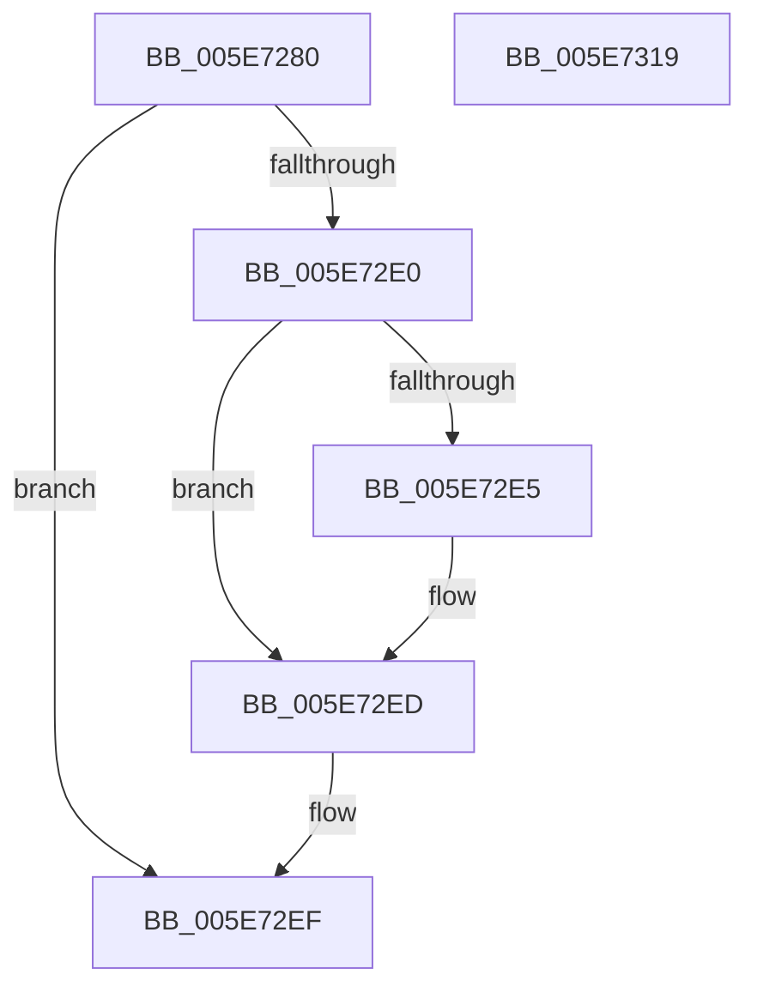

# RtlQueryAllInternalFeatureConfigurations

- RVA: `0x005E7280`–`0x005E731A` (길이 `154` bytes)
- VA: `0x00000001405E7280`
- 실행 섹션: `.text`
- PDB 이름 있음: `예`; PDB Function 태그: `아니요`
- unwind 정보 RVA: `0x0005D7BC`
- 디코드: `44`개 명령, `154/154` bytes 표시
- 미해석 바이트: `0` (있으면 어셈블리에 `.byte`로 보존)

> 이 문서는 커널 이미지의 기계어와 PDB 기호를 분석해 생성했습니다. 4번과 5번은 함수 원형과 자료형을 바이너리 사용 방식에서 추정한 C 해석이며 원본 소스 복구 결과는 아닙니다.

## 1. Dependencies

- 직접 호출 지점: **4**; 고유 호출 대상: **4**
- 직접 호출자로 확인된 함수: **0**
- RIP 상대 이미지 참조: **0**

### Outgoing calls
- `0x005E72AE` → [RtlpFcGetBufferManager](../../page/70/RtlpFcGetBufferManager_function_00705A30.md) (function, `0x00705A30`)
- `0x005E72C3` → [RtlpFcBufferManagerReferenceBuffers](../4A/RtlpFcBufferManagerReferenceBuffers_function_004A73B8.md) (function, `0x004A73B8`)
- `0x005E72D5` → [RtlpFcQueryAllInternalFeatureConfigurationsFromBufferSet](../5F/RtlpFcQueryAllInternalFeatureConfigurationsFromBufferSet_function_005F0D98.md) (function, `0x005F0D98`)
- `0x005E72F7` → [RtlpFcBufferManagerDereferenceBuffers](../37/RtlpFcBufferManagerDereferenceBuffers_function_00378D84.md) (function, `0x00378D84`)

### Direct callers
- 이 함수 시작 RVA로 연결되는 직접 call은 확인되지 않았습니다. 간접 호출은 완전히 역산할 수 없습니다.

### Static image references
- 디코드된 RIP-relative 메모리 참조가 없습니다.

## 2. Other-region calls and transfers

- 다른 실행 섹션으로 향하는 call: **1**
  - `0x005E72AE` → [RtlpFcGetBufferManager](../../page/70/RtlpFcGetBufferManager_function_00705A30.md) (`.text` → `PAGE`)
- 별도 외부 분기/꼬리 이동을 확인하지 못했습니다.

## 3. Assembly (complete function range)

```asm
005E7280  48 8B C4                        mov rax, rsp
005E7283  48 89 58 08                     mov qword ptr [rax + 8], rbx
005E7287  48 89 68 10                     mov qword ptr [rax + 0x10], rbp
005E728B  48 89 70 18                     mov qword ptr [rax + 0x18], rsi
005E728F  48 89 78 20                     mov qword ptr [rax + 0x20], rdi
005E7293  41 56                           push r14
005E7295  48 83 EC 30                     sub rsp, 0x30
005E7299  48 83 60 F0 00                  and qword ptr [rax - 0x10], 0
005E729E  49 8B F9                        mov rdi, r9
005E72A1  48 83 60 E8 00                  and qword ptr [rax - 0x18], 0
005E72A6  49 8B F0                        mov rsi, r8
005E72A9  4C 8B F2                        mov r14, rdx
005E72AC  8B D9                           mov ebx, ecx
005E72AE  E8 7D E7 11 00                  call 0x140705a30
005E72B3  48 8B C8                        mov rcx, rax
005E72B6  4C 8D 44 24 20                  lea r8, [rsp + 0x20]
005E72BB  48 8D 54 24 28                  lea rdx, [rsp + 0x28]
005E72C0  48 8B E8                        mov rbp, rax
005E72C3  E8 F0 00 EC FF                  call 0x1404a73b8
005E72C8  48 8B 4C 24 20                  mov rcx, qword ptr [rsp + 0x20]
005E72CD  4C 8B CF                        mov r9, rdi
005E72D0  4C 8B C6                        mov r8, rsi
005E72D3  8B D3                           mov edx, ebx
005E72D5  E8 BE 9A 00 00                  call 0x1405f0d98
005E72DA  8B D8                           mov ebx, eax
005E72DC  85 C0                           test eax, eax
005E72DE  78 0F                           js 0x1405e72ef
005E72E0  4D 85 F6                        test r14, r14
005E72E3  74 08                           je 0x1405e72ed
005E72E5  48 8B 44 24 28                  mov rax, qword ptr [rsp + 0x28]
005E72EA  49 89 06                        mov qword ptr [r14], rax
005E72ED  33 DB                           xor ebx, ebx
005E72EF  48 8B 54 24 20                  mov rdx, qword ptr [rsp + 0x20]
005E72F4  48 8B CD                        mov rcx, rbp
005E72F7  E8 88 1A D9 FF                  call 0x140378d84
005E72FC  48 8B 6C 24 48                  mov rbp, qword ptr [rsp + 0x48]
005E7301  8B C3                           mov eax, ebx
005E7303  48 8B 5C 24 40                  mov rbx, qword ptr [rsp + 0x40]
005E7308  48 8B 74 24 50                  mov rsi, qword ptr [rsp + 0x50]
005E730D  48 8B 7C 24 58                  mov rdi, qword ptr [rsp + 0x58]
005E7312  48 83 C4 30                     add rsp, 0x30
005E7316  41 5E                           pop r14
005E7318  C3                              ret
005E7319  CC                              int3
```

## 4. C-style interpretation (structured pseudocode)

```c
__int64 __fastcall RtlQueryAllInternalFeatureConfigurations(int a1, __int64 a2, __int64 a3, __int64 a4)
{
    __int64 result;
    __int64 v_rbx;
    __int64 v_rsp;
    unsigned __int64 v_stack_m10;
    unsigned __int64 v_stack_m18;
    unsigned __int64 v_stack_p10;
    unsigned __int64 v_stack_p18;
    unsigned __int64 v_stack_p20;
    unsigned __int64 v_stack_p8;

    *(unsigned __int64 *)(v_rsp + 8) = v_rbx;
    *(unsigned __int64 *)(v_rsp + 16) = v_rbp;
    *(unsigned __int64 *)(v_rsp + 24) = v_rsi;
    *(unsigned __int64 *)(v_rsp + 32) = v_rdi;
    v_rsp = (v_rsp) - (48);
    result = RtlpFcGetBufferManager(a1, a2, a3, a4);
    result = RtlpFcBufferManagerReferenceBuffers(result, v_stack_m10, v_stack_m18, a4);
    result = RtlpFcQueryAllInternalFeatureConfigurationsFromBufferSet(v_stack_m18, (unsigned int)((unsigned int)((unsigned int)(a1))), a3, a4);
    if (sign_flag) goto loc_005E72EF;
    if (a2 != 0) {
        result = v_stack_m10;
        *(unsigned __int64 *)(a2) = result;
    }
    v_rbx = 0;
loc_005E72EF:
    result = RtlpFcBufferManagerDereferenceBuffers(result, v_stack_m18, a3, a4);
    v_rsp = (v_rsp) + (48);
    return 0;
}
```

## 5. (Beta) C Style

```c
int64_t RtlQueryAllInternalFeatureConfigurations(int32_t Arg1, int64_t Arg2, int64_t Arg3, int64_t Arg4)
{
    int64_t result;
    int64_t local_rbx;
    int64_t local_rsp;
    uint64_t v_stack_m10;
    uint64_t v_stack_m18;
    uint64_t v_stack_p10;
    uint64_t v_stack_p18;
    uint64_t v_stack_p20;
    uint64_t v_stack_p8;

    *(uint64_t *)(local_rsp + 0x8) = local_rbx;
    *(uint64_t *)(local_rsp + 0x10) = local_rbp;
    *(uint64_t *)(local_rsp + 0x18) = local_rsi;
    *(uint64_t *)(local_rsp + 0x20) = local_rdi;
    local_rsp = (local_rsp) - (48);
    result = RtlpFcGetBufferManager(Arg1, Arg2, Arg3, Arg4);
    result = RtlpFcBufferManagerReferenceBuffers(result, v_stack_m10, v_stack_m18, Arg4);
    result = RtlpFcQueryAllInternalFeatureConfigurationsFromBufferSet(v_stack_m18, (uint32_t)((uint32_t)((uint32_t)(Arg1))), Arg3, Arg4);
    if (sign_flag) goto loc_005E72EF;
    if (Arg2 != 0) {
        result = v_stack_m10;
        *(uint64_t *)(Arg2) = result;
    }
    local_rbx = 0;
loc_005E72EF:
    result = RtlpFcBufferManagerDereferenceBuffers(result, v_stack_m18, Arg3, Arg4);
    local_rsp = (local_rsp) + (48);
    return 0;
}
```

## 6. Execution-region graph

[열기: 2D/3D 그래프와 함수 탐색 컨트롤 패널](../../../control-panel.html?section=text&rva=0x005E7280&view=graph)

- 2D 그래프는 위에서 아래로 흐르고, 3D 그래프는 빈 공간을 드래그해 회전합니다. Shift+드래그는 이동, 휠은 확대·축소, 함수 노드 선택은 대상 보고서 이동입니다.

### Static fallback


