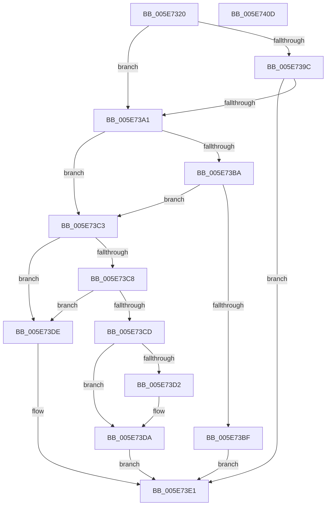

# RtlQueryAllInternalRuntimeFeatureConfigurations

- RVA: `0x005E7320`–`0x005E740E` (길이 `238` bytes)
- VA: `0x00000001405E7320`
- 실행 섹션: `.text`
- PDB 이름 있음: `예`; PDB Function 태그: `아니요`
- unwind 정보 RVA: `0x000847EC`
- 디코드: `71`개 명령, `238/238` bytes 표시
- 미해석 바이트: `0` (있으면 어셈블리에 `.byte`로 보존)

> 이 문서는 커널 이미지의 기계어와 PDB 기호를 분석해 생성했습니다. 4번과 5번은 함수 원형과 자료형을 바이너리 사용 방식에서 추정한 C 해석이며 원본 소스 복구 결과는 아닙니다.

## 1. Dependencies

- 직접 호출 지점: **5**; 고유 호출 대상: **5**
- 직접 호출자로 확인된 함수: **0**
- RIP 상대 이미지 참조: **0**

### Outgoing calls
- `0x005E7353` → [RtlpFcGetBufferManager](../../page/70/RtlpFcGetBufferManager_function_00705A30.md) (function, `0x00705A30`)
- `0x005E7368` → [RtlpFcBufferManagerReferenceBuffers](../4A/RtlpFcBufferManagerReferenceBuffers_function_004A73B8.md) (function, `0x004A73B8`)
- `0x005E7380` → [RtlpFcQueryAllInternalFeatureConfigurationsFromBufferSet](../5F/RtlpFcQueryAllInternalFeatureConfigurationsFromBufferSet_function_005F0D98.md) (function, `0x005F0D98`)
- `0x005E73AC` → [RtlpFcQueryAllGovernedFeaturesFromBufferSet](../../page/79/RtlpFcQueryAllGovernedFeaturesFromBufferSet_function_0079AA10.md) (function, `0x0079AA10`)
- `0x005E73E7` → [RtlpFcBufferManagerDereferenceBuffers](../37/RtlpFcBufferManagerDereferenceBuffers_function_00378D84.md) (function, `0x00378D84`)

### Direct callers
- 이 함수 시작 RVA로 연결되는 직접 call은 확인되지 않았습니다. 간접 호출은 완전히 역산할 수 없습니다.

### Static image references
- 디코드된 RIP-relative 메모리 참조가 없습니다.

## 2. Other-region calls and transfers

- 다른 실행 섹션으로 향하는 call: **2**
  - `0x005E7353` → [RtlpFcGetBufferManager](../../page/70/RtlpFcGetBufferManager_function_00705A30.md) (`.text` → `PAGE`)
  - `0x005E73AC` → [RtlpFcQueryAllGovernedFeaturesFromBufferSet](../../page/79/RtlpFcQueryAllGovernedFeaturesFromBufferSet_function_0079AA10.md) (`.text` → `PAGE`)
- 별도 외부 분기/꼬리 이동을 확인하지 못했습니다.

## 3. Assembly (complete function range)

```asm
005E7320  48 8B C4                        mov rax, rsp
005E7323  48 89 58 08                     mov qword ptr [rax + 8], rbx
005E7327  48 89 68 10                     mov qword ptr [rax + 0x10], rbp
005E732B  48 89 70 18                     mov qword ptr [rax + 0x18], rsi
005E732F  48 89 78 20                     mov qword ptr [rax + 0x20], rdi
005E7333  41 54                           push r12
005E7335  41 56                           push r14
005E7337  41 57                           push r15
005E7339  48 83 EC 30                     sub rsp, 0x30
005E733D  48 83 60 E0 00                  and qword ptr [rax - 0x20], 0
005E7342  4D 8B F1                        mov r14, r9
005E7345  48 83 60 D8 00                  and qword ptr [rax - 0x28], 0
005E734A  49 8B D8                        mov rbx, r8
005E734D  48 8B FA                        mov rdi, rdx
005E7350  48 8B F1                        mov rsi, rcx
005E7353  E8 D8 E6 11 00                  call 0x140705a30
005E7358  48 8B C8                        mov rcx, rax
005E735B  4C 8D 44 24 20                  lea r8, [rsp + 0x20]
005E7360  48 8D 54 24 28                  lea rdx, [rsp + 0x28]
005E7365  48 8B E8                        mov rbp, rax
005E7368  E8 4B 00 EC FF                  call 0x1404a73b8
005E736D  4C 8B C7                        mov r8, rdi
005E7370  4C 8B CB                        mov r9, rbx
005E7373  48 8B 7C 24 20                  mov rdi, qword ptr [rsp + 0x20]
005E7378  BA 01 00 00 00                  mov edx, 1
005E737D  48 8B CF                        mov rcx, rdi
005E7380  E8 13 9A 00 00                  call 0x1405f0d98
005E7385  41 BC 00 00 00 80               mov r12d, 0x80000000
005E738B  8B D8                           mov ebx, eax
005E738D  41 BF 05 00 00 80               mov r15d, 0x80000005
005E7393  42 8D 0C 20                     lea ecx, [rax + r12]
005E7397  41 85 CC                        test r12d, ecx
005E739A  75 05                           jne 0x1405e73a1
005E739C  41 3B C7                        cmp eax, r15d
005E739F  75 40                           jne 0x1405e73e1
005E73A1  4C 8B 44 24 70                  mov r8, qword ptr [rsp + 0x70]
005E73A6  49 8B D6                        mov rdx, r14
005E73A9  48 8B CF                        mov rcx, rdi
005E73AC  E8 5F 36 1B 00                  call 0x14079aa10
005E73B1  42 8D 0C 20                     lea ecx, [rax + r12]
005E73B5  41 85 CC                        test r12d, ecx
005E73B8  75 09                           jne 0x1405e73c3
005E73BA  41 3B C7                        cmp eax, r15d
005E73BD  74 04                           je 0x1405e73c3
005E73BF  8B D8                           mov ebx, eax
005E73C1  EB 1E                           jmp 0x1405e73e1
005E73C3  41 3B DF                        cmp ebx, r15d
005E73C6  74 16                           je 0x1405e73de
005E73C8  41 3B C7                        cmp eax, r15d
005E73CB  74 11                           je 0x1405e73de
005E73CD  48 85 F6                        test rsi, rsi
005E73D0  74 08                           je 0x1405e73da
005E73D2  48 8B 44 24 28                  mov rax, qword ptr [rsp + 0x28]
005E73D7  48 89 06                        mov qword ptr [rsi], rax
005E73DA  33 DB                           xor ebx, ebx
005E73DC  EB 03                           jmp 0x1405e73e1
005E73DE  41 8B DF                        mov ebx, r15d
005E73E1  48 8B D7                        mov rdx, rdi
005E73E4  48 8B CD                        mov rcx, rbp
005E73E7  E8 98 19 D9 FF                  call 0x140378d84
005E73EC  48 8B 6C 24 58                  mov rbp, qword ptr [rsp + 0x58]
005E73F1  8B C3                           mov eax, ebx
005E73F3  48 8B 5C 24 50                  mov rbx, qword ptr [rsp + 0x50]
005E73F8  48 8B 74 24 60                  mov rsi, qword ptr [rsp + 0x60]
005E73FD  48 8B 7C 24 68                  mov rdi, qword ptr [rsp + 0x68]
005E7402  48 83 C4 30                     add rsp, 0x30
005E7406  41 5F                           pop r15
005E7408  41 5E                           pop r14
005E740A  41 5C                           pop r12
005E740C  C3                              ret
005E740D  CC                              int3
```

## 4. C-style interpretation (structured pseudocode)

```c
__int64 __fastcall RtlQueryAllInternalRuntimeFeatureConfigurations(__int64 a1, __int64 a2, __int64 a3, __int64 a4, __int64 a5)
{
    __int64 result;
    __int64 v_rbx;
    __int64 v_rsp;
    unsigned __int64 v_stack_m20;
    unsigned __int64 v_stack_m28;
    unsigned __int64 v_stack_p10;
    unsigned __int64 v_stack_p18;
    unsigned __int64 v_stack_p20;
    unsigned __int64 v_stack_p8;

    *(unsigned __int64 *)(v_rsp + 8) = v_rbx;
    *(unsigned __int64 *)(v_rsp + 16) = v_rbp;
    *(unsigned __int64 *)(v_rsp + 24) = v_rsi;
    *(unsigned __int64 *)(v_rsp + 32) = v_rdi;
    v_rsp = (v_rsp) - (48);
    result = RtlpFcGetBufferManager(a1, a2, a3, a4);
    result = RtlpFcBufferManagerReferenceBuffers(result, v_stack_m20, v_stack_m28, a4);
    result = RtlpFcQueryAllInternalFeatureConfigurationsFromBufferSet(v_stack_m28, 1, a2, a3);
    if ((((unsigned int)((unsigned int)(0x80000000ULL))) & ((unsigned int)(result + (unsigned int)(0x80000000ULL) * 1))) != 0) goto loc_005E73A1;
    if (((unsigned int)(result)) != ((unsigned int)((unsigned int)(0x80000005ULL)))) goto loc_005E73E1;
loc_005E73A1:
    result = RtlpFcQueryAllGovernedFeaturesFromBufferSet(v_stack_m28, a4, a5, a3);
    if ((((unsigned int)((unsigned int)(0x80000000ULL))) & ((unsigned int)(result + (unsigned int)(0x80000000ULL) * 1))) != 0) goto loc_005E73C3;
    if (((unsigned int)(result)) == ((unsigned int)((unsigned int)(0x80000005ULL)))) goto loc_005E73C3;
    goto loc_005E73E1;
loc_005E73C3:
    if (((unsigned int)((unsigned int)((unsigned int)(result)))) == ((unsigned int)((unsigned int)(0x80000005ULL)))) goto loc_005E73DE;
    if (((unsigned int)(result)) == ((unsigned int)((unsigned int)(0x80000005ULL)))) goto loc_005E73DE;
    if (a1 != 0) {
        result = v_stack_m20;
        *(unsigned __int64 *)(a1) = result;
    }
    v_rbx = 0;
    goto loc_005E73E1;
loc_005E73DE:
loc_005E73E1:
    result = RtlpFcBufferManagerDereferenceBuffers(result, v_stack_m28, a5, a3);
    v_rsp = (v_rsp) + (48);
    return (unsigned int)((unsigned int)((unsigned int)((unsigned int)((unsigned int)(0x80000005ULL)))));
}
```

## 5. (Beta) C Style

```c
int64_t RtlQueryAllInternalRuntimeFeatureConfigurations(int64_t Arg1, int64_t Arg2, int64_t Arg3, int64_t Arg4, int64_t Arg5)
{
    int64_t result;
    int64_t local_rbx;
    int64_t local_rsp;
    uint64_t v_stack_m20;
    uint64_t v_stack_m28;
    uint64_t v_stack_p10;
    uint64_t v_stack_p18;
    uint64_t v_stack_p20;
    uint64_t v_stack_p8;

    *(uint64_t *)(local_rsp + 0x8) = local_rbx;
    *(uint64_t *)(local_rsp + 0x10) = local_rbp;
    *(uint64_t *)(local_rsp + 0x18) = local_rsi;
    *(uint64_t *)(local_rsp + 0x20) = local_rdi;
    local_rsp = (local_rsp) - (48);
    result = RtlpFcGetBufferManager(Arg1, Arg2, Arg3, Arg4);
    result = RtlpFcBufferManagerReferenceBuffers(result, v_stack_m20, v_stack_m28, Arg4);
    result = RtlpFcQueryAllInternalFeatureConfigurationsFromBufferSet(v_stack_m28, 1, Arg2, Arg3);
    if ((((uint32_t)((uint32_t)(0x80000000ULL))) & ((uint32_t)(result + (uint32_t)(0x80000000ULL) * 1))) != 0) goto loc_005E73A1;
    if (((uint32_t)(result)) != ((uint32_t)((uint32_t)(0x80000005ULL)))) goto loc_005E73E1;
loc_005E73A1:
    result = RtlpFcQueryAllGovernedFeaturesFromBufferSet(v_stack_m28, Arg4, Arg5, Arg3);
    if ((((uint32_t)((uint32_t)(0x80000000ULL))) & ((uint32_t)(result + (uint32_t)(0x80000000ULL) * 1))) != 0) goto loc_005E73C3;
    if (((uint32_t)(result)) == ((uint32_t)((uint32_t)(0x80000005ULL)))) goto loc_005E73C3;
    goto loc_005E73E1;
loc_005E73C3:
    if (((uint32_t)((uint32_t)((uint32_t)(result)))) == ((uint32_t)((uint32_t)(0x80000005ULL)))) goto loc_005E73DE;
    if (((uint32_t)(result)) == ((uint32_t)((uint32_t)(0x80000005ULL)))) goto loc_005E73DE;
    if (Arg1 != 0) {
        result = v_stack_m20;
        *(uint64_t *)(Arg1) = result;
    }
    local_rbx = 0;
    goto loc_005E73E1;
loc_005E73DE:
loc_005E73E1:
    result = RtlpFcBufferManagerDereferenceBuffers(result, v_stack_m28, Arg5, Arg3);
    local_rsp = (local_rsp) + (48);
    return (uint32_t)((uint32_t)((uint32_t)((uint32_t)((uint32_t)(0x80000005ULL)))));
}
```

## 6. Execution-region graph

[열기: 2D/3D 그래프와 함수 탐색 컨트롤 패널](../../../control-panel.html?section=text&rva=0x005E7320&view=graph)

- 2D 그래프는 위에서 아래로 흐르고, 3D 그래프는 빈 공간을 드래그해 회전합니다. Shift+드래그는 이동, 휠은 확대·축소, 함수 노드 선택은 대상 보고서 이동입니다.

### Static fallback


