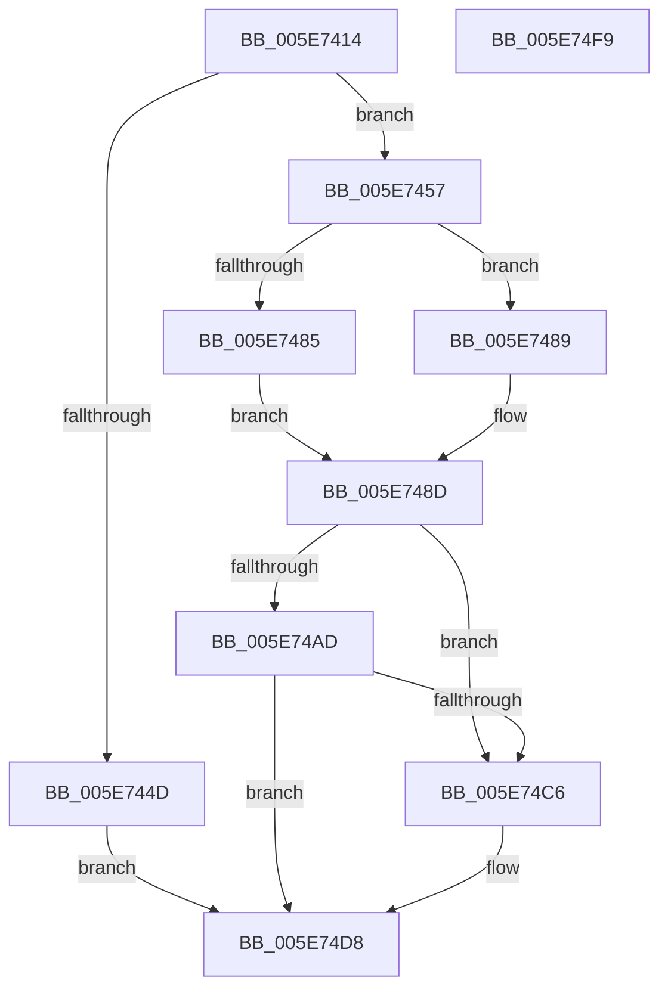

# RtlQueryFeatureConfigurationFromBuffers

- RVA: `0x005E7414`–`0x005E74FA` (길이 `230` bytes)
- VA: `0x00000001405E7414`
- 실행 섹션: `.text`
- PDB 이름 있음: `예`; PDB Function 태그: `아니요`
- unwind 정보 RVA: `0x000C5618`
- 디코드: `67`개 명령, `230/230` bytes 표시
- 미해석 바이트: `0` (있으면 어셈블리에 `.byte`로 보존)

> 이 문서는 커널 이미지의 기계어와 PDB 기호를 분석해 생성했습니다. 4번과 5번은 함수 원형과 자료형을 바이너리 사용 방식에서 추정한 C 해석이며 원본 소스 복구 결과는 아닙니다.

## 1. Dependencies

- 직접 호출 지점: **4**; 고유 호출 대상: **4**
- 직접 호출자로 확인된 함수: **1**
- RIP 상대 이미지 참조: **1**

### Outgoing calls
- `0x005E74A4` → [RtlpFcHasEffectiveStateInGovernedFeatureInfoTable](../../page/79/RtlpFcHasEffectiveStateInGovernedFeatureInfoTable_function_0079A72C.md) (function, `0x0079A72C`)
- `0x005E74BB` → [RtlpFcQueryFeatureConfigurationFromBuffers](../../page/9B/RtlpFcQueryFeatureConfigurationFromBuffers_function_009BC928.md) (function, `0x009BC928`)
- `0x005E74D3` → [RtlpFcConvertFeatureConfigurationsInternalToExternal](../4F/RtlpFcConvertFeatureConfigurationsInternalToExternal_function_004FD050.md) (function, `0x004FD050`)
- `0x005E74E1` → [_security_check_cookie](../6A/_security_check_cookie_function_006AC640.md) (function, `0x006AC640`)

### Direct callers
- [wil_details_PopulateInitialConfiguredFeatureStatesFromBuffers](../../init/C5/wil_details_PopulateInitialConfiguredFeatureStatesFromBuffers_function_00C5ADC8.md) at `0x00C5AE2B`

### Static image references
- `0x005E7426` → RVA `0x00E0A740` (`.data`; read)

## 2. Other-region calls and transfers

- 다른 실행 섹션으로 향하는 call: **2**
  - `0x005E74A4` → [RtlpFcHasEffectiveStateInGovernedFeatureInfoTable](../../page/79/RtlpFcHasEffectiveStateInGovernedFeatureInfoTable_function_0079A72C.md) (`.text` → `PAGE`)
  - `0x005E74BB` → [RtlpFcQueryFeatureConfigurationFromBuffers](../../page/9B/RtlpFcQueryFeatureConfigurationFromBuffers_function_009BC928.md) (`.text` → `PAGE`)
- 별도 외부 분기/꼬리 이동을 확인하지 못했습니다.

## 3. Assembly (complete function range)

```asm
005E7414  48 89 5C 24 18                  mov qword ptr [rsp + 0x18], rbx
005E7419  55                              push rbp
005E741A  56                              push rsi
005E741B  57                              push rdi
005E741C  48 8B EC                        mov rbp, rsp
005E741F  48 81 EC 80 00 00 00            sub rsp, 0x80
005E7426  48 8B 05 13 33 82 00            mov rax, qword ptr [rip + 0x823313]
005E742D  48 33 C4                        xor rax, rsp
005E7430  48 89 45 F0                     mov qword ptr [rbp - 0x10], rax
005E7434  0F 57 C0                        xorps xmm0, xmm0
005E7437  49 8B F1                        mov rsi, r9
005E743A  4C 8B 49 08                     mov r9, qword ptr [rcx + 8]
005E743E  8B FA                           mov edi, edx
005E7440  48 8B 11                        mov rdx, qword ptr [rcx]
005E7443  0F 11 45 E0                     movups xmmword ptr [rbp - 0x20], xmm0
005E7447  41 83 F8 02                     cmp r8d, 2
005E744B  72 0A                           jb 0x1405e7457
005E744D  BB 0D 00 00 C0                  mov ebx, 0xc000000d
005E7452  E9 81 00 00 00                  jmp 0x1405e74d8
005E7457  48 8B 02                        mov rax, qword ptr [rdx]
005E745A  33 DB                           xor ebx, ebx
005E745C  48 21 5D C8                     and qword ptr [rbp - 0x38], rbx
005E7460  48 21 5D B0                     and qword ptr [rbp - 0x50], rbx
005E7464  48 89 45 D0                     mov qword ptr [rbp - 0x30], rax
005E7468  48 8B 42 08                     mov rax, qword ptr [rdx + 8]
005E746C  48 89 45 D8                     mov qword ptr [rbp - 0x28], rax
005E7470  48 8B 42 10                     mov rax, qword ptr [rdx + 0x10]
005E7474  48 89 45 B8                     mov qword ptr [rbp - 0x48], rax
005E7478  48 8B 42 18                     mov rax, qword ptr [rdx + 0x18]
005E747C  48 89 45 C0                     mov qword ptr [rbp - 0x40], rax
005E7480  4D 85 C9                        test r9, r9
005E7483  75 04                           jne 0x1405e7489
005E7485  33 D2                           xor edx, edx
005E7487  EB 04                           jmp 0x1405e748d
005E7489  49 8B 51 20                     mov rdx, qword ptr [r9 + 0x20]
005E748D  48 8D 45 E0                     lea rax, [rbp - 0x20]
005E7491  45 33 C9                        xor r9d, r9d
005E7494  48 89 44 24 28                  mov qword ptr [rsp + 0x28], rax
005E7499  8B CF                           mov ecx, edi
005E749B  48 8D 45 B0                     lea rax, [rbp - 0x50]
005E749F  48 89 44 24 20                  mov qword ptr [rsp + 0x20], rax
005E74A4  E8 83 32 1B 00                  call 0x14079a72c
005E74A9  84 C0                           test al, al
005E74AB  75 19                           jne 0x1405e74c6
005E74AD  4C 8D 4D E0                     lea r9, [rbp - 0x20]
005E74B1  8B CF                           mov ecx, edi
005E74B3  4C 8D 45 B0                     lea r8, [rbp - 0x50]
005E74B7  48 8D 55 C8                     lea rdx, [rbp - 0x38]
005E74BB  E8 68 54 3D 00                  call 0x1409bc928
005E74C0  8B D8                           mov ebx, eax
005E74C2  85 C0                           test eax, eax
005E74C4  75 12                           jne 0x1405e74d8
005E74C6  41 B8 01 00 00 00               mov r8d, 1
005E74CC  48 8D 4D E0                     lea rcx, [rbp - 0x20]
005E74D0  48 8B D6                        mov rdx, rsi
005E74D3  E8 78 5B F1 FF                  call 0x1404fd050
005E74D8  8B C3                           mov eax, ebx
005E74DA  48 8B 4D F0                     mov rcx, qword ptr [rbp - 0x10]
005E74DE  48 33 CC                        xor rcx, rsp
005E74E1  E8 5A 51 0C 00                  call 0x1406ac640
005E74E6  48 8B 9C 24 B0 00 00 00         mov rbx, qword ptr [rsp + 0xb0]
005E74EE  48 81 C4 80 00 00 00            add rsp, 0x80
005E74F5  5F                              pop rdi
005E74F6  5E                              pop rsi
005E74F7  5D                              pop rbp
005E74F8  C3                              ret
005E74F9  CC                              int3
```

## 4. C-style interpretation (structured pseudocode)

```c
__int64 __fastcall RtlQueryFeatureConfigurationFromBuffers(__int64 a1, int a2, int a3, __int64 a4)
{
    __int64 result;
    __int64 v_rbx;
    __int64 v_rsp;
    unsigned __int64 v_stack_m28;
    unsigned __int64 v_stack_m38;
    unsigned __int64 v_stack_m40;
    unsigned __int64 v_stack_m48;
    unsigned __int64 v_stack_m50;
    unsigned __int64 v_stack_m58;
    unsigned __int64 v_stack_m60;
    unsigned __int64 v_stack_m68;
    unsigned __int64 v_stack_m70;
    unsigned __int64 v_stack_m78;
    unsigned __int64 v_stack_p18;

    v_stack_p18 = v_rbx;
    v_rsp = (v_rsp) - (128);
    result = (*(unsigned __int64 *)(v_rip + 8532755)) ^ (v_rsp);
    v_stack_m28 = result;
    v_stack_m38 = v_xmm0;
    if (a3 < 2) goto loc_005E7457;
    goto loc_005E74D8;
loc_005E7457:
    v_rbx = 0;
    v_stack_m48 = *(unsigned __int64 *)(*(unsigned __int64 *)(a1));
    v_stack_m40 = *(unsigned __int64 *)(*(unsigned __int64 *)(a1) + 8);
    v_stack_m60 = *(unsigned __int64 *)(*(unsigned __int64 *)(a1) + 16);
    v_stack_m58 = *(unsigned __int64 *)(*(unsigned __int64 *)(a1) + 24);
    if (*(unsigned __int64 *)(a1 + 8) != 0) goto loc_005E7489;
    a2 = 0;
    goto loc_005E748D;
loc_005E7489:
loc_005E748D:
    a4 = 0;
    v_stack_m70 = v_stack_m38;
    v_stack_m78 = v_stack_m68;
    result = RtlpFcHasEffectiveStateInGovernedFeatureInfoTable((unsigned int)((unsigned int)((unsigned int)(a2))), *(unsigned __int64 *)(*(unsigned __int64 *)(a1 + 8) + 32), a3, a4);
    if ((unsigned __int8)(result) != 0) goto loc_005E74C6;
    result = RtlpFcQueryFeatureConfigurationFromBuffers((unsigned int)((unsigned int)((unsigned int)(a2))), v_stack_m50, v_stack_m68, v_stack_m38);
    if ((unsigned int)(result) == 0) {
        a3 = 1;
        a1 = v_stack_m38;
        a2 = 0;
        result = RtlpFcConvertFeatureConfigurationsInternalToExternal(a1, a2, a3, v_stack_m38);
    }
    a1 = (v_stack_m28) ^ (v_rsp);
    result = _security_check_cookie(a1, a2, a3, v_stack_m38);
    v_rsp = (v_rsp) + (128);
    return result;
}
```

## 5. (Beta) C Style

```c
int64_t RtlQueryFeatureConfigurationFromBuffers(void *Arg1, int32_t Arg2, int32_t Arg3, int64_t Arg4)
{
    uint8_t *arg1 = (uint8_t *)Arg1;

    int64_t result;
    int64_t local_rbx;
    int64_t local_rsp;
    uint64_t v_stack_m28;
    uint64_t v_stack_m38;
    uint64_t v_stack_m40;
    uint64_t v_stack_m48;
    uint64_t v_stack_m50;
    uint64_t v_stack_m58;
    uint64_t v_stack_m60;
    uint64_t v_stack_m68;
    uint64_t v_stack_m70;
    uint64_t v_stack_m78;
    uint64_t v_stack_p18;

    v_stack_p18 = local_rbx;
    local_rsp = (local_rsp) - (128);
    result = (*(uint64_t *)(v_rip + 0x823313)) ^ (local_rsp);
    v_stack_m28 = result;
    v_stack_m38 = v_xmm0;
    if (Arg3 < 2) goto loc_005E7457;
    goto loc_005E74D8;
loc_005E7457:
    local_rbx = 0;
    v_stack_m48 = *(uint64_t *)(*(uint64_t *)(arg1));
    v_stack_m40 = *(uint64_t *)(*(uint64_t *)(arg1) + 0x8);
    v_stack_m60 = *(uint64_t *)(*(uint64_t *)(arg1) + 0x10);
    v_stack_m58 = *(uint64_t *)(*(uint64_t *)(arg1) + 0x18);
    if (*(uint64_t *)(arg1 + 0x8) != 0) goto loc_005E7489;
    Arg2 = 0;
    goto loc_005E748D;
loc_005E7489:
loc_005E748D:
    Arg4 = 0;
    v_stack_m70 = v_stack_m38;
    v_stack_m78 = v_stack_m68;
    result = RtlpFcHasEffectiveStateInGovernedFeatureInfoTable((uint32_t)((uint32_t)((uint32_t)(Arg2))), *(uint64_t *)(*(uint64_t *)(arg1 + 0x8) + 0x20), Arg3, Arg4);
    if ((uint8_t)(result) != 0) goto loc_005E74C6;
    result = RtlpFcQueryFeatureConfigurationFromBuffers((uint32_t)((uint32_t)((uint32_t)(Arg2))), v_stack_m50, v_stack_m68, v_stack_m38);
    if ((uint32_t)(result) == 0) {
        Arg3 = 1;
        Arg1 = v_stack_m38;
        Arg2 = 0;
        result = RtlpFcConvertFeatureConfigurationsInternalToExternal(Arg1, Arg2, Arg3, v_stack_m38);
    }
    Arg1 = (v_stack_m28) ^ (local_rsp);
    result = _security_check_cookie(Arg1, Arg2, Arg3, v_stack_m38);
    local_rsp = (local_rsp) + (128);
    return result;
}
```

### 관측된 메모리 오프셋

구조체 형식이 확인되지 않은 접근은 인자 기준의 오프셋으로만 기록했습니다.

| 기준 인자 | 오프셋 표현 | 폭 (bit) | 접근 |
|---|---:|---:|---|
| `Arg1` | `+ 0x0` | `64` | `R` |
| `Arg1` | `+ 0x8` | `64` | `R` |

## 6. Execution-region graph

[열기: 2D/3D 그래프와 함수 탐색 컨트롤 패널](../../../control-panel.html?section=text&rva=0x005E7414&view=graph)

- 2D 그래프는 위에서 아래로 흐르고, 3D 그래프는 빈 공간을 드래그해 회전합니다. Shift+드래그는 이동, 휠은 확대·축소, 함수 노드 선택은 대상 보고서 이동입니다.

### Static fallback


