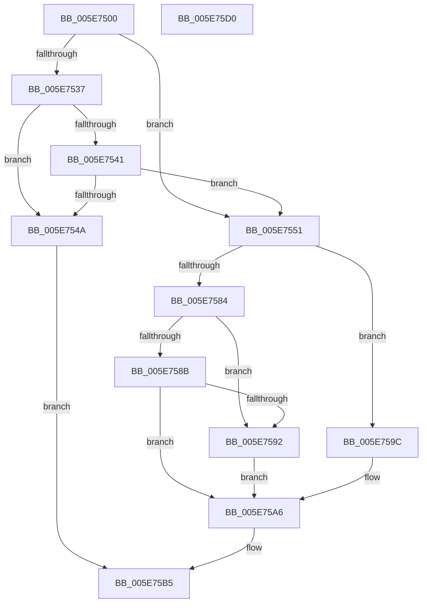

# RtlQueryInternalFeatureConfiguration

- RVA: `0x005E7500`–`0x005E75D1` (길이 `209` bytes)
- VA: `0x00000001405E7500`
- 실행 섹션: `.text`
- PDB 이름 있음: `예`; PDB Function 태그: `아니요`
- unwind 정보 RVA: `0x0005D7BC`
- 디코드: `59`개 명령, `209/209` bytes 표시
- 미해석 바이트: `0` (있으면 어셈블리에 `.byte`로 보존)

> 이 문서는 커널 이미지의 기계어와 PDB 기호를 분석해 생성했습니다. 4번과 5번은 함수 원형과 자료형을 바이너리 사용 방식에서 추정한 C 해석이며 원본 소스 복구 결과는 아닙니다.

## 1. Dependencies

- 직접 호출 지점: **5**; 고유 호출 대상: **5**
- 직접 호출자로 확인된 함수: **0**
- RIP 상대 이미지 참조: **2**

### Outgoing calls
- `0x005E752E` → [KeGetEffectiveIrql](../2F/KeGetEffectiveIrql_function_002F8030.md) (function, `0x002F8030`)
- `0x005E7551` → [RtlpFcGetBufferManager](../../page/70/RtlpFcGetBufferManager_function_00705A30.md) (function, `0x00705A30`)
- `0x005E7566` → [RtlpFcBufferManagerReferenceBuffers](../4A/RtlpFcBufferManagerReferenceBuffers_function_004A73B8.md) (function, `0x004A73B8`)
- `0x005E7579` → [RtlpFcQueryFeatureConfigurationFromBufferSet](../../page/70/RtlpFcQueryFeatureConfigurationFromBufferSet_function_007035C4.md) (function, `0x007035C4`)
- `0x005E75AE` → [RtlpFcBufferManagerDereferenceBuffers](../37/RtlpFcBufferManagerDereferenceBuffers_function_00378D84.md) (function, `0x00378D84`)

### Direct callers
- 이 함수 시작 RVA로 연결되는 직접 call은 확인되지 않았습니다. 간접 호출은 완전히 역산할 수 없습니다.

### Static image references
- `0x005E7537` → RVA `0x00F4754C` (`.data`; read)
- `0x005E7541` → RVA `0x00F0BD20` (`.data`; read)

## 2. Other-region calls and transfers

- 다른 실행 섹션으로 향하는 call: **2**
  - `0x005E7551` → [RtlpFcGetBufferManager](../../page/70/RtlpFcGetBufferManager_function_00705A30.md) (`.text` → `PAGE`)
  - `0x005E7579` → [RtlpFcQueryFeatureConfigurationFromBufferSet](../../page/70/RtlpFcQueryFeatureConfigurationFromBufferSet_function_007035C4.md) (`.text` → `PAGE`)
- 별도 외부 분기/꼬리 이동을 확인하지 못했습니다.

## 3. Assembly (complete function range)

```asm
005E7500  48 8B C4                        mov rax, rsp
005E7503  48 89 58 08                     mov qword ptr [rax + 8], rbx
005E7507  48 89 68 10                     mov qword ptr [rax + 0x10], rbp
005E750B  48 89 70 18                     mov qword ptr [rax + 0x18], rsi
005E750F  48 89 78 20                     mov qword ptr [rax + 0x20], rdi
005E7513  41 56                           push r14
005E7515  48 83 EC 30                     sub rsp, 0x30
005E7519  48 83 60 E8 00                  and qword ptr [rax - 0x18], 0
005E751E  49 8B D9                        mov rbx, r9
005E7521  48 83 60 F0 00                  and qword ptr [rax - 0x10], 0
005E7526  49 8B F8                        mov rdi, r8
005E7529  8B EA                           mov ebp, edx
005E752B  44 8B F1                        mov r14d, ecx
005E752E  E8 FD 0A D1 FF                  call 0x1402f8030
005E7533  3C 01                           cmp al, 1
005E7535  76 1A                           jbe 0x1405e7551
005E7537  8B 05 0F 00 96 00               mov eax, dword ptr [rip + 0x96000f]
005E753D  A8 03                           test al, 3
005E753F  75 09                           jne 0x1405e754a
005E7541  80 3D D8 47 92 00 00            cmp byte ptr [rip + 0x9247d8], 0
005E7548  74 07                           je 0x1405e7551
005E754A  B8 22 00 00 80                  mov eax, 0x80000022
005E754F  EB 64                           jmp 0x1405e75b5
005E7551  E8 DA E4 11 00                  call 0x140705a30
005E7556  48 8B C8                        mov rcx, rax
005E7559  4C 8D 44 24 28                  lea r8, [rsp + 0x28]
005E755E  48 8D 54 24 20                  lea rdx, [rsp + 0x20]
005E7563  48 8B F0                        mov rsi, rax
005E7566  E8 4D FE EB FF                  call 0x1404a73b8
005E756B  48 8B 4C 24 28                  mov rcx, qword ptr [rsp + 0x28]
005E7570  4C 8B CB                        mov r9, rbx
005E7573  44 8B C5                        mov r8d, ebp
005E7576  41 8B D6                        mov edx, r14d
005E7579  E8 46 C0 11 00                  call 0x1407035c4
005E757E  8B D8                           mov ebx, eax
005E7580  85 C0                           test eax, eax
005E7582  79 18                           jns 0x1405e759c
005E7584  3D 25 02 00 C0                  cmp eax, 0xc0000225
005E7589  74 07                           je 0x1405e7592
005E758B  3D 22 00 00 80                  cmp eax, 0x80000022
005E7590  75 14                           jne 0x1405e75a6
005E7592  48 8B 4C 24 20                  mov rcx, qword ptr [rsp + 0x20]
005E7597  48 89 0F                        mov qword ptr [rdi], rcx
005E759A  EB 0A                           jmp 0x1405e75a6
005E759C  48 8B 44 24 20                  mov rax, qword ptr [rsp + 0x20]
005E75A1  33 DB                           xor ebx, ebx
005E75A3  48 89 07                        mov qword ptr [rdi], rax
005E75A6  48 8B 54 24 28                  mov rdx, qword ptr [rsp + 0x28]
005E75AB  48 8B CE                        mov rcx, rsi
005E75AE  E8 D1 17 D9 FF                  call 0x140378d84
005E75B3  8B C3                           mov eax, ebx
005E75B5  48 8B 5C 24 40                  mov rbx, qword ptr [rsp + 0x40]
005E75BA  48 8B 6C 24 48                  mov rbp, qword ptr [rsp + 0x48]
005E75BF  48 8B 74 24 50                  mov rsi, qword ptr [rsp + 0x50]
005E75C4  48 8B 7C 24 58                  mov rdi, qword ptr [rsp + 0x58]
005E75C9  48 83 C4 30                     add rsp, 0x30
005E75CD  41 5E                           pop r14
005E75CF  C3                              ret
005E75D0  CC                              int3
```

## 4. C-style interpretation (structured pseudocode)

```c
__int64 __fastcall RtlQueryInternalFeatureConfiguration(int a1, int a2, __int64 a3, __int64 a4)
{
    __int64 result;
    __int64 v_rbx;
    __int64 v_rsp;
    unsigned __int64 v_stack_m10;
    unsigned __int64 v_stack_m18;
    unsigned __int64 v_stack_p10;
    unsigned __int64 v_stack_p18;
    unsigned __int64 v_stack_p20;
    unsigned __int64 v_stack_p8;

    *(unsigned __int64 *)(v_rsp + 8) = v_rbx;
    *(unsigned __int64 *)(v_rsp + 16) = v_rbp;
    *(unsigned __int64 *)(v_rsp + 24) = v_rsi;
    *(unsigned __int64 *)(v_rsp + 32) = v_rdi;
    v_rsp = (v_rsp) - (48);
    result = KeGetEffectiveIrql(a1, a2, a3, a4);
    if (((unsigned __int8)(result)) <= 1) goto loc_005E7551;
    if ((((unsigned __int8)((unsigned int)(*(unsigned int *)(v_rip + 9830415)))) & (3)) != 0) goto loc_005E754A;
    if ((*(unsigned __int8 *)(v_rip + 9586648)) == 0) goto loc_005E7551;
loc_005E754A:
    goto loc_005E75B5;
loc_005E7551:
    result = RtlpFcGetBufferManager(a1, a2, a3, a4);
    result = RtlpFcBufferManagerReferenceBuffers(result, v_stack_m18, v_stack_m10, a4);
    result = RtlpFcQueryFeatureConfigurationFromBufferSet(v_stack_m10, (unsigned int)((unsigned int)((unsigned int)(a1))), (unsigned int)((unsigned int)((unsigned int)(a2))), a4);
    if (!sign_flag) goto loc_005E759C;
    if (((unsigned int)(result)) == 0xC0000225ULL) goto loc_005E7592;
    if (((unsigned int)(result)) != 0x80000022ULL) goto loc_005E75A6;
loc_005E7592:
    *(unsigned __int64 *)(a3) = v_stack_m18;
    goto loc_005E75A6;
loc_005E759C:
    v_rbx = 0;
    *(unsigned __int64 *)(a3) = v_stack_m18;
loc_005E75A6:
    result = RtlpFcBufferManagerDereferenceBuffers(result, v_stack_m10, (unsigned int)((unsigned int)((unsigned int)(a2))), a4);
loc_005E75B5:
    v_rsp = (v_rsp) + (48);
    return 0;
}
```

## 5. (Beta) C Style

```c
int64_t RtlQueryInternalFeatureConfiguration(int32_t Arg1, int32_t Arg2, void *Arg3, int64_t Arg4)
{
    uint8_t *arg3 = (uint8_t *)Arg3;

    int64_t result;
    int64_t local_rbx;
    int64_t local_rsp;
    uint64_t v_stack_m10;
    uint64_t v_stack_m18;
    uint64_t v_stack_p10;
    uint64_t v_stack_p18;
    uint64_t v_stack_p20;
    uint64_t v_stack_p8;

    *(uint64_t *)(local_rsp + 0x8) = local_rbx;
    *(uint64_t *)(local_rsp + 0x10) = local_rbp;
    *(uint64_t *)(local_rsp + 0x18) = local_rsi;
    *(uint64_t *)(local_rsp + 0x20) = local_rdi;
    local_rsp = (local_rsp) - (48);
    result = KeGetEffectiveIrql(Arg1, Arg2, Arg3, Arg4);
    if (((uint8_t)(result)) <= 1) goto loc_005E7551;
    if ((((uint8_t)((uint32_t)(*(uint32_t *)(v_rip + 0x96000F)))) & (3)) != 0) goto loc_005E754A;
    if ((*(uint8_t *)(v_rip + 0x9247D8)) == 0) goto loc_005E7551;
loc_005E754A:
    goto loc_005E75B5;
loc_005E7551:
    result = RtlpFcGetBufferManager(Arg1, Arg2, Arg3, Arg4);
    result = RtlpFcBufferManagerReferenceBuffers(result, v_stack_m18, v_stack_m10, Arg4);
    result = RtlpFcQueryFeatureConfigurationFromBufferSet(v_stack_m10, (uint32_t)((uint32_t)((uint32_t)(Arg1))), (uint32_t)((uint32_t)((uint32_t)(Arg2))), Arg4);
    if (!sign_flag) goto loc_005E759C;
    if (((uint32_t)(result)) == 0xC0000225ULL) goto loc_005E7592;
    if (((uint32_t)(result)) != 0x80000022ULL) goto loc_005E75A6;
loc_005E7592:
    *(uint64_t *)(arg3) = v_stack_m18;
    goto loc_005E75A6;
loc_005E759C:
    local_rbx = 0;
    *(uint64_t *)(arg3) = v_stack_m18;
loc_005E75A6:
    result = RtlpFcBufferManagerDereferenceBuffers(result, v_stack_m10, (uint32_t)((uint32_t)((uint32_t)(Arg2))), Arg4);
loc_005E75B5:
    local_rsp = (local_rsp) + (48);
    return 0;
}
```

### 관측된 메모리 오프셋

구조체 형식이 확인되지 않은 접근은 인자 기준의 오프셋으로만 기록했습니다.

| 기준 인자 | 오프셋 표현 | 폭 (bit) | 접근 |
|---|---:|---:|---|
| `Arg3` | `+ 0x0` | `64` | `W` |

## 6. Execution-region graph

[열기: 2D/3D 그래프와 함수 탐색 컨트롤 패널](../../../control-panel.html?section=text&rva=0x005E7500&view=graph)

- 2D 그래프는 위에서 아래로 흐르고, 3D 그래프는 빈 공간을 드래그해 회전합니다. Shift+드래그는 이동, 휠은 확대·축소, 함수 노드 선택은 대상 보고서 이동입니다.

### Static fallback


