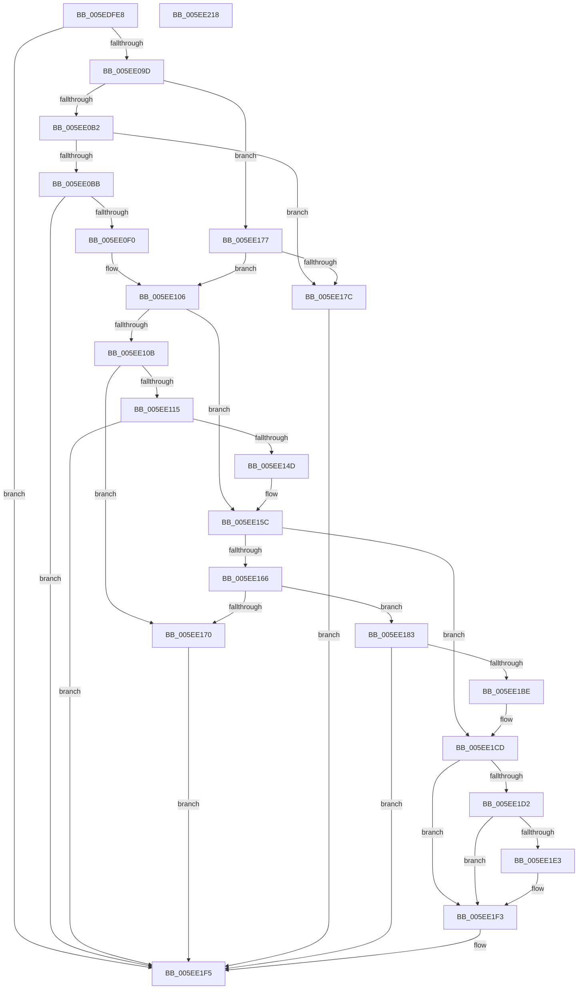

# RtlQueryPackageClaimsEx

- RVA: `0x005EDFE8`–`0x005EE219` (길이 `561` bytes)
- VA: `0x00000001405EDFE8`
- 실행 섹션: `.text`
- PDB 이름 있음: `예`; PDB Function 태그: `아니요`
- unwind 정보 RVA: `0x000CFED4`
- 디코드: `145`개 명령, `561/561` bytes 표시
- 미해석 바이트: `0` (있으면 어셈블리에 `.byte`로 보존)

> 이 문서는 커널 이미지의 기계어와 PDB 기호를 분석해 생성했습니다. 4번과 5번은 함수 원형과 자료형을 바이너리 사용 방식에서 추정한 C 해석이며 원본 소스 복구 결과는 아닙니다.

## 1. Dependencies

- 직접 호출 지점: **7**; 고유 호출 대상: **5**
- 직접 호출자로 확인된 함수: **3**
- RIP 상대 이미지 참조: **2**

### Outgoing calls
- `0x005EE06D` → [memset](../6C/memset_function_006C6C40.md) (function, `0x006C6C40`)
- `0x005EE08E` → [RtlpQueryPackageIdentityAttributes](../45/RtlpQueryPackageIdentityAttributes_function_00453C9C.md) (function, `0x00453C9C`)
- `0x005EE0E1` → [RtlStringCbPrintfExW](../46/RtlStringCbPrintfExW_function_00461AD4.md) (function, `0x00461AD4`)
- `0x005EE13E` → [RtlStringCbPrintfExW](../46/RtlStringCbPrintfExW_function_00461AD4.md) (function, `0x00461AD4`)
- `0x005EE1B3` → [RtlStringCbPrintfExW](../46/RtlStringCbPrintfExW_function_00461AD4.md) (function, `0x00461AD4`)
- `0x005EE1EE` → [RtlGUIDFromString](../../page/8F/RtlGUIDFromString_function_008F1EF0.md) (function, `0x008F1EF0`)
- `0x005EE1FF` → [_security_check_cookie](../6A/_security_check_cookie_function_006AC640.md) (function, `0x006AC640`)

### Direct callers
- [RtlQueryPackageClaims](../45/RtlQueryPackageClaims_function_0045C3F0.md) at `0x0045C431`
- [AppModelPolicy_GetPolicy_Internal](../49/AppModelPolicy_GetPolicy_Internal_function_0049FAEC.md) at `0x0049FB35`
- [SepAppIdentityFromPackageInformation](../60/SepAppIdentityFromPackageInformation_function_00607D7C.md) at `0x00607E4C`

### Static image references
- `0x005EE004` → RVA `0x00E0A740` (`.data`; read)
- `0x005EE09D` → RVA `0x006CD220` (` ?? ::FNODOBFM::`string'`; read)

## 2. Other-region calls and transfers

- 다른 실행 섹션으로 향하는 call: **1**
  - `0x005EE1EE` → [RtlGUIDFromString](../../page/8F/RtlGUIDFromString_function_008F1EF0.md) (`.text` → `PAGE`)
- 별도 외부 분기/꼬리 이동을 확인하지 못했습니다.

## 3. Assembly (complete function range)

```asm
005EDFE8  40 55                           push rbp
005EDFEA  53                              push rbx
005EDFEB  56                              push rsi
005EDFEC  57                              push rdi
005EDFED  41 54                           push r12
005EDFEF  41 55                           push r13
005EDFF1  41 56                           push r14
005EDFF3  41 57                           push r15
005EDFF5  48 8D AC 24 48 FD FF FF         lea rbp, [rsp - 0x2b8]
005EDFFD  48 81 EC B8 03 00 00            sub rsp, 0x3b8
005EE004  48 8B 05 35 C7 81 00            mov rax, qword ptr [rip + 0x81c735]
005EE00B  48 33 C4                        xor rax, rsp
005EE00E  48 89 85 A8 02 00 00            mov qword ptr [rbp + 0x2a8], rax
005EE015  48 8B 85 20 03 00 00            mov rax, qword ptr [rbp + 0x320]
005EE01C  4D 8B F0                        mov r14, r8
005EE01F  4C 8B BD 38 03 00 00            mov r15, qword ptr [rbp + 0x338]
005EE026  4C 8B E2                        mov r12, rdx
005EE029  48 8B BD 40 03 00 00            mov rdi, qword ptr [rbp + 0x340]
005EE030  48 8B F1                        mov rsi, rcx
005EE033  48 8B 9D 48 03 00 00            mov rbx, qword ptr [rbp + 0x348]
005EE03A  48 8D 4C 24 78                  lea rcx, [rsp + 0x78]
005EE03F  48 83 64 24 48 00               and qword ptr [rsp + 0x48], 0
005EE045  33 D2                           xor edx, edx
005EE047  48 89 44 24 58                  mov qword ptr [rsp + 0x58], rax
005EE04C  41 B8 30 03 00 00               mov r8d, 0x330
005EE052  48 8B 85 28 03 00 00            mov rax, qword ptr [rbp + 0x328]
005EE059  4D 8B E9                        mov r13, r9
005EE05C  48 89 44 24 60                  mov qword ptr [rsp + 0x60], rax
005EE061  48 8B 85 30 03 00 00            mov rax, qword ptr [rbp + 0x330]
005EE068  48 89 44 24 68                  mov qword ptr [rsp + 0x68], rax
005EE06D  E8 CE 8B 0D 00                  call 0x1406c6c40
005EE072  48 83 64 24 40 00               and qword ptr [rsp + 0x40], 0
005EE078  4C 8D 44 24 78                  lea r8, [rsp + 0x78]
005EE07D  48 83 64 24 50 00               and qword ptr [rsp + 0x50], 0
005EE083  4C 8B CF                        mov r9, rdi
005EE086  48 8B CE                        mov rcx, rsi
005EE089  48 89 5C 24 20                  mov qword ptr [rsp + 0x20], rbx
005EE08E  E8 09 5C E6 FF                  call 0x140453c9c
005EE093  8B D8                           mov ebx, eax
005EE095  85 C0                           test eax, eax
005EE097  0F 88 58 01 00 00               js 0x1405ee1f5
005EE09D  48 8D 15 7C F1 0D 00            lea rdx, [rip + 0xdf17c]
005EE0A4  BE 00 08 00 00                  mov esi, 0x800
005EE0A9  4D 85 E4                        test r12, r12
005EE0AC  0F 84 C5 00 00 00               je 0x1405ee177
005EE0B2  4D 85 F6                        test r14, r14
005EE0B5  0F 84 C1 00 00 00               je 0x1405ee17c
005EE0BB  48 8B 45 80                     mov rax, qword ptr [rbp - 0x80]
005EE0BF  4C 8D 4C 24 70                  lea r9, [rsp + 0x70]
005EE0C4  4C 8D 44 24 40                  lea r8, [rsp + 0x40]
005EE0C9  48 8B 48 20                     mov rcx, qword ptr [rax + 0x20]
005EE0CD  48 89 4C 24 30                  mov qword ptr [rsp + 0x30], rcx
005EE0D2  49 8B CC                        mov rcx, r12
005EE0D5  48 89 54 24 28                  mov qword ptr [rsp + 0x28], rdx
005EE0DA  49 8B 16                        mov rdx, qword ptr [r14]
005EE0DD  89 74 24 20                     mov dword ptr [rsp + 0x20], esi
005EE0E1  E8 EE 39 E7 FF                  call 0x140461ad4
005EE0E6  8B D8                           mov ebx, eax
005EE0E8  85 C0                           test eax, eax
005EE0EA  0F 88 05 01 00 00               js 0x1405ee1f5
005EE0F0  48 8B 44 24 40                  mov rax, qword ptr [rsp + 0x40]
005EE0F5  48 8D 15 24 F1 0D 00            lea rdx, [rip + 0xdf124]
005EE0FC  49 2B C4                        sub rax, r12
005EE0FF  48 83 C0 02                     add rax, 2
005EE103  49 89 06                        mov qword ptr [r14], rax
005EE106  4D 85 ED                        test r13, r13
005EE109  74 51                           je 0x1405ee15c
005EE10B  48 8B 45 80                     mov rax, qword ptr [rbp - 0x80]
005EE10F  83 78 18 02                     cmp dword ptr [rax + 0x18], 2
005EE113  72 5B                           jb 0x1405ee170
005EE115  48 8B 40 20                     mov rax, qword ptr [rax + 0x20]
005EE119  4C 8D 44 24 48                  lea r8, [rsp + 0x48]
005EE11E  48 8B 7C 24 58                  mov rdi, qword ptr [rsp + 0x58]
005EE123  48 83 C0 10                     add rax, 0x10
005EE127  48 89 44 24 30                  mov qword ptr [rsp + 0x30], rax
005EE12C  45 33 C9                        xor r9d, r9d
005EE12F  48 89 54 24 28                  mov qword ptr [rsp + 0x28], rdx
005EE134  49 8B CD                        mov rcx, r13
005EE137  89 74 24 20                     mov dword ptr [rsp + 0x20], esi
005EE13B  48 8B 17                        mov rdx, qword ptr [rdi]
005EE13E  E8 91 39 E7 FF                  call 0x140461ad4
005EE143  8B D8                           mov ebx, eax
005EE145  85 C0                           test eax, eax
005EE147  0F 88 A8 00 00 00               js 0x1405ee1f5
005EE14D  48 8B 44 24 48                  mov rax, qword ptr [rsp + 0x48]
005EE152  49 2B C5                        sub rax, r13
005EE155  48 83 C0 02                     add rax, 2
005EE159  48 89 07                        mov qword ptr [rdi], rax
005EE15C  48 8B 7C 24 60                  mov rdi, qword ptr [rsp + 0x60]
005EE161  48 85 FF                        test rdi, rdi
005EE164  74 67                           je 0x1405ee1cd
005EE166  48 8B 45 80                     mov rax, qword ptr [rbp - 0x80]
005EE16A  83 78 18 03                     cmp dword ptr [rax + 0x18], 3
005EE16E  73 13                           jae 0x1405ee183
005EE170  B8 0C 05 00 C0                  mov eax, 0xc000050c
005EE175  EB 7E                           jmp 0x1405ee1f5
005EE177  4D 85 F6                        test r14, r14
005EE17A  74 8A                           je 0x1405ee106
005EE17C  B8 0D 00 00 C0                  mov eax, 0xc000000d
005EE181  EB 72                           jmp 0x1405ee1f5
005EE183  48 8B 40 20                     mov rax, qword ptr [rax + 0x20]
005EE187  4C 8D 44 24 50                  lea r8, [rsp + 0x50]
005EE18C  48 83 C0 20                     add rax, 0x20
005EE190  45 33 C9                        xor r9d, r9d
005EE193  48 89 44 24 30                  mov qword ptr [rsp + 0x30], rax
005EE198  48 8B CF                        mov rcx, rdi
005EE19B  48 8D 05 7E F0 0D 00            lea rax, [rip + 0xdf07e]
005EE1A2  48 89 44 24 28                  mov qword ptr [rsp + 0x28], rax
005EE1A7  89 74 24 20                     mov dword ptr [rsp + 0x20], esi
005EE1AB  48 8B 74 24 68                  mov rsi, qword ptr [rsp + 0x68]
005EE1B0  48 8B 16                        mov rdx, qword ptr [rsi]
005EE1B3  E8 1C 39 E7 FF                  call 0x140461ad4
005EE1B8  8B D8                           mov ebx, eax
005EE1BA  85 C0                           test eax, eax
005EE1BC  78 37                           js 0x1405ee1f5
005EE1BE  48 8B 44 24 50                  mov rax, qword ptr [rsp + 0x50]
005EE1C3  48 2B C7                        sub rax, rdi
005EE1C6  48 83 C0 02                     add rax, 2
005EE1CA  48 89 06                        mov qword ptr [rsi], rax
005EE1CD  4D 85 FF                        test r15, r15
005EE1D0  74 21                           je 0x1405ee1f3
005EE1D2  48 8B 4D 80                     mov rcx, qword ptr [rbp - 0x80]
005EE1D6  0F 57 C0                        xorps xmm0, xmm0
005EE1D9  41 0F 11 07                     movups xmmword ptr [r15], xmm0
005EE1DD  83 79 18 03                     cmp dword ptr [rcx + 0x18], 3
005EE1E1  76 10                           jbe 0x1405ee1f3
005EE1E3  48 8B 49 20                     mov rcx, qword ptr [rcx + 0x20]
005EE1E7  49 8B D7                        mov rdx, r15
005EE1EA  48 83 C1 30                     add rcx, 0x30
005EE1EE  E8 FD 3C 30 00                  call 0x1408f1ef0
005EE1F3  8B C3                           mov eax, ebx
005EE1F5  48 8B 8D A8 02 00 00            mov rcx, qword ptr [rbp + 0x2a8]
005EE1FC  48 33 CC                        xor rcx, rsp
005EE1FF  E8 3C E4 0B 00                  call 0x1406ac640
005EE204  48 81 C4 B8 03 00 00            add rsp, 0x3b8
005EE20B  41 5F                           pop r15
005EE20D  41 5E                           pop r14
005EE20F  41 5D                           pop r13
005EE211  41 5C                           pop r12
005EE213  5F                              pop rdi
005EE214  5E                              pop rsi
005EE215  5B                              pop rbx
005EE216  5D                              pop rbp
005EE217  C3                              ret
005EE218  CC                              int3
```

## 4. C-style interpretation (structured pseudocode)

```c
__int64 __fastcall RtlQueryPackageClaimsEx(__int64 a1, __int64 a2, __int64 a3, __int64 a4, __int64 a5, __int64 a6, __int64 a7, __int64 a8, __int64 a9, __int64 a10)
{
    __int64 result;
    __int64 v_rsp;
    unsigned __int64 v_stack_m2F8;
    unsigned __int64 v_stack_m378;
    unsigned __int64 v_stack_m380;
    unsigned __int64 v_stack_m388;
    unsigned __int64 v_stack_m390;
    unsigned __int64 v_stack_m398;
    unsigned __int64 v_stack_m3A0;
    unsigned __int64 v_stack_m3A8;
    unsigned __int64 v_stack_m3B0;
    unsigned __int64 v_stack_m3B8;
    unsigned __int64 v_stack_m3C8;
    unsigned __int64 v_stack_m3D0;
    unsigned __int64 v_stack_m3D8;
    unsigned __int64 v_stack_m50;

    v_rsp = (v_rsp) - (952);
    result = (*(unsigned __int64 *)(v_rip + 8505141)) ^ (v_rsp);
    v_stack_m50 = result;
    a2 = 0;
    v_stack_m3A0 = a5;
    v_stack_m398 = a6;
    v_stack_m390 = a7;
    result = memset(v_stack_m380, a2, 816, a4);
    v_stack_m3D8 = a10;
    result = RtlpQueryPackageIdentityAttributes(a1, a2, v_stack_m380, a9);
    if (sign_flag) goto loc_005EE1F5;
    if (0 == 0) goto loc_005EE177;
    if (a3 == 0) goto loc_005EE17C;
    v_stack_m3C8 = *(unsigned __int64 *)(v_stack_m378 + 32);
    v_stack_m3D0 = v_rip + 913788;
    v_stack_m3D8 = (unsigned int)((unsigned int)(0x800ULL));
    result = RtlStringCbPrintfExW(0, *(unsigned __int64 *)(a3), v_stack_m3B8, v_stack_m388);
    if (sign_flag) goto loc_005EE1F5;
    result = (v_stack_m3B8) - (0);
    result = (result) + (2);
    *(unsigned __int64 *)(a3) = result;
loc_005EE106:
    if (a4 == 0) goto loc_005EE15C;
    if ((*(unsigned int *)(v_stack_m378 + 24)) < 2) goto loc_005EE170;
    result = (*(unsigned __int64 *)(v_stack_m378 + 32)) + (16);
    v_stack_m3C8 = result;
    a4 = 0;
    v_stack_m3D0 = v_rip + 913700;
    v_stack_m3D8 = (unsigned int)((unsigned int)(0x800ULL));
    result = RtlStringCbPrintfExW(0, *(unsigned __int64 *)(v_stack_m3A0), v_stack_m3B0, a4);
    if (sign_flag) goto loc_005EE1F5;
    result = (v_stack_m3B0) - (0);
    result = (result) + (2);
    *(unsigned __int64 *)(v_stack_m3A0) = result;
loc_005EE15C:
    if (v_stack_m398 == 0) goto loc_005EE1CD;
    if ((*(unsigned int *)(v_stack_m378 + 24)) >= 3) goto loc_005EE183;
loc_005EE170:
    goto loc_005EE1F5;
loc_005EE177:
    if (a3 == 0) goto loc_005EE106;
loc_005EE17C:
    goto loc_005EE1F5;
loc_005EE183:
    result = (*(unsigned __int64 *)((unsigned int)(0xC000000DULL) + 32)) + (32);
    a4 = 0;
    v_stack_m3C8 = result;
    v_stack_m3D0 = v_rip + 913534;
    v_stack_m3D8 = (unsigned int)((unsigned int)(0x800ULL));
    result = RtlStringCbPrintfExW(v_stack_m398, *(unsigned __int64 *)(v_stack_m390), v_stack_m3A8, a4);
    if (sign_flag) goto loc_005EE1F5;
    result = (v_stack_m3A8) - (v_stack_m398);
    result = (result) + (2);
    *(unsigned __int64 *)(v_stack_m390) = result;
loc_005EE1CD:
    if (a8 == 0) goto loc_005EE1F3;
    *(unsigned __int64 *)(a8) = v_xmm0;
    if ((*(unsigned int *)(v_stack_m378 + 24)) >= = 3) {
        a1 = *(unsigned __int64 *)(v_stack_m378 + 32);
        a2 = a8;
        a1 = (a1) + (48);
        result = RtlGUIDFromString(a1, a2, v_stack_m3A8, a4);
    }
loc_005EE1F5:
    a1 = (v_stack_m50) ^ (v_rsp);
    result = _security_check_cookie(a1, a2, v_stack_m3A8, a4);
    v_rsp = (v_rsp) + (952);
    return result;
}
```

## 5. (Beta) C Style

```c
int64_t RtlQueryPackageClaimsEx(int64_t Arg1, int64_t Arg2, int64_t Arg3, int64_t Arg4, int64_t Arg5, int64_t Arg6, int64_t Arg7, int64_t Arg8, int64_t Arg9, int64_t Arg10)
{
    int64_t result;
    int64_t local_rsp;
    uint64_t v_stack_m2F8;
    uint64_t v_stack_m378;
    uint64_t v_stack_m380;
    uint64_t v_stack_m388;
    uint64_t v_stack_m390;
    uint64_t v_stack_m398;
    uint64_t v_stack_m3A0;
    uint64_t v_stack_m3A8;
    uint64_t v_stack_m3B0;
    uint64_t v_stack_m3B8;
    uint64_t v_stack_m3C8;
    uint64_t v_stack_m3D0;
    uint64_t v_stack_m3D8;
    uint64_t v_stack_m50;

    local_rsp = (local_rsp) - (952);
    result = (*(uint64_t *)(v_rip + 0x81C735)) ^ (local_rsp);
    v_stack_m50 = result;
    Arg2 = 0;
    v_stack_m3A0 = Arg5;
    v_stack_m398 = Arg6;
    v_stack_m390 = Arg7;
    result = memset(v_stack_m380, Arg2, 816, Arg4);
    v_stack_m3D8 = Arg10;
    result = RtlpQueryPackageIdentityAttributes(Arg1, Arg2, v_stack_m380, Arg9);
    if (sign_flag) goto loc_005EE1F5;
    if (0 == 0) goto loc_005EE177;
    if (Arg3 == 0) goto loc_005EE17C;
    v_stack_m3C8 = *(uint64_t *)(v_stack_m378 + 0x20);
    v_stack_m3D0 = v_rip + 913788;
    v_stack_m3D8 = (uint32_t)((uint32_t)(0x800ULL));
    result = RtlStringCbPrintfExW(0, *(uint64_t *)(Arg3), v_stack_m3B8, v_stack_m388);
    if (sign_flag) goto loc_005EE1F5;
    result = (v_stack_m3B8) - (0);
    result = (result) + (2);
    *(uint64_t *)(Arg3) = result;
loc_005EE106:
    if (Arg4 == 0) goto loc_005EE15C;
    if ((*(uint32_t *)(v_stack_m378 + 0x18)) < 2) goto loc_005EE170;
    result = (*(uint64_t *)(v_stack_m378 + 0x20)) + (16);
    v_stack_m3C8 = result;
    Arg4 = 0;
    v_stack_m3D0 = v_rip + 913700;
    v_stack_m3D8 = (uint32_t)((uint32_t)(0x800ULL));
    result = RtlStringCbPrintfExW(0, *(uint64_t *)(v_stack_m3A0), v_stack_m3B0, Arg4);
    if (sign_flag) goto loc_005EE1F5;
    result = (v_stack_m3B0) - (0);
    result = (result) + (2);
    *(uint64_t *)(v_stack_m3A0) = result;
loc_005EE15C:
    if (v_stack_m398 == 0) goto loc_005EE1CD;
    if ((*(uint32_t *)(v_stack_m378 + 0x18)) >= 3) goto loc_005EE183;
loc_005EE170:
    goto loc_005EE1F5;
loc_005EE177:
    if (Arg3 == 0) goto loc_005EE106;
loc_005EE17C:
    goto loc_005EE1F5;
loc_005EE183:
    result = (*(uint64_t *)((uint32_t)(0xC000000DULL) + 0x20)) + (32);
    Arg4 = 0;
    v_stack_m3C8 = result;
    v_stack_m3D0 = v_rip + 913534;
    v_stack_m3D8 = (uint32_t)((uint32_t)(0x800ULL));
    result = RtlStringCbPrintfExW(v_stack_m398, *(uint64_t *)(v_stack_m390), v_stack_m3A8, Arg4);
    if (sign_flag) goto loc_005EE1F5;
    result = (v_stack_m3A8) - (v_stack_m398);
    result = (result) + (2);
    *(uint64_t *)(v_stack_m390) = result;
loc_005EE1CD:
    if (Arg8 == 0) goto loc_005EE1F3;
    *(uint64_t *)(Arg8) = v_xmm0;
    if ((*(uint32_t *)(v_stack_m378 + 0x18)) >= = 3) {
        Arg1 = *(uint64_t *)(v_stack_m378 + 0x20);
        Arg2 = Arg8;
        Arg1 = (Arg1) + (48);
        result = RtlGUIDFromString(Arg1, Arg2, v_stack_m3A8, Arg4);
    }
loc_005EE1F5:
    Arg1 = (v_stack_m50) ^ (local_rsp);
    result = _security_check_cookie(Arg1, Arg2, v_stack_m3A8, Arg4);
    local_rsp = (local_rsp) + (952);
    return result;
}
```

## 6. Execution-region graph

[열기: 2D/3D 그래프와 함수 탐색 컨트롤 패널](../../../control-panel.html?section=text&rva=0x005EDFE8&view=graph)

- 2D 그래프는 위에서 아래로 흐르고, 3D 그래프는 빈 공간을 드래그해 회전합니다. Shift+드래그는 이동, 휠은 확대·축소, 함수 노드 선택은 대상 보고서 이동입니다.

### Static fallback


