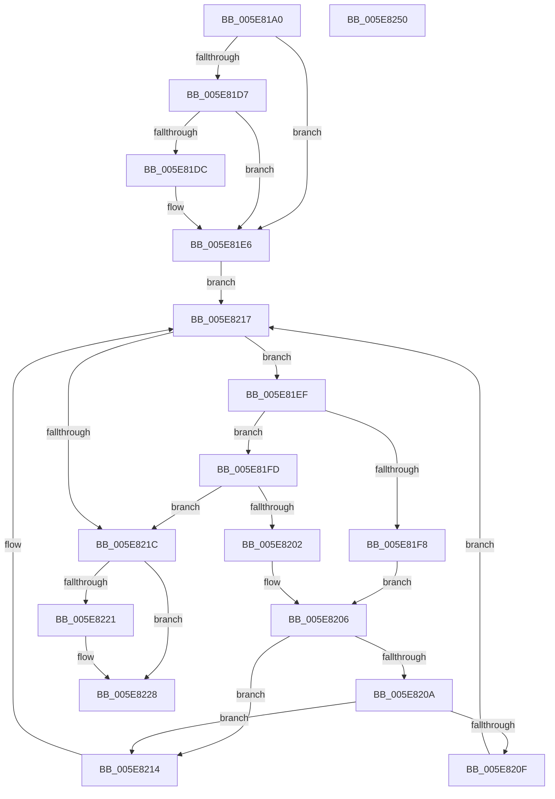

# RtlQueryPointerMapping

- RVA: `0x005E81A0`–`0x005E8251` (길이 `177` bytes)
- VA: `0x00000001405E81A0`
- 실행 섹션: `.text`
- PDB 이름 있음: `예`; PDB Function 태그: `아니요`
- unwind 정보 RVA: `0x00060BC4`
- 디코드: `53`개 명령, `177/177` bytes 표시
- 미해석 바이트: `0` (있으면 어셈블리에 `.byte`로 보존)

> 이 문서는 커널 이미지의 기계어와 PDB 기호를 분석해 생성했습니다. 4번과 5번은 함수 원형과 자료형을 바이너리 사용 방식에서 추정한 C 해석이며 원본 소스 복구 결과는 아닙니다.

## 1. Dependencies

- 직접 호출 지점: **2**; 고유 호출 대상: **2**
- 직접 호출자로 확인된 함수: **0**
- RIP 상대 이미지 참조: **3**

### Outgoing calls
- `0x005E81BC` → [RtlpAcquirePropStoreLockShared](RtlpAcquirePropStoreLockShared_function_005E850C.md) (function, `0x005E850C`)
- `0x005E822F` → [RtlpReleasePropStoreLockShared](RtlpReleasePropStoreLockShared_function_005E85B0.md) (function, `0x005E85B0`)

### Direct callers
- 이 함수 시작 RVA로 연결되는 직접 call은 확인되지 않았습니다. 간접 호출은 완전히 역산할 수 없습니다.

### Static image references
- `0x005E81B5` → RVA `0x00E67B18` (`.data`; read)
- `0x005E81C1` → RVA `0x00E0C5C8` (`.data`; read)
- `0x005E81CA` → RVA `0x00E0C5C0` (`.data`; read)

## 2. Other-region calls and transfers

- 다른 실행 섹션으로 향하는 call: **0**
- 별도 외부 분기/꼬리 이동을 확인하지 못했습니다.

## 3. Assembly (complete function range)

```asm
005E81A0  48 89 5C 24 08                  mov qword ptr [rsp + 8], rbx
005E81A5  48 89 74 24 10                  mov qword ptr [rsp + 0x10], rsi
005E81AA  57                              push rdi
005E81AB  48 83 EC 20                     sub rsp, 0x20
005E81AF  48 8B F1                        mov rsi, rcx
005E81B2  48 8B FA                        mov rdi, rdx
005E81B5  48 8D 0D 5C F9 87 00            lea rcx, [rip + 0x87f95c]
005E81BC  E8 4B 03 00 00                  call 0x1405e850c
005E81C1  4C 8B 05 00 44 82 00            mov r8, qword ptr [rip + 0x824400]
005E81C8  8A D0                           mov dl, al
005E81CA  48 8B 1D EF 43 82 00            mov rbx, qword ptr [rip + 0x8243ef]
005E81D1  41 F6 C0 01                     test r8b, 1
005E81D5  74 0F                           je 0x1405e81e6
005E81D7  48 85 DB                        test rbx, rbx
005E81DA  74 0A                           je 0x1405e81e6
005E81DC  48 8D 05 DD 43 82 00            lea rax, [rip + 0x8243dd]
005E81E3  48 33 D8                        xor rbx, rax
005E81E6  41 0F B6 C8                     movzx ecx, r8b
005E81EA  83 E1 01                        and ecx, 1
005E81ED  EB 28                           jmp 0x1405e8217
005E81EF  48 8B C6                        mov rax, rsi
005E81F2  48 2B 43 18                     sub rax, qword ptr [rbx + 0x18]
005E81F6  79 05                           jns 0x1405e81fd
005E81F8  48 8B 03                        mov rax, qword ptr [rbx]
005E81FB  EB 09                           jmp 0x1405e8206
005E81FD  48 85 C0                        test rax, rax
005E8200  7E 1A                           jle 0x1405e821c
005E8202  48 8B 43 08                     mov rax, qword ptr [rbx + 8]
005E8206  85 C9                           test ecx, ecx
005E8208  74 0A                           je 0x1405e8214
005E820A  48 85 C0                        test rax, rax
005E820D  74 05                           je 0x1405e8214
005E820F  48 33 D8                        xor rbx, rax
005E8212  EB 03                           jmp 0x1405e8217
005E8214  48 8B D8                        mov rbx, rax
005E8217  48 85 DB                        test rbx, rbx
005E821A  75 D3                           jne 0x1405e81ef
005E821C  48 85 DB                        test rbx, rbx
005E821F  74 07                           je 0x1405e8228
005E8221  48 8B 43 20                     mov rax, qword ptr [rbx + 0x20]
005E8225  48 89 07                        mov qword ptr [rdi], rax
005E8228  48 8D 0D E9 F8 87 00            lea rcx, [rip + 0x87f8e9]
005E822F  E8 7C 03 00 00                  call 0x1405e85b0
005E8234  48 8B 74 24 38                  mov rsi, qword ptr [rsp + 0x38]
005E8239  48 F7 DB                        neg rbx
005E823C  48 8B 5C 24 30                  mov rbx, qword ptr [rsp + 0x30]
005E8241  1B C0                           sbb eax, eax
005E8243  F7 D0                           not eax
005E8245  25 25 02 00 C0                  and eax, 0xc0000225
005E824A  48 83 C4 20                     add rsp, 0x20
005E824E  5F                              pop rdi
005E824F  C3                              ret
005E8250  CC                              int3
```

## 4. C-style interpretation (structured pseudocode)

```c
__int64 __fastcall RtlQueryPointerMapping(__int64 a1, __int64 a2)
{
    __int64 result;
    __int64 v_rbx;
    __int64 v_rsp;
    unsigned __int64 v_stack_p10;
    unsigned __int64 v_stack_p8;

    v_stack_p8 = v_rbx;
    v_stack_p10 = v_rsi;
    v_rsp = (v_rsp) - (32);
    result = RtlpAcquirePropStoreLockShared(v_rip + 8911196, a2, a3, a4);
    if ((((unsigned __int8)(*(unsigned __int64 *)(v_rip + 8537088))) & (1)) == 0) goto loc_005E81E6;
    v_rbx = *(unsigned __int64 *)(v_rip + 8537071);
    if (*(unsigned __int64 *)(v_rip + 8537071) != 0) {
        result = v_rip + 8537053;
        v_rbx = (*(unsigned __int64 *)(v_rip + 8537071)) ^ (result);
    }
    a1 = (unsigned int)(((unsigned __int8)(*(unsigned __int64 *)(v_rip + 8537088))) & (1));
    goto loc_005E8217;
loc_005E81EF:
    result = (a1) - (*(unsigned __int64 *)(v_rbx + 24));
    if (!sign_flag) goto loc_005E81FD;
    goto loc_005E8206;
loc_005E81FD:
    if (condition_is_less_or_equal) goto loc_005E821C;
loc_005E8206:
    if ((unsigned int)(a1) == 0) goto loc_005E8214;
    if (*(unsigned __int64 *)(v_rbx + 8) == 0) goto loc_005E8214;
    v_rbx = (v_rbx) ^ (*(unsigned __int64 *)(v_rbx + 8));
    goto loc_005E8217;
loc_005E8214:
loc_005E8217:
    if (*(unsigned __int64 *)(v_rbx + 8) != 0) goto loc_005E81EF;
loc_005E821C:
    result = *(unsigned __int64 *)(v_rbx + 8);
    if (*(unsigned __int64 *)(v_rbx + 8) != 0) {
        result = *(unsigned __int64 *)(*(unsigned __int64 *)(v_rbx + 8) + 32);
        *(unsigned __int64 *)(a2) = result;
    }
    result = RtlpReleasePropStoreLockShared(v_rip + 8911081, (unsigned __int8)(result), *(unsigned __int64 *)(v_rip + 8537088), a4);
    v_rbx = -(*(unsigned __int64 *)(v_rbx + 8));
    result = (unsigned int)(~(result));
    result = (unsigned int)((result) & (0xC0000225ULL));
    v_rsp = (v_rsp) + (32);
    return result;
}
```

## 5. (Beta) C Style

```c
int64_t RtlQueryPointerMapping(int64_t Arg1, void *Arg2)
{
    uint8_t *arg2 = (uint8_t *)Arg2;

    int64_t result;
    int64_t local_rbx;
    int64_t local_rsp;
    uint64_t v_stack_p10;
    uint64_t v_stack_p8;

    v_stack_p8 = local_rbx;
    v_stack_p10 = local_rsi;
    local_rsp = (local_rsp) - (32);
    result = RtlpAcquirePropStoreLockShared(v_rip + 8911196, Arg2, a3, a4);
    if ((((uint8_t)(*(uint64_t *)(v_rip + 0x824400))) & (1)) == 0) goto loc_005E81E6;
    local_rbx = *(uint64_t *)(v_rip + 0x8243EF);
    if (*(uint64_t *)(v_rip + 0x8243EF) != 0) {
        result = v_rip + 8537053;
        local_rbx = (*(uint64_t *)(v_rip + 0x8243EF)) ^ (result);
    }
    Arg1 = (uint32_t)(((uint8_t)(*(uint64_t *)(v_rip + 0x824400))) & (1));
    goto loc_005E8217;
loc_005E81EF:
    result = (Arg1) - (*(uint64_t *)(local_rbx + 0x18));
    if (!sign_flag) goto loc_005E81FD;
    goto loc_005E8206;
loc_005E81FD:
    if (condition_is_less_or_equal) goto loc_005E821C;
loc_005E8206:
    if ((uint32_t)(Arg1) == 0) goto loc_005E8214;
    if (*(uint64_t *)(local_rbx + 0x8) == 0) goto loc_005E8214;
    local_rbx = (local_rbx) ^ (*(uint64_t *)(local_rbx + 0x8));
    goto loc_005E8217;
loc_005E8214:
loc_005E8217:
    if (*(uint64_t *)(local_rbx + 0x8) != 0) goto loc_005E81EF;
loc_005E821C:
    result = *(uint64_t *)(local_rbx + 0x8);
    if (*(uint64_t *)(local_rbx + 0x8) != 0) {
        result = *(uint64_t *)(*(uint64_t *)(local_rbx + 0x8) + 0x20);
        *(uint64_t *)(arg2) = result;
    }
    result = RtlpReleasePropStoreLockShared(v_rip + 8911081, (uint8_t)(result), *(uint64_t *)(v_rip + 0x824400), a4);
    local_rbx = -(*(uint64_t *)(local_rbx + 0x8));
    result = (uint32_t)(~(result));
    result = (uint32_t)((result) & (0xC0000225ULL));
    local_rsp = (local_rsp) + (32);
    return result;
}
```

### 관측된 메모리 오프셋

구조체 형식이 확인되지 않은 접근은 인자 기준의 오프셋으로만 기록했습니다.

| 기준 인자 | 오프셋 표현 | 폭 (bit) | 접근 |
|---|---:|---:|---|
| `Arg2` | `+ 0x0` | `64` | `W` |

## 6. Execution-region graph

[열기: 2D/3D 그래프와 함수 탐색 컨트롤 패널](../../../control-panel.html?section=text&rva=0x005E81A0&view=graph)

- 2D 그래프는 위에서 아래로 흐르고, 3D 그래프는 빈 공간을 드래그해 회전합니다. Shift+드래그는 이동, 휠은 확대·축소, 함수 노드 선택은 대상 보고서 이동입니다.

### Static fallback


