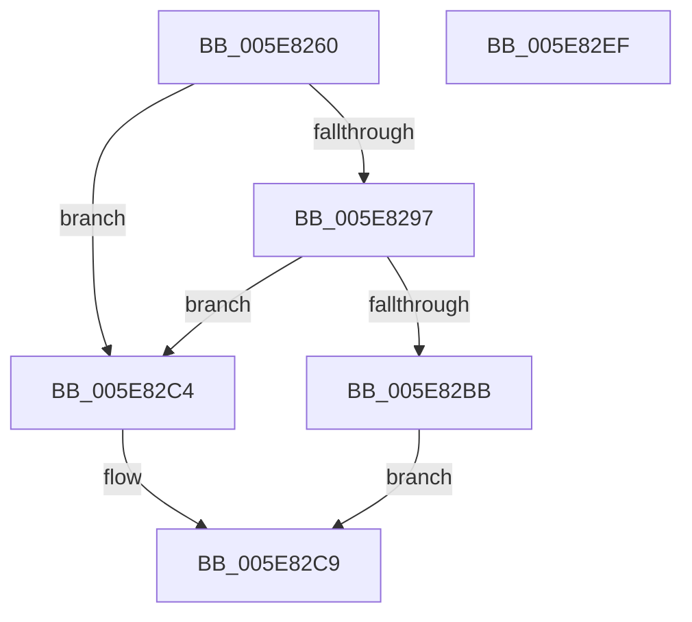

# RtlQueryPropertyStore

- RVA: `0x005E8260`–`0x005E82F0` (길이 `144` bytes)
- VA: `0x00000001405E8260`
- 실행 섹션: `.text`
- PDB 이름 있음: `예`; PDB Function 태그: `아니요`
- unwind 정보 RVA: `0x00066400`
- 디코드: `37`개 명령, `144/144` bytes 표시
- 미해석 바이트: `0` (있으면 어셈블리에 `.byte`로 보존)

> 이 문서는 커널 이미지의 기계어와 PDB 기호를 분석해 생성했습니다. 4번과 5번은 함수 원형과 자료형을 바이너리 사용 방식에서 추정한 C 해석이며 원본 소스 복구 결과는 아닙니다.

## 1. Dependencies

- 직접 호출 지점: **3**; 고유 호출 대상: **3**
- 직접 호출자로 확인된 함수: **0**
- RIP 상대 이미지 참조: **4**

### Outgoing calls
- `0x005E8281` → [RtlpAcquirePropStoreLockShared](RtlpAcquirePropStoreLockShared_function_005E850C.md) (function, `0x005E850C`)
- `0x005E82B1` → [bsearch](../50/bsearch_function_00500430.md) (function, `0x00500430`)
- `0x005E82D3` → [RtlpReleasePropStoreLockShared](RtlpReleasePropStoreLockShared_function_005E85B0.md) (function, `0x005E85B0`)

### Direct callers
- 이 함수 시작 RVA로 연결되는 직접 call은 확인되지 않았습니다. 간접 호출은 완전히 역산할 수 없습니다.

### Static image references
- `0x005E827A` → RVA `0x00E67B1C` (`.data`; read)
- `0x005E8286` → RVA `0x00F05C10` (`.data`; read)
- `0x005E8297` → RVA `0x00F05C1C` (`.data`; read)
- `0x005E829E` → RVA `0x005E8560` (`RtlpComparePropertyEntry`; read)

## 2. Other-region calls and transfers

- 다른 실행 섹션으로 향하는 call: **0**
- 별도 외부 분기/꼬리 이동을 확인하지 못했습니다.

## 3. Assembly (complete function range)

```asm
005E8260  48 89 5C 24 08                  mov qword ptr [rsp + 8], rbx
005E8265  48 89 6C 24 10                  mov qword ptr [rsp + 0x10], rbp
005E826A  48 89 74 24 18                  mov qword ptr [rsp + 0x18], rsi
005E826F  57                              push rdi
005E8270  48 83 EC 30                     sub rsp, 0x30
005E8274  48 8B E9                        mov rbp, rcx
005E8277  48 8B F2                        mov rsi, rdx
005E827A  48 8D 0D 9B F8 87 00            lea rcx, [rip + 0x87f89b]
005E8281  E8 86 02 00 00                  call 0x1405e850c
005E8286  48 8B 15 83 D9 91 00            mov rdx, qword ptr [rip + 0x91d983]
005E828D  33 DB                           xor ebx, ebx
005E828F  40 8A F8                        mov dil, al
005E8292  48 85 D2                        test rdx, rdx
005E8295  74 2D                           je 0x1405e82c4
005E8297  44 8B 05 7E D9 91 00            mov r8d, dword ptr [rip + 0x91d97e]
005E829E  48 8D 05 BB 02 00 00            lea rax, [rip + 0x2bb]
005E82A5  44 8D 4B 18                     lea r9d, [rbx + 0x18]
005E82A9  48 89 44 24 20                  mov qword ptr [rsp + 0x20], rax
005E82AE  48 8B CD                        mov rcx, rbp
005E82B1  E8 7A 81 F1 FF                  call 0x140500430
005E82B6  48 85 C0                        test rax, rax
005E82B9  74 09                           je 0x1405e82c4
005E82BB  48 8B 40 10                     mov rax, qword ptr [rax + 0x10]
005E82BF  48 89 06                        mov qword ptr [rsi], rax
005E82C2  EB 05                           jmp 0x1405e82c9
005E82C4  BB 25 02 00 C0                  mov ebx, 0xc0000225
005E82C9  40 8A D7                        mov dl, dil
005E82CC  48 8D 0D 49 F8 87 00            lea rcx, [rip + 0x87f849]
005E82D3  E8 D8 02 00 00                  call 0x1405e85b0
005E82D8  48 8B 6C 24 48                  mov rbp, qword ptr [rsp + 0x48]
005E82DD  8B C3                           mov eax, ebx
005E82DF  48 8B 5C 24 40                  mov rbx, qword ptr [rsp + 0x40]
005E82E4  48 8B 74 24 50                  mov rsi, qword ptr [rsp + 0x50]
005E82E9  48 83 C4 30                     add rsp, 0x30
005E82ED  5F                              pop rdi
005E82EE  C3                              ret
005E82EF  CC                              int3
```

## 4. C-style interpretation (structured pseudocode)

```c
__int64 __fastcall RtlQueryPropertyStore(__int64 a1, __int64 a2)
{
    __int64 result;
    __int64 v_rbx;
    __int64 v_rsp;
    unsigned __int64 v_stack_m18;
    unsigned __int64 v_stack_p10;
    unsigned __int64 v_stack_p18;
    unsigned __int64 v_stack_p8;

    v_stack_p8 = v_rbx;
    v_stack_p10 = v_rbp;
    v_stack_p18 = v_rsi;
    v_rsp = (v_rsp) - (48);
    result = RtlpAcquirePropStoreLockShared(v_rip + 8911003, a2, a3, a4);
    v_rbx = 0;
    if (*(unsigned __int64 *)(v_rip + 9558403) == 0) goto loc_005E82C4;
    v_stack_m18 = v_rip + 699;
    result = bsearch(a1, *(unsigned __int64 *)(v_rip + 9558403), (unsigned int)(*(unsigned int *)(v_rip + 9558398)), v_rbx + 24);
    if (result == 0) goto loc_005E82C4;
    *(unsigned __int64 *)(a2) = *(unsigned __int64 *)(result + 16);
    goto loc_005E82C9;
loc_005E82C4:
loc_005E82C9:
    result = RtlpReleasePropStoreLockShared(v_rip + 8910921, (unsigned __int8)((unsigned __int8)(result)), (unsigned int)(*(unsigned int *)(v_rip + 9558398)), v_rbx + 24);
    v_rsp = (v_rsp) + (48);
    return (unsigned int)((unsigned int)((unsigned int)(0xC0000225ULL)));
}
```

## 5. (Beta) C Style

```c
int64_t RtlQueryPropertyStore(int64_t Arg1, void *Arg2)
{
    uint8_t *arg2 = (uint8_t *)Arg2;

    int64_t result;
    int64_t local_rbx;
    int64_t local_rsp;
    uint64_t v_stack_m18;
    uint64_t v_stack_p10;
    uint64_t v_stack_p18;
    uint64_t v_stack_p8;

    v_stack_p8 = local_rbx;
    v_stack_p10 = local_rbp;
    v_stack_p18 = local_rsi;
    local_rsp = (local_rsp) - (48);
    result = RtlpAcquirePropStoreLockShared(v_rip + 8911003, Arg2, a3, a4);
    local_rbx = 0;
    if (*(uint64_t *)(v_rip + 0x91D983) == 0) goto loc_005E82C4;
    v_stack_m18 = v_rip + 699;
    result = bsearch(Arg1, *(uint64_t *)(v_rip + 0x91D983), (uint32_t)(*(uint32_t *)(v_rip + 0x91D97E)), local_rbx + 24);
    if (result == 0) goto loc_005E82C4;
    *(uint64_t *)(arg2) = *(uint64_t *)(result + 0x10);
    goto loc_005E82C9;
loc_005E82C4:
loc_005E82C9:
    result = RtlpReleasePropStoreLockShared(v_rip + 8910921, (uint8_t)((uint8_t)(result)), (uint32_t)(*(uint32_t *)(v_rip + 0x91D97E)), local_rbx + 24);
    local_rsp = (local_rsp) + (48);
    return (uint32_t)((uint32_t)((uint32_t)(0xC0000225ULL)));
}
```

### 관측된 메모리 오프셋

구조체 형식이 확인되지 않은 접근은 인자 기준의 오프셋으로만 기록했습니다.

| 기준 인자 | 오프셋 표현 | 폭 (bit) | 접근 |
|---|---:|---:|---|
| `Arg2` | `+ 0x0` | `64` | `W` |

## 6. Execution-region graph

[열기: 2D/3D 그래프와 함수 탐색 컨트롤 패널](../../../control-panel.html?section=text&rva=0x005E8260&view=graph)

- 2D 그래프는 위에서 아래로 흐르고, 3D 그래프는 빈 공간을 드래그해 회전합니다. Shift+드래그는 이동, 휠은 확대·축소, 함수 노드 선택은 대상 보고서 이동입니다.

### Static fallback


