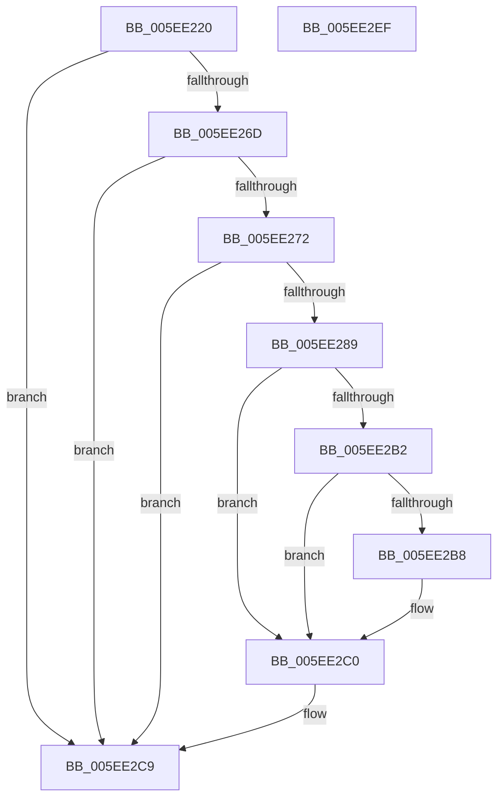

# RtlQueryValidationRunlevel

- RVA: `0x005EE220`–`0x005EE2F0` (길이 `208` bytes)
- VA: `0x00000001405EE220`
- 실행 섹션: `.text`
- PDB 이름 있음: `예`; PDB Function 태그: `아니요`
- unwind 정보 RVA: `0x000CFEF8`
- 디코드: `58`개 명령, `208/208` bytes 표시
- 미해석 바이트: `0` (있으면 어셈블리에 `.byte`로 보존)

> 이 문서는 커널 이미지의 기계어와 PDB 기호를 분석해 생성했습니다. 4번과 5번은 함수 원형과 자료형을 바이너리 사용 방식에서 추정한 C 해석이며 원본 소스 복구 결과는 아닙니다.

## 1. Dependencies

- 직접 호출 지점: **4**; 고유 호출 대상: **4**
- 직접 호출자로 확인된 함수: **0**
- RIP 상대 이미지 참조: **2**

### Outgoing calls
- `0x005EE280` → [ZwOpenKey](../6A/ZwOpenKey_function_006AD310.md) (function, `0x006AD310`)
- `0x005EE2A9` → [ZwQueryValueKey](../6A/ZwQueryValueKey_function_006AD3B0.md) (function, `0x006AD3B0`)
- `0x005EE2C4` → [NtClose](../../page/86/NtClose_function_00868870.md) (function, `0x00868870`)
- `0x005EE2D4` → [_security_check_cookie](../6A/_security_check_cookie_function_006AC640.md) (function, `0x006AC640`)

### Direct callers
- 이 함수 시작 RVA로 연결되는 직접 call은 확인되지 않았습니다. 간접 호출은 완전히 역산할 수 없습니다.

### Static image references
- `0x005EE237` → RVA `0x00E0A740` (`.data`; read)
- `0x005EE272` → RVA `0x0000B6A0` (`.rdata`; read)

## 2. Other-region calls and transfers

- 다른 실행 섹션으로 향하는 call: **1**
  - `0x005EE2C4` → [NtClose](../../page/86/NtClose_function_00868870.md) (`.text` → `PAGE`)
- 별도 외부 분기/꼬리 이동을 확인하지 못했습니다.

## 3. Assembly (complete function range)

```asm
005EE220  48 89 5C 24 10                  mov qword ptr [rsp + 0x10], rbx
005EE225  48 89 74 24 18                  mov qword ptr [rsp + 0x18], rsi
005EE22A  48 89 7C 24 20                  mov qword ptr [rsp + 0x20], rdi
005EE22F  55                              push rbp
005EE230  48 8B EC                        mov rbp, rsp
005EE233  48 83 EC 60                     sub rsp, 0x60
005EE237  48 8B 05 02 C5 81 00            mov rax, qword ptr [rip + 0x81c502]
005EE23E  48 33 C4                        xor rax, rsp
005EE241  48 89 45 F8                     mov qword ptr [rbp - 8], rax
005EE245  33 DB                           xor ebx, ebx
005EE247  33 C0                           xor eax, eax
005EE249  48 89 5D D8                     mov qword ptr [rbp - 0x28], rbx
005EE24D  0F 57 C0                        xorps xmm0, xmm0
005EE250  89 5D D0                        mov dword ptr [rbp - 0x30], ebx
005EE253  48 8B F1                        mov rsi, rcx
005EE256  89 45 F0                        mov dword ptr [rbp - 0x10], eax
005EE259  0F 11 45 E0                     movups xmmword ptr [rbp - 0x20], xmm0
005EE25D  A1 58 02 00 00 80 F7 FF FF      movabs eax, dword ptr [0xfffff78000000258]
005EE266  8B F8                           mov edi, eax
005EE268  48 85 C9                        test rcx, rcx
005EE26B  74 5C                           je 0x1405ee2c9
005EE26D  83 F8 FF                        cmp eax, -1
005EE270  74 57                           je 0x1405ee2c9
005EE272  4C 8D 05 27 D4 A1 FF            lea r8, [rip - 0x5e2bd9]
005EE279  8D 53 01                        lea edx, [rbx + 1]
005EE27C  48 8D 4D D8                     lea rcx, [rbp - 0x28]
005EE280  E8 8B F0 0B 00                  call 0x1406ad310
005EE285  85 C0                           test eax, eax
005EE287  78 40                           js 0x1405ee2c9
005EE289  48 8B 4D D8                     mov rcx, qword ptr [rbp - 0x28]
005EE28D  48 8D 45 D0                     lea rax, [rbp - 0x30]
005EE291  48 89 44 24 28                  mov qword ptr [rsp + 0x28], rax
005EE296  4C 8D 4D E0                     lea r9, [rbp - 0x20]
005EE29A  44 8D 43 02                     lea r8d, [rbx + 2]
005EE29E  C7 44 24 20 14 00 00 00         mov dword ptr [rsp + 0x20], 0x14
005EE2A6  48 8B D6                        mov rdx, rsi
005EE2A9  E8 02 F1 0B 00                  call 0x1406ad3b0
005EE2AE  85 C0                           test eax, eax
005EE2B0  78 0E                           js 0x1405ee2c0
005EE2B2  83 7D E4 04                     cmp dword ptr [rbp - 0x1c], 4
005EE2B6  75 08                           jne 0x1405ee2c0
005EE2B8  83 7D E8 04                     cmp dword ptr [rbp - 0x18], 4
005EE2BC  0F 44 5D EC                     cmove ebx, dword ptr [rbp - 0x14]
005EE2C0  48 8B 4D D8                     mov rcx, qword ptr [rbp - 0x28]
005EE2C4  E8 A7 A5 27 00                  call 0x140868870
005EE2C9  0B FB                           or edi, ebx
005EE2CB  8B C7                           mov eax, edi
005EE2CD  48 8B 4D F8                     mov rcx, qword ptr [rbp - 8]
005EE2D1  48 33 CC                        xor rcx, rsp
005EE2D4  E8 67 E3 0B 00                  call 0x1406ac640
005EE2D9  4C 8D 5C 24 60                  lea r11, [rsp + 0x60]
005EE2DE  49 8B 5B 18                     mov rbx, qword ptr [r11 + 0x18]
005EE2E2  49 8B 73 20                     mov rsi, qword ptr [r11 + 0x20]
005EE2E6  49 8B 7B 28                     mov rdi, qword ptr [r11 + 0x28]
005EE2EA  49 8B E3                        mov rsp, r11
005EE2ED  5D                              pop rbp
005EE2EE  C3                              ret
005EE2EF  CC                              int3
```

## 4. C-style interpretation (structured pseudocode)

```c
__int64 __fastcall RtlQueryValidationRunlevel(__int64 a1)
{
    __int64 result;
    __int64 v_rbx;
    __int64 v_rdi;
    __int64 v_rsp;
    unsigned __int64 v_stack_m10;
    unsigned int v_stack_m18;
    unsigned int v_stack_m1C;
    unsigned int v_stack_m20;
    unsigned int v_stack_m24;
    unsigned __int64 v_stack_m28;
    unsigned __int64 v_stack_m30;
    unsigned int v_stack_m38;
    unsigned __int64 v_stack_m40;
    unsigned int v_stack_m48;
    unsigned __int64 v_stack_m8;
    unsigned __int64 v_stack_p10;
    unsigned __int64 v_stack_p18;
    unsigned __int64 v_stack_p20;

    v_stack_p10 = v_rbx;
    v_stack_p18 = v_rsi;
    v_stack_p20 = v_rdi;
    v_rsp = (v_rsp) - (96);
    result = (*(unsigned __int64 *)(v_rip + 8504578)) ^ (v_rsp);
    v_stack_m10 = result;
    v_rbx = 0;
    result = 0;
    v_stack_m30 = 0;
    v_stack_m38 = 0;
    v_stack_m18 = 0;
    v_stack_m28 = v_xmm0;
    if (a1 == 0) goto loc_005EE2C9;
    if (0 == -1) goto loc_005EE2C9;
    result = ZwOpenKey(v_stack_m30, v_rbx + 1, v_rip - 6171609, a4);
    if (sign_flag) goto loc_005EE2C9;
    v_stack_m40 = v_stack_m38;
    v_stack_m48 = 20;
    result = ZwQueryValueKey(v_stack_m30, a1, v_rbx + 2, v_stack_m28);
    if (sign_flag) goto loc_005EE2C0;
    if (v_stack_m24 == 4) {
        if (v_stack_m20 == 4) { v_rbx = v_stack_m1C; }
    }
    result = NtClose(v_stack_m30, a1, v_rbx + 2, v_stack_m28);
loc_005EE2C9:
    v_rdi = (unsigned int)((0) | ((unsigned int)(v_rbx)));
    a1 = (v_stack_m10) ^ (v_rsp);
    result = _security_check_cookie(a1, a1, v_rbx + 2, v_stack_m28);
    return result;
}
```

## 5. (Beta) C Style

```c
int64_t RtlQueryValidationRunlevel(int64_t Arg1)
{
    int64_t result;
    int64_t local_rbx;
    int64_t local_rdi;
    int64_t local_rsp;
    uint64_t v_stack_m10;
    uint32_t v_stack_m18;
    uint32_t v_stack_m1C;
    uint32_t v_stack_m20;
    uint32_t v_stack_m24;
    uint64_t v_stack_m28;
    uint64_t v_stack_m30;
    uint32_t v_stack_m38;
    uint64_t v_stack_m40;
    uint32_t v_stack_m48;
    uint64_t v_stack_m8;
    uint64_t v_stack_p10;
    uint64_t v_stack_p18;
    uint64_t v_stack_p20;

    v_stack_p10 = local_rbx;
    v_stack_p18 = local_rsi;
    v_stack_p20 = local_rdi;
    local_rsp = (local_rsp) - (96);
    result = (*(uint64_t *)(v_rip + 0x81C502)) ^ (local_rsp);
    v_stack_m10 = result;
    local_rbx = 0;
    result = 0;
    v_stack_m30 = 0;
    v_stack_m38 = 0;
    v_stack_m18 = 0;
    v_stack_m28 = v_xmm0;
    if (Arg1 == 0) goto loc_005EE2C9;
    if (0 == -1) goto loc_005EE2C9;
    result = ZwOpenKey(v_stack_m30, local_rbx + 1, v_rip - 6171609, a4);
    if (sign_flag) goto loc_005EE2C9;
    v_stack_m40 = v_stack_m38;
    v_stack_m48 = 20;
    result = ZwQueryValueKey(v_stack_m30, Arg1, local_rbx + 2, v_stack_m28);
    if (sign_flag) goto loc_005EE2C0;
    if (v_stack_m24 == 4) {
        if (v_stack_m20 == 4) { local_rbx = v_stack_m1C; }
    }
    result = NtClose(v_stack_m30, Arg1, local_rbx + 2, v_stack_m28);
loc_005EE2C9:
    local_rdi = (uint32_t)((0) | ((uint32_t)(local_rbx)));
    Arg1 = (v_stack_m10) ^ (local_rsp);
    result = _security_check_cookie(Arg1, Arg1, local_rbx + 2, v_stack_m28);
    return result;
}
```

## 6. Execution-region graph

[열기: 2D/3D 그래프와 함수 탐색 컨트롤 패널](../../../control-panel.html?section=text&rva=0x005EE220&view=graph)

- 2D 그래프는 위에서 아래로 흐르고, 3D 그래프는 빈 공간을 드래그해 회전합니다. Shift+드래그는 이동, 휠은 확대·축소, 함수 노드 선택은 대상 보고서 이동입니다.

### Static fallback


