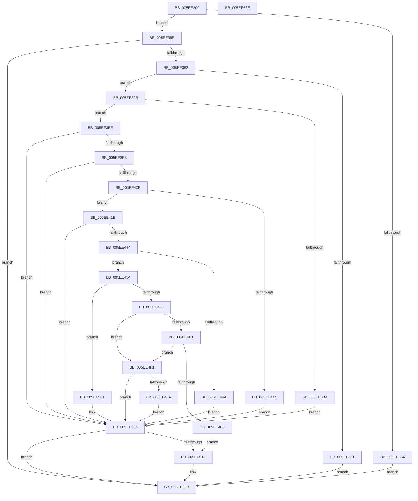

# RtlRaiseCustomSystemEventTrigger

- RVA: `0x005EE300`–`0x005EE53F` (길이 `575` bytes)
- VA: `0x00000001405EE300`
- 실행 섹션: `.text`
- PDB 이름 있음: `예`; PDB Function 태그: `아니요`
- unwind 정보 RVA: `0x000CFF18`
- 디코드: `145`개 명령, `575/575` bytes 표시
- 미해석 바이트: `0` (있으면 어셈블리에 `.byte`로 보존)

> 이 문서는 커널 이미지의 기계어와 PDB 기호를 분석해 생성했습니다. 4번과 5번은 함수 원형과 자료형을 바이너리 사용 방식에서 추정한 C 해석이며 원본 소스 복구 결과는 아닙니다.

## 1. Dependencies

- 직접 호출 지점: **12**; 고유 호출 대상: **11**
- 직접 호출자로 확인된 함수: **0**
- RIP 상대 이미지 참조: **3**

### Outgoing calls
- `0x005EE366` → [RtlInitUnicodeString](../42/RtlInitUnicodeString_function_0042A780.md) (function, `0x0042A780`)
- `0x005EE373` → [RtlGUIDFromString](../../page/8F/RtlGUIDFromString_function_008F1EF0.md) (function, `0x008F1EF0`)
- `0x005EE3A7` → [RtlpCtAllocateMemory](../../page/79/RtlpCtAllocateMemory_function_007948B8.md) (function, `0x007948B8`)
- `0x005EE3D9` → [ZwQueryWnfStateData](../6A/ZwQueryWnfStateData_function_006AFEF0.md) (function, `0x006AFEF0`)
- `0x005EE3FF` → [ZwQueryWnfStateNameInformation](../6A/ZwQueryWnfStateNameInformation_function_006AFF10.md) (function, `0x006AFF10`)
- `0x005EE435` → [ZwQueryWnfStateNameInformation](../6A/ZwQueryWnfStateNameInformation_function_006AFF10.md) (function, `0x006AFF10`)
- `0x005EE4A6` → [RtlpCtContextInit](../../page/79/RtlpCtContextInit_function_00794938.md) (function, `0x00794938`)
- `0x005EE4D8` → [ZwUpdateWnfStateData](../6B/ZwUpdateWnfStateData_function_006B0D10.md) (function, `0x006B0D10`)
- `0x005EE4EA` → [RtlpCtQueueWorkItem](../../page/79/RtlpCtQueueWorkItem_function_00794A68.md) (function, `0x00794A68`)
- `0x005EE4FA` → [RtlpCtContextFree](../../page/79/RtlpCtContextFree_function_007948DC.md) (function, `0x007948DC`)
- `0x005EE516` → [RtlpCtFreeMemory](../../page/79/RtlpCtFreeMemory_function_00794A4C.md) (function, `0x00794A4C`)
- `0x005EE524` → [_security_check_cookie](../6A/_security_check_cookie_function_006AC640.md) (function, `0x006AC640`)

### Direct callers
- 이 함수 시작 RVA로 연결되는 직접 call은 확인되지 않았습니다. 간접 호출은 완전히 역산할 수 없습니다.

### Static image references
- `0x005EE317` → RVA `0x00E0A740` (`.data`; read)
- `0x005EE338` → RVA `0x000208A8` (`.rdata`; read)
- `0x005EE387` → RVA `0x00F05BF0` (`.data`; read/write)

## 2. Other-region calls and transfers

- 다른 실행 섹션으로 향하는 call: **6**
  - `0x005EE373` → [RtlGUIDFromString](../../page/8F/RtlGUIDFromString_function_008F1EF0.md) (`.text` → `PAGE`)
  - `0x005EE3A7` → [RtlpCtAllocateMemory](../../page/79/RtlpCtAllocateMemory_function_007948B8.md) (`.text` → `PAGE`)
  - `0x005EE4A6` → [RtlpCtContextInit](../../page/79/RtlpCtContextInit_function_00794938.md) (`.text` → `PAGE`)
  - `0x005EE4EA` → [RtlpCtQueueWorkItem](../../page/79/RtlpCtQueueWorkItem_function_00794A68.md) (`.text` → `PAGE`)
  - `0x005EE4FA` → [RtlpCtContextFree](../../page/79/RtlpCtContextFree_function_007948DC.md) (`.text` → `PAGE`)
  - `0x005EE516` → [RtlpCtFreeMemory](../../page/79/RtlpCtFreeMemory_function_00794A4C.md) (`.text` → `PAGE`)
- 별도 외부 분기/꼬리 이동을 확인하지 못했습니다.

## 3. Assembly (complete function range)

```asm
005EE300  48 89 5C 24 10                  mov qword ptr [rsp + 0x10], rbx
005EE305  48 89 7C 24 18                  mov qword ptr [rsp + 0x18], rdi
005EE30A  55                              push rbp
005EE30B  48 8D 6C 24 A9                  lea rbp, [rsp - 0x57]
005EE310  48 81 EC A0 00 00 00            sub rsp, 0xa0
005EE317  48 8B 05 22 C4 81 00            mov rax, qword ptr [rip + 0x81c422]
005EE31E  48 33 C4                        xor rax, rsp
005EE321  48 89 45 47                     mov qword ptr [rbp + 0x47], rax
005EE325  83 65 FB 00                     and dword ptr [rbp - 5], 0
005EE329  0F 57 C0                        xorps xmm0, xmm0
005EE32C  83 65 FF 00                     and dword ptr [rbp - 1], 0
005EE330  0F 57 C9                        xorps xmm1, xmm1
005EE333  48 83 65 07 00                  and qword ptr [rbp + 7], 0
005EE338  48 8B 05 69 25 A3 FF            mov rax, qword ptr [rip - 0x5cda97]
005EE33F  48 89 45 2F                     mov qword ptr [rbp + 0x2f], rax
005EE343  0F 11 45 1F                     movups xmmword ptr [rbp + 0x1f], xmm0
005EE347  0F 11 45 0F                     movups xmmword ptr [rbp + 0xf], xmm0
005EE34B  0F 11 4D 37                     movups xmmword ptr [rbp + 0x37], xmm1
005EE34F  48 85 C9                        test rcx, rcx
005EE352  75 0A                           jne 0x1405ee35e
005EE354  BB 0D 00 00 C0                  mov ebx, 0xc000000d
005EE359  E9 BD 01 00 00                  jmp 0x1405ee51b
005EE35E  48 8B 51 08                     mov rdx, qword ptr [rcx + 8]
005EE362  48 8D 4D 0F                     lea rcx, [rbp + 0xf]
005EE366  E8 15 C4 E3 FF                  call 0x14042a780
005EE36B  48 8D 55 37                     lea rdx, [rbp + 0x37]
005EE36F  48 8D 4D 0F                     lea rcx, [rbp + 0xf]
005EE373  E8 78 3B 30 00                  call 0x1408f1ef0
005EE378  8B D8                           mov ebx, eax
005EE37A  85 C0                           test eax, eax
005EE37C  0F 88 99 01 00 00               js 0x1405ee51b
005EE382  B8 01 00 00 00                  mov eax, 1
005EE387  87 05 63 78 91 00               xchg dword ptr [rip + 0x917863], eax
005EE38D  85 C0                           test eax, eax
005EE38F  74 0A                           je 0x1405ee39b
005EE391  BB 01 00 00 C0                  mov ebx, 0xc0000001
005EE396  E9 80 01 00 00                  jmp 0x1405ee51b
005EE39B  B9 00 10 00 00                  mov ecx, 0x1000
005EE3A0  C7 45 F7 00 10 00 00            mov dword ptr [rbp - 9], 0x1000
005EE3A7  E8 0C 65 1A 00                  call 0x1407948b8
005EE3AC  48 8B F8                        mov rdi, rax
005EE3AF  48 85 C0                        test rax, rax
005EE3B2  75 0A                           jne 0x1405ee3be
005EE3B4  BB 9A 00 00 C0                  mov ebx, 0xc000009a
005EE3B9  E9 48 01 00 00                  jmp 0x1405ee506
005EE3BE  48 8D 45 F7                     lea rax, [rbp - 9]
005EE3C2  45 33 C0                        xor r8d, r8d
005EE3C5  48 89 44 24 28                  mov qword ptr [rsp + 0x28], rax
005EE3CA  4C 8D 4D FF                     lea r9, [rbp - 1]
005EE3CE  33 D2                           xor edx, edx
005EE3D0  48 89 7C 24 20                  mov qword ptr [rsp + 0x20], rdi
005EE3D5  48 8D 4D 2F                     lea rcx, [rbp + 0x2f]
005EE3D9  E8 12 1B 0C 00                  call 0x1406afef0
005EE3DE  8B D8                           mov ebx, eax
005EE3E0  85 C0                           test eax, eax
005EE3E2  0F 88 1E 01 00 00               js 0x1405ee506
005EE3E8  45 33 C0                        xor r8d, r8d
005EE3EB  C7 44 24 20 04 00 00 00         mov dword ptr [rsp + 0x20], 4
005EE3F3  4C 8D 4D FB                     lea r9, [rbp - 5]
005EE3F7  48 8D 4D 2F                     lea rcx, [rbp + 0x2f]
005EE3FB  41 8D 50 02                     lea edx, [r8 + 2]
005EE3FF  E8 0C 1B 0C 00                  call 0x1406aff10
005EE404  8B D8                           mov ebx, eax
005EE406  85 C0                           test eax, eax
005EE408  0F 88 F8 00 00 00               js 0x1405ee506
005EE40E  83 7D FB 00                     cmp dword ptr [rbp - 5], 0
005EE412  75 0A                           jne 0x1405ee41e
005EE414  BB 01 00 00 C0                  mov ebx, 0xc0000001
005EE419  E9 E8 00 00 00                  jmp 0x1405ee506
005EE41E  45 33 C0                        xor r8d, r8d
005EE421  C7 44 24 20 04 00 00 00         mov dword ptr [rsp + 0x20], 4
005EE429  4C 8D 4D FB                     lea r9, [rbp - 5]
005EE42D  48 8D 4D 2F                     lea rcx, [rbp + 0x2f]
005EE431  41 8D 50 01                     lea edx, [r8 + 1]
005EE435  E8 D6 1A 0C 00                  call 0x1406aff10
005EE43A  8B D8                           mov ebx, eax
005EE43C  85 C0                           test eax, eax
005EE43E  0F 88 C2 00 00 00               js 0x1405ee506
005EE444  83 7D FB 00                     cmp dword ptr [rbp - 5], 0
005EE448  75 0A                           jne 0x1405ee454
005EE44A  BB AB 00 00 C0                  mov ebx, 0xc00000ab
005EE44F  E9 B2 00 00 00                  jmp 0x1405ee506
005EE454  48 8D 47 08                     lea rax, [rdi + 8]
005EE458  C7 45 F7 00 10 00 00            mov dword ptr [rbp - 9], 0x1000
005EE45F  48 85 C0                        test rax, rax
005EE462  0F 84 99 00 00 00               je 0x1405ee501
005EE468  0F 10 45 1F                     movups xmm0, xmmword ptr [rbp + 0x1f]
005EE46C  48 8D 4D 07                     lea rcx, [rbp + 7]
005EE470  F3 0F 7F 00                     movdqu xmmword ptr [rax], xmm0
005EE474  0F 10 4D 37                     movups xmm1, xmmword ptr [rbp + 0x37]
005EE478  F3 0F 7F 48 10                  movdqu xmmword ptr [rax + 0x10], xmm1
005EE47D  C7 40 20 10 00 00 00            mov dword ptr [rax + 0x20], 0x10
005EE484  C7 45 F7 24 00 00 00            mov dword ptr [rbp - 9], 0x24
005EE48B  83 27 00                        and dword ptr [rdi], 0
005EE48E  83 4F 04 FF                     or dword ptr [rdi + 4], 0xffffffff
005EE492  8B 45 F7                        mov eax, dword ptr [rbp - 9]
005EE495  25 FF 0F 00 00                  and eax, 0xfff
005EE49A  0F BA E8 14                     bts eax, 0x14
005EE49E  C1 E0 02                        shl eax, 2
005EE4A1  89 07                           mov dword ptr [rdi], eax
005EE4A3  8B 55 FF                        mov edx, dword ptr [rbp - 1]
005EE4A6  E8 8D 64 1A 00                  call 0x140794938
005EE4AB  8B D8                           mov ebx, eax
005EE4AD  85 C0                           test eax, eax
005EE4AF  78 40                           js 0x1405ee4f1
005EE4B1  44 8B 45 F7                     mov r8d, dword ptr [rbp - 9]
005EE4B5  48 8D 4D 2F                     lea rcx, [rbp + 0x2f]
005EE4B9  8B 45 FF                        mov eax, dword ptr [rbp - 1]
005EE4BC  41 83 C0 08                     add r8d, 8
005EE4C0  C7 44 24 30 01 00 00 00         mov dword ptr [rsp + 0x30], 1
005EE4C8  45 33 C9                        xor r9d, r9d
005EE4CB  89 44 24 28                     mov dword ptr [rsp + 0x28], eax
005EE4CF  48 8B D7                        mov rdx, rdi
005EE4D2  48 83 64 24 20 00               and qword ptr [rsp + 0x20], 0
005EE4D8  E8 33 28 0C 00                  call 0x1406b0d10
005EE4DD  8B D8                           mov ebx, eax
005EE4DF  85 C0                           test eax, eax
005EE4E1  78 0E                           js 0x1405ee4f1
005EE4E3  48 8B 4D 07                     mov rcx, qword ptr [rbp + 7]
005EE4E7  48 8B 09                        mov rcx, qword ptr [rcx]
005EE4EA  E8 79 65 1A 00                  call 0x140794a68
005EE4EF  EB 22                           jmp 0x1405ee513
005EE4F1  48 8B 4D 07                     mov rcx, qword ptr [rbp + 7]
005EE4F5  48 85 C9                        test rcx, rcx
005EE4F8  74 0C                           je 0x1405ee506
005EE4FA  E8 DD 63 1A 00                  call 0x1407948dc
005EE4FF  EB 05                           jmp 0x1405ee506
005EE501  BB 0D 00 00 C0                  mov ebx, 0xc000000d
005EE506  33 C0                           xor eax, eax
005EE508  87 05 E2 76 91 00               xchg dword ptr [rip + 0x9176e2], eax
005EE50E  48 85 FF                        test rdi, rdi
005EE511  74 08                           je 0x1405ee51b
005EE513  48 8B CF                        mov rcx, rdi
005EE516  E8 31 65 1A 00                  call 0x140794a4c
005EE51B  8B C3                           mov eax, ebx
005EE51D  48 8B 4D 47                     mov rcx, qword ptr [rbp + 0x47]
005EE521  48 33 CC                        xor rcx, rsp
005EE524  E8 17 E1 0B 00                  call 0x1406ac640
005EE529  4C 8D 9C 24 A0 00 00 00         lea r11, [rsp + 0xa0]
005EE531  49 8B 5B 18                     mov rbx, qword ptr [r11 + 0x18]
005EE535  49 8B 7B 20                     mov rdi, qword ptr [r11 + 0x20]
005EE539  49 8B E3                        mov rsp, r11
005EE53C  5D                              pop rbp
005EE53D  C3                              ret
005EE53E  CC                              int3
```

## 4. C-style interpretation (structured pseudocode)

```c
__int64 __fastcall RtlRaiseCustomSystemEventTrigger(__int64 a1, __int64 a2, int a3)
{
    __int64 result;
    __int64 v_rsp;
    unsigned __int64 v_stack_m18;
    unsigned __int64 v_stack_m28;
    unsigned __int64 v_stack_m30;
    unsigned __int64 v_stack_m40;
    unsigned __int64 v_stack_m50;
    unsigned __int64 v_stack_m58;
    unsigned __int64 v_stack_m5F;
    unsigned int v_stack_m60;
    unsigned int v_stack_m64;
    unsigned int v_stack_m68;
    unsigned int v_stack_m78;
    unsigned __int64 v_stack_m8;
    unsigned __int64 v_stack_m80;
    unsigned __int64 v_stack_m88;
    unsigned __int64 v_stack_p10;
    unsigned __int64 v_stack_p18;

    v_stack_p10 = v_rbx;
    v_stack_p18 = v_rdi;
    v_rsp = (v_rsp) - (160);
    result = (*(unsigned __int64 *)(v_rip + 8504354)) ^ (v_rsp);
    v_stack_m18 = result;
    v_stack_m30 = *(unsigned __int64 *)(v_rip - 6085271);
    v_stack_m40 = v_xmm0;
    v_stack_m50 = v_xmm0;
    v_stack_m28 = v_xmm1;
    if (a1 != 0) goto loc_005EE35E;
    goto loc_005EE51B;
loc_005EE35E:
    result = RtlInitUnicodeString(v_stack_m50, *(unsigned __int64 *)(a1 + 8), a3, a4);
    result = RtlGUIDFromString(v_stack_m50, v_stack_m28, a3, a4);
    if (sign_flag) goto loc_005EE51B;
    if (1 == 0) goto loc_005EE39B;
    goto loc_005EE51B;
loc_005EE39B:
    v_stack_m68 = 0x1000ULL;
    result = RtlpCtAllocateMemory((unsigned int)(0x1000ULL), v_stack_m28, a3, a4);
    if (result != 0) goto loc_005EE3BE;
    goto loc_005EE506;
loc_005EE3BE:
    a3 = 0;
    v_stack_m80 = v_stack_m68;
    a2 = 0;
    v_stack_m88 = result;
    result = ZwQueryWnfStateData(v_stack_m30, a2, a3, v_stack_m60);
    if (sign_flag) goto loc_005EE506;
    a3 = 0;
    v_stack_m88 = 4;
    result = ZwQueryWnfStateNameInformation(v_stack_m30, a3 + 2, a3, v_stack_m64);
    if (sign_flag) goto loc_005EE506;
    if (v_stack_m64 != 0) goto loc_005EE41E;
    goto loc_005EE506;
loc_005EE41E:
    a3 = 0;
    v_stack_m88 = 4;
    result = ZwQueryWnfStateNameInformation(v_stack_m30, a3 + 1, a3, v_stack_m64);
    if (sign_flag) goto loc_005EE506;
    if (v_stack_m64 != 0) goto loc_005EE454;
    goto loc_005EE506;
loc_005EE454:
    v_stack_m68 = 0x1000ULL;
    if (result + 8 == 0) goto loc_005EE501;
    *(unsigned __int64 *)(result + 8) = v_xmm0;
    *(unsigned __int64 *)(result + 8 + 16) = v_xmm1;
    *(unsigned int *)(result + 8 + 32) = 16;
    v_stack_m68 = 36;
    result = (unsigned int)(((unsigned int)(v_stack_m68)) & (0xFFFULL));
    result = (unsigned int)((result) << (2));
    *(unsigned int *)(result) = (unsigned int)(result);
    result = RtlpCtContextInit(v_stack_m58, (unsigned int)(v_stack_m60), a3, v_stack_m64);
    if (sign_flag) goto loc_005EE4F1;
    a3 = (unsigned int)(((unsigned int)(v_stack_m68)) + (8));
    v_stack_m78 = 1;
    a4 = 0;
    v_stack_m80 = (unsigned int)((unsigned int)(v_stack_m60));
    result = ZwUpdateWnfStateData(v_stack_m30, result, a3, a4);
    if (sign_flag) goto loc_005EE4F1;
    result = RtlpCtQueueWorkItem(*(unsigned __int64 *)(v_stack_m58), result, a3, a4);
    goto loc_005EE513;
loc_005EE4F1:
    if (v_stack_m58 == 0) goto loc_005EE506;
    result = RtlpCtContextFree(v_stack_m58, result, a3, a4);
    goto loc_005EE506;
loc_005EE501:
loc_005EE506:
    result = 0;
    if (0 != 0) {
        a1 = 0;
        result = RtlpCtFreeMemory(a1, result, a3, a4);
    }
    a1 = (v_stack_m18) ^ (v_rsp);
    result = _security_check_cookie(a1, result, a3, a4);
    return result;
}
```

## 5. (Beta) C Style

```c
int64_t RtlRaiseCustomSystemEventTrigger(int64_t Arg1, int64_t Arg2, int32_t Arg3)
{
    int64_t result;
    int64_t local_rsp;
    uint64_t v_stack_m18;
    uint64_t v_stack_m28;
    uint64_t v_stack_m30;
    uint64_t v_stack_m40;
    uint64_t v_stack_m50;
    uint64_t v_stack_m58;
    uint64_t v_stack_m5F;
    uint32_t v_stack_m60;
    uint32_t v_stack_m64;
    uint32_t v_stack_m68;
    uint32_t v_stack_m78;
    uint64_t v_stack_m8;
    uint64_t v_stack_m80;
    uint64_t v_stack_m88;
    uint64_t v_stack_p10;
    uint64_t v_stack_p18;

    v_stack_p10 = local_rbx;
    v_stack_p18 = local_rdi;
    local_rsp = (local_rsp) - (160);
    result = (*(uint64_t *)(v_rip + 0x81C422)) ^ (local_rsp);
    v_stack_m18 = result;
    v_stack_m30 = *(uint64_t *)(v_rip - 0x5CDA97);
    v_stack_m40 = v_xmm0;
    v_stack_m50 = v_xmm0;
    v_stack_m28 = v_xmm1;
    if (Arg1 != 0) goto loc_005EE35E;
    goto loc_005EE51B;
loc_005EE35E:
    result = RtlInitUnicodeString(v_stack_m50, *(uint64_t *)(Arg1 + 0x8), Arg3, a4);
    result = RtlGUIDFromString(v_stack_m50, v_stack_m28, Arg3, a4);
    if (sign_flag) goto loc_005EE51B;
    if (1 == 0) goto loc_005EE39B;
    goto loc_005EE51B;
loc_005EE39B:
    v_stack_m68 = 0x1000ULL;
    result = RtlpCtAllocateMemory((uint32_t)(0x1000ULL), v_stack_m28, Arg3, a4);
    if (result != 0) goto loc_005EE3BE;
    goto loc_005EE506;
loc_005EE3BE:
    Arg3 = 0;
    v_stack_m80 = v_stack_m68;
    Arg2 = 0;
    v_stack_m88 = result;
    result = ZwQueryWnfStateData(v_stack_m30, Arg2, Arg3, v_stack_m60);
    if (sign_flag) goto loc_005EE506;
    Arg3 = 0;
    v_stack_m88 = 4;
    result = ZwQueryWnfStateNameInformation(v_stack_m30, Arg3 + 2, Arg3, v_stack_m64);
    if (sign_flag) goto loc_005EE506;
    if (v_stack_m64 != 0) goto loc_005EE41E;
    goto loc_005EE506;
loc_005EE41E:
    Arg3 = 0;
    v_stack_m88 = 4;
    result = ZwQueryWnfStateNameInformation(v_stack_m30, Arg3 + 1, Arg3, v_stack_m64);
    if (sign_flag) goto loc_005EE506;
    if (v_stack_m64 != 0) goto loc_005EE454;
    goto loc_005EE506;
loc_005EE454:
    v_stack_m68 = 0x1000ULL;
    if (result + 8 == 0) goto loc_005EE501;
    *(uint64_t *)(result + 0x8) = v_xmm0;
    *(uint64_t *)(result + 0x8 + 0x10) = v_xmm1;
    *(uint32_t *)(result + 0x8 + 0x20) = 16;
    v_stack_m68 = 36;
    result = (uint32_t)(((uint32_t)(v_stack_m68)) & (0xFFFULL));
    result = (uint32_t)((result) << (2));
    *(uint32_t *)(result) = (uint32_t)(result);
    result = RtlpCtContextInit(v_stack_m58, (uint32_t)(v_stack_m60), Arg3, v_stack_m64);
    if (sign_flag) goto loc_005EE4F1;
    Arg3 = (uint32_t)(((uint32_t)(v_stack_m68)) + (8));
    v_stack_m78 = 1;
    a4 = 0;
    v_stack_m80 = (uint32_t)((uint32_t)(v_stack_m60));
    result = ZwUpdateWnfStateData(v_stack_m30, result, Arg3, a4);
    if (sign_flag) goto loc_005EE4F1;
    result = RtlpCtQueueWorkItem(*(uint64_t *)(v_stack_m58), result, Arg3, a4);
    goto loc_005EE513;
loc_005EE4F1:
    if (v_stack_m58 == 0) goto loc_005EE506;
    result = RtlpCtContextFree(v_stack_m58, result, Arg3, a4);
    goto loc_005EE506;
loc_005EE501:
loc_005EE506:
    result = 0;
    if (0 != 0) {
        Arg1 = 0;
        result = RtlpCtFreeMemory(Arg1, result, Arg3, a4);
    }
    Arg1 = (v_stack_m18) ^ (local_rsp);
    result = _security_check_cookie(Arg1, result, Arg3, a4);
    return result;
}
```

## 6. Execution-region graph

[열기: 2D/3D 그래프와 함수 탐색 컨트롤 패널](../../../control-panel.html?section=text&rva=0x005EE300&view=graph)

- 2D 그래프는 위에서 아래로 흐르고, 3D 그래프는 빈 공간을 드래그해 회전합니다. Shift+드래그는 이동, 휠은 확대·축소, 함수 노드 선택은 대상 보고서 이동입니다.

### Static fallback


