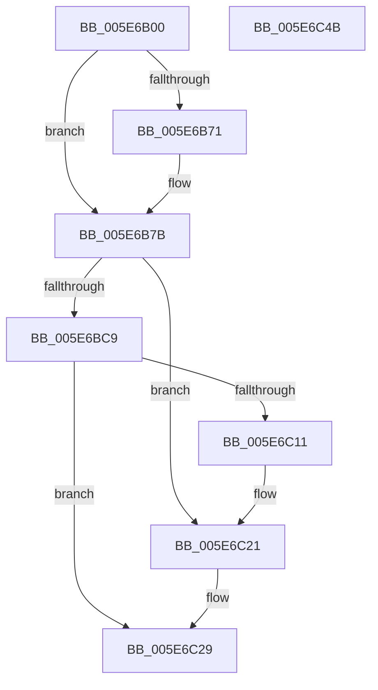

# RtlRaiseException

- RVA: `0x005E6B00`–`0x005E6C4C` (길이 `332` bytes)
- VA: `0x00000001405E6B00`
- 실행 섹션: `.text`
- PDB 이름 있음: `예`; PDB Function 태그: `아니요`
- unwind 정보 RVA: `0x000CF8D8`
- 디코드: `87`개 명령, `332/332` bytes 표시
- 미해석 바이트: `0` (있으면 어셈블리에 `.byte`로 보존)

> 이 문서는 커널 이미지의 기계어와 PDB 기호를 분석해 생성했습니다. 4번과 5번은 함수 원형과 자료형을 바이너리 사용 방식에서 추정한 C 해석이며 원본 소스 복구 결과는 아닙니다.

## 1. Dependencies

- 직접 호출 지점: **10**; 고유 호출 대상: **10**
- 직접 호출자로 확인된 함수: **7**
- RIP 상대 이미지 참조: **2**

### Outgoing calls
- `0x005E6B60` → [RtlGetExtendedContextLength2](../49/RtlGetExtendedContextLength2_function_00493FE0.md) (function, `0x00493FE0`)
- `0x005E6B82` → [_chkstk](../6B/_chkstk_function_006BA960.md) (function, `0x006BA960`)
- `0x005E6B9F` → [RtlInitializeExtendedContext2](../2F/RtlInitializeExtendedContext2_function_002F5D40.md) (function, `0x002F5D40`)
- `0x005E6BA9` → [RtlpCaptureContext2](../4F/RtlpCaptureContext2_function_004FE6B0.md) (function, `0x004FE6B0`)
- `0x005E6BBF` → [RtlLookupFunctionEntry](../2F/RtlLookupFunctionEntry_function_002F2F30.md) (function, `0x002F2F30`)
- `0x005E6BF2` → [RtlVirtualUnwind](../47/RtlVirtualUnwind_function_0047D210.md) (function, `0x0047D210`)
- `0x005E6C08` → [RtlDispatchException](../2F/RtlDispatchException_function_002F22A0.md) (function, `0x002F22A0`)
- `0x005E6C1A` → [ZwRaiseException](../6A/ZwRaiseException_function_006AFF70.md) (function, `0x006AFF70`)
- `0x005E6C23` → [RtlRaiseStatus](../2F/RtlRaiseStatus_function_002F6A50.md) (function, `0x002F6A50`)
- `0x005E6C30` → [_security_check_cookie](../6A/_security_check_cookie_function_006AC640.md) (function, `0x006AC640`)

### Direct callers
- [HvlpSetRegister64](../4D/HvlpSetRegister64_function_004DDA70.md) at `0x004DDB8E`
- [RaiseException](../50/RaiseException_function_00504510.md) at `0x005045B2`
- [raise_exc_ex](../50/raise_exc_ex_function_00504620.md) at `0x00504860`
- [HvlpGetRegister128](../58/HvlpGetRegister128_function_0058CA30.md) at `0x0058CA66`
- [KiStallBugcheckThread](../5C/KiStallBugcheckThread_function_005C7C78.md) at `0x005C7E01`
- [RtlpAllocateHeapRaiseException](RtlpAllocateHeapRaiseException_function_005E94A4.md) at `0x005E9505`
- [sub_006E436C](../6E/Unknown_function_006E436C.md) at `0x006E43AA`

### Static image references
- `0x005E6B1B` → RVA `0x00E0A740` (`.data`; read)
- `0x005E6B4B` → RVA `0x01201841` (`CFGRO`; read)

## 2. Other-region calls and transfers

- 다른 실행 섹션으로 향하는 call: **0**
- 별도 외부 분기/꼬리 이동을 확인하지 못했습니다.

## 3. Assembly (complete function range)

```asm
005E6B00  40 55                           push rbp
005E6B02  48 83 EC 70                     sub rsp, 0x70
005E6B06  48 8D 6C 24 40                  lea rbp, [rsp + 0x40]
005E6B0B  48 89 5D 40                     mov qword ptr [rbp + 0x40], rbx
005E6B0F  48 89 75 48                     mov qword ptr [rbp + 0x48], rsi
005E6B13  48 89 7D 50                     mov qword ptr [rbp + 0x50], rdi
005E6B17  4C 89 75 58                     mov qword ptr [rbp + 0x58], r14
005E6B1B  48 8B 05 1E 3C 82 00            mov rax, qword ptr [rip + 0x823c1e]
005E6B22  48 33 C5                        xor rax, rbp
005E6B25  48 89 45 20                     mov qword ptr [rbp + 0x20], rax
005E6B29  83 65 00 00                     and dword ptr [rbp], 0
005E6B2D  48 8D 55 00                     lea rdx, [rbp]
005E6B31  48 83 65 10 00                  and qword ptr [rbp + 0x10], 0
005E6B36  48 8B F9                        mov rdi, rcx
005E6B39  48 83 65 18 00                  and qword ptr [rbp + 0x18], 0
005E6B3E  B9 80 00 00 00                  mov ecx, 0x80
005E6B43  48 83 65 08 00                  and qword ptr [rbp + 8], 0
005E6B48  09 4F 04                        or dword ptr [rdi + 4], ecx
005E6B4B  8A 05 F0 AC C1 00               mov al, byte ptr [rip + 0xc1acf0]
005E6B51  F6 D8                           neg al
005E6B53  1B DB                           sbb ebx, ebx
005E6B55  45 33 C0                        xor r8d, r8d
005E6B58  23 D9                           and ebx, ecx
005E6B5A  8D 8B 0B 00 10 00               lea ecx, [rbx + 0x10000b]
005E6B60  E8 7B D4 EA FF                  call 0x140493fe0
005E6B65  8B 45 00                        mov eax, dword ptr [rbp]
005E6B68  48 8D 48 0F                     lea rcx, [rax + 0xf]
005E6B6C  48 3B C8                        cmp rcx, rax
005E6B6F  77 0A                           ja 0x1405e6b7b
005E6B71  48 B9 F0 FF FF FF FF FF FF 0F   movabs rcx, 0xffffffffffffff0
005E6B7B  48 83 E1 F0                     and rcx, 0xfffffffffffffff0
005E6B7F  48 8B C1                        mov rax, rcx
005E6B82  E8 D9 3D 0D 00                  call 0x1406ba960
005E6B87  48 2B E1                        sub rsp, rcx
005E6B8A  4C 8D 45 00                     lea r8, [rbp]
005E6B8E  45 33 C9                        xor r9d, r9d
005E6B91  8D 93 0B 00 10 00               lea edx, [rbx + 0x10000b]
005E6B97  48 8D 74 24 40                  lea rsi, [rsp + 0x40]
005E6B9C  48 8B CE                        mov rcx, rsi
005E6B9F  E8 9C F1 D0 FF                  call 0x1402f5d40
005E6BA4  48 8B CE                        mov rcx, rsi
005E6BA7  8B D8                           mov ebx, eax
005E6BA9  E8 02 7B F1 FF                  call 0x1404fe6b0
005E6BAE  4C 8B B6 F8 00 00 00            mov r14, qword ptr [rsi + 0xf8]
005E6BB5  48 8D 55 08                     lea rdx, [rbp + 8]
005E6BB9  49 8B CE                        mov rcx, r14
005E6BBC  45 33 C0                        xor r8d, r8d
005E6BBF  E8 6C C3 D0 FF                  call 0x1402f2f30
005E6BC4  48 85 C0                        test rax, rax
005E6BC7  74 58                           je 0x1405e6c21
005E6BC9  48 83 64 24 38 00               and qword ptr [rsp + 0x38], 0
005E6BCF  48 8D 4D 10                     lea rcx, [rbp + 0x10]
005E6BD3  48 8B 55 08                     mov rdx, qword ptr [rbp + 8]
005E6BD7  4C 8B C8                        mov r9, rax
005E6BDA  48 89 4C 24 30                  mov qword ptr [rsp + 0x30], rcx
005E6BDF  4D 8B C6                        mov r8, r14
005E6BE2  48 8D 4D 18                     lea rcx, [rbp + 0x18]
005E6BE6  48 89 4C 24 28                  mov qword ptr [rsp + 0x28], rcx
005E6BEB  33 C9                           xor ecx, ecx
005E6BED  48 89 74 24 20                  mov qword ptr [rsp + 0x20], rsi
005E6BF2  E8 19 66 E9 FF                  call 0x14047d210
005E6BF7  48 8B 86 F8 00 00 00            mov rax, qword ptr [rsi + 0xf8]
005E6BFE  48 8B D6                        mov rdx, rsi
005E6C01  48 8B CF                        mov rcx, rdi
005E6C04  48 89 47 10                     mov qword ptr [rdi + 0x10], rax
005E6C08  E8 93 B6 D0 FF                  call 0x1402f22a0
005E6C0D  84 C0                           test al, al
005E6C0F  75 18                           jne 0x1405e6c29
005E6C11  45 33 C0                        xor r8d, r8d
005E6C14  48 8B D6                        mov rdx, rsi
005E6C17  48 8B CF                        mov rcx, rdi
005E6C1A  E8 51 93 0C 00                  call 0x1406aff70
005E6C1F  8B D8                           mov ebx, eax
005E6C21  8B CB                           mov ecx, ebx
005E6C23  E8 28 FE D0 FF                  call 0x1402f6a50
005E6C28  CC                              int3
005E6C29  48 8B 4D 20                     mov rcx, qword ptr [rbp + 0x20]
005E6C2D  48 33 CD                        xor rcx, rbp
005E6C30  E8 0B 5A 0C 00                  call 0x1406ac640
005E6C35  48 8B 5D 40                     mov rbx, qword ptr [rbp + 0x40]
005E6C39  48 8B 75 48                     mov rsi, qword ptr [rbp + 0x48]
005E6C3D  48 8B 7D 50                     mov rdi, qword ptr [rbp + 0x50]
005E6C41  4C 8B 75 58                     mov r14, qword ptr [rbp + 0x58]
005E6C45  48 8D 65 30                     lea rsp, [rbp + 0x30]
005E6C49  5D                              pop rbp
005E6C4A  C3                              ret
005E6C4B  CC                              int3
```

## 4. C-style interpretation (structured pseudocode)

```c
__int64 __fastcall RtlRaiseException(__int64 a1, __int64 a2, int a3, int a4)
{
    __int64 result;
    __int64 v_rbx;
    __int64 v_rsp;
    unsigned __int64 v_stack_m18;
    unsigned __int64 v_stack_m20;
    unsigned __int64 v_stack_m28;
    unsigned __int64 v_stack_m30;
    unsigned __int64 v_stack_m38;
    unsigned __int64 v_stack_m40;
    unsigned __int64 v_stack_m48;
    unsigned __int64 v_stack_m50;
    unsigned __int64 v_stack_m58;
    unsigned __int64 v_stack_m8;
    unsigned __int64 v_stack_p10;
    unsigned __int64 v_stack_p18;
    unsigned __int64 v_stack_p20;
    unsigned __int64 v_stack_p8;

    v_rsp = (v_rsp) - (112);
    v_stack_p8 = v_rbx;
    v_stack_p10 = v_rsi;
    v_stack_p18 = v_rdi;
    v_stack_p20 = v_r14;
    result = (*(unsigned __int64 *)(v_rip + 8535070)) ^ (v_stack_m38);
    v_stack_m18 = result;
    result = (unsigned __int8)(-(*(unsigned __int8 *)(v_rip + 12692720)));
    a3 = 0;
    v_rbx = (unsigned int)((v_rbx) & (128));
    result = RtlGetExtendedContextLength2(v_rbx + 1048587, v_stack_m38, a3, a4);
    if (((unsigned int)(v_stack_m38) + 15) <= ((unsigned int)(v_stack_m38))) {
    }
    a1 = ((unsigned int)(v_stack_m38) + 15) & (-16);
    result = _chkstk(a1, v_stack_m38, a3, a4);
    v_rsp = (v_rsp) - (a1);
    a4 = 0;
    result = RtlInitializeExtendedContext2(v_stack_m38, v_rbx + 1048587, v_stack_m38, a4);
    result = RtlpCaptureContext2(v_stack_m38, v_rbx + 1048587, v_stack_m38, a4);
    a3 = 0;
    result = RtlLookupFunctionEntry(*(unsigned __int64 *)(v_stack_m38 + 248), v_stack_m30, a3, a4);
    if (result == 0) goto loc_005E6C21;
    v_stack_m48 = v_stack_m28;
    v_stack_m50 = v_stack_m20;
    a1 = 0;
    v_stack_m58 = v_stack_m38;
    result = RtlVirtualUnwind(a1, v_stack_m30, *(unsigned __int64 *)(v_stack_m38 + 248), result);
    *(unsigned __int64 *)(a1 + 16) = *(unsigned __int64 *)(v_stack_m38 + 248);
    result = RtlDispatchException(0, v_stack_m38, *(unsigned __int64 *)(v_stack_m38 + 248), result);
    if ((unsigned __int8)(result) != 0) goto loc_005E6C29;
    a3 = 0;
    result = ZwRaiseException(0, v_stack_m38, a3, result);
loc_005E6C21:
    result = RtlRaiseStatus((unsigned int)((unsigned int)((unsigned int)((unsigned int)(result)))), v_stack_m38, a3, result);
loc_005E6C29:
    a1 = (v_stack_m18) ^ (v_stack_m38);
    result = _security_check_cookie(a1, v_stack_m38, a3, result);
    return result;
}
```

## 5. (Beta) C Style

```c
int64_t RtlRaiseException(void *Arg1, int64_t Arg2, int32_t Arg3, int32_t Arg4)
{
    uint8_t *arg1 = (uint8_t *)Arg1;

    int64_t result;
    int64_t local_rbx;
    int64_t local_rsp;
    uint64_t v_stack_m18;
    uint64_t v_stack_m20;
    uint64_t v_stack_m28;
    uint64_t v_stack_m30;
    uint64_t v_stack_m38;
    uint64_t v_stack_m40;
    uint64_t v_stack_m48;
    uint64_t v_stack_m50;
    uint64_t v_stack_m58;
    uint64_t v_stack_m8;
    uint64_t v_stack_p10;
    uint64_t v_stack_p18;
    uint64_t v_stack_p20;
    uint64_t v_stack_p8;

    local_rsp = (local_rsp) - (112);
    v_stack_p8 = local_rbx;
    v_stack_p10 = local_rsi;
    v_stack_p18 = local_rdi;
    v_stack_p20 = local_r14;
    result = (*(uint64_t *)(v_rip + 0x823C1E)) ^ (v_stack_m38);
    v_stack_m18 = result;
    result = (uint8_t)(-(*(uint8_t *)(v_rip + 0xC1ACF0)));
    Arg3 = 0;
    local_rbx = (uint32_t)((local_rbx) & (128));
    result = RtlGetExtendedContextLength2(local_rbx + 1048587, v_stack_m38, Arg3, Arg4);
    if (((uint32_t)(v_stack_m38) + 15) <= ((uint32_t)(v_stack_m38))) {
    }
    Arg1 = ((uint32_t)(v_stack_m38) + 15) & (-16);
    result = _chkstk(Arg1, v_stack_m38, Arg3, Arg4);
    local_rsp = (local_rsp) - (Arg1);
    Arg4 = 0;
    result = RtlInitializeExtendedContext2(v_stack_m38, local_rbx + 1048587, v_stack_m38, Arg4);
    result = RtlpCaptureContext2(v_stack_m38, local_rbx + 1048587, v_stack_m38, Arg4);
    Arg3 = 0;
    result = RtlLookupFunctionEntry(*(uint64_t *)(v_stack_m38 + 0xF8), v_stack_m30, Arg3, Arg4);
    if (result == 0) goto loc_005E6C21;
    v_stack_m48 = v_stack_m28;
    v_stack_m50 = v_stack_m20;
    Arg1 = 0;
    v_stack_m58 = v_stack_m38;
    result = RtlVirtualUnwind(Arg1, v_stack_m30, *(uint64_t *)(v_stack_m38 + 0xF8), result);
    *(uint64_t *)(arg1 + 0x10) = *(uint64_t *)(v_stack_m38 + 0xF8);
    result = RtlDispatchException(0, v_stack_m38, *(uint64_t *)(v_stack_m38 + 0xF8), result);
    if ((uint8_t)(result) != 0) goto loc_005E6C29;
    Arg3 = 0;
    result = ZwRaiseException(0, v_stack_m38, Arg3, result);
loc_005E6C21:
    result = RtlRaiseStatus((uint32_t)((uint32_t)((uint32_t)((uint32_t)(result)))), v_stack_m38, Arg3, result);
loc_005E6C29:
    Arg1 = (v_stack_m18) ^ (v_stack_m38);
    result = _security_check_cookie(Arg1, v_stack_m38, Arg3, result);
    return result;
}
```

### 관측된 메모리 오프셋

구조체 형식이 확인되지 않은 접근은 인자 기준의 오프셋으로만 기록했습니다.

| 기준 인자 | 오프셋 표현 | 폭 (bit) | 접근 |
|---|---:|---:|---|
| `Arg1` | `+ 0x4` | `32` | `R/W` |
| `Arg1` | `+ 0x10` | `64` | `W` |

## 6. Execution-region graph

[열기: 2D/3D 그래프와 함수 탐색 컨트롤 패널](../../../control-panel.html?section=text&rva=0x005E6B00&view=graph)

- 2D 그래프는 위에서 아래로 흐르고, 3D 그래프는 빈 공간을 드래그해 회전합니다. Shift+드래그는 이동, 휠은 확대·축소, 함수 노드 선택은 대상 보고서 이동입니다.

### Static fallback


