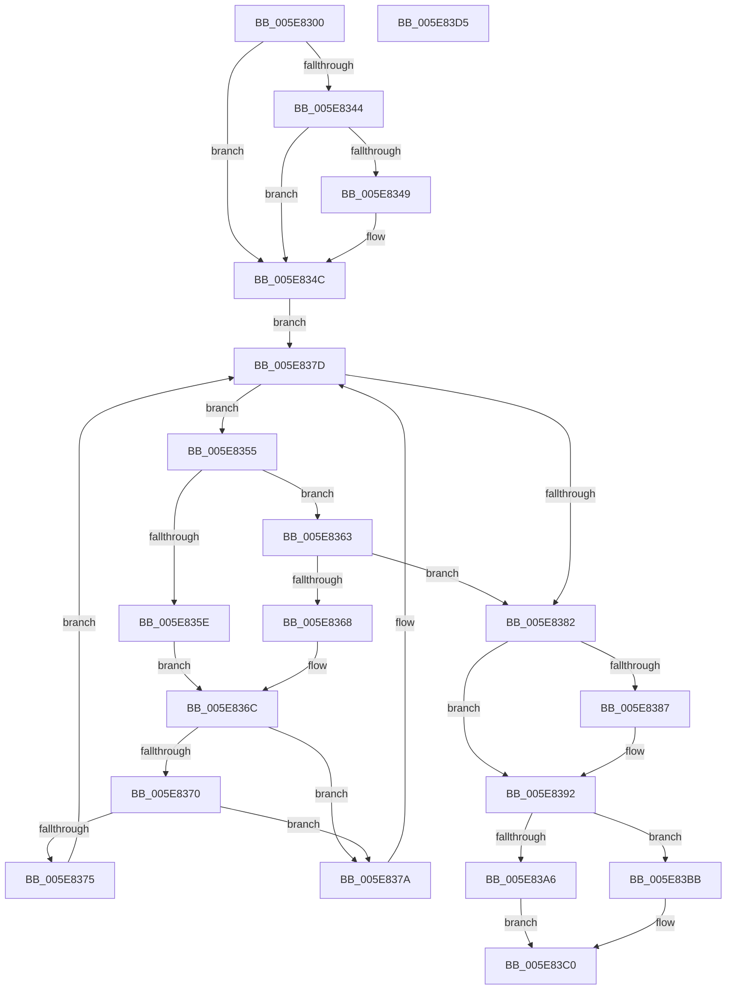

# RtlRemovePointerMapping

- RVA: `0x005E8300`–`0x005E83D6` (길이 `214` bytes)
- VA: `0x00000001405E8300`
- 실행 섹션: `.text`
- PDB 이름 있음: `예`; PDB Function 태그: `아니요`
- unwind 정보 RVA: `0x0005C954`
- 디코드: `63`개 명령, `214/214` bytes 표시
- 미해석 바이트: `0` (있으면 어셈블리에 `.byte`로 보존)

> 이 문서는 커널 이미지의 기계어와 PDB 기호를 분석해 생성했습니다. 4번과 5번은 함수 원형과 자료형을 바이너리 사용 방식에서 추정한 C 해석이며 원본 소스 복구 결과는 아닙니다.

## 1. Dependencies

- 직접 호출 지점: **4**; 고유 호출 대상: **4**
- 직접 호출자로 확인된 함수: **0**
- RIP 상대 이미지 참조: **3**

### Outgoing calls
- `0x005E8321` → [RtlpAcquirePropStoreLockExclusive](RtlpAcquirePropStoreLockExclusive_function_005E84C4.md) (function, `0x005E84C4`)
- `0x005E838D` → [RtlRbRemoveNode](../2E/RtlRbRemoveNode_function_002E4C10.md) (function, `0x002E4C10`)
- `0x005E839C` → [RtlpReleasePropStoreLockExclusive](RtlpReleasePropStoreLockExclusive_function_005E857C.md) (function, `0x005E857C`)
- `0x005E83B2` → [ExFreePoolWithTag](../../poolcode/B8/ExFreePoolWithTag_function_00B82870.md) (function, `0x00B82870`)

### Direct callers
- 이 함수 시작 RVA로 연결되는 직접 call은 확인되지 않았습니다. 간접 호출은 완전히 역산할 수 없습니다.

### Static image references
- `0x005E831A` → RVA `0x00E67B18` (`.data`; read)
- `0x005E8326` → RVA `0x00E0C5C8` (`.data`; read)
- `0x005E832D` → RVA `0x00E0C5C0` (`.data`; read)

## 2. Other-region calls and transfers

- 다른 실행 섹션으로 향하는 call: **1**
  - `0x005E83B2` → [ExFreePoolWithTag](../../poolcode/B8/ExFreePoolWithTag_function_00B82870.md) (`.text` → `POOLCODE`)
- 별도 외부 분기/꼬리 이동을 확인하지 못했습니다.

## 3. Assembly (complete function range)

```asm
005E8300  48 89 5C 24 08                  mov qword ptr [rsp + 8], rbx
005E8305  48 89 6C 24 10                  mov qword ptr [rsp + 0x10], rbp
005E830A  48 89 74 24 18                  mov qword ptr [rsp + 0x18], rsi
005E830F  57                              push rdi
005E8310  48 83 EC 20                     sub rsp, 0x20
005E8314  48 8B F1                        mov rsi, rcx
005E8317  48 8B FA                        mov rdi, rdx
005E831A  48 8D 0D F7 F7 87 00            lea rcx, [rip + 0x87f7f7]
005E8321  E8 9E 01 00 00                  call 0x1405e84c4
005E8326  4C 8B 05 9B 42 82 00            mov r8, qword ptr [rip + 0x82429b]
005E832D  4C 8D 0D 8C 42 82 00            lea r9, [rip + 0x82428c]
005E8334  48 8B 1D 85 42 82 00            mov rbx, qword ptr [rip + 0x824285]
005E833B  40 8A E8                        mov bpl, al
005E833E  41 F6 C0 01                     test r8b, 1
005E8342  74 08                           je 0x1405e834c
005E8344  48 85 DB                        test rbx, rbx
005E8347  74 03                           je 0x1405e834c
005E8349  49 33 D9                        xor rbx, r9
005E834C  41 0F B6 C8                     movzx ecx, r8b
005E8350  83 E1 01                        and ecx, 1
005E8353  EB 28                           jmp 0x1405e837d
005E8355  48 8B C6                        mov rax, rsi
005E8358  48 2B 43 18                     sub rax, qword ptr [rbx + 0x18]
005E835C  79 05                           jns 0x1405e8363
005E835E  48 8B 03                        mov rax, qword ptr [rbx]
005E8361  EB 09                           jmp 0x1405e836c
005E8363  48 85 C0                        test rax, rax
005E8366  7E 1A                           jle 0x1405e8382
005E8368  48 8B 43 08                     mov rax, qword ptr [rbx + 8]
005E836C  85 C9                           test ecx, ecx
005E836E  74 0A                           je 0x1405e837a
005E8370  48 85 C0                        test rax, rax
005E8373  74 05                           je 0x1405e837a
005E8375  48 33 D8                        xor rbx, rax
005E8378  EB 03                           jmp 0x1405e837d
005E837A  48 8B D8                        mov rbx, rax
005E837D  48 85 DB                        test rbx, rbx
005E8380  75 D3                           jne 0x1405e8355
005E8382  48 85 DB                        test rbx, rbx
005E8385  74 0B                           je 0x1405e8392
005E8387  48 8B D3                        mov rdx, rbx
005E838A  49 8B C9                        mov rcx, r9
005E838D  E8 7E C8 CF FF                  call 0x1402e4c10
005E8392  40 8A D5                        mov dl, bpl
005E8395  48 8D 0D 7C F7 87 00            lea rcx, [rip + 0x87f77c]
005E839C  E8 DB 01 00 00                  call 0x1405e857c
005E83A1  48 85 DB                        test rbx, rbx
005E83A4  74 15                           je 0x1405e83bb
005E83A6  48 8B 43 20                     mov rax, qword ptr [rbx + 0x20]
005E83AA  33 D2                           xor edx, edx
005E83AC  48 8B CB                        mov rcx, rbx
005E83AF  48 89 07                        mov qword ptr [rdi], rax
005E83B2  E8 B9 A4 59 00                  call 0x140b82870
005E83B7  33 C0                           xor eax, eax
005E83B9  EB 05                           jmp 0x1405e83c0
005E83BB  B8 25 02 00 C0                  mov eax, 0xc0000225
005E83C0  48 8B 5C 24 30                  mov rbx, qword ptr [rsp + 0x30]
005E83C5  48 8B 6C 24 38                  mov rbp, qword ptr [rsp + 0x38]
005E83CA  48 8B 74 24 40                  mov rsi, qword ptr [rsp + 0x40]
005E83CF  48 83 C4 20                     add rsp, 0x20
005E83D3  5F                              pop rdi
005E83D4  C3                              ret
005E83D5  CC                              int3
```

## 4. C-style interpretation (structured pseudocode)

```c
__int64 __fastcall RtlRemovePointerMapping(__int64 a1, __int64 a2)
{
    __int64 result;
    __int64 v_rbx;
    __int64 v_rsp;
    unsigned __int64 v_stack_p10;
    unsigned __int64 v_stack_p18;
    unsigned __int64 v_stack_p8;

    v_stack_p8 = v_rbx;
    v_stack_p10 = v_rbp;
    v_stack_p18 = v_rsi;
    v_rsp = (v_rsp) - (32);
    result = RtlpAcquirePropStoreLockExclusive(v_rip + 8910839, a2, a3, a4);
    if ((((unsigned __int8)(*(unsigned __int64 *)(v_rip + 8536731))) & (1)) == 0) goto loc_005E834C;
    v_rbx = *(unsigned __int64 *)(v_rip + 8536709);
    if (*(unsigned __int64 *)(v_rip + 8536709) != 0) {
        v_rbx = (*(unsigned __int64 *)(v_rip + 8536709)) ^ (v_rip + 8536716);
    }
    a1 = (unsigned int)(((unsigned __int8)(*(unsigned __int64 *)(v_rip + 8536731))) & (1));
    goto loc_005E837D;
loc_005E8355:
    result = (a1) - (*(unsigned __int64 *)(v_rbx + 24));
    if (!sign_flag) goto loc_005E8363;
    goto loc_005E836C;
loc_005E8363:
    if (condition_is_less_or_equal) goto loc_005E8382;
loc_005E836C:
    if ((unsigned int)(a1) == 0) goto loc_005E837A;
    if (*(unsigned __int64 *)(v_rbx + 8) == 0) goto loc_005E837A;
    v_rbx = (v_rbx) ^ (*(unsigned __int64 *)(v_rbx + 8));
    goto loc_005E837D;
loc_005E837A:
loc_005E837D:
    if (*(unsigned __int64 *)(v_rbx + 8) != 0) goto loc_005E8355;
loc_005E8382:
    result = *(unsigned __int64 *)(v_rbx + 8);
    if (*(unsigned __int64 *)(v_rbx + 8) != 0) {
        a2 = *(unsigned __int64 *)(v_rbx + 8);
        a1 = v_rip + 8536716;
        result = RtlRbRemoveNode(a1, a2, *(unsigned __int64 *)(v_rip + 8536731), v_rip + 8536716);
    }
    result = RtlpReleasePropStoreLockExclusive(v_rip + 8910716, (unsigned __int8)((unsigned __int8)(result)), *(unsigned __int64 *)(v_rip + 8536731), v_rip + 8536716);
    if (*(unsigned __int64 *)(v_rbx + 8) == 0) goto loc_005E83BB;
    a2 = 0;
    *(unsigned __int64 *)(a2) = *(unsigned __int64 *)(*(unsigned __int64 *)(v_rbx + 8) + 32);
    result = ExFreePoolWithTag(*(unsigned __int64 *)(v_rbx + 8), a2, *(unsigned __int64 *)(v_rip + 8536731), v_rip + 8536716);
    result = 0;
    goto loc_005E83C0;
loc_005E83BB:
loc_005E83C0:
    v_rsp = (v_rsp) + (32);
    return (unsigned int)(0xC0000225ULL);
}
```

## 5. (Beta) C Style

```c
int64_t RtlRemovePointerMapping(int64_t Arg1, void *Arg2)
{
    uint8_t *arg2 = (uint8_t *)Arg2;

    int64_t result;
    int64_t local_rbx;
    int64_t local_rsp;
    uint64_t v_stack_p10;
    uint64_t v_stack_p18;
    uint64_t v_stack_p8;

    v_stack_p8 = local_rbx;
    v_stack_p10 = local_rbp;
    v_stack_p18 = local_rsi;
    local_rsp = (local_rsp) - (32);
    result = RtlpAcquirePropStoreLockExclusive(v_rip + 8910839, Arg2, a3, a4);
    if ((((uint8_t)(*(uint64_t *)(v_rip + 0x82429B))) & (1)) == 0) goto loc_005E834C;
    local_rbx = *(uint64_t *)(v_rip + 0x824285);
    if (*(uint64_t *)(v_rip + 0x824285) != 0) {
        local_rbx = (*(uint64_t *)(v_rip + 0x824285)) ^ (v_rip + 8536716);
    }
    Arg1 = (uint32_t)(((uint8_t)(*(uint64_t *)(v_rip + 0x82429B))) & (1));
    goto loc_005E837D;
loc_005E8355:
    result = (Arg1) - (*(uint64_t *)(local_rbx + 0x18));
    if (!sign_flag) goto loc_005E8363;
    goto loc_005E836C;
loc_005E8363:
    if (condition_is_less_or_equal) goto loc_005E8382;
loc_005E836C:
    if ((uint32_t)(Arg1) == 0) goto loc_005E837A;
    if (*(uint64_t *)(local_rbx + 0x8) == 0) goto loc_005E837A;
    local_rbx = (local_rbx) ^ (*(uint64_t *)(local_rbx + 0x8));
    goto loc_005E837D;
loc_005E837A:
loc_005E837D:
    if (*(uint64_t *)(local_rbx + 0x8) != 0) goto loc_005E8355;
loc_005E8382:
    result = *(uint64_t *)(local_rbx + 0x8);
    if (*(uint64_t *)(local_rbx + 0x8) != 0) {
        Arg2 = *(uint64_t *)(local_rbx + 0x8);
        Arg1 = v_rip + 8536716;
        result = RtlRbRemoveNode(Arg1, Arg2, *(uint64_t *)(v_rip + 0x82429B), v_rip + 8536716);
    }
    result = RtlpReleasePropStoreLockExclusive(v_rip + 8910716, (uint8_t)((uint8_t)(result)), *(uint64_t *)(v_rip + 0x82429B), v_rip + 8536716);
    if (*(uint64_t *)(local_rbx + 0x8) == 0) goto loc_005E83BB;
    Arg2 = 0;
    *(uint64_t *)(arg2) = *(uint64_t *)(*(uint64_t *)(local_rbx + 0x8) + 0x20);
    result = ExFreePoolWithTag(*(uint64_t *)(local_rbx + 0x8), Arg2, *(uint64_t *)(v_rip + 0x82429B), v_rip + 8536716);
    result = 0;
    goto loc_005E83C0;
loc_005E83BB:
loc_005E83C0:
    local_rsp = (local_rsp) + (32);
    return (uint32_t)(0xC0000225ULL);
}
```

### 관측된 메모리 오프셋

구조체 형식이 확인되지 않은 접근은 인자 기준의 오프셋으로만 기록했습니다.

| 기준 인자 | 오프셋 표현 | 폭 (bit) | 접근 |
|---|---:|---:|---|
| `Arg2` | `+ 0x0` | `64` | `W` |

## 6. Execution-region graph

[열기: 2D/3D 그래프와 함수 탐색 컨트롤 패널](../../../control-panel.html?section=text&rva=0x005E8300&view=graph)

- 2D 그래프는 위에서 아래로 흐르고, 3D 그래프는 빈 공간을 드래그해 회전합니다. Shift+드래그는 이동, 휠은 확대·축소, 함수 노드 선택은 대상 보고서 이동입니다.

### Static fallback


