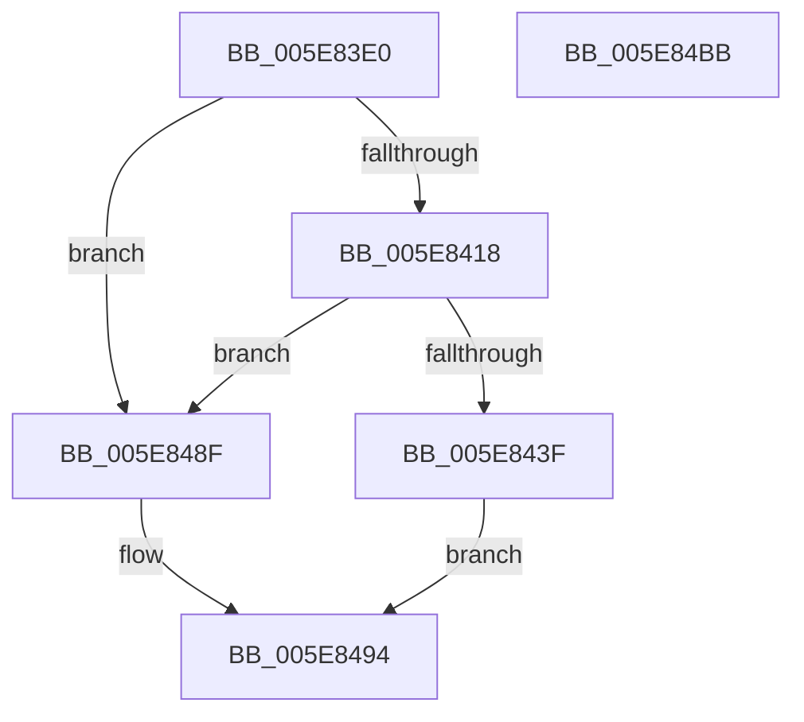

# RtlRemovePropertyStore

- RVA: `0x005E83E0`–`0x005E84BC` (길이 `220` bytes)
- VA: `0x00000001405E83E0`
- 실행 섹션: `.text`
- PDB 이름 있음: `예`; PDB Function 태그: `아니요`
- unwind 정보 RVA: `0x0009B270`
- 디코드: `53`개 명령, `220/220` bytes 표시
- 미해석 바이트: `0` (있으면 어셈블리에 `.byte`로 보존)

> 이 문서는 커널 이미지의 기계어와 PDB 기호를 분석해 생성했습니다. 4번과 5번은 함수 원형과 자료형을 바이너리 사용 방식에서 추정한 C 해석이며 원본 소스 복구 결과는 아닙니다.

## 1. Dependencies

- 직접 호출 지점: **4**; 고유 호출 대상: **4**
- 직접 호출자로 확인된 함수: **0**
- RIP 상대 이미지 참조: **5**

### Outgoing calls
- `0x005E8402` → [RtlpAcquirePropStoreLockExclusive](RtlpAcquirePropStoreLockExclusive_function_005E84C4.md) (function, `0x005E84C4`)
- `0x005E8432` → [bsearch](../50/bsearch_function_00500430.md) (function, `0x00500430`)
- `0x005E8480` → [memcpy](../6C/memcpy_function_006C6840.md) (function, `0x006C6840`)
- `0x005E849E` → [RtlpReleasePropStoreLockExclusive](RtlpReleasePropStoreLockExclusive_function_005E857C.md) (function, `0x005E857C`)

### Direct callers
- 이 함수 시작 RVA로 연결되는 직접 call은 확인되지 않았습니다. 간접 호출은 완전히 역산할 수 없습니다.

### Static image references
- `0x005E83FB` → RVA `0x00E67B1C` (`.data`; read)
- `0x005E8407` → RVA `0x00F05C10` (`.data`; read)
- `0x005E8418` → RVA `0x00F05C1C` (`.data`; read)
- `0x005E841F` → RVA `0x005E8560` (`RtlpComparePropertyEntry`; read)
- `0x005E8487` → RVA `0x00F05C1C` (`.data`; write)

## 2. Other-region calls and transfers

- 다른 실행 섹션으로 향하는 call: **0**
- 별도 외부 분기/꼬리 이동을 확인하지 못했습니다.

## 3. Assembly (complete function range)

```asm
005E83E0  48 89 5C 24 08                  mov qword ptr [rsp + 8], rbx
005E83E5  48 89 74 24 10                  mov qword ptr [rsp + 0x10], rsi
005E83EA  48 89 7C 24 18                  mov qword ptr [rsp + 0x18], rdi
005E83EF  41 56                           push r14
005E83F1  48 83 EC 30                     sub rsp, 0x30
005E83F5  48 8B D9                        mov rbx, rcx
005E83F8  4C 8B F2                        mov r14, rdx
005E83FB  48 8D 0D 1A F7 87 00            lea rcx, [rip + 0x87f71a]
005E8402  E8 BD 00 00 00                  call 0x1405e84c4
005E8407  48 8B 15 02 D8 91 00            mov rdx, qword ptr [rip + 0x91d802]
005E840E  33 FF                           xor edi, edi
005E8410  40 8A F0                        mov sil, al
005E8413  48 85 D2                        test rdx, rdx
005E8416  74 77                           je 0x1405e848f
005E8418  44 8B 05 FD D7 91 00            mov r8d, dword ptr [rip + 0x91d7fd]
005E841F  48 8D 05 3A 01 00 00            lea rax, [rip + 0x13a]
005E8426  44 8D 4F 18                     lea r9d, [rdi + 0x18]
005E842A  48 89 44 24 20                  mov qword ptr [rsp + 0x20], rax
005E842F  48 8B CB                        mov rcx, rbx
005E8432  E8 F9 7F F1 FF                  call 0x140500430
005E8437  4C 8B C8                        mov r9, rax
005E843A  48 85 C0                        test rax, rax
005E843D  74 50                           je 0x1405e848f
005E843F  48 8B 48 10                     mov rcx, qword ptr [rax + 0x10]
005E8443  49 8D 51 18                     lea rdx, [r9 + 0x18]
005E8447  8B 1D CF D7 91 00               mov ebx, dword ptr [rip + 0x91d7cf]
005E844D  49 89 0E                        mov qword ptr [r14], rcx
005E8450  48 8B C8                        mov rcx, rax
005E8453  48 2B 0D B6 D7 91 00            sub rcx, qword ptr [rip + 0x91d7b6]
005E845A  48 B8 AB AA AA AA AA AA AA AA   movabs rax, 0xaaaaaaaaaaaaaaab
005E8464  48 C1 F9 03                     sar rcx, 3
005E8468  48 0F AF C8                     imul rcx, rax
005E846C  8B C3                           mov eax, ebx
005E846E  48 2B C1                        sub rax, rcx
005E8471  49 8B C9                        mov rcx, r9
005E8474  4C 8D 04 40                     lea r8, [rax + rax*2]
005E8478  4E 8D 04 C5 E8 FF FF FF         lea r8, [r8*8 - 0x18]
005E8480  E8 BB E3 0D 00                  call 0x1406c6840
005E8485  FF CB                           dec ebx
005E8487  89 1D 8F D7 91 00               mov dword ptr [rip + 0x91d78f], ebx
005E848D  EB 05                           jmp 0x1405e8494
005E848F  BF 25 02 00 C0                  mov edi, 0xc0000225
005E8494  40 8A D6                        mov dl, sil
005E8497  48 8D 0D 7E F6 87 00            lea rcx, [rip + 0x87f67e]
005E849E  E8 D9 00 00 00                  call 0x1405e857c
005E84A3  48 8B 5C 24 40                  mov rbx, qword ptr [rsp + 0x40]
005E84A8  8B C7                           mov eax, edi
005E84AA  48 8B 7C 24 50                  mov rdi, qword ptr [rsp + 0x50]
005E84AF  48 8B 74 24 48                  mov rsi, qword ptr [rsp + 0x48]
005E84B4  48 83 C4 30                     add rsp, 0x30
005E84B8  41 5E                           pop r14
005E84BA  C3                              ret
005E84BB  CC                              int3
```

## 4. C-style interpretation (structured pseudocode)

```c
__int64 __fastcall RtlRemovePropertyStore(__int64 a1, __int64 a2)
{
    __int64 result;
    __int64 v_rbx;
    __int64 v_rdi;
    __int64 v_rsp;
    unsigned __int64 v_stack_m18;
    unsigned __int64 v_stack_p10;
    unsigned __int64 v_stack_p18;
    unsigned __int64 v_stack_p8;

    v_stack_p8 = v_rbx;
    v_stack_p10 = v_rsi;
    v_stack_p18 = v_rdi;
    v_rsp = (v_rsp) - (48);
    result = RtlpAcquirePropStoreLockExclusive(v_rip + 8910618, a2, a3, a4);
    v_rdi = 0;
    if (*(unsigned __int64 *)(v_rip + 9558018) == 0) goto loc_005E848F;
    v_stack_m18 = v_rip + 314;
    result = bsearch(a1, *(unsigned __int64 *)(v_rip + 9558018), (unsigned int)(*(unsigned int *)(v_rip + 9558013)), v_rdi + 24);
    if (result == 0) goto loc_005E848F;
    *(unsigned __int64 *)(a2) = *(unsigned __int64 *)(result + 16);
    a1 = (result) - (*(unsigned __int64 *)(v_rip + 9557942));
    a1 = (a1) >> (3);
    a1 = (a1) * (result);
    result = ((unsigned int)((unsigned int)((unsigned int)(*(unsigned int *)(v_rip + 9557967))))) - (a1);
    result = memcpy(result, result + 24, result + result * 2 * 8 - 24, result);
    v_rbx = (unsigned int)(((unsigned int)(*(unsigned int *)(v_rip + 9557967))) - 1);
    *(unsigned int *)(v_rip + 9557903) = (unsigned int)(v_rbx);
    goto loc_005E8494;
loc_005E848F:
loc_005E8494:
    result = RtlpReleasePropStoreLockExclusive(v_rip + 8910462, (unsigned __int8)((unsigned __int8)(result)), result + result * 2 * 8 - 24, result);
    v_rsp = (v_rsp) + (48);
    return (unsigned int)((unsigned int)((unsigned int)(0xC0000225ULL)));
}
```

## 5. (Beta) C Style

```c
int64_t RtlRemovePropertyStore(int64_t Arg1, void *Arg2)
{
    uint8_t *arg2 = (uint8_t *)Arg2;

    int64_t result;
    int64_t local_rbx;
    int64_t local_rdi;
    int64_t local_rsp;
    uint64_t v_stack_m18;
    uint64_t v_stack_p10;
    uint64_t v_stack_p18;
    uint64_t v_stack_p8;

    v_stack_p8 = local_rbx;
    v_stack_p10 = local_rsi;
    v_stack_p18 = local_rdi;
    local_rsp = (local_rsp) - (48);
    result = RtlpAcquirePropStoreLockExclusive(v_rip + 8910618, Arg2, a3, a4);
    local_rdi = 0;
    if (*(uint64_t *)(v_rip + 0x91D802) == 0) goto loc_005E848F;
    v_stack_m18 = v_rip + 314;
    result = bsearch(Arg1, *(uint64_t *)(v_rip + 0x91D802), (uint32_t)(*(uint32_t *)(v_rip + 0x91D7FD)), local_rdi + 24);
    if (result == 0) goto loc_005E848F;
    *(uint64_t *)(arg2) = *(uint64_t *)(result + 0x10);
    Arg1 = (result) - (*(uint64_t *)(v_rip + 0x91D7B6));
    Arg1 = (Arg1) >> (3);
    Arg1 = (Arg1) * (result);
    result = ((uint32_t)((uint32_t)((uint32_t)(*(uint32_t *)(v_rip + 0x91D7CF))))) - (Arg1);
    result = memcpy(result, result + 24, result + result * 2 * 8 - 24, result);
    local_rbx = (uint32_t)(((uint32_t)(*(uint32_t *)(v_rip + 0x91D7CF))) - 1);
    *(uint32_t *)(v_rip + 0x91D78F) = (uint32_t)(local_rbx);
    goto loc_005E8494;
loc_005E848F:
loc_005E8494:
    result = RtlpReleasePropStoreLockExclusive(v_rip + 8910462, (uint8_t)((uint8_t)(result)), result + result * 2 * 8 - 24, result);
    local_rsp = (local_rsp) + (48);
    return (uint32_t)((uint32_t)((uint32_t)(0xC0000225ULL)));
}
```

### 관측된 메모리 오프셋

구조체 형식이 확인되지 않은 접근은 인자 기준의 오프셋으로만 기록했습니다.

| 기준 인자 | 오프셋 표현 | 폭 (bit) | 접근 |
|---|---:|---:|---|
| `Arg2` | `+ 0x0` | `64` | `W` |

## 6. Execution-region graph

[열기: 2D/3D 그래프와 함수 탐색 컨트롤 패널](../../../control-panel.html?section=text&rva=0x005E83E0&view=graph)

- 2D 그래프는 위에서 아래로 흐르고, 3D 그래프는 빈 공간을 드래그해 회전합니다. Shift+드래그는 이동, 휠은 확대·축소, 함수 노드 선택은 대상 보고서 이동입니다.

### Static fallback


