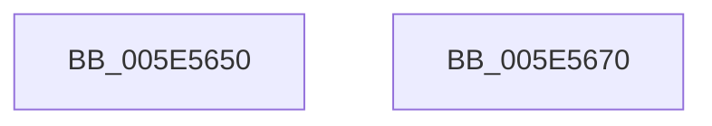

# RtlSecondsSince1970ToTime

- RVA: `0x005E5650`–`0x005E5671` (길이 `33` bytes)
- VA: `0x00000001405E5650`
- 실행 섹션: `.text`
- PDB 이름 있음: `예`; PDB Function 태그: `아니요`
- unwind 정보 RVA: `0x000DB714`
- 디코드: `8`개 명령, `33/33` bytes 표시
- 미해석 바이트: `0` (있으면 어셈블리에 `.byte`로 보존)

> 이 문서는 커널 이미지의 기계어와 PDB 기호를 분석해 생성했습니다. 4번과 5번은 함수 원형과 자료형을 바이너리 사용 방식에서 추정한 C 해석이며 원본 소스 복구 결과는 아닙니다.

## 1. Dependencies

- 직접 호출 지점: **0**; 고유 호출 대상: **0**
- 직접 호출자로 확인된 함수: **0**
- RIP 상대 이미지 참조: **1**

### Outgoing calls
- 직접 디코드된 call 명령이 없습니다.

### Direct callers
- 이 함수 시작 RVA로 연결되는 직접 call은 확인되지 않았습니다. 간접 호출은 완전히 역산할 수 없습니다.

### Static image references
- `0x005E5655` → RVA `0x00014D28` (`.rdata`; read)

## 2. Other-region calls and transfers

- 다른 실행 섹션으로 향하는 call: **0**
- 별도 외부 분기/꼬리 이동을 확인하지 못했습니다.

## 3. Assembly (complete function range)

```asm
005E5650  83 64 24 14 00                  and dword ptr [rsp + 0x14], 0
005E5655  4C 8B 05 CC F6 A2 FF            mov r8, qword ptr [rip - 0x5d0934]
005E565C  89 4C 24 10                     mov dword ptr [rsp + 0x10], ecx
005E5660  4C 03 44 24 10                  add r8, qword ptr [rsp + 0x10]
005E5665  49 69 C0 80 96 98 00            imul rax, r8, 0x989680
005E566C  48 89 02                        mov qword ptr [rdx], rax
005E566F  C3                              ret
005E5670  CC                              int3
```

## 4. C-style interpretation (structured pseudocode)

```c
__int64 __fastcall RtlSecondsSince1970ToTime(int a1, __int64 a2)
{
    __int64 result;
    unsigned int v_stack_p10;
    unsigned int v_stack_p14;

    v_stack_p10 = a1;
    a3 = (*(unsigned __int64 *)(v_rip - 6097204)) + (v_stack_p10);
    result = (result) * (a3);
    *(unsigned __int64 *)(a2) = result;
    return result;
}
```

## 5. (Beta) C Style

```c
int64_t RtlSecondsSince1970ToTime(int32_t Arg1, void *Arg2)
{
    uint8_t *arg2 = (uint8_t *)Arg2;

    int64_t result;
    uint32_t v_stack_p10;
    uint32_t v_stack_p14;

    v_stack_p10 = Arg1;
    a3 = (*(uint64_t *)(v_rip - 0x5D0934)) + (v_stack_p10);
    result = (result) * (a3);
    *(uint64_t *)(arg2) = result;
    return result;
}
```

### 관측된 메모리 오프셋

구조체 형식이 확인되지 않은 접근은 인자 기준의 오프셋으로만 기록했습니다.

| 기준 인자 | 오프셋 표현 | 폭 (bit) | 접근 |
|---|---:|---:|---|
| `Arg2` | `+ 0x0` | `64` | `W` |

## 6. Execution-region graph

[열기: 2D/3D 그래프와 함수 탐색 컨트롤 패널](../../../control-panel.html?section=text&rva=0x005E5650&view=graph)

- 2D 그래프는 위에서 아래로 흐르고, 3D 그래프는 빈 공간을 드래그해 회전합니다. Shift+드래그는 이동, 휠은 확대·축소, 함수 노드 선택은 대상 보고서 이동입니다.

### Static fallback


