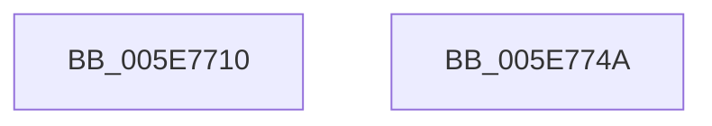

# RtlSetPortableOperatingSystem

- RVA: `0x005E7710`–`0x005E774B` (길이 `59` bytes)
- VA: `0x00000001405E7710`
- 실행 섹션: `.text`
- PDB 이름 있음: `예`; PDB Function 태그: `아니요`
- unwind 정보 RVA: `0x0005D2F4`
- 디코드: `16`개 명령, `59/59` bytes 표시
- 미해석 바이트: `0` (있으면 어셈블리에 `.byte`로 보존)

> 이 문서는 커널 이미지의 기계어와 PDB 기호를 분석해 생성했습니다. 4번과 5번은 함수 원형과 자료형을 바이너리 사용 방식에서 추정한 C 해석이며 원본 소스 복구 결과는 아닙니다.

## 1. Dependencies

- 직접 호출 지점: **1**; 고유 호출 대상: **1**
- 직접 호출자로 확인된 함수: **0**
- RIP 상대 이미지 참조: **1**

### Outgoing calls
- `0x005E7740` → [RtlWriteRegistryValue](../../page/A6/RtlWriteRegistryValue_function_00A6C620.md) (function, `0x00A6C620`)

### Direct callers
- 이 함수 시작 RVA로 연결되는 직접 call은 확인되지 않았습니다. 간접 호출은 완전히 역산할 수 없습니다.

### Static image references
- `0x005E7716` → RVA `0x006CC7B0` (` ?? ::FNODOBFM::`string'`; read)

## 2. Other-region calls and transfers

- 다른 실행 섹션으로 향하는 call: **1**
  - `0x005E7740` → [RtlWriteRegistryValue](../../page/A6/RtlWriteRegistryValue_function_00A6C620.md) (`.text` → `PAGE`)
- 별도 외부 분기/꼬리 이동을 확인하지 못했습니다.

## 3. Assembly (complete function range)

```asm
005E7710  48 83 EC 38                     sub rsp, 0x38
005E7714  33 C0                           xor eax, eax
005E7716  4C 8D 05 93 50 0E 00            lea r8, [rip + 0xe5093]
005E771D  84 C9                           test cl, cl
005E771F  41 B9 04 00 00 00               mov r9d, 4
005E7725  44 89 4C 24 28                  mov dword ptr [rsp + 0x28], r9d
005E772A  0F 95 C0                        setne al
005E772D  33 D2                           xor edx, edx
005E772F  89 44 24 40                     mov dword ptr [rsp + 0x40], eax
005E7733  48 8D 44 24 40                  lea rax, [rsp + 0x40]
005E7738  48 89 44 24 20                  mov qword ptr [rsp + 0x20], rax
005E773D  8D 4A 02                        lea ecx, [rdx + 2]
005E7740  E8 DB 4E 48 00                  call 0x140a6c620
005E7745  48 83 C4 38                     add rsp, 0x38
005E7749  C3                              ret
005E774A  CC                              int3
```

## 4. C-style interpretation (structured pseudocode)

```c
__int64 __fastcall RtlSetPortableOperatingSystem(unsigned __int8 a1, int a2)
{
    __int64 result;
    __int64 v_rsp;
    unsigned int v_stack_m10;
    unsigned __int64 v_stack_m18;
    unsigned int v_stack_p8;

    v_rsp = (v_rsp) - (56);
    result = 0;
    v_stack_m10 = 4;
    result = (a1 != 0) ? 1 : 0;
    a2 = 0;
    v_stack_p8 = (unsigned int)(result);
    v_stack_m18 = v_stack_p8;
    result = RtlWriteRegistryValue(a2 + 2, a2, v_rip + 938131, 4);
    v_rsp = (v_rsp) + (56);
    return result;
}
```

## 5. (Beta) C Style

```c
int64_t RtlSetPortableOperatingSystem(uint8_t Arg1, int32_t Arg2)
{
    int64_t result;
    int64_t local_rsp;
    uint32_t v_stack_m10;
    uint64_t v_stack_m18;
    uint32_t v_stack_p8;

    local_rsp = (local_rsp) - (56);
    result = 0;
    v_stack_m10 = 4;
    result = (Arg1 != 0) ? 1 : 0;
    Arg2 = 0;
    v_stack_p8 = (uint32_t)(result);
    v_stack_m18 = v_stack_p8;
    result = RtlWriteRegistryValue(Arg2 + 2, Arg2, v_rip + 938131, 4);
    local_rsp = (local_rsp) + (56);
    return result;
}
```

## 6. Execution-region graph

[열기: 2D/3D 그래프와 함수 탐색 컨트롤 패널](../../../control-panel.html?section=text&rva=0x005E7710&view=graph)

- 2D 그래프는 위에서 아래로 흐르고, 3D 그래프는 빈 공간을 드래그해 회전합니다. Shift+드래그는 이동, 휠은 확대·축소, 함수 노드 선택은 대상 보고서 이동입니다.

### Static fallback


