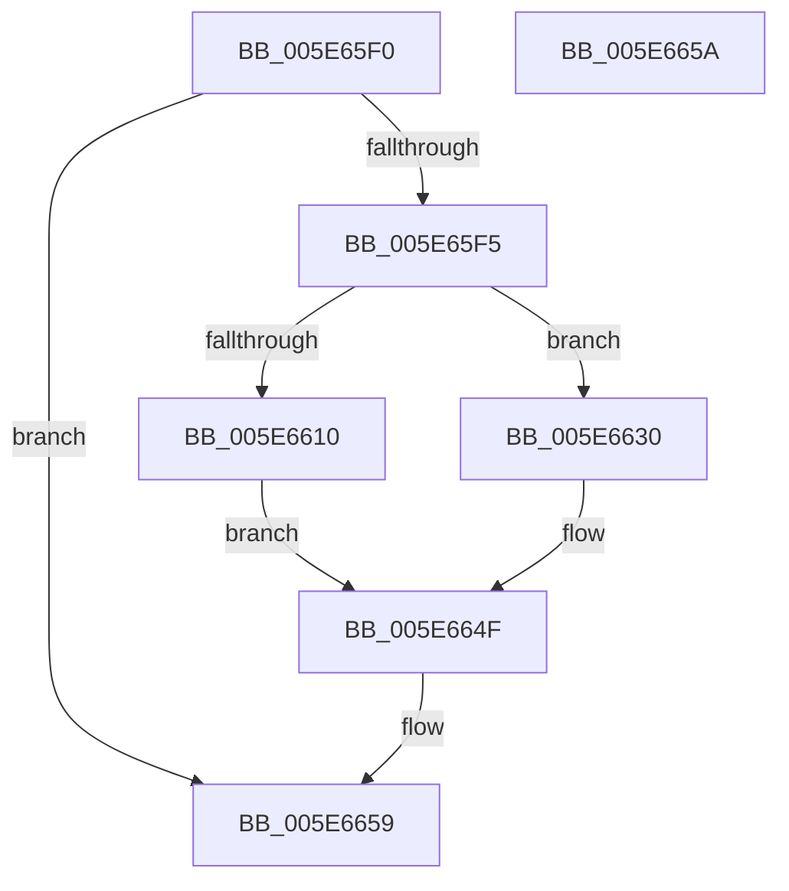

# RtlShiftLeftBitMapEx

- RVA: `0x005E65F0`–`0x005E665B` (길이 `107` bytes)
- VA: `0x00000001405E65F0`
- 실행 섹션: `.text`
- PDB 이름 있음: `예`; PDB Function 태그: `아니요`
- unwind 정보 RVA: `0x00084918`
- 디코드: `34`개 명령, `107/107` bytes 표시
- 미해석 바이트: `0` (있으면 어셈블리에 `.byte`로 보존)

> 이 문서는 커널 이미지의 기계어와 PDB 기호를 분석해 생성했습니다. 4번과 5번은 함수 원형과 자료형을 바이너리 사용 방식에서 추정한 C 해석이며 원본 소스 복구 결과는 아닙니다.

## 1. Dependencies

- 직접 호출 지점: **3**; 고유 호출 대상: **3**
- 직접 호출자로 확인된 함수: **0**
- RIP 상대 이미지 참조: **0**

### Outgoing calls
- `0x005E6629` → [memset](../6C/memset_function_006C6C40.md) (function, `0x006C6C40`)
- `0x005E6639` → [RtlExtractBitMapEx](../4A/RtlExtractBitMapEx_function_004A5170.md) (function, `0x004A5170`)
- `0x005E664A` → [RtlClearBitsEx](../29/RtlClearBitsEx_function_00297740.md) (function, `0x00297740`)

### Direct callers
- 이 함수 시작 RVA로 연결되는 직접 call은 확인되지 않았습니다. 간접 호출은 완전히 역산할 수 없습니다.

### Static image references
- 디코드된 RIP-relative 메모리 참조가 없습니다.

## 2. Other-region calls and transfers

- 다른 실행 섹션으로 향하는 call: **0**
- 별도 외부 분기/꼬리 이동을 확인하지 못했습니다.

## 3. Assembly (complete function range)

```asm
005E65F0  48 85 D2                        test rdx, rdx
005E65F3  74 64                           je 0x1405e6659
005E65F5  48 89 5C 24 08                  mov qword ptr [rsp + 8], rbx
005E65FA  57                              push rdi
005E65FB  48 83 EC 20                     sub rsp, 0x20
005E65FF  4C 8B 09                        mov r9, qword ptr [rcx]
005E6602  45 33 C0                        xor r8d, r8d
005E6605  48 8B DA                        mov rbx, rdx
005E6608  48 8B F9                        mov rdi, rcx
005E660B  49 3B D1                        cmp rdx, r9
005E660E  72 20                           jb 0x1405e6630
005E6610  48 8B 49 08                     mov rcx, qword ptr [rcx + 8]
005E6614  41 F6 C1 1F                     test r9b, 0x1f
005E6618  41 0F 95 C0                     setne r8b
005E661C  49 C1 E9 05                     shr r9, 5
005E6620  4D 03 C1                        add r8, r9
005E6623  33 D2                           xor edx, edx
005E6625  49 C1 E0 02                     shl r8, 2
005E6629  E8 12 06 0E 00                  call 0x1406c6c40
005E662E  EB 1F                           jmp 0x1405e664f
005E6630  4C 2B CB                        sub r9, rbx
005E6633  4C 8B C3                        mov r8, rbx
005E6636  48 8B D7                        mov rdx, rdi
005E6639  E8 32 EB EB FF                  call 0x1404a5170
005E663E  48 8B 17                        mov rdx, qword ptr [rdi]
005E6641  4C 8B C3                        mov r8, rbx
005E6644  48 2B D3                        sub rdx, rbx
005E6647  48 8B CF                        mov rcx, rdi
005E664A  E8 F1 10 CB FF                  call 0x140297740
005E664F  48 8B 5C 24 30                  mov rbx, qword ptr [rsp + 0x30]
005E6654  48 83 C4 20                     add rsp, 0x20
005E6658  5F                              pop rdi
005E6659  C3                              ret
005E665A  CC                              int3
```

## 4. C-style interpretation (structured pseudocode)

```c
__int64 __fastcall RtlShiftLeftBitMapEx(__int64 a1, __int64 a2, int a3)
{
    __int64 result;
    __int64 v_rsp;
    unsigned __int64 v_stack_p8;

    if (a2 == 0) goto loc_005E6659;
    v_stack_p8 = v_rbx;
    v_rsp = (v_rsp) - (32);
    a3 = 0;
    if (a2 < (*(unsigned __int64 *)(a1))) goto loc_005E6630;
    a3 = ((((unsigned __int8)(*(unsigned __int64 *)(a1))) & (31)) != 0) ? 1 : 0;
    a4 = (*(unsigned __int64 *)(a1)) >> (5);
    a3 = (a3) + (a4);
    a2 = 0;
    a3 = (a3) << (2);
    result = memset(*(unsigned __int64 *)(a1 + 8), a2, a3, a4);
    goto loc_005E664F;
loc_005E6630:
    a4 = (a4) - (0);
    result = RtlExtractBitMapEx(*(unsigned __int64 *)(a1 + 8), a1, 0, a4);
    a2 = (*(unsigned __int64 *)(a1)) - (0);
    result = RtlClearBitsEx(a1, a2, 0, a4);
loc_005E664F:
    v_rsp = (v_rsp) + (32);
loc_005E6659:
    return result;
}
```

## 5. (Beta) C Style

```c
int64_t RtlShiftLeftBitMapEx(void *Arg1, int64_t Arg2, int32_t Arg3)
{
    uint8_t *arg1 = (uint8_t *)Arg1;

    int64_t result;
    int64_t local_rsp;
    uint64_t v_stack_p8;

    if (Arg2 == 0) goto loc_005E6659;
    v_stack_p8 = local_rbx;
    local_rsp = (local_rsp) - (32);
    Arg3 = 0;
    if (Arg2 < (*(uint64_t *)(arg1))) goto loc_005E6630;
    Arg3 = ((((uint8_t)(*(uint64_t *)(arg1))) & (31)) != 0) ? 1 : 0;
    a4 = (*(uint64_t *)(arg1)) >> (5);
    Arg3 = (Arg3) + (a4);
    Arg2 = 0;
    Arg3 = (Arg3) << (2);
    result = memset(*(uint64_t *)(arg1 + 0x8), Arg2, Arg3, a4);
    goto loc_005E664F;
loc_005E6630:
    a4 = (a4) - (0);
    result = RtlExtractBitMapEx(*(uint64_t *)(arg1 + 0x8), Arg1, 0, a4);
    Arg2 = (*(uint64_t *)(arg1)) - (0);
    result = RtlClearBitsEx(Arg1, Arg2, 0, a4);
loc_005E664F:
    local_rsp = (local_rsp) + (32);
loc_005E6659:
    return result;
}
```

### 관측된 메모리 오프셋

구조체 형식이 확인되지 않은 접근은 인자 기준의 오프셋으로만 기록했습니다.

| 기준 인자 | 오프셋 표현 | 폭 (bit) | 접근 |
|---|---:|---:|---|
| `Arg1` | `+ 0x0` | `64` | `R` |
| `Arg1` | `+ 0x8` | `64` | `R` |

## 6. Execution-region graph

[열기: 2D/3D 그래프와 함수 탐색 컨트롤 패널](../../../control-panel.html?section=text&rva=0x005E65F0&view=graph)

- 2D 그래프는 위에서 아래로 흐르고, 3D 그래프는 빈 공간을 드래그해 회전합니다. Shift+드래그는 이동, 휠은 확대·축소, 함수 노드 선택은 대상 보고서 이동입니다.

### Static fallback


