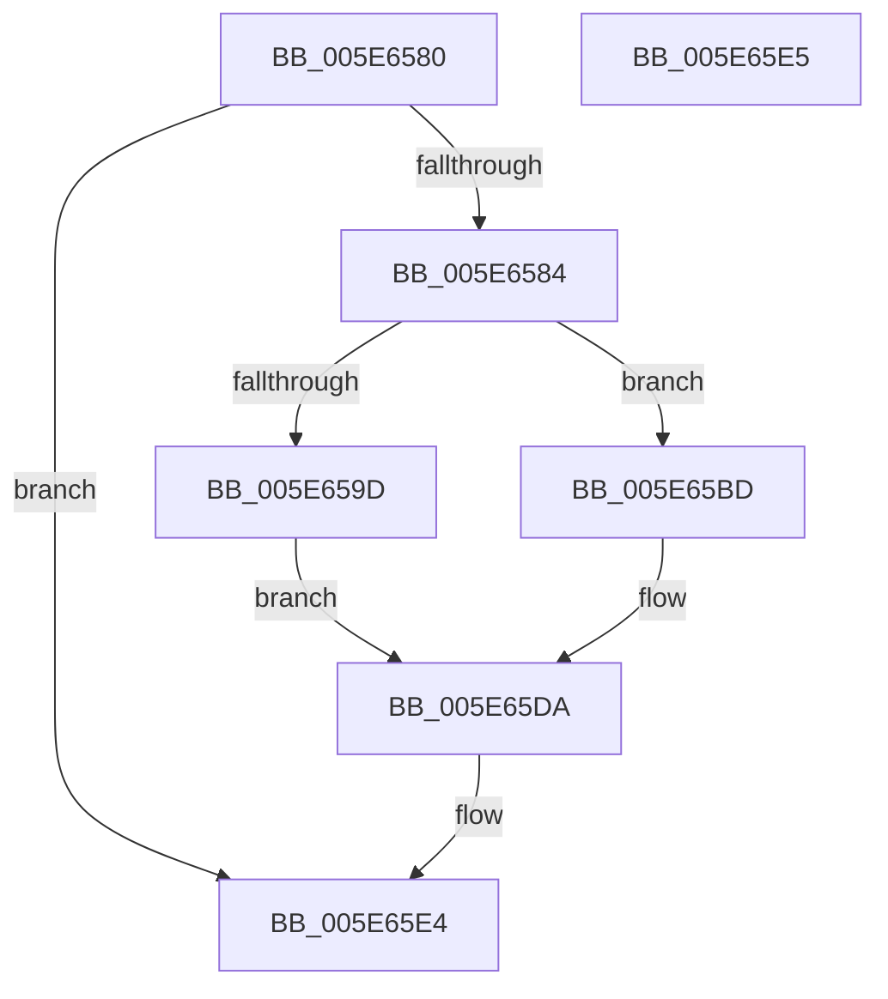

# RtlShiftLeftBitMap

- RVA: `0x005E6580`–`0x005E65E6` (길이 `102` bytes)
- VA: `0x00000001405E6580`
- 실행 섹션: `.text`
- PDB 이름 있음: `예`; PDB Function 태그: `아니요`
- unwind 정보 RVA: `0x000A689C`
- 디코드: `34`개 명령, `102/102` bytes 표시
- 미해석 바이트: `0` (있으면 어셈블리에 `.byte`로 보존)

> 이 문서는 커널 이미지의 기계어와 PDB 기호를 분석해 생성했습니다. 4번과 5번은 함수 원형과 자료형을 바이너리 사용 방식에서 추정한 C 해석이며 원본 소스 복구 결과는 아닙니다.

## 1. Dependencies

- 직접 호출 지점: **3**; 고유 호출 대상: **3**
- 직접 호출자로 확인된 함수: **0**
- RIP 상대 이미지 참조: **0**

### Outgoing calls
- `0x005E65B6` → [memset](../6C/memset_function_006C6C40.md) (function, `0x006C6C40`)
- `0x005E65C6` → [RtlExtractBitMap](RtlExtractBitMap_function_005E6090.md) (function, `0x005E6090`)
- `0x005E65D5` → [RtlClearBits](../3E/RtlClearBits_function_003E1A90.md) (function, `0x003E1A90`)

### Direct callers
- 이 함수 시작 RVA로 연결되는 직접 call은 확인되지 않았습니다. 간접 호출은 완전히 역산할 수 없습니다.

### Static image references
- 디코드된 RIP-relative 메모리 참조가 없습니다.

## 2. Other-region calls and transfers

- 다른 실행 섹션으로 향하는 call: **0**
- 별도 외부 분기/꼬리 이동을 확인하지 못했습니다.

## 3. Assembly (complete function range)

```asm
005E6580  85 D2                           test edx, edx
005E6582  74 60                           je 0x1405e65e4
005E6584  48 89 5C 24 08                  mov qword ptr [rsp + 8], rbx
005E6589  57                              push rdi
005E658A  48 83 EC 20                     sub rsp, 0x20
005E658E  44 8B 09                        mov r9d, dword ptr [rcx]
005E6591  33 C0                           xor eax, eax
005E6593  8B DA                           mov ebx, edx
005E6595  48 8B F9                        mov rdi, rcx
005E6598  41 3B D1                        cmp edx, r9d
005E659B  72 20                           jb 0x1405e65bd
005E659D  48 8B 49 08                     mov rcx, qword ptr [rcx + 8]
005E65A1  41 F6 C1 1F                     test r9b, 0x1f
005E65A5  0F 95 C0                        setne al
005E65A8  41 C1 E9 05                     shr r9d, 5
005E65AC  33 D2                           xor edx, edx
005E65AE  45 8D 04 01                     lea r8d, [r9 + rax]
005E65B2  41 C1 E0 02                     shl r8d, 2
005E65B6  E8 85 06 0E 00                  call 0x1406c6c40
005E65BB  EB 1D                           jmp 0x1405e65da
005E65BD  44 2B CB                        sub r9d, ebx
005E65C0  44 8B C3                        mov r8d, ebx
005E65C3  48 8B D7                        mov rdx, rdi
005E65C6  E8 C5 FA FF FF                  call 0x1405e6090
005E65CB  8B 17                           mov edx, dword ptr [rdi]
005E65CD  44 8B C3                        mov r8d, ebx
005E65D0  2B D3                           sub edx, ebx
005E65D2  48 8B CF                        mov rcx, rdi
005E65D5  E8 B6 B4 DF FF                  call 0x1403e1a90
005E65DA  48 8B 5C 24 30                  mov rbx, qword ptr [rsp + 0x30]
005E65DF  48 83 C4 20                     add rsp, 0x20
005E65E3  5F                              pop rdi
005E65E4  C3                              ret
005E65E5  CC                              int3
```

## 4. C-style interpretation (structured pseudocode)

```c
__int64 __fastcall RtlShiftLeftBitMap(__int64 a1, int a2)
{
    __int64 result;
    __int64 v_rsp;
    unsigned __int64 v_stack_p8;

    if (a2 == 0) goto loc_005E65E4;
    v_stack_p8 = v_rbx;
    v_rsp = (v_rsp) - (32);
    result = 0;
    if (a2 < ((unsigned int)((unsigned int)(*(unsigned int *)(a1))))) goto loc_005E65BD;
    result = ((((unsigned __int8)((unsigned int)(*(unsigned int *)(a1)))) & (31)) != 0) ? 1 : 0;
    a4 = (unsigned int)(((unsigned int)(*(unsigned int *)(a1))) >> (5));
    a2 = 0;
    a3 = (unsigned int)((a4 + result * 1) << (2));
    result = memset(*(unsigned __int64 *)(a1 + 8), a2, a3, a4);
    goto loc_005E65DA;
loc_005E65BD:
    a4 = (unsigned int)((a4) - ((unsigned int)((unsigned int)(a2))));
    result = RtlExtractBitMap(*(unsigned __int64 *)(a1 + 8), a1, (unsigned int)((unsigned int)((unsigned int)(a2))), a4);
    a2 = (unsigned int)(((unsigned int)(*(unsigned int *)(a1))) - ((unsigned int)((unsigned int)(a2))));
    result = RtlClearBits(a1, a2, (unsigned int)((unsigned int)((unsigned int)(a2))), a4);
loc_005E65DA:
    v_rsp = (v_rsp) + (32);
loc_005E65E4:
    return result;
}
```

## 5. (Beta) C Style

```c
int64_t RtlShiftLeftBitMap(void *Arg1, int32_t Arg2)
{
    uint8_t *arg1 = (uint8_t *)Arg1;

    int64_t result;
    int64_t local_rsp;
    uint64_t v_stack_p8;

    if (Arg2 == 0) goto loc_005E65E4;
    v_stack_p8 = local_rbx;
    local_rsp = (local_rsp) - (32);
    result = 0;
    if (Arg2 < ((uint32_t)((uint32_t)(*(uint32_t *)(arg1))))) goto loc_005E65BD;
    result = ((((uint8_t)((uint32_t)(*(uint32_t *)(arg1)))) & (31)) != 0) ? 1 : 0;
    a4 = (uint32_t)(((uint32_t)(*(uint32_t *)(arg1))) >> (5));
    Arg2 = 0;
    a3 = (uint32_t)((a4 + result * 1) << (2));
    result = memset(*(uint64_t *)(arg1 + 0x8), Arg2, a3, a4);
    goto loc_005E65DA;
loc_005E65BD:
    a4 = (uint32_t)((a4) - ((uint32_t)((uint32_t)(Arg2))));
    result = RtlExtractBitMap(*(uint64_t *)(arg1 + 0x8), Arg1, (uint32_t)((uint32_t)((uint32_t)(Arg2))), a4);
    Arg2 = (uint32_t)(((uint32_t)(*(uint32_t *)(arg1))) - ((uint32_t)((uint32_t)(Arg2))));
    result = RtlClearBits(Arg1, Arg2, (uint32_t)((uint32_t)((uint32_t)(Arg2))), a4);
loc_005E65DA:
    local_rsp = (local_rsp) + (32);
loc_005E65E4:
    return result;
}
```

### 관측된 메모리 오프셋

구조체 형식이 확인되지 않은 접근은 인자 기준의 오프셋으로만 기록했습니다.

| 기준 인자 | 오프셋 표현 | 폭 (bit) | 접근 |
|---|---:|---:|---|
| `Arg1` | `+ 0x0` | `32` | `R` |
| `Arg1` | `+ 0x8` | `64` | `R` |

## 6. Execution-region graph

[열기: 2D/3D 그래프와 함수 탐색 컨트롤 패널](../../../control-panel.html?section=text&rva=0x005E6580&view=graph)

- 2D 그래프는 위에서 아래로 흐르고, 3D 그래프는 빈 공간을 드래그해 회전합니다. Shift+드래그는 이동, 휠은 확대·축소, 함수 노드 선택은 대상 보고서 이동입니다.

### Static fallback


