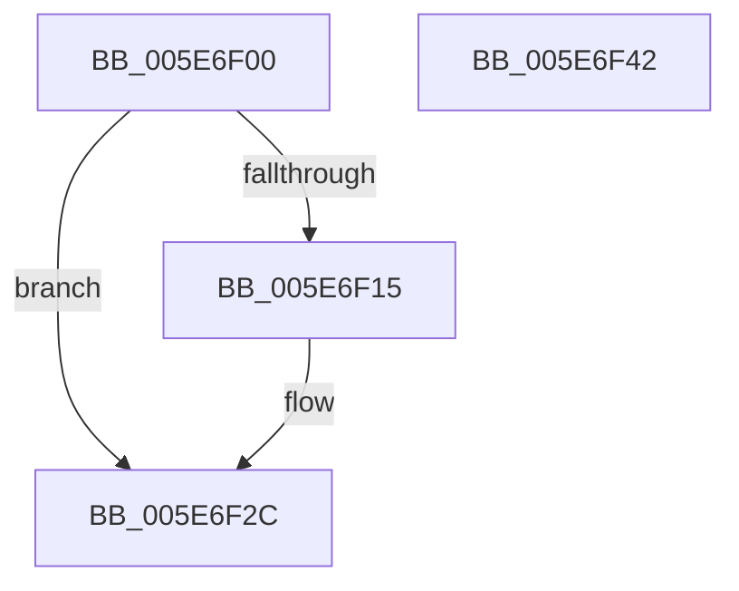

# RtlSizeHeap

- RVA: `0x005E6F00`–`0x005E6F43` (길이 `67` bytes)
- VA: `0x00000001405E6F00`
- 실행 섹션: `.text`
- PDB 이름 있음: `예`; PDB Function 태그: `아니요`
- unwind 정보 RVA: `0x0006E5F8`
- 디코드: `21`개 명령, `67/67` bytes 표시
- 미해석 바이트: `0` (있으면 어셈블리에 `.byte`로 보존)

> 이 문서는 커널 이미지의 기계어와 PDB 기호를 분석해 생성했습니다. 4번과 5번은 함수 원형과 자료형을 바이너리 사용 방식에서 추정한 C 해석이며 원본 소스 복구 결과는 아닙니다.

## 1. Dependencies

- 직접 호출 지점: **2**; 고유 호출 대상: **2**
- 직접 호출자로 확인된 함수: **0**
- RIP 상대 이미지 참조: **0**

### Outgoing calls
- `0x005E6F27` → [RtlpLogHeapFailure](../35/RtlpLogHeapFailure_function_0035B7BC.md) (function, `0x0035B7BC`)
- `0x005E6F32` → [RtlpSizeHeapInternal](RtlpSizeHeapInternal_function_005EBAD0.md) (function, `0x005EBAD0`)

### Direct callers
- 이 함수 시작 RVA로 연결되는 직접 call은 확인되지 않았습니다. 간접 호출은 완전히 역산할 수 없습니다.

### Static image references
- 디코드된 RIP-relative 메모리 참조가 없습니다.

## 2. Other-region calls and transfers

- 다른 실행 섹션으로 향하는 call: **0**
- 별도 외부 분기/꼬리 이동을 확인하지 못했습니다.

## 3. Assembly (complete function range)

```asm
005E6F00  48 89 5C 24 08                  mov qword ptr [rsp + 8], rbx
005E6F05  57                              push rdi
005E6F06  48 83 EC 30                     sub rsp, 0x30
005E6F0A  49 8B F8                        mov rdi, r8
005E6F0D  48 8B D9                        mov rbx, rcx
005E6F10  48 85 C9                        test rcx, rcx
005E6F13  75 17                           jne 0x1405e6f2c
005E6F15  48 21 4C 24 28                  and qword ptr [rsp + 0x28], rcx
005E6F1A  45 33 C9                        xor r9d, r9d
005E6F1D  48 21 4C 24 20                  and qword ptr [rsp + 0x20], rcx
005E6F22  33 D2                           xor edx, edx
005E6F24  8D 4B 13                        lea ecx, [rbx + 0x13]
005E6F27  E8 90 48 D7 FF                  call 0x14035b7bc
005E6F2C  4C 8B C7                        mov r8, rdi
005E6F2F  48 8B CB                        mov rcx, rbx
005E6F32  E8 99 4B 00 00                  call 0x1405ebad0
005E6F37  48 8B 5C 24 40                  mov rbx, qword ptr [rsp + 0x40]
005E6F3C  48 83 C4 30                     add rsp, 0x30
005E6F40  5F                              pop rdi
005E6F41  C3                              ret
005E6F42  CC                              int3
```

## 4. C-style interpretation (structured pseudocode)

```c
__int64 __fastcall RtlSizeHeap(__int64 a1, int a2, __int64 a3, int a4)
{
    __int64 result;
    __int64 v_rsp;
    unsigned __int64 v_stack_m10;
    unsigned __int64 v_stack_m18;
    unsigned __int64 v_stack_p8;

    v_stack_p8 = v_rbx;
    v_rsp = (v_rsp) - (48);
    if (a1 == 0) {
        a4 = 0;
        a2 = 0;
        a1 = a1 + 19;
        result = RtlpLogHeapFailure(a1, a2, a3, a4);
    }
    result = RtlpSizeHeapInternal(a1, a2, a3, a4);
    v_rsp = (v_rsp) + (48);
    return result;
}
```

## 5. (Beta) C Style

```c
int64_t RtlSizeHeap(void *Arg1, int32_t Arg2, int64_t Arg3, int32_t Arg4)
{
    uint8_t *arg1 = (uint8_t *)Arg1;

    int64_t result;
    int64_t local_rsp;
    uint64_t v_stack_m10;
    uint64_t v_stack_m18;
    uint64_t v_stack_p8;

    v_stack_p8 = local_rbx;
    local_rsp = (local_rsp) - (48);
    if (Arg1 == NULL) {
        Arg4 = 0;
        Arg2 = 0;
        Arg1 = Arg1 + 19;
        result = RtlpLogHeapFailure(Arg1, Arg2, Arg3, Arg4);
    }
    result = RtlpSizeHeapInternal(Arg1, Arg2, Arg3, Arg4);
    local_rsp = (local_rsp) + (48);
    return result;
}
```

### 관측된 메모리 오프셋

구조체 형식이 확인되지 않은 접근은 인자 기준의 오프셋으로만 기록했습니다.

| 기준 인자 | 오프셋 표현 | 폭 (bit) | 접근 |
|---|---:|---:|---|
| `Arg1` | `+ 0x13` | `32` | `R` |

## 6. Execution-region graph

[열기: 2D/3D 그래프와 함수 탐색 컨트롤 패널](../../../control-panel.html?section=text&rva=0x005E6F00&view=graph)

- 2D 그래프는 위에서 아래로 흐르고, 3D 그래프는 빈 공간을 드래그해 회전합니다. Shift+드래그는 이동, 휠은 확대·축소, 함수 노드 선택은 대상 보고서 이동입니다.

### Static fallback


