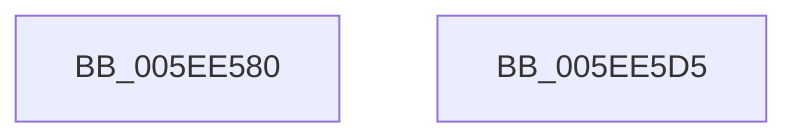

# RtlTraceDatabaseAdd

- RVA: `0x005EE580`–`0x005EE5D6` (길이 `86` bytes)
- VA: `0x00000001405EE580`
- 실행 섹션: `.text`
- PDB 이름 있음: `예`; PDB Function 태그: `아니요`
- unwind 정보 RVA: `0x0005C954`
- 디코드: `26`개 명령, `86/86` bytes 표시
- 미해석 바이트: `0` (있으면 어셈블리에 `.byte`로 보존)

> 이 문서는 커널 이미지의 기계어와 PDB 기호를 분석해 생성했습니다. 4번과 5번은 함수 원형과 자료형을 바이너리 사용 방식에서 추정한 C 해석이며 원본 소스 복구 결과는 아닙니다.

## 1. Dependencies

- 직접 호출 지점: **3**; 고유 호출 대상: **3**
- 직접 호출자로 확인된 함수: **0**
- RIP 상대 이미지 참조: **0**

### Outgoing calls
- `0x005EE59F` → [RtlpTraceDatabaseAcquireLock](RtlpTraceDatabaseAcquireLock_function_005EE938.md) (function, `0x005EE938`)
- `0x005EE5AF` → [RtlpTraceDatabaseInternalAdd](RtlpTraceDatabaseInternalAdd_function_005EE9A0.md) (function, `0x005EE9A0`)
- `0x005EE5B9` → [RtlpTraceDatabaseReleaseLock](RtlpTraceDatabaseReleaseLock_function_005EEC1C.md) (function, `0x005EEC1C`)

### Direct callers
- 이 함수 시작 RVA로 연결되는 직접 call은 확인되지 않았습니다. 간접 호출은 완전히 역산할 수 없습니다.

### Static image references
- 디코드된 RIP-relative 메모리 참조가 없습니다.

## 2. Other-region calls and transfers

- 다른 실행 섹션으로 향하는 call: **0**
- 별도 외부 분기/꼬리 이동을 확인하지 못했습니다.

## 3. Assembly (complete function range)

```asm
005EE580  48 89 5C 24 08                  mov qword ptr [rsp + 8], rbx
005EE585  48 89 6C 24 10                  mov qword ptr [rsp + 0x10], rbp
005EE58A  48 89 74 24 18                  mov qword ptr [rsp + 0x18], rsi
005EE58F  57                              push rdi
005EE590  48 83 EC 20                     sub rsp, 0x20
005EE594  49 8B D9                        mov rbx, r9
005EE597  49 8B F8                        mov rdi, r8
005EE59A  8B F2                           mov esi, edx
005EE59C  48 8B E9                        mov rbp, rcx
005EE59F  E8 94 03 00 00                  call 0x1405ee938
005EE5A4  4C 8B CB                        mov r9, rbx
005EE5A7  4C 8B C7                        mov r8, rdi
005EE5AA  8B D6                           mov edx, esi
005EE5AC  48 8B CD                        mov rcx, rbp
005EE5AF  E8 EC 03 00 00                  call 0x1405ee9a0
005EE5B4  48 8B CD                        mov rcx, rbp
005EE5B7  8A D8                           mov bl, al
005EE5B9  E8 5E 06 00 00                  call 0x1405eec1c
005EE5BE  48 8B 6C 24 38                  mov rbp, qword ptr [rsp + 0x38]
005EE5C3  8A C3                           mov al, bl
005EE5C5  48 8B 5C 24 30                  mov rbx, qword ptr [rsp + 0x30]
005EE5CA  48 8B 74 24 40                  mov rsi, qword ptr [rsp + 0x40]
005EE5CF  48 83 C4 20                     add rsp, 0x20
005EE5D3  5F                              pop rdi
005EE5D4  C3                              ret
005EE5D5  CC                              int3
```

## 4. C-style interpretation (structured pseudocode)

```c
__int64 __fastcall RtlTraceDatabaseAdd(__int64 a1, int a2, __int64 a3, __int64 a4)
{
    __int64 result;
    __int64 v_rsp;
    unsigned __int64 v_stack_p10;
    unsigned __int64 v_stack_p18;
    unsigned __int64 v_stack_p8;

    v_stack_p8 = v_rbx;
    v_stack_p10 = v_rbp;
    v_stack_p18 = v_rsi;
    v_rsp = (v_rsp) - (32);
    result = RtlpTraceDatabaseAcquireLock(a1, a2, a3, a4);
    result = RtlpTraceDatabaseInternalAdd(a1, (unsigned int)((unsigned int)((unsigned int)(a2))), a3, a4);
    result = RtlpTraceDatabaseReleaseLock(a1, (unsigned int)((unsigned int)((unsigned int)(a2))), a3, a4);
    v_rsp = (v_rsp) + (32);
    return (unsigned __int8)((unsigned __int8)(result));
}
```

## 5. (Beta) C Style

```c
int64_t RtlTraceDatabaseAdd(int64_t Arg1, int32_t Arg2, int64_t Arg3, int64_t Arg4)
{
    int64_t result;
    int64_t local_rsp;
    uint64_t v_stack_p10;
    uint64_t v_stack_p18;
    uint64_t v_stack_p8;

    v_stack_p8 = local_rbx;
    v_stack_p10 = local_rbp;
    v_stack_p18 = local_rsi;
    local_rsp = (local_rsp) - (32);
    result = RtlpTraceDatabaseAcquireLock(Arg1, Arg2, Arg3, Arg4);
    result = RtlpTraceDatabaseInternalAdd(Arg1, (uint32_t)((uint32_t)((uint32_t)(Arg2))), Arg3, Arg4);
    result = RtlpTraceDatabaseReleaseLock(Arg1, (uint32_t)((uint32_t)((uint32_t)(Arg2))), Arg3, Arg4);
    local_rsp = (local_rsp) + (32);
    return (uint8_t)((uint8_t)(result));
}
```

## 6. Execution-region graph

[열기: 2D/3D 그래프와 함수 탐색 컨트롤 패널](../../../control-panel.html?section=text&rva=0x005EE580&view=graph)

- 2D 그래프는 위에서 아래로 흐르고, 3D 그래프는 빈 공간을 드래그해 회전합니다. Shift+드래그는 이동, 휠은 확대·축소, 함수 노드 선택은 대상 보고서 이동입니다.

### Static fallback


