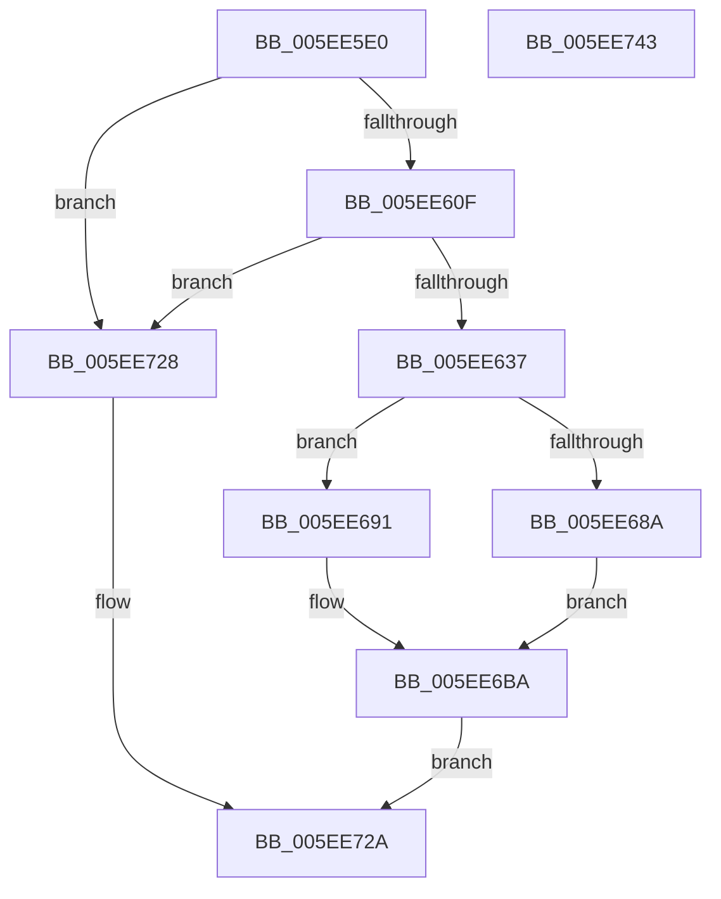

# RtlTraceDatabaseCreate

- RVA: `0x005EE5E0`–`0x005EE744` (길이 `356` bytes)
- VA: `0x00000001405EE5E0`
- 실행 섹션: `.text`
- PDB 이름 있음: `예`; PDB Function 태그: `아니요`
- unwind 정보 RVA: `0x00060300`
- 디코드: `85`개 명령, `356/356` bytes 표시
- 미해석 바이트: `0` (있으면 어셈블리에 `.byte`로 보존)

> 이 문서는 커널 이미지의 기계어와 PDB 기호를 분석해 생성했습니다. 4번과 5번은 함수 원형과 자료형을 바이너리 사용 방식에서 추정한 C 해석이며 원본 소스 복구 결과는 아닙니다.

## 1. Dependencies

- 직접 호출 지점: **3**; 고유 호출 대상: **2**
- 직접 호출자로 확인된 함수: **0**
- RIP 상대 이미지 참조: **1**

### Outgoing calls
- `0x005EE626` → [RtlpTraceDatabaseAllocate](RtlpTraceDatabaseAllocate_function_005EE978.md) (function, `0x005EE978`)
- `0x005EE67E` → [memset](../6C/memset_function_006C6C40.md) (function, `0x006C6C40`)
- `0x005EE700` → [memset](../6C/memset_function_006C6C40.md) (function, `0x006C6C40`)

### Direct callers
- 이 함수 시작 RVA로 연결되는 직접 call은 확인되지 않았습니다. 간접 호출은 완전히 역산할 수 없습니다.

### Static image references
- `0x005EE6C7` → RVA `0x0042D1C0` (`RtlStackTraceHashFunction`; read)

## 2. Other-region calls and transfers

- 다른 실행 섹션으로 향하는 call: **0**
- 별도 외부 분기/꼬리 이동을 확인하지 못했습니다.

## 3. Assembly (complete function range)

```asm
005EE5E0  48 89 5C 24 08                  mov qword ptr [rsp + 8], rbx
005EE5E5  48 89 6C 24 10                  mov qword ptr [rsp + 0x10], rbp
005EE5EA  48 89 74 24 18                  mov qword ptr [rsp + 0x18], rsi
005EE5EF  57                              push rdi
005EE5F0  41 56                           push r14
005EE5F2  41 57                           push r15
005EE5F4  48 83 EC 20                     sub rsp, 0x20
005EE5F8  8B F1                           mov esi, ecx
005EE5FA  41 8B E9                        mov ebp, r9d
005EE5FD  45 8B F0                        mov r14d, r8d
005EE600  4C 8B FA                        mov r15, rdx
005EE603  81 F9 00 00 10 00               cmp ecx, 0x100000
005EE609  0F 87 19 01 00 00               ja 0x1405ee728
005EE60F  48 8D 0C F5 10 11 00 00         lea rcx, [rsi*8 + 0x1110]
005EE617  45 8B C1                        mov r8d, r9d
005EE61A  48 81 E1 00 F0 FF FF            and rcx, 0xfffffffffffff000
005EE621  BA 06 00 00 00                  mov edx, 6
005EE626  E8 4D 03 00 00                  call 0x1405ee978
005EE62B  48 8B D8                        mov rbx, rax
005EE62E  48 85 C0                        test rax, rax
005EE631  0F 84 F1 00 00 00               je 0x1405ee728
005EE637  48 83 60 30 00                  and qword ptr [rax + 0x30], 0
005EE63C  48 8D 88 98 00 00 00            lea rcx, [rax + 0x98]
005EE643  48 83 A0 90 00 00 00 00         and qword ptr [rax + 0x90], 0
005EE64B  48 8D B8 D8 00 00 00            lea rdi, [rax + 0xd8]
005EE652  48 83 A0 88 00 00 00 00         and qword ptr [rax + 0x88], 0
005EE65A  33 D2                           xor edx, edx
005EE65C  89 68 08                        mov dword ptr [rax + 8], ebp
005EE65F  41 83 CE 02                     or r14d, 2
005EE663  BD 00 10 00 00                  mov ebp, 0x1000
005EE668  C7 00 CC CC CD AB               mov dword ptr [rax], 0xabcdcccc
005EE66E  44 89 70 04                     mov dword ptr [rax + 4], r14d
005EE672  44 8D 42 40                     lea r8d, [rdx + 0x40]
005EE676  4C 89 78 18                     mov qword ptr [rax + 0x18], r15
005EE67A  48 89 68 20                     mov qword ptr [rax + 0x20], rbp
005EE67E  E8 BD 85 0D 00                  call 0x1406c6c40
005EE683  8B 43 04                        mov eax, dword ptr [rbx + 4]
005EE686  A8 04                           test al, 4
005EE688  74 07                           je 0x1405ee691
005EE68A  48 83 63 38 00                  and qword ptr [rbx + 0x38], 0
005EE68F  EB 29                           jmp 0x1405ee6ba
005EE691  48 83 63 40 00                  and qword ptr [rbx + 0x40], 0
005EE696  48 8D 43 58                     lea rax, [rbx + 0x58]
005EE69A  83 63 48 00                     and dword ptr [rbx + 0x48], 0
005EE69E  C7 43 38 01 00 00 00            mov dword ptr [rbx + 0x38], 1
005EE6A5  83 63 54 00                     and dword ptr [rbx + 0x54], 0
005EE6A9  66 C7 43 50 01 00               mov word ptr [rbx + 0x50], 1
005EE6AF  C6 43 52 06                     mov byte ptr [rbx + 0x52], 6
005EE6B3  48 89 40 08                     mov qword ptr [rax + 8], rax
005EE6B7  48 89 00                        mov qword ptr [rax], rax
005EE6BA  48 83 7C 24 60 00               cmp qword ptr [rsp + 0x60], 0
005EE6C0  48 8D 4F 38                     lea rcx, [rdi + 0x38]
005EE6C4  89 73 70                        mov dword ptr [rbx + 0x70], esi
005EE6C7  48 8D 05 F2 EA E3 FF            lea rax, [rip - 0x1c150e]
005EE6CE  48 0F 45 44 24 60               cmovne rax, qword ptr [rsp + 0x60]
005EE6D4  33 D2                           xor edx, edx
005EE6D6  48 89 83 80 00 00 00            mov qword ptr [rbx + 0x80], rax
005EE6DD  48 83 67 10 00                  and qword ptr [rdi + 0x10], 0
005EE6E2  C7 07 BB BB CD AB               mov dword ptr [rdi], 0xabcdbbbb
005EE6E8  48 89 5F 08                     mov qword ptr [rdi + 8], rbx
005EE6EC  48 89 6F 18                     mov qword ptr [rdi + 0x18], rbp
005EE6F0  44 8B 43 70                     mov r8d, dword ptr [rbx + 0x70]
005EE6F4  49 C1 E0 03                     shl r8, 3
005EE6F8  48 89 7B 10                     mov qword ptr [rbx + 0x10], rdi
005EE6FC  48 89 4B 78                     mov qword ptr [rbx + 0x78], rcx
005EE700  E8 3B 85 0D 00                  call 0x1406c6c40
005EE705  48 8D 83 00 10 00 00            lea rax, [rbx + 0x1000]
005EE70C  48 89 5F 20                     mov qword ptr [rdi + 0x20], rbx
005EE710  48 89 47 28                     mov qword ptr [rdi + 0x28], rax
005EE714  8B 43 70                        mov eax, dword ptr [rbx + 0x70]
005EE717  48 83 C0 07                     add rax, 7
005EE71B  48 8D 0C C7                     lea rcx, [rdi + rax*8]
005EE71F  48 8B C3                        mov rax, rbx
005EE722  48 89 4F 30                     mov qword ptr [rdi + 0x30], rcx
005EE726  EB 02                           jmp 0x1405ee72a
005EE728  33 C0                           xor eax, eax
005EE72A  48 8B 5C 24 40                  mov rbx, qword ptr [rsp + 0x40]
005EE72F  48 8B 6C 24 48                  mov rbp, qword ptr [rsp + 0x48]
005EE734  48 8B 74 24 50                  mov rsi, qword ptr [rsp + 0x50]
005EE739  48 83 C4 20                     add rsp, 0x20
005EE73D  41 5F                           pop r15
005EE73F  41 5E                           pop r14
005EE741  5F                              pop rdi
005EE742  C3                              ret
005EE743  CC                              int3
```

## 4. C-style interpretation (structured pseudocode)

```c
__int64 __fastcall RtlTraceDatabaseCreate(int a1, __int64 a2, int a3, int a4, __int64 a5)
{
    __int64 result;
    __int64 v_r14;
    __int64 v_rsp;
    unsigned __int64 v_stack_p10;
    unsigned __int64 v_stack_p18;
    unsigned __int64 v_stack_p8;

    v_stack_p8 = v_rbx;
    v_stack_p10 = v_rbp;
    v_stack_p18 = v_rsi;
    v_rsp = (v_rsp) - (32);
    if (a1 > 0x100000ULL) goto loc_005EE728;
    a1 = ((unsigned int)(a1) * 8 + 4368) & (0xFFFFFFFFFFFFF000ULL);
    result = RtlpTraceDatabaseAllocate(a1, 6, (unsigned int)(a4), a4);
    if (result == 0) goto loc_005EE728;
    a2 = 0;
    *(unsigned int *)(result + 8) = (unsigned int)((unsigned int)(a4));
    v_r14 = (unsigned int)(((unsigned int)(a3)) | (2));
    *(unsigned int *)(result) = 0xABCDCCCCULL;
    *(unsigned int *)(result + 4) = (unsigned int)(v_r14);
    *(unsigned __int64 *)(result + 24) = 0;
    *(unsigned __int64 *)(result + 32) = (unsigned int)(0x1000ULL);
    result = memset(result + 152, a2, a2 + 64, a4);
    if ((((unsigned __int8)((unsigned int)(*(unsigned int *)(result + 4)))) & (4)) == 0) goto loc_005EE691;
    goto loc_005EE6BA;
loc_005EE691:
    *(unsigned int *)(result + 56) = 1;
    *(unsigned __int16 *)(result + 80) = 1;
    *(unsigned __int8 *)(result + 82) = 6;
    *(unsigned __int64 *)(result + 88 + 8) = result + 88;
    *(unsigned __int64 *)(result + 88) = result + 88;
loc_005EE6BA:
    *(unsigned int *)(result + 112) = (unsigned int)((unsigned int)(a1));
    result = v_rip - 1840398;
    if (a5 != 0) { result = a5; }
    a2 = 0;
    *(unsigned __int64 *)(result + 128) = result;
    *(unsigned int *)(result + 216) = 0xABCDBBBBULL;
    *(unsigned __int64 *)(result + 216 + 8) = result;
    *(unsigned __int64 *)(result + 216 + 24) = (unsigned int)(0x1000ULL);
    a3 = ((unsigned int)(*(unsigned int *)(result + 112))) << (3);
    *(unsigned __int64 *)(result + 16) = result + 216;
    *(unsigned __int64 *)(result + 120) = result + 216 + 56;
    result = memset(result + 216 + 56, a2, a3, a4);
    *(unsigned __int64 *)(result + 216 + 32) = result;
    *(unsigned __int64 *)(result + 216 + 40) = result + 4096;
    result = ((unsigned int)(*(unsigned int *)(result + 112))) + (7);
    *(unsigned __int64 *)(result + 216 + 48) = result + 216 + result * 8;
    goto loc_005EE72A;
loc_005EE728:
    result = 0;
loc_005EE72A:
    v_rsp = (v_rsp) + (32);
    return result;
}
```

## 5. (Beta) C Style

```c
int64_t RtlTraceDatabaseCreate(int32_t Arg1, int64_t Arg2, int32_t Arg3, int32_t Arg4, int64_t Arg5)
{
    int64_t result;
    int64_t local_r14;
    int64_t local_rsp;
    uint64_t v_stack_p10;
    uint64_t v_stack_p18;
    uint64_t v_stack_p8;

    v_stack_p8 = local_rbx;
    v_stack_p10 = local_rbp;
    v_stack_p18 = local_rsi;
    local_rsp = (local_rsp) - (32);
    if (Arg1 > 0x100000ULL) goto loc_005EE728;
    Arg1 = ((uint32_t)(Arg1) * 8 + 4368) & (0xFFFFFFFFFFFFF000ULL);
    result = RtlpTraceDatabaseAllocate(Arg1, 6, (uint32_t)(Arg4), Arg4);
    if (result == 0) goto loc_005EE728;
    Arg2 = 0;
    *(uint32_t *)(result + 0x8) = (uint32_t)((uint32_t)(Arg4));
    local_r14 = (uint32_t)(((uint32_t)(Arg3)) | (2));
    *(uint32_t *)(result) = 0xABCDCCCCULL;
    *(uint32_t *)(result + 0x4) = (uint32_t)(local_r14);
    *(uint64_t *)(result + 0x18) = 0;
    *(uint64_t *)(result + 0x20) = (uint32_t)(0x1000ULL);
    result = memset(result + 152, Arg2, Arg2 + 64, Arg4);
    if ((((uint8_t)((uint32_t)(*(uint32_t *)(result + 0x4)))) & (4)) == 0) goto loc_005EE691;
    goto loc_005EE6BA;
loc_005EE691:
    *(uint32_t *)(result + 0x38) = 1;
    *(uint16_t *)(result + 0x50) = 1;
    *(uint8_t *)(result + 0x52) = 6;
    *(uint64_t *)(result + 0x58 + 0x8) = result + 88;
    *(uint64_t *)(result + 0x58) = result + 88;
loc_005EE6BA:
    *(uint32_t *)(result + 0x70) = (uint32_t)((uint32_t)(Arg1));
    result = v_rip - 1840398;
    if (Arg5 != 0) { result = Arg5; }
    Arg2 = 0;
    *(uint64_t *)(result + 0x80) = result;
    *(uint32_t *)(result + 0xD8) = 0xABCDBBBBULL;
    *(uint64_t *)(result + 0xD8 + 0x8) = result;
    *(uint64_t *)(result + 0xD8 + 0x18) = (uint32_t)(0x1000ULL);
    Arg3 = ((uint32_t)(*(uint32_t *)(result + 0x70))) << (3);
    *(uint64_t *)(result + 0x10) = result + 216;
    *(uint64_t *)(result + 0x78) = result + 216 + 56;
    result = memset(result + 216 + 56, Arg2, Arg3, Arg4);
    *(uint64_t *)(result + 0xD8 + 0x20) = result;
    *(uint64_t *)(result + 0xD8 + 0x28) = result + 4096;
    result = ((uint32_t)(*(uint32_t *)(result + 0x70))) + (7);
    *(uint64_t *)(result + 0xD8 + 0x30) = result + 216 + result * 8;
    goto loc_005EE72A;
loc_005EE728:
    result = 0;
loc_005EE72A:
    local_rsp = (local_rsp) + (32);
    return result;
}
```

## 6. Execution-region graph

[열기: 2D/3D 그래프와 함수 탐색 컨트롤 패널](../../../control-panel.html?section=text&rva=0x005EE5E0&view=graph)

- 2D 그래프는 위에서 아래로 흐르고, 3D 그래프는 빈 공간을 드래그해 회전합니다. Shift+드래그는 이동, 휠은 확대·축소, 함수 노드 선택은 대상 보고서 이동입니다.

### Static fallback


