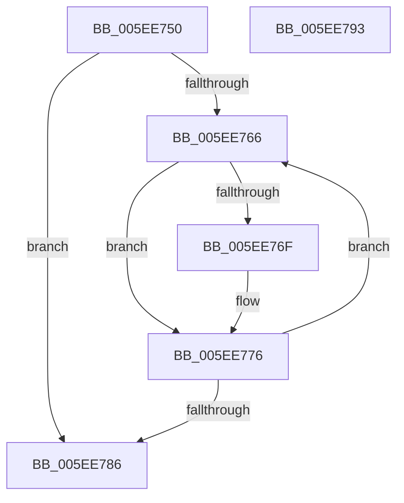

# RtlTraceDatabaseDestroy

- RVA: `0x005EE750`–`0x005EE794` (길이 `68` bytes)
- VA: `0x00000001405EE750`
- 실행 섹션: `.text`
- PDB 이름 있음: `예`; PDB Function 태그: `아니요`
- unwind 정보 RVA: `0x0005CAAC`
- 디코드: `22`개 명령, `68/68` bytes 표시
- 미해석 바이트: `0` (있으면 어셈블리에 `.byte`로 보존)

> 이 문서는 커널 이미지의 기계어와 PDB 기호를 분석해 생성했습니다. 4번과 5번은 함수 원형과 자료형을 바이너리 사용 방식에서 추정한 C 해석이며 원본 소스 복구 결과는 아닙니다.

## 1. Dependencies

- 직접 호출 지점: **1**; 고유 호출 대상: **1**
- 직접 호출자로 확인된 함수: **0**
- RIP 상대 이미지 참조: **0**

### Outgoing calls
- `0x005EE779` → [ExFreePoolWithTag](../../poolcode/B8/ExFreePoolWithTag_function_00B82870.md) (function, `0x00B82870`)

### Direct callers
- 이 함수 시작 RVA로 연결되는 직접 call은 확인되지 않았습니다. 간접 호출은 완전히 역산할 수 없습니다.

### Static image references
- 디코드된 RIP-relative 메모리 참조가 없습니다.

## 2. Other-region calls and transfers

- 다른 실행 섹션으로 향하는 call: **1**
  - `0x005EE779` → [ExFreePoolWithTag](../../poolcode/B8/ExFreePoolWithTag_function_00B82870.md) (`.text` → `POOLCODE`)
- 별도 외부 분기/꼬리 이동을 확인하지 못했습니다.

## 3. Assembly (complete function range)

```asm
005EE750  48 89 5C 24 08                  mov qword ptr [rsp + 8], rbx
005EE755  57                              push rdi
005EE756  48 83 EC 20                     sub rsp, 0x20
005EE75A  48 8B F9                        mov rdi, rcx
005EE75D  48 8B 49 10                     mov rcx, qword ptr [rcx + 0x10]
005EE761  48 85 C9                        test rcx, rcx
005EE764  74 20                           je 0x1405ee786
005EE766  48 8B 59 10                     mov rbx, qword ptr [rcx + 0x10]
005EE76A  48 85 DB                        test rbx, rbx
005EE76D  75 07                           jne 0x1405ee776
005EE76F  48 81 E9 D8 00 00 00            sub rcx, 0xd8
005EE776  8B 57 08                        mov edx, dword ptr [rdi + 8]
005EE779  E8 F2 40 59 00                  call 0x140b82870
005EE77E  48 8B CB                        mov rcx, rbx
005EE781  48 85 DB                        test rbx, rbx
005EE784  75 E0                           jne 0x1405ee766
005EE786  48 8B 5C 24 30                  mov rbx, qword ptr [rsp + 0x30]
005EE78B  B0 01                           mov al, 1
005EE78D  48 83 C4 20                     add rsp, 0x20
005EE791  5F                              pop rdi
005EE792  C3                              ret
005EE793  CC                              int3
```

## 4. C-style interpretation (structured pseudocode)

```c
__int64 __fastcall RtlTraceDatabaseDestroy(__int64 a1)
{
    __int64 result;
    __int64 v_rsp;
    unsigned __int64 v_stack_p8;

    v_stack_p8 = v_rbx;
    v_rsp = (v_rsp) - (32);
    if (*(unsigned __int64 *)(a1 + 16) == 0) goto loc_005EE786;
loc_005EE766:
    if (*(unsigned __int64 *)(*(unsigned __int64 *)(a1 + 16) + 16) == 0) {
        a1 = (*(unsigned __int64 *)(a1 + 16)) - (216);
    }
    result = ExFreePoolWithTag(a1, (unsigned int)(*(unsigned int *)(a1 + 8)), a3, a4);
    if (*(unsigned __int64 *)(*(unsigned __int64 *)(a1 + 16) + 16) != 0) goto loc_005EE766;
loc_005EE786:
    v_rsp = (v_rsp) + (32);
    return 1;
}
```

## 5. (Beta) C Style

```c
int64_t RtlTraceDatabaseDestroy(void *Arg1)
{
    uint8_t *arg1 = (uint8_t *)Arg1;

    int64_t result;
    int64_t local_rsp;
    uint64_t v_stack_p8;

    v_stack_p8 = local_rbx;
    local_rsp = (local_rsp) - (32);
    if (*(uint64_t *)(arg1 + 0x10) == 0) goto loc_005EE786;
loc_005EE766:
    if (*(uint64_t *)(*(uint64_t *)(arg1 + 0x10) + 0x10) == 0) {
        Arg1 = (*(uint64_t *)(arg1 + 0x10)) - (216);
    }
    result = ExFreePoolWithTag(Arg1, (uint32_t)(*(uint32_t *)(arg1 + 0x8)), a3, a4);
    if (*(uint64_t *)(*(uint64_t *)(arg1 + 0x10) + 0x10) != 0) goto loc_005EE766;
loc_005EE786:
    local_rsp = (local_rsp) + (32);
    return 1;
}
```

### 관측된 메모리 오프셋

구조체 형식이 확인되지 않은 접근은 인자 기준의 오프셋으로만 기록했습니다.

| 기준 인자 | 오프셋 표현 | 폭 (bit) | 접근 |
|---|---:|---:|---|
| `Arg1` | `+ 0x8` | `32` | `R` |
| `Arg1` | `+ 0x10` | `64` | `R` |

## 6. Execution-region graph

[열기: 2D/3D 그래프와 함수 탐색 컨트롤 패널](../../../control-panel.html?section=text&rva=0x005EE750&view=graph)

- 2D 그래프는 위에서 아래로 흐르고, 3D 그래프는 빈 공간을 드래그해 회전합니다. Shift+드래그는 이동, 휠은 확대·축소, 함수 노드 선택은 대상 보고서 이동입니다.

### Static fallback


