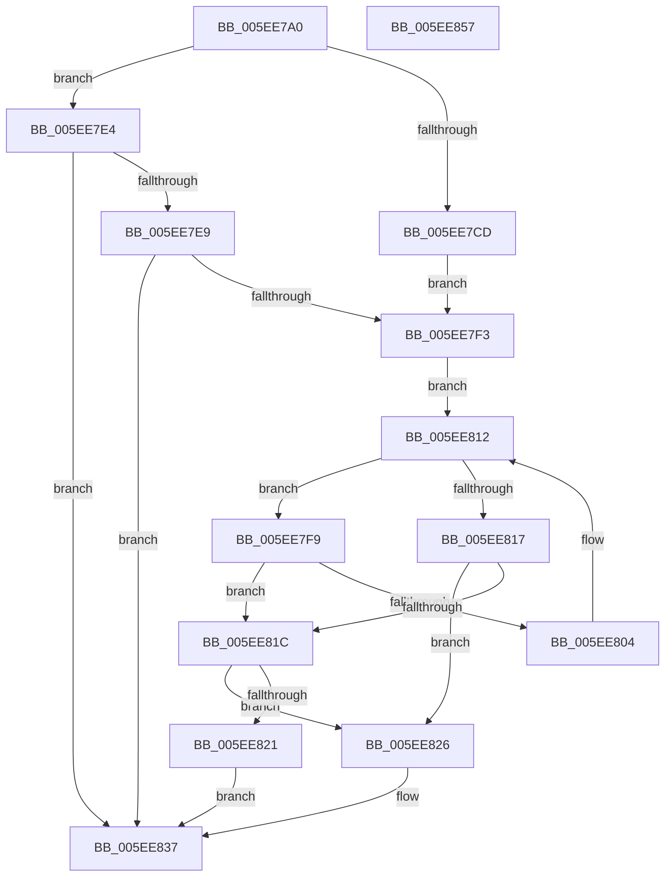

# RtlTraceDatabaseEnumerate

- RVA: `0x005EE7A0`–`0x005EE858` (길이 `184` bytes)
- VA: `0x00000001405EE7A0`
- 실행 섹션: `.text`
- PDB 이름 있음: `예`; PDB Function 태그: `아니요`
- unwind 정보 RVA: `0x0006F978`
- 디코드: `60`개 명령, `184/184` bytes 표시
- 미해석 바이트: `0` (있으면 어셈블리에 `.byte`로 보존)

> 이 문서는 커널 이미지의 기계어와 PDB 기호를 분석해 생성했습니다. 4번과 5번은 함수 원형과 자료형을 바이너리 사용 방식에서 추정한 C 해석이며 원본 소스 복구 결과는 아닙니다.

## 1. Dependencies

- 직접 호출 지점: **2**; 고유 호출 대상: **2**
- 직접 호출자로 확인된 함수: **0**
- RIP 상대 이미지 참조: **0**

### Outgoing calls
- `0x005EE7BE` → [RtlpTraceDatabaseAcquireLock](RtlpTraceDatabaseAcquireLock_function_005EE938.md) (function, `0x005EE938`)
- `0x005EE83A` → [RtlpTraceDatabaseReleaseLock](RtlpTraceDatabaseReleaseLock_function_005EEC1C.md) (function, `0x005EEC1C`)

### Direct callers
- 이 함수 시작 RVA로 연결되는 직접 call은 확인되지 않았습니다. 간접 호출은 완전히 역산할 수 없습니다.

### Static image references
- 디코드된 RIP-relative 메모리 참조가 없습니다.

## 2. Other-region calls and transfers

- 다른 실행 섹션으로 향하는 call: **0**
- 별도 외부 분기/꼬리 이동을 확인하지 못했습니다.

## 3. Assembly (complete function range)

```asm
005EE7A0  48 89 5C 24 08                  mov qword ptr [rsp + 8], rbx
005EE7A5  48 89 74 24 10                  mov qword ptr [rsp + 0x10], rsi
005EE7AA  48 89 7C 24 18                  mov qword ptr [rsp + 0x18], rdi
005EE7AF  41 56                           push r14
005EE7B1  48 83 EC 20                     sub rsp, 0x20
005EE7B5  4D 8B F0                        mov r14, r8
005EE7B8  48 8B F2                        mov rsi, rdx
005EE7BB  48 8B F9                        mov rdi, rcx
005EE7BE  E8 75 01 00 00                  call 0x1405ee938
005EE7C3  48 8B 06                        mov rax, qword ptr [rsi]
005EE7C6  33 DB                           xor ebx, ebx
005EE7C8  48 85 C0                        test rax, rax
005EE7CB  75 17                           jne 0x1405ee7e4
005EE7CD  48 89 3E                        mov qword ptr [rsi], rdi
005EE7D0  8B D3                           mov edx, ebx
005EE7D2  89 5E 08                        mov dword ptr [rsi + 8], ebx
005EE7D5  48 8B 47 78                     mov rax, qword ptr [rdi + 0x78]
005EE7D9  48 8B 08                        mov rcx, qword ptr [rax]
005EE7DC  48 89 4E 10                     mov qword ptr [rsi + 0x10], rcx
005EE7E0  8B CB                           mov ecx, ebx
005EE7E2  EB 0F                           jmp 0x1405ee7f3
005EE7E4  48 3B C7                        cmp rax, rdi
005EE7E7  75 4E                           jne 0x1405ee837
005EE7E9  8B 4E 08                        mov ecx, dword ptr [rsi + 8]
005EE7EC  8B D1                           mov edx, ecx
005EE7EE  3B 4F 70                        cmp ecx, dword ptr [rdi + 0x70]
005EE7F1  73 44                           jae 0x1405ee837
005EE7F3  48 8B 46 10                     mov rax, qword ptr [rsi + 0x10]
005EE7F7  EB 19                           jmp 0x1405ee812
005EE7F9  8D 51 01                        lea edx, [rcx + 1]
005EE7FC  89 56 08                        mov dword ptr [rsi + 8], edx
005EE7FF  3B 57 70                        cmp edx, dword ptr [rdi + 0x70]
005EE802  73 18                           jae 0x1405ee81c
005EE804  48 8B 47 78                     mov rax, qword ptr [rdi + 0x78]
005EE808  8B CA                           mov ecx, edx
005EE80A  48 8B 04 D0                     mov rax, qword ptr [rax + rdx*8]
005EE80E  48 89 46 10                     mov qword ptr [rsi + 0x10], rax
005EE812  48 85 C0                        test rax, rax
005EE815  74 E2                           je 0x1405ee7f9
005EE817  3B 57 70                        cmp edx, dword ptr [rdi + 0x70]
005EE81A  72 0A                           jb 0x1405ee826
005EE81C  48 85 C0                        test rax, rax
005EE81F  75 05                           jne 0x1405ee826
005EE821  49 89 1E                        mov qword ptr [r14], rbx
005EE824  EB 11                           jmp 0x1405ee837
005EE826  49 89 06                        mov qword ptr [r14], rax
005EE829  B3 01                           mov bl, 1
005EE82B  48 8B 46 10                     mov rax, qword ptr [rsi + 0x10]
005EE82F  48 8B 48 28                     mov rcx, qword ptr [rax + 0x28]
005EE833  48 89 4E 10                     mov qword ptr [rsi + 0x10], rcx
005EE837  48 8B CF                        mov rcx, rdi
005EE83A  E8 DD 03 00 00                  call 0x1405eec1c
005EE83F  48 8B 74 24 38                  mov rsi, qword ptr [rsp + 0x38]
005EE844  8A C3                           mov al, bl
005EE846  48 8B 5C 24 30                  mov rbx, qword ptr [rsp + 0x30]
005EE84B  48 8B 7C 24 40                  mov rdi, qword ptr [rsp + 0x40]
005EE850  48 83 C4 20                     add rsp, 0x20
005EE854  41 5E                           pop r14
005EE856  C3                              ret
005EE857  CC                              int3
```

## 4. C-style interpretation (structured pseudocode)

```c
__int64 __fastcall RtlTraceDatabaseEnumerate(__int64 a1, __int64 a2, __int64 a3)
{
    __int64 result;
    __int64 v_rbx;
    __int64 v_rsp;
    unsigned __int64 v_stack_p10;
    unsigned __int64 v_stack_p18;
    unsigned __int64 v_stack_p8;

    v_stack_p8 = v_rbx;
    v_stack_p10 = v_rsi;
    v_stack_p18 = v_rdi;
    v_rsp = (v_rsp) - (32);
    result = RtlpTraceDatabaseAcquireLock(a1, a2, a3, a4);
    v_rbx = 0;
    if (*(unsigned __int64 *)(a2) != 0) goto loc_005EE7E4;
    *(unsigned __int64 *)(a2) = a1;
    *(unsigned int *)(a2 + 8) = 0;
    *(unsigned __int64 *)(a2 + 16) = *(unsigned __int64 *)(*(unsigned __int64 *)(a1 + 120));
    goto loc_005EE7F3;
loc_005EE7E4:
    if ((*(unsigned __int64 *)(a1 + 120)) != a1) goto loc_005EE837;
    if (((unsigned int)((unsigned int)(*(unsigned int *)(a2 + 8)))) >= (*(unsigned int *)(a1 + 112))) goto loc_005EE837;
loc_005EE7F3:
    goto loc_005EE812;
loc_005EE7F9:
    *(unsigned int *)(a2 + 8) = (unsigned int)((unsigned int)(*(unsigned int *)(a2 + 8)) + 1);
    if (((unsigned int)((unsigned int)(*(unsigned int *)(a2 + 8)) + 1)) >= (*(unsigned int *)(a1 + 112))) goto loc_005EE81C;
    *(unsigned __int64 *)(a2 + 16) = *(unsigned __int64 *)(*(unsigned __int64 *)(a1 + 120) + (unsigned int)(*(unsigned int *)(a2 + 8)) + 1 * 8);
loc_005EE812:
    if (*(unsigned __int64 *)(*(unsigned __int64 *)(a1 + 120) + (unsigned int)(*(unsigned int *)(a2 + 8)) + 1 * 8) == 0) goto loc_005EE7F9;
    if (((unsigned int)((unsigned int)(*(unsigned int *)(a2 + 8)) + 1)) < (*(unsigned int *)(a1 + 112))) goto loc_005EE826;
loc_005EE81C:
    if (*(unsigned __int64 *)(*(unsigned __int64 *)(a1 + 120) + (unsigned int)(*(unsigned int *)(a2 + 8)) + 1 * 8) != 0) goto loc_005EE826;
    *(unsigned __int64 *)(a3) = 0;
    goto loc_005EE837;
loc_005EE826:
    *(unsigned __int64 *)(a3) = *(unsigned __int64 *)(*(unsigned __int64 *)(a1 + 120) + (unsigned int)(*(unsigned int *)(a2 + 8)) + 1 * 8);
    *(unsigned __int64 *)(a2 + 16) = *(unsigned __int64 *)(*(unsigned __int64 *)(a2 + 16) + 40);
loc_005EE837:
    result = RtlpTraceDatabaseReleaseLock(a1, (unsigned int)(*(unsigned int *)(a2 + 8)) + 1, a3, a4);
    v_rsp = (v_rsp) + (32);
    return 1;
}
```

## 5. (Beta) C Style

```c
int64_t RtlTraceDatabaseEnumerate(void *Arg1, void *Arg2, void *Arg3)
{
    uint8_t *arg1 = (uint8_t *)Arg1;
    uint8_t *arg2 = (uint8_t *)Arg2;
    uint8_t *arg3 = (uint8_t *)Arg3;

    int64_t result;
    int64_t local_rbx;
    int64_t local_rsp;
    uint64_t v_stack_p10;
    uint64_t v_stack_p18;
    uint64_t v_stack_p8;

    v_stack_p8 = local_rbx;
    v_stack_p10 = local_rsi;
    v_stack_p18 = local_rdi;
    local_rsp = (local_rsp) - (32);
    result = RtlpTraceDatabaseAcquireLock(Arg1, Arg2, Arg3, a4);
    local_rbx = 0;
    if (*(uint64_t *)(arg2) != 0) goto loc_005EE7E4;
    *(void **)(arg2) = Arg1;
    *(uint32_t *)(arg2 + 0x8) = 0;
    *(uint64_t *)(arg2 + 0x10) = *(uint64_t *)(*(uint64_t *)(arg1 + 0x78));
    goto loc_005EE7F3;
loc_005EE7E4:
    if ((*(uint64_t *)(arg1 + 0x78)) != Arg1) goto loc_005EE837;
    if (((uint32_t)((uint32_t)(*(uint32_t *)(arg2 + 0x8)))) >= (*(uint32_t *)(arg1 + 0x70))) goto loc_005EE837;
loc_005EE7F3:
    goto loc_005EE812;
loc_005EE7F9:
    *(uint32_t *)(arg2 + 0x8) = (uint32_t)((uint32_t)(*(uint32_t *)(arg2 + 0x8)) + 1);
    if (((uint32_t)((uint32_t)(*(uint32_t *)(arg2 + 0x8)) + 1)) >= (*(uint32_t *)(arg1 + 0x70))) goto loc_005EE81C;
    *(uint64_t *)(arg2 + 0x10) = *(uint64_t *)(*(uint64_t *)(arg1 + 0x78) + (uint32_t)(*(uint32_t *)(arg2 + 0x8)) + 0x1 * 8);
loc_005EE812:
    if (*(uint64_t *)(*(uint64_t *)(arg1 + 0x78) + (uint32_t)(*(uint32_t *)(arg2 + 0x8)) + 0x1 * 8) == 0) goto loc_005EE7F9;
    if (((uint32_t)((uint32_t)(*(uint32_t *)(arg2 + 0x8)) + 1)) < (*(uint32_t *)(arg1 + 0x70))) goto loc_005EE826;
loc_005EE81C:
    if (*(uint64_t *)(*(uint64_t *)(arg1 + 0x78) + (uint32_t)(*(uint32_t *)(arg2 + 0x8)) + 0x1 * 8) != 0) goto loc_005EE826;
    *(uint64_t *)(arg3) = 0;
    goto loc_005EE837;
loc_005EE826:
    *(uint64_t *)(arg3) = *(uint64_t *)(*(uint64_t *)(arg1 + 0x78) + (uint32_t)(*(uint32_t *)(arg2 + 0x8)) + 0x1 * 8);
    *(uint64_t *)(arg2 + 0x10) = *(uint64_t *)(*(uint64_t *)(arg2 + 0x10) + 0x28);
loc_005EE837:
    result = RtlpTraceDatabaseReleaseLock(Arg1, (uint32_t)(*(uint32_t *)(arg2 + 0x8)) + 1, Arg3, a4);
    local_rsp = (local_rsp) + (32);
    return 1;
}
```

### 관측된 메모리 오프셋

구조체 형식이 확인되지 않은 접근은 인자 기준의 오프셋으로만 기록했습니다.

| 기준 인자 | 오프셋 표현 | 폭 (bit) | 접근 |
|---|---:|---:|---|
| `Arg1` | `+ 0x70` | `32` | `R` |
| `Arg1` | `+ 0x78` | `64` | `R` |
| `Arg2` | `+ 0x0` | `64` | `R` |
| `Arg2` | `+ 0x0` | `64` | `W` |
| `Arg2` | `+ 0x8` | `32` | `R` |
| `Arg2` | `+ 0x8` | `32` | `W` |
| `Arg2` | `+ 0x10` | `64` | `R` |
| `Arg2` | `+ 0x10` | `64` | `W` |
| `Arg3` | `+ 0x0` | `64` | `W` |

## 6. Execution-region graph

[열기: 2D/3D 그래프와 함수 탐색 컨트롤 패널](../../../control-panel.html?section=text&rva=0x005EE7A0&view=graph)

- 2D 그래프는 위에서 아래로 흐르고, 3D 그래프는 빈 공간을 드래그해 회전합니다. Shift+드래그는 이동, 휠은 확대·축소, 함수 노드 선택은 대상 보고서 이동입니다.

### Static fallback


