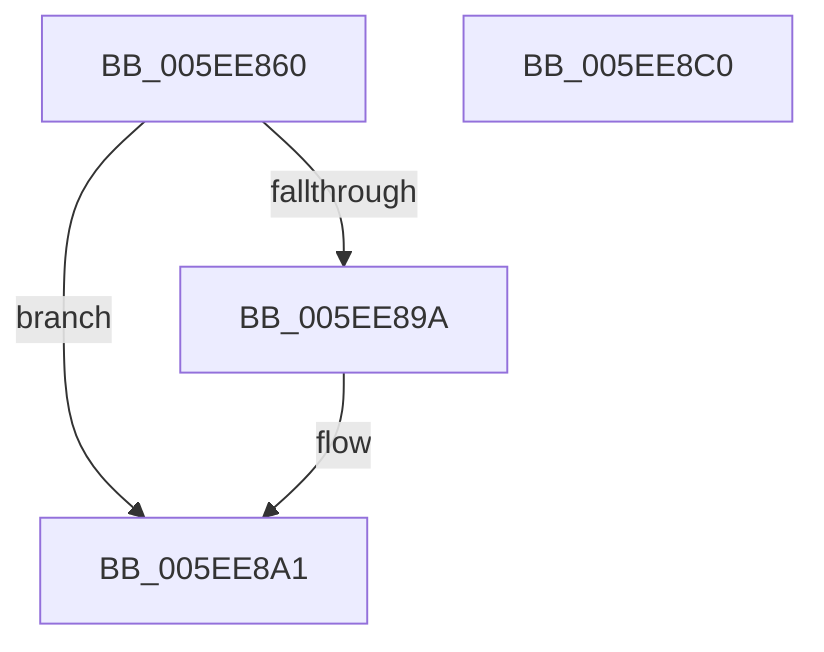

# RtlTraceDatabaseFind

- RVA: `0x005EE860`–`0x005EE8C1` (길이 `97` bytes)
- VA: `0x00000001405EE860`
- 실행 섹션: `.text`
- PDB 이름 있음: `예`; PDB Function 태그: `아니요`
- unwind 정보 RVA: `0x0005C954`
- 디코드: `29`개 명령, `97/97` bytes 표시
- 미해석 바이트: `0` (있으면 어셈블리에 `.byte`로 보존)

> 이 문서는 커널 이미지의 기계어와 PDB 기호를 분석해 생성했습니다. 4번과 5번은 함수 원형과 자료형을 바이너리 사용 방식에서 추정한 C 해석이며 원본 소스 복구 결과는 아닙니다.

## 1. Dependencies

- 직접 호출 지점: **3**; 고유 호출 대상: **3**
- 직접 호출자로 확인된 함수: **0**
- RIP 상대 이미지 참조: **0**

### Outgoing calls
- `0x005EE87F` → [RtlpTraceDatabaseAcquireLock](RtlpTraceDatabaseAcquireLock_function_005EE938.md) (function, `0x005EE938`)
- `0x005EE88F` → [RtlpTraceDatabaseInternalFind](RtlpTraceDatabaseInternalFind_function_005EEB64.md) (function, `0x005EEB64`)
- `0x005EE8A4` → [RtlpTraceDatabaseReleaseLock](RtlpTraceDatabaseReleaseLock_function_005EEC1C.md) (function, `0x005EEC1C`)

### Direct callers
- 이 함수 시작 RVA로 연결되는 직접 call은 확인되지 않았습니다. 간접 호출은 완전히 역산할 수 없습니다.

### Static image references
- 디코드된 RIP-relative 메모리 참조가 없습니다.

## 2. Other-region calls and transfers

- 다른 실행 섹션으로 향하는 call: **0**
- 별도 외부 분기/꼬리 이동을 확인하지 못했습니다.

## 3. Assembly (complete function range)

```asm
005EE860  48 89 5C 24 08                  mov qword ptr [rsp + 8], rbx
005EE865  48 89 6C 24 10                  mov qword ptr [rsp + 0x10], rbp
005EE86A  48 89 74 24 18                  mov qword ptr [rsp + 0x18], rsi
005EE86F  57                              push rdi
005EE870  48 83 EC 20                     sub rsp, 0x20
005EE874  49 8B D9                        mov rbx, r9
005EE877  49 8B F8                        mov rdi, r8
005EE87A  8B F2                           mov esi, edx
005EE87C  48 8B E9                        mov rbp, rcx
005EE87F  E8 B4 00 00 00                  call 0x1405ee938
005EE884  4C 8B CB                        mov r9, rbx
005EE887  4C 8B C7                        mov r8, rdi
005EE88A  8B D6                           mov edx, esi
005EE88C  48 8B CD                        mov rcx, rbp
005EE88F  E8 D0 02 00 00                  call 0x1405eeb64
005EE894  8A D8                           mov bl, al
005EE896  84 C0                           test al, al
005EE898  74 07                           je 0x1405ee8a1
005EE89A  48 FF 85 90 00 00 00            inc qword ptr [rbp + 0x90]
005EE8A1  48 8B CD                        mov rcx, rbp
005EE8A4  E8 73 03 00 00                  call 0x1405eec1c
005EE8A9  48 8B 6C 24 38                  mov rbp, qword ptr [rsp + 0x38]
005EE8AE  8A C3                           mov al, bl
005EE8B0  48 8B 5C 24 30                  mov rbx, qword ptr [rsp + 0x30]
005EE8B5  48 8B 74 24 40                  mov rsi, qword ptr [rsp + 0x40]
005EE8BA  48 83 C4 20                     add rsp, 0x20
005EE8BE  5F                              pop rdi
005EE8BF  C3                              ret
005EE8C0  CC                              int3
```

## 4. C-style interpretation (structured pseudocode)

```c
__int64 __fastcall RtlTraceDatabaseFind(__int64 a1, int a2, __int64 a3, __int64 a4)
{
    __int64 result;
    __int64 v_rsp;
    unsigned __int64 v_stack_p10;
    unsigned __int64 v_stack_p18;
    unsigned __int64 v_stack_p8;

    v_stack_p8 = v_rbx;
    v_stack_p10 = v_rbp;
    v_stack_p18 = v_rsi;
    v_rsp = (v_rsp) - (32);
    result = RtlpTraceDatabaseAcquireLock(a1, a2, a3, a4);
    result = RtlpTraceDatabaseInternalFind(a1, (unsigned int)((unsigned int)((unsigned int)(a2))), a3, a4);
    if ((unsigned __int8)(result) != 0) {
    }
    result = RtlpTraceDatabaseReleaseLock(a1, (unsigned int)((unsigned int)((unsigned int)(a2))), a3, a4);
    v_rsp = (v_rsp) + (32);
    return (unsigned __int8)((unsigned __int8)(result));
}
```

## 5. (Beta) C Style

```c
int64_t RtlTraceDatabaseFind(void *Arg1, int32_t Arg2, int64_t Arg3, int64_t Arg4)
{
    uint8_t *arg1 = (uint8_t *)Arg1;

    int64_t result;
    int64_t local_rsp;
    uint64_t v_stack_p10;
    uint64_t v_stack_p18;
    uint64_t v_stack_p8;

    v_stack_p8 = local_rbx;
    v_stack_p10 = local_rbp;
    v_stack_p18 = local_rsi;
    local_rsp = (local_rsp) - (32);
    result = RtlpTraceDatabaseAcquireLock(Arg1, Arg2, Arg3, Arg4);
    result = RtlpTraceDatabaseInternalFind(Arg1, (uint32_t)((uint32_t)((uint32_t)(Arg2))), Arg3, Arg4);
    if ((uint8_t)(result) != 0) {
    }
    result = RtlpTraceDatabaseReleaseLock(Arg1, (uint32_t)((uint32_t)((uint32_t)(Arg2))), Arg3, Arg4);
    local_rsp = (local_rsp) + (32);
    return (uint8_t)((uint8_t)(result));
}
```

### 관측된 메모리 오프셋

구조체 형식이 확인되지 않은 접근은 인자 기준의 오프셋으로만 기록했습니다.

| 기준 인자 | 오프셋 표현 | 폭 (bit) | 접근 |
|---|---:|---:|---|
| `Arg1` | `+ 0x90` | `64` | `R/W` |

## 6. Execution-region graph

[열기: 2D/3D 그래프와 함수 탐색 컨트롤 패널](../../../control-panel.html?section=text&rva=0x005EE860&view=graph)

- 2D 그래프는 위에서 아래로 흐르고, 3D 그래프는 빈 공간을 드래그해 회전합니다. Shift+드래그는 이동, 휠은 확대·축소, 함수 노드 선택은 대상 보고서 이동입니다.

### Static fallback


