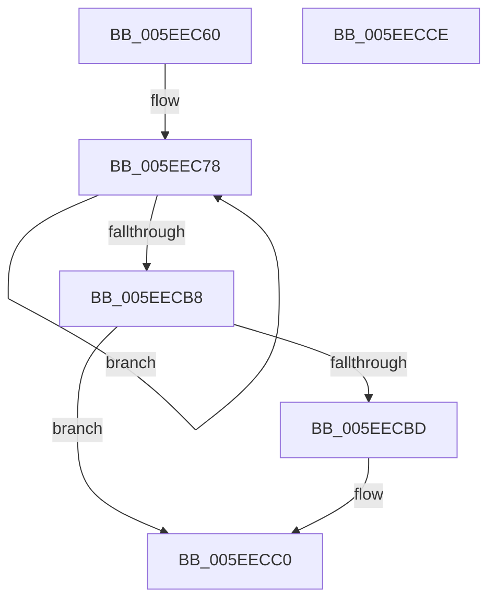

# RtlUdiv128

- RVA: `0x005EEC60`–`0x005EECCF` (길이 `111` bytes)
- VA: `0x00000001405EEC60`
- 실행 섹션: `.text`
- PDB 이름 있음: `예`; PDB Function 태그: `아니요`
- unwind 정보 RVA: `0x000950EC`
- 디코드: `33`개 명령, `111/111` bytes 표시
- 미해석 바이트: `0` (있으면 어셈블리에 `.byte`로 보존)

> 이 문서는 커널 이미지의 기계어와 PDB 기호를 분석해 생성했습니다. 4번과 5번은 함수 원형과 자료형을 바이너리 사용 방식에서 추정한 C 해석이며 원본 소스 복구 결과는 아닙니다.

## 1. Dependencies

- 직접 호출 지점: **0**; 고유 호출 대상: **0**
- 직접 호출자로 확인된 함수: **1**
- RIP 상대 이미지 참조: **0**

### Outgoing calls
- 직접 디코드된 call 명령이 없습니다.

### Direct callers
- [HalpInitializeTimers](../53/HalpInitializeTimers_function_0053C1E0.md) at `0x0053C35E`

### Static image references
- 디코드된 RIP-relative 메모리 참조가 없습니다.

## 2. Other-region calls and transfers

- 다른 실행 섹션으로 향하는 call: **0**
- 별도 외부 분기/꼬리 이동을 확인하지 못했습니다.

## 3. Assembly (complete function range)

```asm
005EEC60  48 89 5C 24 08                  mov qword ptr [rsp + 8], rbx
005EEC65  48 89 7C 24 10                  mov qword ptr [rsp + 0x10], rdi
005EEC6A  4D 8B D9                        mov r11, r9
005EEC6D  48 8B DA                        mov rbx, rdx
005EEC70  4C 8B D1                        mov r10, rcx
005EEC73  BF 40 00 00 00                  mov edi, 0x40
005EEC78  4B 8D 04 12                     lea rax, [r10 + r10]
005EEC7C  4C 8B CB                        mov r9, rbx
005EEC7F  49 C1 E9 3F                     shr r9, 0x3f
005EEC83  48 8D 0C 1B                     lea rcx, [rbx + rbx]
005EEC87  4C 0B C8                        or r9, rax
005EEC8A  49 8B D2                        mov rdx, r10
005EEC8D  48 C1 FA 3F                     sar rdx, 0x3f
005EEC91  4D 8B D1                        mov r10, r9
005EEC94  4D 2B D0                        sub r10, r8
005EEC97  49 8B C1                        mov rax, r9
005EEC9A  48 0B C2                        or rax, rdx
005EEC9D  48 8B D9                        mov rbx, rcx
005EECA0  49 3B C0                        cmp rax, r8
005EECA3  4D 0F 42 D1                     cmovb r10, r9
005EECA7  48 83 CB 01                     or rbx, 1
005EECAB  49 3B C0                        cmp rax, r8
005EECAE  48 0F 42 D9                     cmovb rbx, rcx
005EECB2  48 83 EF 01                     sub rdi, 1
005EECB6  75 C0                           jne 0x1405eec78
005EECB8  4D 85 DB                        test r11, r11
005EECBB  74 03                           je 0x1405eecc0
005EECBD  4D 89 13                        mov qword ptr [r11], r10
005EECC0  48 8B 7C 24 10                  mov rdi, qword ptr [rsp + 0x10]
005EECC5  48 8B C3                        mov rax, rbx
005EECC8  48 8B 5C 24 08                  mov rbx, qword ptr [rsp + 8]
005EECCD  C3                              ret
005EECCE  CC                              int3
```

## 4. C-style interpretation (structured pseudocode)

```c
__int64 __fastcall RtlUdiv128(__int64 a1, __int64 a2, __int64 a3, __int64 a4)
{
    __int64 result;
    __int64 v_r10;
    __int64 v_rbx;
    __int64 v_rdi;
    unsigned __int64 v_stack_p10;
    unsigned __int64 v_stack_p8;

    v_stack_p8 = v_rbx;
    v_stack_p10 = v_rdi;
loc_005EEC78:
    a4 = (a2) >> (63);
    a4 = (a4) | (a1 + a1 * 1);
    a2 = (a1) >> (63);
    v_r10 = (a4) - (a3);
    result = (a4) | (a2);
    if (result < a3) { v_r10 = a4; }
    v_rbx = (a2 + a2 * 1) | (1);
    if (result < a3) { v_rbx = a2 + a2 * 1; }
    v_rdi = (64) - (1);
    if (condition_is_not_equal) goto loc_005EEC78;
    if (a4 != 0) {
        *(unsigned __int64 *)(a4) = v_r10;
    }
    return v_rbx;
}
```

## 5. (Beta) C Style

```c
int64_t RtlUdiv128(int64_t Arg1, int64_t Arg2, int64_t Arg3, int64_t Arg4)
{
    int64_t result;
    int64_t local_r10;
    int64_t local_rbx;
    int64_t local_rdi;
    uint64_t v_stack_p10;
    uint64_t v_stack_p8;

    v_stack_p8 = local_rbx;
    v_stack_p10 = local_rdi;
loc_005EEC78:
    Arg4 = (Arg2) >> (63);
    Arg4 = (Arg4) | (Arg1 + Arg1 * 1);
    Arg2 = (Arg1) >> (63);
    local_r10 = (Arg4) - (Arg3);
    result = (Arg4) | (Arg2);
    if (result < Arg3) { local_r10 = Arg4; }
    local_rbx = (Arg2 + Arg2 * 1) | (1);
    if (result < Arg3) { local_rbx = Arg2 + Arg2 * 1; }
    local_rdi = (64) - (1);
    if (condition_is_not_equal) goto loc_005EEC78;
    if (Arg4 != 0) {
        *(uint64_t *)(Arg4) = local_r10;
    }
    return local_rbx;
}
```

## 6. Execution-region graph

[열기: 2D/3D 그래프와 함수 탐색 컨트롤 패널](../../../control-panel.html?section=text&rva=0x005EEC60&view=graph)

- 2D 그래프는 위에서 아래로 흐르고, 3D 그래프는 빈 공간을 드래그해 회전합니다. Shift+드래그는 이동, 휠은 확대·축소, 함수 노드 선택은 대상 보고서 이동입니다.

### Static fallback


