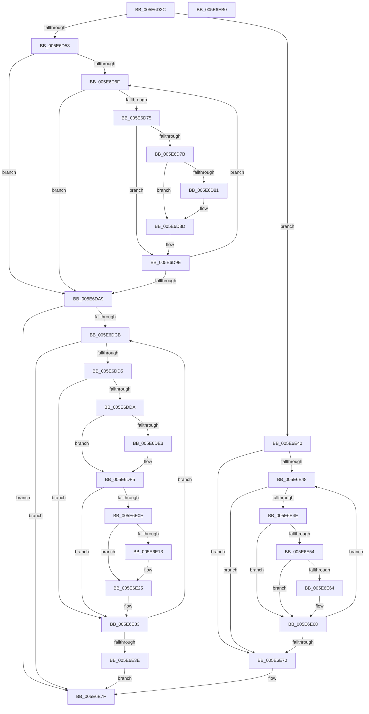

# RtlUpdateXSaveSizeAndVolatileFeatures

- RVA: `0x005E6D2C`–`0x005E6EB1` (길이 `389` bytes)
- VA: `0x00000001405E6D2C`
- 실행 섹션: `.text`
- PDB 이름 있음: `예`; PDB Function 태그: `아니요`
- unwind 정보 RVA: `0x000DB714`
- 디코드: `101`개 명령, `389/389` bytes 표시
- 미해석 바이트: `0` (있으면 어셈블리에 `.byte`로 보존)

> 이 문서는 커널 이미지의 기계어와 PDB 기호를 분석해 생성했습니다. 4번과 5번은 함수 원형과 자료형을 바이너리 사용 방식에서 추정한 C 해석이며 원본 소스 복구 결과는 아닙니다.

## 1. Dependencies

- 직접 호출 지점: **0**; 고유 호출 대상: **0**
- 직접 호출자로 확인된 함수: **1**
- RIP 상대 이미지 참조: **0**

### Outgoing calls
- 직접 디코드된 call 명령이 없습니다.

### Direct callers
- [KiInitializeXSaveConfiguration](../../pagelk/B6/KiInitializeXSaveConfiguration_function_00B66F10.md) at `0x00B67085`

### Static image references
- 디코드된 RIP-relative 메모리 참조가 없습니다.

## 2. Other-region calls and transfers

- 다른 실행 섹션으로 향하는 call: **0**
- 별도 외부 분기/꼬리 이동을 확인하지 못했습니다.

## 3. Assembly (complete function range)

```asm
005E6D2C  4C 8B 01                        mov r8, qword ptr [rcx]
005E6D2F  B8 40 02 00 00                  mov eax, 0x240
005E6D34  89 41 10                        mov dword ptr [rcx + 0x10], eax
005E6D37  41 B9 02 00 00 00               mov r9d, 2
005E6D3D  89 81 28 02 00 00               mov dword ptr [rcx + 0x228], eax
005E6D43  48 8B D1                        mov rdx, rcx
005E6D46  89 81 40 03 00 00               mov dword ptr [rcx + 0x340], eax
005E6D4C  8B 41 14                        mov eax, dword ptr [rcx + 0x14]
005E6D4F  41 84 C1                        test r9b, al
005E6D52  0F 84 E8 00 00 00               je 0x1405e6e40
005E6D58  4C 8B 91 20 02 00 00            mov r10, qword ptr [rcx + 0x220]
005E6D5F  45 8B D9                        mov r11d, r9d
005E6D62  49 C1 EA 02                     shr r10, 2
005E6D66  49 C1 E8 02                     shr r8, 2
005E6D6A  4D 85 C0                        test r8, r8
005E6D6D  74 3A                           je 0x1405e6da9
005E6D6F  41 83 FB 40                     cmp r11d, 0x40
005E6D73  73 34                           jae 0x1405e6da9
005E6D75  41 F6 C0 01                     test r8b, 1
005E6D79  74 23                           je 0x1405e6d9e
005E6D7B  41 F6 C2 01                     test r10b, 1
005E6D7F  74 0C                           je 0x1405e6d8d
005E6D81  8B 42 10                        mov eax, dword ptr [rdx + 0x10]
005E6D84  83 C0 3F                        add eax, 0x3f
005E6D87  83 E0 C0                        and eax, 0xffffffc0
005E6D8A  89 42 10                        mov dword ptr [rdx + 0x10], eax
005E6D8D  8B 42 10                        mov eax, dword ptr [rdx + 0x10]
005E6D90  41 8B CB                        mov ecx, r11d
005E6D93  89 44 CA 18                     mov dword ptr [rdx + rcx*8 + 0x18], eax
005E6D97  8B 44 CA 1C                     mov eax, dword ptr [rdx + rcx*8 + 0x1c]
005E6D9B  01 42 10                        add dword ptr [rdx + 0x10], eax
005E6D9E  49 D1 EA                        shr r10, 1
005E6DA1  41 FF C3                        inc r11d
005E6DA4  49 D1 E8                        shr r8, 1
005E6DA7  75 C6                           jne 0x1405e6d6f
005E6DA9  48 8B 8A 18 02 00 00            mov rcx, qword ptr [rdx + 0x218]
005E6DB0  48 0B 0A                        or rcx, qword ptr [rdx]
005E6DB3  4C 8B 82 20 02 00 00            mov r8, qword ptr [rdx + 0x220]
005E6DBA  48 C1 E9 02                     shr rcx, 2
005E6DBE  49 C1 E8 02                     shr r8, 2
005E6DC2  48 85 C9                        test rcx, rcx
005E6DC5  0F 84 B4 00 00 00               je 0x1405e6e7f
005E6DCB  41 83 F9 40                     cmp r9d, 0x40
005E6DCF  0F 83 AA 00 00 00               jae 0x1405e6e7f
005E6DD5  F6 C1 01                        test cl, 1
005E6DD8  74 59                           je 0x1405e6e33
005E6DDA  4D 8B D0                        mov r10, r8
005E6DDD  41 83 E2 01                     and r10d, 1
005E6DE1  74 12                           je 0x1405e6df5
005E6DE3  8B 82 28 02 00 00               mov eax, dword ptr [rdx + 0x228]
005E6DE9  83 C0 3F                        add eax, 0x3f
005E6DEC  83 E0 C0                        and eax, 0xffffffc0
005E6DEF  89 82 28 02 00 00               mov dword ptr [rdx + 0x228], eax
005E6DF5  45 8B D9                        mov r11d, r9d
005E6DF8  42 8B 84 9A 2C 02 00 00         mov eax, dword ptr [rdx + r11*4 + 0x22c]
005E6E00  01 82 28 02 00 00               add dword ptr [rdx + 0x228], eax
005E6E06  41 8D 41 EE                     lea eax, [r9 - 0x12]
005E6E0A  85 C0                           test eax, eax
005E6E0C  74 25                           je 0x1405e6e33
005E6E0E  4D 85 D2                        test r10, r10
005E6E11  74 12                           je 0x1405e6e25
005E6E13  8B 82 40 03 00 00               mov eax, dword ptr [rdx + 0x340]
005E6E19  83 C0 3F                        add eax, 0x3f
005E6E1C  83 E0 C0                        and eax, 0xffffffc0
005E6E1F  89 82 40 03 00 00               mov dword ptr [rdx + 0x340], eax
005E6E25  42 8B 84 9A 2C 02 00 00         mov eax, dword ptr [rdx + r11*4 + 0x22c]
005E6E2D  01 82 40 03 00 00               add dword ptr [rdx + 0x340], eax
005E6E33  49 D1 E8                        shr r8, 1
005E6E36  41 FF C1                        inc r9d
005E6E39  48 D1 E9                        shr rcx, 1
005E6E3C  75 8D                           jne 0x1405e6dcb
005E6E3E  EB 3F                           jmp 0x1405e6e7f
005E6E40  45 33 C9                        xor r9d, r9d
005E6E43  4D 85 C0                        test r8, r8
005E6E46  74 28                           je 0x1405e6e70
005E6E48  41 83 F9 40                     cmp r9d, 0x40
005E6E4C  73 22                           jae 0x1405e6e70
005E6E4E  41 F6 C0 01                     test r8b, 1
005E6E52  74 14                           je 0x1405e6e68
005E6E54  46 8B 54 C9 18                  mov r10d, dword ptr [rcx + r9*8 + 0x18]
005E6E59  46 03 54 C9 1C                  add r10d, dword ptr [rcx + r9*8 + 0x1c]
005E6E5E  44 39 51 10                     cmp dword ptr [rcx + 0x10], r10d
005E6E62  73 04                           jae 0x1405e6e68
005E6E64  44 89 51 10                     mov dword ptr [rcx + 0x10], r10d
005E6E68  41 FF C1                        inc r9d
005E6E6B  49 D1 E8                        shr r8, 1
005E6E6E  75 D8                           jne 0x1405e6e48
005E6E70  8B 41 10                        mov eax, dword ptr [rcx + 0x10]
005E6E73  89 81 28 02 00 00               mov dword ptr [rcx + 0x228], eax
005E6E79  89 81 40 03 00 00               mov dword ptr [rcx + 0x340], eax
005E6E7F  48 8B 0A                        mov rcx, qword ptr [rdx]
005E6E82  49 B8 EF FF FF FF FF FF FF BF   movabs r8, 0xbfffffffffffffef
005E6E8C  48 21 8A 38 03 00 00            and qword ptr [rdx + 0x338], rcx
005E6E93  48 8B C1                        mov rax, rcx
005E6E96  49 23 C0                        and rax, r8
005E6E99  48 89 42 08                     mov qword ptr [rdx + 8], rax
005E6E9D  8B 82 18 02 00 00               mov eax, dword ptr [rdx + 0x218]
005E6EA3  25 00 08 00 00                  and eax, 0x800
005E6EA8  48 89 82 30 03 00 00            mov qword ptr [rdx + 0x330], rax
005E6EAF  C3                              ret
005E6EB0  CC                              int3
```

## 4. C-style interpretation (structured pseudocode)

```c
__int64 __fastcall RtlUpdateXSaveSizeAndVolatileFeatures(__int64 a1)
{
    __int64 result;
    __int64 v_r10;
    __int64 v_r11;

    *(unsigned int *)(a1 + 16) = 576;
    *(unsigned int *)(a1 + 552) = 576;
    *(unsigned int *)(a1 + 832) = 576;
    if (((2) & ((unsigned __int8)((unsigned int)(*(unsigned int *)(a1 + 20))))) == 0) goto loc_005E6E40;
    v_r10 = (*(unsigned __int64 *)(a1 + 544)) >> (2);
    a3 = (*(unsigned __int64 *)(a1)) >> (2);
    if (a3 == 0) goto loc_005E6DA9;
loc_005E6D6F:
    if (2 >= 64) goto loc_005E6DA9;
    if ((((unsigned __int8)(a3)) & (1)) == 0) goto loc_005E6D9E;
    result = (unsigned int)(*(unsigned int *)(a1 + 20));
    if ((((unsigned __int8)(v_r10)) & (1)) != 0) {
        result = *(unsigned int *)(a1 + 16);
        result = (unsigned int)((result) + (63));
        result = (unsigned int)((result) & (0xFFFFFFC0ULL));
        *(unsigned int *)(a1 + 16) = (unsigned int)(result);
    }
    *(unsigned int *)(a1 + 2 * 8 + 24) = (unsigned int)((unsigned int)(*(unsigned int *)(a1 + 16)));
loc_005E6D9E:
    v_r10 = (v_r10) >> (1);
    v_r11 = (unsigned int)((2) + 1);
    a3 = (a3) >> (1);
    if (condition_is_not_equal) goto loc_005E6D6F;
loc_005E6DA9:
    a1 = (*(unsigned __int64 *)(a1 + 536)) | (*(unsigned __int64 *)(a1));
    a1 = (a1) >> (2);
    a3 = (*(unsigned __int64 *)(a1 + 544)) >> (2);
    if (a1 == 0) goto loc_005E6E7F;
loc_005E6DCB:
    if (2 >= 64) goto loc_005E6E7F;
    if ((((unsigned __int8)(a1)) & (1)) == 0) goto loc_005E6E33;
    v_r10 = (unsigned int)((a3) & (1));
    result = (unsigned int)(*(unsigned int *)(a1 + 2 * 8 + 28));
    if (!(condition_is_equal)) {
        result = *(unsigned int *)(a1 + 552);
        result = (unsigned int)((result) + (63));
        result = (unsigned int)((result) & (0xFFFFFFC0ULL));
        *(unsigned int *)(a1 + 552) = (unsigned int)(result);
    }
    if ((unsigned int)(2 - 18) == 0) goto loc_005E6E33;
    result = 2 - 18;
    if (v_r10 != 0) {
        result = *(unsigned int *)(a1 + 832);
        result = (unsigned int)((result) + (63));
        result = (unsigned int)((result) & (0xFFFFFFC0ULL));
        *(unsigned int *)(a1 + 832) = (unsigned int)(result);
    }
loc_005E6E33:
    a3 = (a3) >> (1);
    a4 = (unsigned int)((2) + 1);
    a1 = (a1) >> (1);
    if (condition_is_not_equal) goto loc_005E6DCB;
    goto loc_005E6E7F;
loc_005E6E40:
    a4 = 0;
    if (a3 == 0) goto loc_005E6E70;
loc_005E6E48:
    if (0 >= 64) goto loc_005E6E70;
    if ((((unsigned __int8)(a3)) & (1)) == 0) goto loc_005E6E68;
    v_r10 = (unsigned int)(((unsigned int)(*(unsigned int *)(a1 + a4 * 8 + 24))) + (*(unsigned int *)(a1 + a4 * 8 + 28)));
    if ((*(unsigned int *)(a1 + 16)) < ((unsigned int)(v_r10))) {
        *(unsigned int *)(a1 + 16) = (unsigned int)(v_r10);
    }
    a4 = (unsigned int)((a4) + 1);
    a3 = (a3) >> (1);
    if (condition_is_not_equal) goto loc_005E6E48;
loc_005E6E70:
    *(unsigned int *)(a1 + 552) = (unsigned int)((unsigned int)(*(unsigned int *)(a1 + 16)));
    *(unsigned int *)(a1 + 832) = (unsigned int)((unsigned int)(*(unsigned int *)(a1 + 16)));
loc_005E6E7F:
    result = (*(unsigned __int64 *)(a1)) & (a3);
    *(unsigned __int64 *)(a1 + 8) = result;
    result = (unsigned int)(((unsigned int)(*(unsigned int *)(a1 + 536))) & (0x800ULL));
    *(unsigned __int64 *)(a1 + 816) = result;
    return result;
}
```

## 5. (Beta) C Style

```c
int64_t RtlUpdateXSaveSizeAndVolatileFeatures(void *Arg1)
{
    uint8_t *arg1 = (uint8_t *)Arg1;

    int64_t result;
    int64_t local_r10;
    int64_t local_r11;

    *(uint32_t *)(arg1 + 0x10) = 576;
    *(uint32_t *)(arg1 + 0x228) = 576;
    *(uint32_t *)(arg1 + 0x340) = 576;
    if (((2) & ((uint8_t)((uint32_t)(*(uint32_t *)(arg1 + 0x14))))) == 0) goto loc_005E6E40;
    local_r10 = (*(uint64_t *)(arg1 + 0x220)) >> (2);
    a3 = (*(uint64_t *)(arg1)) >> (2);
    if (a3 == 0) goto loc_005E6DA9;
loc_005E6D6F:
    if (2 >= 64) goto loc_005E6DA9;
    if ((((uint8_t)(a3)) & (1)) == 0) goto loc_005E6D9E;
    result = (uint32_t)(*(uint32_t *)(arg1 + 0x14));
    if ((((uint8_t)(local_r10)) & (1)) != 0) {
        result = *(uint32_t *)(arg1 + 0x10);
        result = (uint32_t)((result) + (63));
        result = (uint32_t)((result) & (0xFFFFFFC0ULL));
        *(uint32_t *)(arg1 + 0x10) = (uint32_t)(result);
    }
    *(uint32_t *)(arg1 + 0x2 * 8 + 0x18) = (uint32_t)((uint32_t)(*(uint32_t *)(arg1 + 0x10)));
loc_005E6D9E:
    local_r10 = (local_r10) >> (1);
    local_r11 = (uint32_t)((2) + 1);
    a3 = (a3) >> (1);
    if (condition_is_not_equal) goto loc_005E6D6F;
loc_005E6DA9:
    Arg1 = (*(uint64_t *)(arg1 + 0x218)) | (*(uint64_t *)(arg1));
    Arg1 = (Arg1) >> (2);
    a3 = (*(uint64_t *)(arg1 + 0x220)) >> (2);
    if (Arg1 == NULL) goto loc_005E6E7F;
loc_005E6DCB:
    if (2 >= 64) goto loc_005E6E7F;
    if ((((uint8_t)(Arg1)) & (1)) == 0) goto loc_005E6E33;
    local_r10 = (uint32_t)((a3) & (1));
    result = (uint32_t)(*(uint32_t *)(arg1 + 0x2 * 8 + 0x1C));
    if (!(condition_is_equal)) {
        result = *(uint32_t *)(arg1 + 0x228);
        result = (uint32_t)((result) + (63));
        result = (uint32_t)((result) & (0xFFFFFFC0ULL));
        *(uint32_t *)(arg1 + 0x228) = (uint32_t)(result);
    }
    if ((uint32_t)(2 - 18) == 0) goto loc_005E6E33;
    result = 2 - 18;
    if (local_r10 != 0) {
        result = *(uint32_t *)(arg1 + 0x340);
        result = (uint32_t)((result) + (63));
        result = (uint32_t)((result) & (0xFFFFFFC0ULL));
        *(uint32_t *)(arg1 + 0x340) = (uint32_t)(result);
    }
loc_005E6E33:
    a3 = (a3) >> (1);
    a4 = (uint32_t)((2) + 1);
    Arg1 = (Arg1) >> (1);
    if (condition_is_not_equal) goto loc_005E6DCB;
    goto loc_005E6E7F;
loc_005E6E40:
    a4 = 0;
    if (a3 == 0) goto loc_005E6E70;
loc_005E6E48:
    if (0 >= 64) goto loc_005E6E70;
    if ((((uint8_t)(a3)) & (1)) == 0) goto loc_005E6E68;
    local_r10 = (uint32_t)(((uint32_t)(*(uint32_t *)(arg1 + a4 * 8 + 0x18))) + (*(uint32_t *)(arg1 + a4 * 8 + 0x1C)));
    if ((*(uint32_t *)(arg1 + 0x10)) < ((uint32_t)(local_r10))) {
        *(uint32_t *)(arg1 + 0x10) = (uint32_t)(local_r10);
    }
    a4 = (uint32_t)((a4) + 1);
    a3 = (a3) >> (1);
    if (condition_is_not_equal) goto loc_005E6E48;
loc_005E6E70:
    *(uint32_t *)(arg1 + 0x228) = (uint32_t)((uint32_t)(*(uint32_t *)(arg1 + 0x10)));
    *(uint32_t *)(arg1 + 0x340) = (uint32_t)((uint32_t)(*(uint32_t *)(arg1 + 0x10)));
loc_005E6E7F:
    result = (*(uint64_t *)(arg1)) & (a3);
    *(uint64_t *)(arg1 + 0x8) = result;
    result = (uint32_t)(((uint32_t)(*(uint32_t *)(arg1 + 0x218))) & (0x800ULL));
    *(uint64_t *)(arg1 + 0x330) = result;
    return result;
}
```

### 관측된 메모리 오프셋

구조체 형식이 확인되지 않은 접근은 인자 기준의 오프셋으로만 기록했습니다.

| 기준 인자 | 오프셋 표현 | 폭 (bit) | 접근 |
|---|---:|---:|---|
| `Arg1` | `+ 0x0` | `64` | `R` |
| `Arg1` | `+ 0x8` | `64` | `W` |
| `Arg1` | `+ 0x10` | `32` | `R` |
| `Arg1` | `+ 0x10` | `32` | `R/W` |
| `Arg1` | `+ 0x10` | `32` | `W` |
| `Arg1` | `+ 0x14` | `32` | `R` |
| `Arg1` | `+ 0x18 + r9*8` | `32` | `R` |
| `Arg1` | `+ 0x18 + rcx*8` | `32` | `W` |
| `Arg1` | `+ 0x1C + r9*8` | `32` | `R` |
| `Arg1` | `+ 0x1C + rcx*8` | `32` | `R` |
| `Arg1` | `+ 0x218` | `32` | `R` |
| `Arg1` | `+ 0x218` | `64` | `R` |
| `Arg1` | `+ 0x220` | `64` | `R` |
| `Arg1` | `+ 0x228` | `32` | `R` |
| `Arg1` | `+ 0x228` | `32` | `R/W` |
| `Arg1` | `+ 0x228` | `32` | `W` |
| `Arg1` | `+ 0x22C + r11*4` | `32` | `R` |
| `Arg1` | `+ 0x330` | `64` | `W` |
| `Arg1` | `+ 0x338` | `64` | `R/W` |
| `Arg1` | `+ 0x340` | `32` | `R` |
| `Arg1` | `+ 0x340` | `32` | `R/W` |
| `Arg1` | `+ 0x340` | `32` | `W` |

## 6. Execution-region graph

[열기: 2D/3D 그래프와 함수 탐색 컨트롤 패널](../../../control-panel.html?section=text&rva=0x005E6D2C&view=graph)

- 2D 그래프는 위에서 아래로 흐르고, 3D 그래프는 빈 공간을 드래그해 회전합니다. Shift+드래그는 이동, 휠은 확대·축소, 함수 노드 선택은 대상 보고서 이동입니다.

### Static fallback


