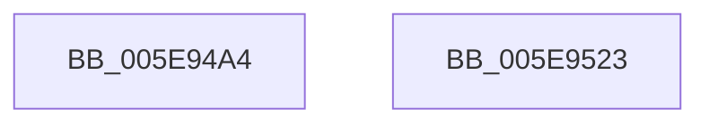

# RtlpAllocateHeapRaiseException

- RVA: `0x005E94A4`–`0x005E9524` (길이 `128` bytes)
- VA: `0x00000001405E94A4`
- 실행 섹션: `.text`
- PDB 이름 있음: `예`; PDB Function 태그: `아니요`
- unwind 정보 RVA: `0x000A1158`
- 디코드: `26`개 명령, `128/128` bytes 표시
- 미해석 바이트: `0` (있으면 어셈블리에 `.byte`로 보존)

> 이 문서는 커널 이미지의 기계어와 PDB 기호를 분석해 생성했습니다. 4번과 5번은 함수 원형과 자료형을 바이너리 사용 방식에서 추정한 C 해석이며 원본 소스 복구 결과는 아닙니다.

## 1. Dependencies

- 직접 호출 지점: **3**; 고유 호출 대상: **3**
- 직접 호출자로 확인된 함수: **1**
- RIP 상대 이미지 참조: **2**

### Outgoing calls
- `0x005E94CF` → [memset](../6C/memset_function_006C6C40.md) (function, `0x006C6C40`)
- `0x005E9505` → [RtlRaiseException](RtlRaiseException_function_005E6B00.md) (function, `0x005E6B00`)
- `0x005E9515` → [_security_check_cookie](../6A/_security_check_cookie_function_006AC640.md) (function, `0x006AC640`)

### Direct callers
- [sub_006DE680](../6D/Unknown_function_006DE680.md) at `0x006DE80B`

### Static image references
- `0x005E94AD` → RVA `0x00E0A740` (`.data`; read)
- `0x005E94DA` → RVA `0x005E6B00` (`RtlRaiseException`; read)

## 2. Other-region calls and transfers

- 다른 실행 섹션으로 향하는 call: **0**
- 별도 외부 분기/꼬리 이동을 확인하지 못했습니다.

## 3. Assembly (complete function range)

```asm
005E94A4  40 53                           push rbx
005E94A6  48 81 EC D0 00 00 00            sub rsp, 0xd0
005E94AD  48 8B 05 8C 12 82 00            mov rax, qword ptr [rip + 0x82128c]
005E94B4  48 33 C4                        xor rax, rsp
005E94B7  48 89 84 24 C0 00 00 00         mov qword ptr [rsp + 0xc0], rax
005E94BF  48 8B D9                        mov rbx, rcx
005E94C2  33 D2                           xor edx, edx
005E94C4  48 8D 4C 24 20                  lea rcx, [rsp + 0x20]
005E94C9  41 B8 98 00 00 00               mov r8d, 0x98
005E94CF  E8 6C D7 0D 00                  call 0x1406c6c40
005E94D4  48 83 64 24 28 00               and qword ptr [rsp + 0x28], 0
005E94DA  48 8D 05 1F D6 FF FF            lea rax, [rip - 0x29e1]
005E94E1  83 64 24 24 00                  and dword ptr [rsp + 0x24], 0
005E94E6  48 8D 4C 24 20                  lea rcx, [rsp + 0x20]
005E94EB  48 89 44 24 30                  mov qword ptr [rsp + 0x30], rax
005E94F0  C7 44 24 20 17 00 00 C0         mov dword ptr [rsp + 0x20], 0xc0000017
005E94F8  C7 44 24 38 01 00 00 00         mov dword ptr [rsp + 0x38], 1
005E9500  48 89 5C 24 40                  mov qword ptr [rsp + 0x40], rbx
005E9505  E8 F6 D5 FF FF                  call 0x1405e6b00
005E950A  48 8B 8C 24 C0 00 00 00         mov rcx, qword ptr [rsp + 0xc0]
005E9512  48 33 CC                        xor rcx, rsp
005E9515  E8 26 31 0C 00                  call 0x1406ac640
005E951A  48 81 C4 D0 00 00 00            add rsp, 0xd0
005E9521  5B                              pop rbx
005E9522  C3                              ret
005E9523  CC                              int3
```

## 4. C-style interpretation (structured pseudocode)

```c
__int64 __fastcall RtlpAllocateHeapRaiseException(__int64 a1, int a2)
{
    __int64 result;
    __int64 v_rsp;
    unsigned __int64 v_stack_m18;
    unsigned __int64 v_stack_m98;
    unsigned int v_stack_mA0;
    unsigned __int64 v_stack_mA8;
    unsigned __int64 v_stack_mB0;
    unsigned int v_stack_mB4;
    unsigned __int64 v_stack_mB8;

    v_rsp = (v_rsp) - (208);
    result = (*(unsigned __int64 *)(v_rip + 8524428)) ^ (v_rsp);
    v_stack_m18 = result;
    a2 = 0;
    result = memset(v_stack_mB8, a2, 152, a4);
    v_stack_mA8 = v_rip - 10721;
    v_stack_mB8 = 0xC0000017ULL;
    v_stack_mA0 = 1;
    v_stack_m98 = a1;
    result = RtlRaiseException(v_stack_mB8, a2, 152, a4);
    a1 = (v_stack_m18) ^ (v_rsp);
    result = _security_check_cookie(a1, a2, 152, a4);
    v_rsp = (v_rsp) + (208);
    return result;
}
```

## 5. (Beta) C Style

```c
int64_t RtlpAllocateHeapRaiseException(int64_t Arg1, int32_t Arg2)
{
    int64_t result;
    int64_t local_rsp;
    uint64_t v_stack_m18;
    uint64_t v_stack_m98;
    uint32_t v_stack_mA0;
    uint64_t v_stack_mA8;
    uint64_t v_stack_mB0;
    uint32_t v_stack_mB4;
    uint64_t v_stack_mB8;

    local_rsp = (local_rsp) - (208);
    result = (*(uint64_t *)(v_rip + 0x82128C)) ^ (local_rsp);
    v_stack_m18 = result;
    Arg2 = 0;
    result = memset(v_stack_mB8, Arg2, 152, a4);
    v_stack_mA8 = v_rip - 10721;
    v_stack_mB8 = 0xC0000017ULL;
    v_stack_mA0 = 1;
    v_stack_m98 = Arg1;
    result = RtlRaiseException(v_stack_mB8, Arg2, 152, a4);
    Arg1 = (v_stack_m18) ^ (local_rsp);
    result = _security_check_cookie(Arg1, Arg2, 152, a4);
    local_rsp = (local_rsp) + (208);
    return result;
}
```

## 6. Execution-region graph

[열기: 2D/3D 그래프와 함수 탐색 컨트롤 패널](../../../control-panel.html?section=text&rva=0x005E94A4&view=graph)

- 2D 그래프는 위에서 아래로 흐르고, 3D 그래프는 빈 공간을 드래그해 회전합니다. Shift+드래그는 이동, 휠은 확대·축소, 함수 노드 선택은 대상 보고서 이동입니다.

### Static fallback


