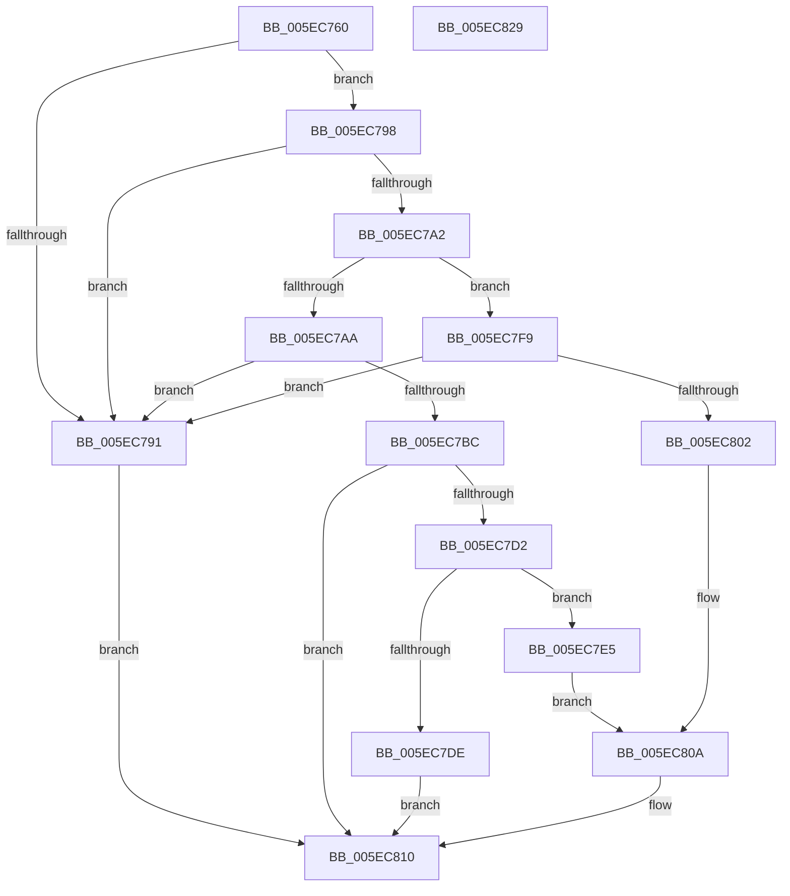

# RtlpCaptureDynamicRelocationTableRva

- RVA: `0x005EC760`–`0x005EC82A` (길이 `202` bytes)
- VA: `0x00000001405EC760`
- 실행 섹션: `.text`
- PDB 이름 있음: `예`; PDB Function 태그: `아니요`
- unwind 정보 RVA: `0x00060300`
- 디코드: `60`개 명령, `202/202` bytes 표시
- 미해석 바이트: `0` (있으면 어셈블리에 `.byte`로 보존)

> 이 문서는 커널 이미지의 기계어와 PDB 기호를 분석해 생성했습니다. 4번과 5번은 함수 원형과 자료형을 바이너리 사용 방식에서 추정한 C 해석이며 원본 소스 복구 결과는 아닙니다.

## 1. Dependencies

- 직접 호출 지점: **2**; 고유 호출 대상: **2**
- 직접 호출자로 확인된 함수: **3**
- RIP 상대 이미지 참조: **0**

### Outgoing calls
- `0x005EC787` → [LdrImageDirectoryEntryToLoadConfig](../../page/A8/LdrImageDirectoryEntryToLoadConfig_function_00A8F564.md) (function, `0x00A8F564`)
- `0x005EC7C9` → [RtlImageNtHeaderEx](../41/RtlImageNtHeaderEx_function_0041EAA0.md) (function, `0x0041EAA0`)

### Direct callers
- [RtlPerformRetpolineRelocationsOnImageEx](../6A/RtlPerformRetpolineRelocationsOnImageEx_function_006A9AD4.md) at `0x006A9B52`
- [RtlUpdateImportRelocationsInImage](../6A/RtlUpdateImportRelocationsInImage_function_006A9E1C.md) at `0x006A9F52`
- [RtlApplyFunctionOverrideFixupsToImage](../../page/79/RtlApplyFunctionOverrideFixupsToImage_function_007954E0.md) at `0x00795533`

### Static image references
- 디코드된 RIP-relative 메모리 참조가 없습니다.

## 2. Other-region calls and transfers

- 다른 실행 섹션으로 향하는 call: **1**
  - `0x005EC787` → [LdrImageDirectoryEntryToLoadConfig](../../page/A8/LdrImageDirectoryEntryToLoadConfig_function_00A8F564.md) (`.text` → `PAGE`)
- 별도 외부 분기/꼬리 이동을 확인하지 못했습니다.

## 3. Assembly (complete function range)

```asm
005EC760  48 8B C4                        mov rax, rsp
005EC763  48 89 58 08                     mov qword ptr [rax + 8], rbx
005EC767  48 89 68 10                     mov qword ptr [rax + 0x10], rbp
005EC76B  48 89 70 18                     mov qword ptr [rax + 0x18], rsi
005EC76F  57                              push rdi
005EC770  41 56                           push r14
005EC772  41 57                           push r15
005EC774  48 83 EC 20                     sub rsp, 0x20
005EC778  45 33 FF                        xor r15d, r15d
005EC77B  8B EA                           mov ebp, edx
005EC77D  4C 89 78 20                     mov qword ptr [rax + 0x20], r15
005EC781  4D 8B F0                        mov r14, r8
005EC784  48 8B F9                        mov rdi, rcx
005EC787  E8 D8 2D 4A 00                  call 0x140a8f564
005EC78C  48 85 C0                        test rax, rax
005EC78F  75 07                           jne 0x1405ec798
005EC791  B8 BB 00 00 C0                  mov eax, 0xc00000bb
005EC796  EB 78                           jmp 0x1405ec810
005EC798  8B 08                           mov ecx, dword ptr [rax]
005EC79A  81 F9 C8 00 00 00               cmp ecx, 0xc8
005EC7A0  72 EF                           jb 0x1405ec791
005EC7A2  81 F9 E6 00 00 00               cmp ecx, 0xe6
005EC7A8  72 4F                           jb 0x1405ec7f9
005EC7AA  0F B7 98 E4 00 00 00            movzx ebx, word ptr [rax + 0xe4]
005EC7B1  8B B0 E0 00 00 00               mov esi, dword ptr [rax + 0xe0]
005EC7B7  66 85 DB                        test bx, bx
005EC7BA  74 D5                           je 0x1405ec791
005EC7BC  4C 8B C5                        mov r8, rbp
005EC7BF  4C 8D 4C 24 58                  lea r9, [rsp + 0x58]
005EC7C4  48 8B D7                        mov rdx, rdi
005EC7C7  33 C9                           xor ecx, ecx
005EC7C9  E8 D2 22 E3 FF                  call 0x14041eaa0
005EC7CE  85 C0                           test eax, eax
005EC7D0  78 3E                           js 0x1405ec810
005EC7D2  4C 8B 44 24 58                  mov r8, qword ptr [rsp + 0x58]
005EC7D7  66 41 3B 58 06                  cmp bx, word ptr [r8 + 6]
005EC7DC  76 07                           jbe 0x1405ec7e5
005EC7DE  B8 7B 00 00 C0                  mov eax, 0xc000007b
005EC7E3  EB 2B                           jmp 0x1405ec810
005EC7E5  41 0F B7 40 14                  movzx eax, word ptr [r8 + 0x14]
005EC7EA  48 8D 0C 9B                     lea rcx, [rbx + rbx*4]
005EC7EE  49 03 C0                        add rax, r8
005EC7F1  8B 44 C8 FC                     mov eax, dword ptr [rax + rcx*8 - 4]
005EC7F5  03 C6                           add eax, esi
005EC7F7  EB 11                           jmp 0x1405ec80a
005EC7F9  4C 39 B8 C0 00 00 00            cmp qword ptr [rax + 0xc0], r15
005EC800  74 8F                           je 0x1405ec791
005EC802  8B 80 C0 00 00 00               mov eax, dword ptr [rax + 0xc0]
005EC808  2B C7                           sub eax, edi
005EC80A  41 89 06                        mov dword ptr [r14], eax
005EC80D  41 8B C7                        mov eax, r15d
005EC810  48 8B 5C 24 40                  mov rbx, qword ptr [rsp + 0x40]
005EC815  48 8B 6C 24 48                  mov rbp, qword ptr [rsp + 0x48]
005EC81A  48 8B 74 24 50                  mov rsi, qword ptr [rsp + 0x50]
005EC81F  48 83 C4 20                     add rsp, 0x20
005EC823  41 5F                           pop r15
005EC825  41 5E                           pop r14
005EC827  5F                              pop rdi
005EC828  C3                              ret
005EC829  CC                              int3
```

## 4. C-style interpretation (structured pseudocode)

```c
__int64 __fastcall RtlpCaptureDynamicRelocationTableRva(__int64 a1, int a2, __int64 a3)
{
    __int64 result;
    __int64 v_r15;
    __int64 v_rsp;
    unsigned __int64 v_stack_p10;
    unsigned __int64 v_stack_p18;
    unsigned __int64 v_stack_p20;
    unsigned __int64 v_stack_p8;

    *(unsigned __int64 *)(v_rsp + 8) = v_rbx;
    *(unsigned __int64 *)(v_rsp + 16) = v_rbp;
    *(unsigned __int64 *)(v_rsp + 24) = v_rsi;
    v_rsp = (v_rsp) - (32);
    v_r15 = 0;
    *(unsigned __int64 *)(v_rsp + 32) = 0;
    result = LdrImageDirectoryEntryToLoadConfig(a1, a2, a3, a4);
    if (result != 0) goto loc_005EC798;
loc_005EC791:
    goto loc_005EC810;
loc_005EC798:
    if (((unsigned int)((unsigned int)(*(unsigned int *)((unsigned int)(0xC00000BBULL))))) < 200) goto loc_005EC791;
    if (((unsigned int)((unsigned int)(*(unsigned int *)((unsigned int)(0xC00000BBULL))))) < 230) goto loc_005EC7F9;
    if ((unsigned __int16)(*(unsigned __int16 *)((unsigned int)(0xC00000BBULL) + 228)) == 0) goto loc_005EC791;
    a1 = 0;
    result = RtlImageNtHeaderEx(a1, a1, (unsigned int)(a2), v_stack_p20);
    if (sign_flag) goto loc_005EC810;
    if (((unsigned __int16)(*(unsigned __int16 *)((unsigned int)(0xC00000BBULL) + 228))) <= (*(unsigned __int16 *)(v_stack_p20 + 6))) goto loc_005EC7E5;
    goto loc_005EC810;
loc_005EC7E5:
    result = (*(unsigned __int16 *)(v_stack_p20 + 20)) + (v_stack_p20);
    result = (unsigned int)(((unsigned int)(*(unsigned int *)(result + *(unsigned __int16 *)((unsigned int)(0xC00000BBULL) + 228) + *(unsigned __int16 *)((unsigned int)(0xC00000BBULL) + 228) * 4 * 8 - 4))) + ((unsigned int)((unsigned int)(*(unsigned int *)((unsigned int)(0xC00000BBULL) + 224)))));
    goto loc_005EC80A;
loc_005EC7F9:
    if ((*(unsigned __int64 *)(result + 192)) == 0) goto loc_005EC791;
    result = (unsigned int)(((unsigned int)(*(unsigned int *)(result + 192))) - (0));
loc_005EC80A:
    *(unsigned int *)(a3) = (unsigned int)(result);
loc_005EC810:
    v_rsp = (v_rsp) + (32);
    return 0;
}
```

## 5. (Beta) C Style

```c
int64_t RtlpCaptureDynamicRelocationTableRva(int64_t Arg1, int32_t Arg2, void *Arg3)
{
    uint8_t *arg3 = (uint8_t *)Arg3;

    int64_t result;
    int64_t local_r15;
    int64_t local_rsp;
    uint64_t v_stack_p10;
    uint64_t v_stack_p18;
    uint64_t v_stack_p20;
    uint64_t v_stack_p8;

    *(uint64_t *)(local_rsp + 0x8) = local_rbx;
    *(uint64_t *)(local_rsp + 0x10) = local_rbp;
    *(uint64_t *)(local_rsp + 0x18) = local_rsi;
    local_rsp = (local_rsp) - (32);
    local_r15 = 0;
    *(uint64_t *)(local_rsp + 0x20) = 0;
    result = LdrImageDirectoryEntryToLoadConfig(Arg1, Arg2, Arg3, a4);
    if (result != 0) goto loc_005EC798;
loc_005EC791:
    goto loc_005EC810;
loc_005EC798:
    if (((uint32_t)((uint32_t)(*(uint32_t *)((uint32_t)(0xC00000BBULL))))) < 200) goto loc_005EC791;
    if (((uint32_t)((uint32_t)(*(uint32_t *)((uint32_t)(0xC00000BBULL))))) < 230) goto loc_005EC7F9;
    if ((uint16_t)(*(uint16_t *)((uint32_t)(0xC00000BBULL) + 0xE4)) == 0) goto loc_005EC791;
    Arg1 = 0;
    result = RtlImageNtHeaderEx(Arg1, Arg1, (uint32_t)(Arg2), v_stack_p20);
    if (sign_flag) goto loc_005EC810;
    if (((uint16_t)(*(uint16_t *)((uint32_t)(0xC00000BBULL) + 0xE4))) <= (*(uint16_t *)(v_stack_p20 + 0x6))) goto loc_005EC7E5;
    goto loc_005EC810;
loc_005EC7E5:
    result = (*(uint16_t *)(v_stack_p20 + 0x14)) + (v_stack_p20);
    result = (uint32_t)(((uint32_t)(*(uint32_t *)(result + *(uint16_t *)((uint32_t)(0xC00000BBULL) + 0xE4) + *(uint16_t *)((uint32_t)(0xC00000BBULL) + 0xE4) * 4 * 8 - 0x4))) + ((uint32_t)((uint32_t)(*(uint32_t *)((uint32_t)(0xC00000BBULL) + 0xE0)))));
    goto loc_005EC80A;
loc_005EC7F9:
    if ((*(uint64_t *)(result + 0xC0)) == 0) goto loc_005EC791;
    result = (uint32_t)(((uint32_t)(*(uint32_t *)(result + 0xC0))) - (0));
loc_005EC80A:
    *(uint32_t *)(arg3) = (uint32_t)(result);
loc_005EC810:
    local_rsp = (local_rsp) + (32);
    return 0;
}
```

### 관측된 메모리 오프셋

구조체 형식이 확인되지 않은 접근은 인자 기준의 오프셋으로만 기록했습니다.

| 기준 인자 | 오프셋 표현 | 폭 (bit) | 접근 |
|---|---:|---:|---|
| `Arg3` | `+ 0x0` | `32` | `W` |

## 6. Execution-region graph

[열기: 2D/3D 그래프와 함수 탐색 컨트롤 패널](../../../control-panel.html?section=text&rva=0x005EC760&view=graph)

- 2D 그래프는 위에서 아래로 흐르고, 3D 그래프는 빈 공간을 드래그해 회전합니다. Shift+드래그는 이동, 휠은 확대·축소, 함수 노드 선택은 대상 보고서 이동입니다.

### Static fallback


