# RtlpCoalesceFreeBlocks

- RVA: `0x005E952C`–`0x005E987F` (길이 `851` bytes)
- VA: `0x00000001405E952C`
- 실행 섹션: `.text`
- PDB 이름 있음: `예`; PDB Function 태그: `아니요`
- unwind 정보 RVA: `0x00093E28`
- 디코드: `240`개 명령, `851/851` bytes 표시
- 미해석 바이트: `0` (있으면 어셈블리에 `.byte`로 보존)

> 이 문서는 커널 이미지의 기계어와 PDB 기호를 분석해 생성했습니다. 4번과 5번은 함수 원형과 자료형을 바이너리 사용 방식에서 추정한 C 해석이며 원본 소스 복구 결과는 아닙니다.

## 1. Dependencies

- 직접 호출 지점: **10**; 고유 호출 대상: **5**
- 직접 호출자로 확인된 함수: **3**
- RIP 상대 이미지 참조: **2**

### Outgoing calls
- `0x005E95A9` → [RtlpAnalyzeHeapFailure](../5F/RtlpAnalyzeHeapFailure_function_005F0F9C.md) (function, `0x005F0F9C`)
- `0x005E961C` → [RtlpHeapRemoveListEntry](../5F/RtlpHeapRemoveListEntry_function_005F1B90.md) (function, `0x005F1B90`)
- `0x005E9656` → [RtlCompareMemoryUlong](../6B/RtlCompareMemoryUlong_function_006BA6F0.md) (function, `0x006BA6F0`)
- `0x005E9671` → [DbgPrint](../35/DbgPrint_function_00358CB0.md) (function, `0x00358CB0`)
- `0x005E96C5` → [RtlpLogHeapFailure](../35/RtlpLogHeapFailure_function_0035B7BC.md) (function, `0x0035B7BC`)
- `0x005E9711` → [RtlpLogHeapFailure](../35/RtlpLogHeapFailure_function_0035B7BC.md) (function, `0x0035B7BC`)
- `0x005E9750` → [RtlpAnalyzeHeapFailure](../5F/RtlpAnalyzeHeapFailure_function_005F0F9C.md) (function, `0x005F0F9C`)
- `0x005E97D1` → [RtlpHeapRemoveListEntry](../5F/RtlpHeapRemoveListEntry_function_005F1B90.md) (function, `0x005F1B90`)
- `0x005E980B` → [RtlCompareMemoryUlong](../6B/RtlCompareMemoryUlong_function_006BA6F0.md) (function, `0x006BA6F0`)
- `0x005E9826` → [DbgPrint](../35/DbgPrint_function_00358CB0.md) (function, `0x00358CB0`)

### Direct callers
- [RtlpDeCommitFreeBlock](RtlpDeCommitFreeBlock_function_005EA158.md) at `0x005EA1E9`
- [RtlpExtendHeap](RtlpExtendHeap_function_005EA708.md) at `0x005EA74E`
- [RtlpFreeHeap](RtlpFreeHeap_function_005EABC0.md) at `0x005EAD04`

### Static image references
- `0x005E966A` → RVA `0x006CC9E0` (` ?? ::FNODOBFM::`string'`; read)
- `0x005E9676` → RVA `0x00F475F8` (`.data`; read)

## 2. Other-region calls and transfers

- 다른 실행 섹션으로 향하는 call: **0**
- 별도 외부 분기/꼬리 이동을 확인하지 못했습니다.

## 3. Assembly (complete function range)

```asm
005E952C  48 89 5C 24 08                  mov qword ptr [rsp + 8], rbx
005E9531  48 89 6C 24 10                  mov qword ptr [rsp + 0x10], rbp
005E9536  48 89 74 24 18                  mov qword ptr [rsp + 0x18], rsi
005E953B  57                              push rdi
005E953C  41 56                           push r14
005E953E  41 57                           push r15
005E9540  48 83 EC 40                     sub rsp, 0x40
005E9544  44 0F B7 4A 0C                  movzx r9d, word ptr [rdx + 0xc]
005E9549  48 8B DA                        mov rbx, rdx
005E954C  0F B7 81 8C 00 00 00            movzx eax, word ptr [rcx + 0x8c]
005E9553  4D 8B F0                        mov r14, r8
005E9556  4C 33 C8                        xor r9, rax
005E9559  48 8B EA                        mov rbp, rdx
005E955C  49 C1 E1 04                     shl r9, 4
005E9560  48 8B F9                        mov rdi, rcx
005E9563  49 2B D9                        sub rbx, r9
005E9566  48 3B DA                        cmp rbx, rdx
005E9569  0F 84 5B 01 00 00               je 0x1405e96ca
005E956F  8B 49 7C                        mov ecx, dword ptr [rcx + 0x7c]
005E9572  8B C1                           mov eax, ecx
005E9574  C1 E8 14                        shr eax, 0x14
005E9577  22 87 8A 00 00 00               and al, byte ptr [rdi + 0x8a]
005E957D  32 43 0A                        xor al, byte ptr [rbx + 0xa]
005E9580  A8 01                           test al, 1
005E9582  0F 85 42 01 00 00               jne 0x1405e96ca
005E9588  85 C9                           test ecx, ecx
005E958A  74 22                           je 0x1405e95ae
005E958C  8B 8F 88 00 00 00               mov ecx, dword ptr [rdi + 0x88]
005E9592  31 4B 08                        xor dword ptr [rbx + 8], ecx
005E9595  8A 4B 0A                        mov cl, byte ptr [rbx + 0xa]
005E9598  32 4B 09                        xor cl, byte ptr [rbx + 9]
005E959B  32 4B 08                        xor cl, byte ptr [rbx + 8]
005E959E  38 4B 0B                        cmp byte ptr [rbx + 0xb], cl
005E95A1  74 0B                           je 0x1405e95ae
005E95A3  48 8B D3                        mov rdx, rbx
005E95A6  48 8B CF                        mov rcx, rdi
005E95A9  E8 EE 79 00 00                  call 0x1405f0f9c
005E95AE  4C 8B 7B 18                     mov r15, qword ptr [rbx + 0x18]
005E95B2  4C 8D 43 10                     lea r8, [rbx + 0x10]
005E95B6  49 8B 30                        mov rsi, qword ptr [r8]
005E95B9  49 8B 07                        mov rax, qword ptr [r15]
005E95BC  4C 8B 4E 08                     mov r9, qword ptr [rsi + 8]
005E95C0  49 3B C1                        cmp rax, r9
005E95C3  0F 85 E9 00 00 00               jne 0x1405e96b2
005E95C9  49 3B C0                        cmp rax, r8
005E95CC  0F 85 E0 00 00 00               jne 0x1405e96b2
005E95D2  0F B7 43 08                     movzx eax, word ptr [rbx + 8]
005E95D6  48 29 87 C0 00 00 00            sub qword ptr [rdi + 0xc0], rax
005E95DD  48 8B 97 38 01 00 00            mov rdx, qword ptr [rdi + 0x138]
005E95E4  48 85 D2                        test rdx, rdx
005E95E7  74 38                           je 0x1405e9621
005E95E9  44 0F B7 4B 08                  movzx r9d, word ptr [rbx + 8]
005E95EE  8B 4A 08                        mov ecx, dword ptr [rdx + 8]
005E95F1  4C 3B C9                        cmp r9, rcx
005E95F4  72 11                           jb 0x1405e9607
005E95F6  48 8B 02                        mov rax, qword ptr [rdx]
005E95F9  48 85 C0                        test rax, rax
005E95FC  74 05                           je 0x1405e9603
005E95FE  48 8B D0                        mov rdx, rax
005E9601  EB EB                           jmp 0x1405e95ee
005E9603  FF C9                           dec ecx
005E9605  EB 03                           jmp 0x1405e960a
005E9607  49 8B C9                        mov rcx, r9
005E960A  4C 89 4C 24 28                  mov qword ptr [rsp + 0x28], r9
005E960F  4D 8B C8                        mov r9, r8
005E9612  89 4C 24 20                     mov dword ptr [rsp + 0x20], ecx
005E9616  41 B0 01                        mov r8b, 1
005E9619  48 8B CF                        mov rcx, rdi
005E961C  E8 6F 85 00 00                  call 0x1405f1b90
005E9621  49 89 37                        mov qword ptr [r15], rsi
005E9624  4C 89 7E 08                     mov qword ptr [rsi + 8], r15
005E9628  8A 43 0A                        mov al, byte ptr [rbx + 0xa]
005E962B  A8 04                           test al, 4
005E962D  74 51                           je 0x1405e9680
005E962F  0F B7 73 08                     movzx esi, word ptr [rbx + 8]
005E9633  48 C1 E6 04                     shl rsi, 4
005E9637  48 83 EE 20                     sub rsi, 0x20
005E963B  A8 02                           test al, 2
005E963D  74 0A                           je 0x1405e9649
005E963F  48 83 FE 04                     cmp rsi, 4
005E9643  76 04                           jbe 0x1405e9649
005E9645  48 83 EE 04                     sub rsi, 4
005E9649  48 8D 4B 20                     lea rcx, [rbx + 0x20]
005E964D  41 B8 EE FE EE FE               mov r8d, 0xfeeefeee
005E9653  48 8B D6                        mov rdx, rsi
005E9656  E8 95 10 0D 00                  call 0x1406ba6f0
005E965B  48 3B C6                        cmp rax, rsi
005E965E  74 20                           je 0x1405e9680
005E9660  4C 8D 43 20                     lea r8, [rbx + 0x20]
005E9664  48 8B D3                        mov rdx, rbx
005E9667  4C 03 C0                        add r8, rax
005E966A  48 8D 0D 6F 33 0E 00            lea rcx, [rip + 0xe336f]
005E9671  E8 3A F6 D6 FF                  call 0x140358cb0
005E9676  80 3D 7B DF 95 00 00            cmp byte ptr [rip + 0x95df7b], 0
005E967D  74 01                           je 0x1405e9680
005E967F  CC                              int3
005E9680  0F B7 43 08                     movzx eax, word ptr [rbx + 8]
005E9684  48 8B EB                        mov rbp, rbx
005E9687  C6 43 0A 00                     mov byte ptr [rbx + 0xa], 0
005E968B  C6 43 0F 00                     mov byte ptr [rbx + 0xf], 0
005E968F  49 01 06                        add qword ptr [r14], rax
005E9692  41 0F B7 06                     movzx eax, word ptr [r14]
005E9696  66 89 43 08                     mov word ptr [rbx + 8], ax
005E969A  0F B7 8F 8C 00 00 00            movzx ecx, word ptr [rdi + 0x8c]
005E96A1  66 41 33 0E                     xor cx, word ptr [r14]
005E96A5  49 8B 06                        mov rax, qword ptr [r14]
005E96A8  48 03 C0                        add rax, rax
005E96AB  66 89 4C C3 0C                  mov word ptr [rbx + rax*8 + 0xc], cx
005E96B0  EB 18                           jmp 0x1405e96ca
005E96B2  48 83 64 24 28 00               and qword ptr [rsp + 0x28], 0
005E96B8  48 8B D7                        mov rdx, rdi
005E96BB  B9 0D 00 00 00                  mov ecx, 0xd
005E96C0  48 89 44 24 20                  mov qword ptr [rsp + 0x20], rax
005E96C5  E8 F2 20 D7 FF                  call 0x14035b7bc
005E96CA  49 8B 1E                        mov rbx, qword ptr [r14]
005E96CD  48 C1 E3 04                     shl rbx, 4
005E96D1  48 03 DD                        add rbx, rbp
005E96D4  83 7F 7C 00                     cmp dword ptr [rdi + 0x7c], 0
005E96D8  74 3C                           je 0x1405e9716
005E96DA  8B 53 08                        mov edx, dword ptr [rbx + 8]
005E96DD  33 97 88 00 00 00               xor edx, dword ptr [rdi + 0x88]
005E96E3  8B CA                           mov ecx, edx
005E96E5  8B C2                           mov eax, edx
005E96E7  C1 E9 10                        shr ecx, 0x10
005E96EA  C1 E8 08                        shr eax, 8
005E96ED  32 C8                           xor cl, al
005E96EF  32 CA                           xor cl, dl
005E96F1  C1 EA 18                        shr edx, 0x18
005E96F4  3A D1                           cmp dl, cl
005E96F6  74 1E                           je 0x1405e9716
005E96F8  48 83 64 24 28 00               and qword ptr [rsp + 0x28], 0
005E96FE  4C 8B C3                        mov r8, rbx
005E9701  48 83 64 24 20 00               and qword ptr [rsp + 0x20], 0
005E9707  45 33 C9                        xor r9d, r9d
005E970A  41 8D 49 03                     lea ecx, [r9 + 3]
005E970E  48 8B D7                        mov rdx, rdi
005E9711  E8 A6 20 D7 FF                  call 0x14035b7bc
005E9716  8B 4F 7C                        mov ecx, dword ptr [rdi + 0x7c]
005E9719  8B C1                           mov eax, ecx
005E971B  C1 E8 14                        shr eax, 0x14
005E971E  22 87 8A 00 00 00               and al, byte ptr [rdi + 0x8a]
005E9724  32 43 0A                        xor al, byte ptr [rbx + 0xa]
005E9727  A8 01                           test al, 1
005E9729  0F 85 33 01 00 00               jne 0x1405e9862
005E972F  85 C9                           test ecx, ecx
005E9731  74 22                           je 0x1405e9755
005E9733  8B 8F 88 00 00 00               mov ecx, dword ptr [rdi + 0x88]
005E9739  31 4B 08                        xor dword ptr [rbx + 8], ecx
005E973C  8A 4B 0A                        mov cl, byte ptr [rbx + 0xa]
005E973F  32 4B 09                        xor cl, byte ptr [rbx + 9]
005E9742  32 4B 08                        xor cl, byte ptr [rbx + 8]
005E9745  38 4B 0B                        cmp byte ptr [rbx + 0xb], cl
005E9748  74 0B                           je 0x1405e9755
005E974A  48 8B D3                        mov rdx, rbx
005E974D  48 8B CF                        mov rcx, rdi
005E9750  E8 47 78 00 00                  call 0x1405f0f9c
005E9755  4C 8B 7B 18                     mov r15, qword ptr [rbx + 0x18]
005E9759  4C 8D 53 10                     lea r10, [rbx + 0x10]
005E975D  49 8B 32                        mov rsi, qword ptr [r10]
005E9760  49 8B 07                        mov rax, qword ptr [r15]
005E9763  4C 8B 4E 08                     mov r9, qword ptr [rsi + 8]
005E9767  49 3B C1                        cmp rax, r9
005E976A  75 05                           jne 0x1405e9771
005E976C  49 3B C2                        cmp rax, r10
005E976F  74 15                           je 0x1405e9786
005E9771  48 83 64 24 28 00               and qword ptr [rsp + 0x28], 0
005E9777  4D 8B C2                        mov r8, r10
005E977A  48 89 44 24 20                  mov qword ptr [rsp + 0x20], rax
005E977F  B9 0D 00 00 00                  mov ecx, 0xd
005E9784  EB 88                           jmp 0x1405e970e
005E9786  0F B7 43 08                     movzx eax, word ptr [rbx + 8]
005E978A  48 29 87 C0 00 00 00            sub qword ptr [rdi + 0xc0], rax
005E9791  48 8B 97 38 01 00 00            mov rdx, qword ptr [rdi + 0x138]
005E9798  48 85 D2                        test rdx, rdx
005E979B  74 39                           je 0x1405e97d6
005E979D  0F B7 4B 08                     movzx ecx, word ptr [rbx + 8]
005E97A1  44 8B 42 08                     mov r8d, dword ptr [rdx + 8]
005E97A5  49 3B C8                        cmp rcx, r8
005E97A8  72 11                           jb 0x1405e97bb
005E97AA  48 8B 02                        mov rax, qword ptr [rdx]
005E97AD  48 85 C0                        test rax, rax
005E97B0  74 05                           je 0x1405e97b7
005E97B2  48 8B D0                        mov rdx, rax
005E97B5  EB EA                           jmp 0x1405e97a1
005E97B7  41 8D 48 FF                     lea ecx, [r8 - 1]
005E97BB  0F B7 43 08                     movzx eax, word ptr [rbx + 8]
005E97BF  4D 8B CA                        mov r9, r10
005E97C2  48 89 44 24 28                  mov qword ptr [rsp + 0x28], rax
005E97C7  41 B0 01                        mov r8b, 1
005E97CA  89 4C 24 20                     mov dword ptr [rsp + 0x20], ecx
005E97CE  48 8B CF                        mov rcx, rdi
005E97D1  E8 BA 83 00 00                  call 0x1405f1b90
005E97D6  49 89 37                        mov qword ptr [r15], rsi
005E97D9  4C 89 7E 08                     mov qword ptr [rsi + 8], r15
005E97DD  8A 43 0A                        mov al, byte ptr [rbx + 0xa]
005E97E0  A8 04                           test al, 4
005E97E2  74 51                           je 0x1405e9835
005E97E4  0F B7 73 08                     movzx esi, word ptr [rbx + 8]
005E97E8  48 C1 E6 04                     shl rsi, 4
005E97EC  48 83 EE 20                     sub rsi, 0x20
005E97F0  A8 02                           test al, 2
005E97F2  74 0A                           je 0x1405e97fe
005E97F4  48 83 FE 04                     cmp rsi, 4
005E97F8  76 04                           jbe 0x1405e97fe
005E97FA  48 83 EE 04                     sub rsi, 4
005E97FE  48 8D 4B 20                     lea rcx, [rbx + 0x20]
005E9802  41 B8 EE FE EE FE               mov r8d, 0xfeeefeee
005E9808  48 8B D6                        mov rdx, rsi
005E980B  E8 E0 0E 0D 00                  call 0x1406ba6f0
005E9810  48 3B C6                        cmp rax, rsi
005E9813  74 20                           je 0x1405e9835
005E9815  4C 8D 40 20                     lea r8, [rax + 0x20]
005E9819  48 8B D3                        mov rdx, rbx
005E981C  4C 03 C3                        add r8, rbx
005E981F  48 8D 0D BA 31 0E 00            lea rcx, [rip + 0xe31ba]
005E9826  E8 85 F4 D6 FF                  call 0x140358cb0
005E982B  80 3D C6 DD 95 00 00            cmp byte ptr [rip + 0x95ddc6], 0
005E9832  74 01                           je 0x1405e9835
005E9834  CC                              int3
005E9835  C6 45 0A 00                     mov byte ptr [rbp + 0xa], 0
005E9839  C6 45 0F 00                     mov byte ptr [rbp + 0xf], 0
005E983D  0F B7 43 08                     movzx eax, word ptr [rbx + 8]
005E9841  49 01 06                        add qword ptr [r14], rax
005E9844  41 0F B7 06                     movzx eax, word ptr [r14]
005E9848  66 89 45 08                     mov word ptr [rbp + 8], ax
005E984C  0F B7 8F 8C 00 00 00            movzx ecx, word ptr [rdi + 0x8c]
005E9853  66 41 33 0E                     xor cx, word ptr [r14]
005E9857  49 8B 06                        mov rax, qword ptr [r14]
005E985A  48 03 C0                        add rax, rax
005E985D  66 89 4C C5 0C                  mov word ptr [rbp + rax*8 + 0xc], cx
005E9862  48 8B 5C 24 60                  mov rbx, qword ptr [rsp + 0x60]
005E9867  48 8B C5                        mov rax, rbp
005E986A  48 8B 6C 24 68                  mov rbp, qword ptr [rsp + 0x68]
005E986F  48 8B 74 24 70                  mov rsi, qword ptr [rsp + 0x70]
005E9874  48 83 C4 40                     add rsp, 0x40
005E9878  41 5F                           pop r15
005E987A  41 5E                           pop r14
005E987C  5F                              pop rdi
005E987D  C3                              ret
005E987E  CC                              int3
```

## 4. C-style interpretation (structured pseudocode)

```c
__int64 __fastcall RtlpCoalesceFreeBlocks(__int64 a1, __int64 a2, __int64 a3)
{
    __int64 result;
    __int64 v_rbx;
    __int64 v_rsi;
    __int64 v_rsp;
    unsigned __int64 v_stack_m30;
    unsigned int v_stack_m38;
    unsigned __int64 v_stack_p10;
    unsigned __int64 v_stack_p18;
    unsigned __int64 v_stack_p8;

    v_stack_p8 = v_rbx;
    v_stack_p10 = v_rbp;
    v_stack_p18 = v_rsi;
    v_rsp = (v_rsp) - (64);
    a4 = (*(unsigned __int16 *)(a2 + 12)) ^ (*(unsigned __int16 *)(a1 + 140));
    a4 = (a4) << (4);
    v_rbx = (a2) - (a4);
    if (v_rbx == a2) goto loc_005E96CA;
    result = (unsigned int)(((unsigned int)((unsigned int)((unsigned int)(*(unsigned int *)(a1 + 124))))) >> (20));
    result = (unsigned __int8)((result) & (*(unsigned __int8 *)(a1 + 138)));
    result = (unsigned __int8)((result) ^ (*(unsigned __int8 *)(v_rbx + 10)));
    if ((((unsigned __int8)(result)) & (1)) != 0) goto loc_005E96CA;
    if ((unsigned int)((unsigned int)(*(unsigned int *)(a1 + 124))) == 0) goto loc_005E95AE;
    a1 = (unsigned __int8)((*(unsigned __int8 *)(v_rbx + 10)) ^ (*(unsigned __int8 *)(v_rbx + 9)));
    a1 = (unsigned __int8)((a1) ^ (*(unsigned __int8 *)(v_rbx + 8)));
    if ((*(unsigned __int8 *)(v_rbx + 11)) != ((unsigned __int8)(a1))) {
        a2 = v_rbx;
        a1 = a1;
        result = RtlpAnalyzeHeapFailure(a1, a2, a3, a4);
    }
    if ((*(unsigned __int64 *)(*(unsigned __int64 *)(v_rbx + 24))) != (*(unsigned __int64 *)(*(unsigned __int64 *)(v_rbx + 16) + 8))) goto loc_005E96B2;
    if ((*(unsigned __int64 *)(*(unsigned __int64 *)(v_rbx + 24))) != (v_rbx + 16)) goto loc_005E96B2;
    if (*(unsigned __int64 *)(a1 + 312) == 0) goto loc_005E9621;
loc_005E95EE:
    if ((*(unsigned __int16 *)(v_rbx + 8)) < ((unsigned int)(*(unsigned int *)(*(unsigned __int64 *)(a1 + 312) + 8)))) goto loc_005E9607;
    if (*(unsigned __int64 *)(*(unsigned __int64 *)(a1 + 312)) == 0) goto loc_005E9603;
    goto loc_005E95EE;
loc_005E9603:
    a1 = (unsigned int)(((unsigned int)(*(unsigned int *)(*(unsigned __int64 *)(a1 + 312) + 8))) - 1);
    goto loc_005E960A;
loc_005E9607:
loc_005E960A:
    v_stack_m30 = *(unsigned __int16 *)(v_rbx + 8);
    v_stack_m38 = (unsigned int)(*(unsigned __int16 *)(v_rbx + 8));
    result = RtlpHeapRemoveListEntry(a1, *(unsigned __int64 *)(*(unsigned __int64 *)(a1 + 312)), 1, v_rbx + 16);
loc_005E9621:
    *(unsigned __int64 *)(*(unsigned __int64 *)(v_rbx + 24)) = *(unsigned __int64 *)(v_rbx + 16);
    *(unsigned __int64 *)(*(unsigned __int64 *)(v_rbx + 16) + 8) = *(unsigned __int64 *)(v_rbx + 24);
    if ((((unsigned __int8)(*(unsigned __int8 *)(v_rbx + 10))) & (4)) == 0) goto loc_005E9680;
    v_rsi = (*(unsigned __int16 *)(v_rbx + 8)) << (4);
    v_rsi = (v_rsi) - (32);
    if ((((unsigned __int8)(*(unsigned __int8 *)(v_rbx + 10))) & (2)) == 0) goto loc_005E9649;
    if (v_rsi >= = 4) {
        v_rsi = (v_rsi) - (4);
    }
    result = RtlCompareMemoryUlong(v_rbx + 32, v_rsi, (unsigned int)(0xFEEEFEEEULL), v_rbx + 16);
    if (result == v_rsi) goto loc_005E9680;
    a3 = (v_rbx + 32) + (result);
    result = DbgPrint(v_rip + 930671, v_rbx, a3, v_rbx + 16);
    if ((*(unsigned __int8 *)(v_rip + 9822075)) != 0) {
    }
    *(unsigned __int8 *)(v_rbx + 10) = 0;
    *(unsigned __int8 *)(v_rbx + 15) = 0;
    *(unsigned __int16 *)(v_rbx + 8) = (unsigned __int16)(*(unsigned __int16 *)(a3));
    a1 = (unsigned __int16)((*(unsigned __int16 *)(a1 + 140)) ^ (*(unsigned __int16 *)(a3)));
    result = (*(unsigned __int64 *)(a3)) + (*(unsigned __int64 *)(a3));
    *(unsigned __int16 *)(v_rbx + result * 8 + 12) = (unsigned __int16)(a1);
    goto loc_005E96CA;
loc_005E96B2:
    v_stack_m38 = result;
    result = RtlpLogHeapFailure(13, a1, a3, v_rbx + 16);
loc_005E96CA:
    v_rbx = (*(unsigned __int64 *)(a3)) << (4);
    v_rbx = (v_rbx) + (v_rbx);
    if ((*(unsigned int *)(a1 + 124)) == 0) goto loc_005E9716;
    a2 = (unsigned int)(((unsigned int)(*(unsigned int *)(v_rbx + 8))) ^ (*(unsigned int *)(a1 + 136)));
    a1 = (unsigned int)(((unsigned int)((unsigned int)(a2))) >> (16));
    result = (unsigned int)(((unsigned int)((unsigned int)(a2))) >> (8));
    a1 = (unsigned __int8)((a1) ^ ((unsigned __int8)(result)));
    a1 = (unsigned __int8)((a1) ^ ((unsigned __int8)(a2)));
    a2 = (unsigned int)((a2) >> (24));
    if (((unsigned __int8)(a2)) == ((unsigned __int8)(a1))) goto loc_005E9716;
    a4 = 0;
loc_005E970E:
    result = RtlpLogHeapFailure(a4 + 3, a1, v_rbx, a4);
loc_005E9716:
    result = (unsigned int)(((unsigned int)((unsigned int)((unsigned int)(*(unsigned int *)(a1 + 124))))) >> (20));
    result = (unsigned __int8)((result) & (*(unsigned __int8 *)(a1 + 138)));
    result = (unsigned __int8)((result) ^ (*(unsigned __int8 *)(v_rbx + 10)));
    if ((((unsigned __int8)(result)) & (1)) != 0) goto loc_005E9862;
    if ((unsigned int)((unsigned int)(*(unsigned int *)(a1 + 124))) == 0) goto loc_005E9755;
    a1 = (unsigned __int8)((*(unsigned __int8 *)(v_rbx + 10)) ^ (*(unsigned __int8 *)(v_rbx + 9)));
    a1 = (unsigned __int8)((a1) ^ (*(unsigned __int8 *)(v_rbx + 8)));
    if ((*(unsigned __int8 *)(v_rbx + 11)) != ((unsigned __int8)(a1))) {
        a2 = v_rbx;
        a1 = a1;
        result = RtlpAnalyzeHeapFailure(a1, a2, v_rbx, a4);
    }
    if ((*(unsigned __int64 *)(*(unsigned __int64 *)(v_rbx + 24))) != (*(unsigned __int64 *)(*(unsigned __int64 *)(v_rbx + 16) + 8))) goto loc_005E9771;
    if ((*(unsigned __int64 *)(*(unsigned __int64 *)(v_rbx + 24))) == (v_rbx + 16)) goto loc_005E9786;
loc_005E9771:
    v_stack_m38 = *(unsigned __int64 *)(*(unsigned __int64 *)(v_rbx + 24));
    goto loc_005E970E;
loc_005E9786:
    if (*(unsigned __int64 *)(a1 + 312) == 0) goto loc_005E97D6;
loc_005E97A1:
    if ((*(unsigned __int16 *)(v_rbx + 8)) < ((unsigned int)(*(unsigned int *)(*(unsigned __int64 *)(a1 + 312) + 8)))) goto loc_005E97BB;
    if (*(unsigned __int64 *)(*(unsigned __int64 *)(a1 + 312)) == 0) goto loc_005E97B7;
    goto loc_005E97A1;
loc_005E97B7:
loc_005E97BB:
    v_stack_m30 = *(unsigned __int16 *)(v_rbx + 8);
    v_stack_m38 = (unsigned int)((unsigned int)(*(unsigned int *)(*(unsigned __int64 *)(a1 + 312) + 8)) - 1);
    result = RtlpHeapRemoveListEntry(a1, *(unsigned __int64 *)(*(unsigned __int64 *)(a1 + 312)), 1, v_rbx + 16);
loc_005E97D6:
    *(unsigned __int64 *)(*(unsigned __int64 *)(v_rbx + 24)) = *(unsigned __int64 *)(v_rbx + 16);
    *(unsigned __int64 *)(*(unsigned __int64 *)(v_rbx + 16) + 8) = *(unsigned __int64 *)(v_rbx + 24);
    if ((((unsigned __int8)(*(unsigned __int8 *)(v_rbx + 10))) & (4)) == 0) goto loc_005E9835;
    v_rsi = (*(unsigned __int16 *)(v_rbx + 8)) << (4);
    v_rsi = (v_rsi) - (32);
    if ((((unsigned __int8)(*(unsigned __int8 *)(v_rbx + 10))) & (2)) == 0) goto loc_005E97FE;
    if (v_rsi >= = 4) {
        v_rsi = (v_rsi) - (4);
    }
    result = RtlCompareMemoryUlong(v_rbx + 32, v_rsi, (unsigned int)(0xFEEEFEEEULL), v_rbx + 16);
    if (result == v_rsi) goto loc_005E9835;
    a3 = (result + 32) + (v_rbx);
    result = DbgPrint(v_rip + 930234, v_rbx, a3, v_rbx + 16);
    if ((*(unsigned __int8 *)(v_rip + 9821638)) != 0) {
    }
    *(unsigned __int8 *)(v_rbx + 10) = 0;
    *(unsigned __int8 *)(v_rbx + 15) = 0;
    *(unsigned __int16 *)(v_rbx + 8) = (unsigned __int16)(*(unsigned __int16 *)(a3));
    a1 = (unsigned __int16)((*(unsigned __int16 *)(a1 + 140)) ^ (*(unsigned __int16 *)(a3)));
    result = (*(unsigned __int64 *)(a3)) + (*(unsigned __int64 *)(a3));
    *(unsigned __int16 *)(v_rbx + result * 8 + 12) = (unsigned __int16)(a1);
loc_005E9862:
    v_rsp = (v_rsp) + (64);
    return v_rbx;
}
```

## 5. (Beta) C Style

```c
int64_t RtlpCoalesceFreeBlocks(void *Arg1, void *Arg2, void *Arg3)
{
    uint8_t *arg1 = (uint8_t *)Arg1;
    uint8_t *arg2 = (uint8_t *)Arg2;
    uint8_t *arg3 = (uint8_t *)Arg3;

    int64_t result;
    int64_t local_rbx;
    int64_t local_rsi;
    int64_t local_rsp;
    uint64_t v_stack_m30;
    uint32_t v_stack_m38;
    uint64_t v_stack_p10;
    uint64_t v_stack_p18;
    uint64_t v_stack_p8;

    v_stack_p8 = local_rbx;
    v_stack_p10 = local_rbp;
    v_stack_p18 = local_rsi;
    local_rsp = (local_rsp) - (64);
    a4 = (*(uint16_t *)(arg2 + 0xC)) ^ (*(uint16_t *)(arg1 + 0x8C));
    a4 = (a4) << (4);
    local_rbx = (Arg2) - (a4);
    if (local_rbx == Arg2) goto loc_005E96CA;
    result = (uint32_t)(((uint32_t)((uint32_t)((uint32_t)(*(uint32_t *)(arg1 + 0x7C))))) >> (20));
    result = (uint8_t)((result) & (*(uint8_t *)(arg1 + 0x8A)));
    result = (uint8_t)((result) ^ (*(uint8_t *)(local_rbx + 0xA)));
    if ((((uint8_t)(result)) & (1)) != 0) goto loc_005E96CA;
    if ((uint32_t)((uint32_t)(*(uint32_t *)(arg1 + 0x7C))) == 0) goto loc_005E95AE;
    Arg1 = (uint8_t)((*(uint8_t *)(local_rbx + 0xA)) ^ (*(uint8_t *)(local_rbx + 0x9)));
    Arg1 = (uint8_t)((Arg1) ^ (*(uint8_t *)(local_rbx + 0x8)));
    if ((*(uint8_t *)(local_rbx + 0xB)) != ((uint8_t)(Arg1))) {
        Arg2 = local_rbx;
        Arg1 = Arg1;
        result = RtlpAnalyzeHeapFailure(Arg1, Arg2, Arg3, a4);
    }
    if ((*(uint64_t *)(*(uint64_t *)(local_rbx + 0x18))) != (*(uint64_t *)(*(uint64_t *)(local_rbx + 0x10) + 0x8))) goto loc_005E96B2;
    if ((*(uint64_t *)(*(uint64_t *)(local_rbx + 0x18))) != (local_rbx + 16)) goto loc_005E96B2;
    if (*(uint64_t *)(arg1 + 0x138) == 0) goto loc_005E9621;
loc_005E95EE:
    if ((*(uint16_t *)(local_rbx + 0x8)) < ((uint32_t)(*(uint32_t *)(*(uint64_t *)(arg1 + 0x138) + 0x8)))) goto loc_005E9607;
    if (*(uint64_t *)(*(uint64_t *)(arg1 + 0x138)) == 0) goto loc_005E9603;
    goto loc_005E95EE;
loc_005E9603:
    Arg1 = (uint32_t)(((uint32_t)(*(uint32_t *)(*(uint64_t *)(arg1 + 0x138) + 0x8))) - 1);
    goto loc_005E960A;
loc_005E9607:
loc_005E960A:
    v_stack_m30 = *(uint16_t *)(local_rbx + 0x8);
    v_stack_m38 = (uint32_t)(*(uint16_t *)(local_rbx + 0x8));
    result = RtlpHeapRemoveListEntry(Arg1, *(uint64_t *)(*(uint64_t *)(arg1 + 0x138)), 1, local_rbx + 16);
loc_005E9621:
    *(uint64_t *)(*(uint64_t *)(local_rbx + 0x18)) = *(uint64_t *)(local_rbx + 0x10);
    *(uint64_t *)(*(uint64_t *)(local_rbx + 0x10) + 0x8) = *(uint64_t *)(local_rbx + 0x18);
    if ((((uint8_t)(*(uint8_t *)(local_rbx + 0xA))) & (4)) == 0) goto loc_005E9680;
    local_rsi = (*(uint16_t *)(local_rbx + 0x8)) << (4);
    local_rsi = (local_rsi) - (32);
    if ((((uint8_t)(*(uint8_t *)(local_rbx + 0xA))) & (2)) == 0) goto loc_005E9649;
    if (local_rsi >= = 4) {
        local_rsi = (local_rsi) - (4);
    }
    result = RtlCompareMemoryUlong(local_rbx + 32, local_rsi, (uint32_t)(0xFEEEFEEEULL), local_rbx + 16);
    if (result == local_rsi) goto loc_005E9680;
    Arg3 = (local_rbx + 32) + (result);
    result = DbgPrint(v_rip + 930671, local_rbx, Arg3, local_rbx + 16);
    if ((*(uint8_t *)(v_rip + 0x95DF7B)) != 0) {
    }
    *(uint8_t *)(local_rbx + 0xA) = 0;
    *(uint8_t *)(local_rbx + 0xF) = 0;
    *(uint16_t *)(local_rbx + 0x8) = (uint16_t)(*(uint16_t *)(arg3));
    Arg1 = (uint16_t)((*(uint16_t *)(arg1 + 0x8C)) ^ (*(uint16_t *)(arg3)));
    result = (*(uint64_t *)(arg3)) + (*(uint64_t *)(arg3));
    *(uint16_t *)(local_rbx + result * 8 + 0xC) = (uint16_t)(Arg1);
    goto loc_005E96CA;
loc_005E96B2:
    v_stack_m38 = result;
    result = RtlpLogHeapFailure(13, Arg1, Arg3, local_rbx + 16);
loc_005E96CA:
    local_rbx = (*(uint64_t *)(arg3)) << (4);
    local_rbx = (local_rbx) + (local_rbx);
    if ((*(uint32_t *)(arg1 + 0x7C)) == 0) goto loc_005E9716;
    Arg2 = (uint32_t)(((uint32_t)(*(uint32_t *)(local_rbx + 0x8))) ^ (*(uint32_t *)(arg1 + 0x88)));
    Arg1 = (uint32_t)(((uint32_t)((uint32_t)(Arg2))) >> (16));
    result = (uint32_t)(((uint32_t)((uint32_t)(Arg2))) >> (8));
    Arg1 = (uint8_t)((Arg1) ^ ((uint8_t)(result)));
    Arg1 = (uint8_t)((Arg1) ^ ((uint8_t)(Arg2)));
    Arg2 = (uint32_t)((Arg2) >> (24));
    if (((uint8_t)(Arg2)) == ((uint8_t)(Arg1))) goto loc_005E9716;
    a4 = 0;
loc_005E970E:
    result = RtlpLogHeapFailure(a4 + 3, Arg1, local_rbx, a4);
loc_005E9716:
    result = (uint32_t)(((uint32_t)((uint32_t)((uint32_t)(*(uint32_t *)(arg1 + 0x7C))))) >> (20));
    result = (uint8_t)((result) & (*(uint8_t *)(arg1 + 0x8A)));
    result = (uint8_t)((result) ^ (*(uint8_t *)(local_rbx + 0xA)));
    if ((((uint8_t)(result)) & (1)) != 0) goto loc_005E9862;
    if ((uint32_t)((uint32_t)(*(uint32_t *)(arg1 + 0x7C))) == 0) goto loc_005E9755;
    Arg1 = (uint8_t)((*(uint8_t *)(local_rbx + 0xA)) ^ (*(uint8_t *)(local_rbx + 0x9)));
    Arg1 = (uint8_t)((Arg1) ^ (*(uint8_t *)(local_rbx + 0x8)));
    if ((*(uint8_t *)(local_rbx + 0xB)) != ((uint8_t)(Arg1))) {
        Arg2 = local_rbx;
        Arg1 = Arg1;
        result = RtlpAnalyzeHeapFailure(Arg1, Arg2, local_rbx, a4);
    }
    if ((*(uint64_t *)(*(uint64_t *)(local_rbx + 0x18))) != (*(uint64_t *)(*(uint64_t *)(local_rbx + 0x10) + 0x8))) goto loc_005E9771;
    if ((*(uint64_t *)(*(uint64_t *)(local_rbx + 0x18))) == (local_rbx + 16)) goto loc_005E9786;
loc_005E9771:
    v_stack_m38 = *(uint64_t *)(*(uint64_t *)(local_rbx + 0x18));
    goto loc_005E970E;
loc_005E9786:
    if (*(uint64_t *)(arg1 + 0x138) == 0) goto loc_005E97D6;
loc_005E97A1:
    if ((*(uint16_t *)(local_rbx + 0x8)) < ((uint32_t)(*(uint32_t *)(*(uint64_t *)(arg1 + 0x138) + 0x8)))) goto loc_005E97BB;
    if (*(uint64_t *)(*(uint64_t *)(arg1 + 0x138)) == 0) goto loc_005E97B7;
    goto loc_005E97A1;
loc_005E97B7:
loc_005E97BB:
    v_stack_m30 = *(uint16_t *)(local_rbx + 0x8);
    v_stack_m38 = (uint32_t)((uint32_t)(*(uint32_t *)(*(uint64_t *)(arg1 + 0x138) + 0x8)) - 1);
    result = RtlpHeapRemoveListEntry(Arg1, *(uint64_t *)(*(uint64_t *)(arg1 + 0x138)), 1, local_rbx + 16);
loc_005E97D6:
    *(uint64_t *)(*(uint64_t *)(local_rbx + 0x18)) = *(uint64_t *)(local_rbx + 0x10);
    *(uint64_t *)(*(uint64_t *)(local_rbx + 0x10) + 0x8) = *(uint64_t *)(local_rbx + 0x18);
    if ((((uint8_t)(*(uint8_t *)(local_rbx + 0xA))) & (4)) == 0) goto loc_005E9835;
    local_rsi = (*(uint16_t *)(local_rbx + 0x8)) << (4);
    local_rsi = (local_rsi) - (32);
    if ((((uint8_t)(*(uint8_t *)(local_rbx + 0xA))) & (2)) == 0) goto loc_005E97FE;
    if (local_rsi >= = 4) {
        local_rsi = (local_rsi) - (4);
    }
    result = RtlCompareMemoryUlong(local_rbx + 32, local_rsi, (uint32_t)(0xFEEEFEEEULL), local_rbx + 16);
    if (result == local_rsi) goto loc_005E9835;
    Arg3 = (result + 32) + (local_rbx);
    result = DbgPrint(v_rip + 930234, local_rbx, Arg3, local_rbx + 16);
    if ((*(uint8_t *)(v_rip + 0x95DDC6)) != 0) {
    }
    *(uint8_t *)(local_rbx + 0xA) = 0;
    *(uint8_t *)(local_rbx + 0xF) = 0;
    *(uint16_t *)(local_rbx + 0x8) = (uint16_t)(*(uint16_t *)(arg3));
    Arg1 = (uint16_t)((*(uint16_t *)(arg1 + 0x8C)) ^ (*(uint16_t *)(arg3)));
    result = (*(uint64_t *)(arg3)) + (*(uint64_t *)(arg3));
    *(uint16_t *)(local_rbx + result * 8 + 0xC) = (uint16_t)(Arg1);
loc_005E9862:
    local_rsp = (local_rsp) + (64);
    return local_rbx;
}
```

### 관측된 메모리 오프셋

구조체 형식이 확인되지 않은 접근은 인자 기준의 오프셋으로만 기록했습니다.

| 기준 인자 | 오프셋 표현 | 폭 (bit) | 접근 |
|---|---:|---:|---|
| `Arg1` | `+ 0x7C` | `32` | `R` |
| `Arg1` | `+ 0x88` | `32` | `R` |
| `Arg1` | `+ 0x8A` | `8` | `R` |
| `Arg1` | `+ 0x8C` | `16` | `R` |
| `Arg1` | `+ 0xC0` | `64` | `R/W` |
| `Arg1` | `+ 0x138` | `64` | `R` |
| `Arg2` | `+ 0xC` | `16` | `R` |
| `Arg3` | `+ 0x0` | `16` | `R` |
| `Arg3` | `+ 0x0` | `64` | `R` |
| `Arg3` | `+ 0x0` | `64` | `R/W` |

## 6. Execution-region graph

[열기: 2D/3D 그래프와 함수 탐색 컨트롤 패널](../../../control-panel.html?section=text&rva=0x005E952C&view=graph)

- 2D 그래프는 위에서 아래로 흐르고, 3D 그래프는 빈 공간을 드래그해 회전합니다. Shift+드래그는 이동, 휠은 확대·축소, 함수 노드 선택은 대상 보고서 이동입니다.

### Static fallback

```mermaid
flowchart TD
  bb_005E952C[BB_005E952C]
  bb_005E956F[BB_005E956F]
  bb_005E9588[BB_005E9588]
  bb_005E958C[BB_005E958C]
  bb_005E95A3[BB_005E95A3]
  bb_005E95AE[BB_005E95AE]
  bb_005E95C9[BB_005E95C9]
  bb_005E95D2[BB_005E95D2]
  bb_005E95E9[BB_005E95E9]
  bb_005E95EE[BB_005E95EE]
  bb_005E95F6[BB_005E95F6]
  bb_005E95FE[BB_005E95FE]
  bb_005E9603[BB_005E9603]
  bb_005E9607[BB_005E9607]
  bb_005E960A[BB_005E960A]
  bb_005E9621[BB_005E9621]
  bb_005E962F[BB_005E962F]
  bb_005E963F[BB_005E963F]
  bb_005E9645[BB_005E9645]
  bb_005E9649[BB_005E9649]
  bb_005E9660[BB_005E9660]
  bb_005E967F[BB_005E967F]
  bb_005E9680[BB_005E9680]
  bb_005E96B2[BB_005E96B2]
  bb_005E96CA[BB_005E96CA]
  bb_005E96DA[BB_005E96DA]
  bb_005E96F8[BB_005E96F8]
  bb_005E970E[BB_005E970E]
  bb_005E9716[BB_005E9716]
  bb_005E972F[BB_005E972F]
  bb_005E9733[BB_005E9733]
  bb_005E974A[BB_005E974A]
  bb_005E9755[BB_005E9755]
  bb_005E976C[BB_005E976C]
  bb_005E9771[BB_005E9771]
  bb_005E9786[BB_005E9786]
  bb_005E979D[BB_005E979D]
  bb_005E97A1[BB_005E97A1]
  bb_005E97AA[BB_005E97AA]
  bb_005E97B2[BB_005E97B2]
  bb_005E97B7[BB_005E97B7]
  bb_005E97BB[BB_005E97BB]
  bb_005E97D6[BB_005E97D6]
  bb_005E97E4[BB_005E97E4]
  bb_005E97F4[BB_005E97F4]
  bb_005E97FA[BB_005E97FA]
  bb_005E97FE[BB_005E97FE]
  bb_005E9815[BB_005E9815]
  bb_005E9834[BB_005E9834]
  bb_005E9835[BB_005E9835]
  bb_005E9862[BB_005E9862]
  bb_005E987E[BB_005E987E]
  bb_005E952C -->|branch| bb_005E96CA
  bb_005E952C -->|fallthrough| bb_005E956F
  bb_005E956F -->|branch| bb_005E96CA
  bb_005E956F -->|fallthrough| bb_005E9588
  bb_005E9588 -->|branch| bb_005E95AE
  bb_005E9588 -->|fallthrough| bb_005E958C
  bb_005E958C -->|branch| bb_005E95AE
  bb_005E958C -->|fallthrough| bb_005E95A3
  bb_005E95A3 -->|flow| bb_005E95AE
  bb_005E95AE -->|branch| bb_005E96B2
  bb_005E95AE -->|fallthrough| bb_005E95C9
  bb_005E95C9 -->|branch| bb_005E96B2
  bb_005E95C9 -->|fallthrough| bb_005E95D2
  bb_005E95D2 -->|branch| bb_005E9621
  bb_005E95D2 -->|fallthrough| bb_005E95E9
  bb_005E95E9 -->|flow| bb_005E95EE
  bb_005E95EE -->|branch| bb_005E9607
  bb_005E95EE -->|fallthrough| bb_005E95F6
  bb_005E95F6 -->|branch| bb_005E9603
  bb_005E95F6 -->|fallthrough| bb_005E95FE
  bb_005E95FE -->|branch| bb_005E95EE
  bb_005E9603 -->|branch| bb_005E960A
  bb_005E9607 -->|flow| bb_005E960A
  bb_005E960A -->|flow| bb_005E9621
  bb_005E9621 -->|branch| bb_005E9680
  bb_005E9621 -->|fallthrough| bb_005E962F
  bb_005E962F -->|branch| bb_005E9649
  bb_005E962F -->|fallthrough| bb_005E963F
  bb_005E963F -->|branch| bb_005E9649
  bb_005E963F -->|fallthrough| bb_005E9645
  bb_005E9645 -->|flow| bb_005E9649
  bb_005E9649 -->|branch| bb_005E9680
  bb_005E9649 -->|fallthrough| bb_005E9660
  bb_005E9660 -->|branch| bb_005E9680
  bb_005E9660 -->|fallthrough| bb_005E967F
  bb_005E967F -->|flow| bb_005E9680
  bb_005E9680 -->|branch| bb_005E96CA
  bb_005E96B2 -->|flow| bb_005E96CA
  bb_005E96CA -->|branch| bb_005E9716
  bb_005E96CA -->|fallthrough| bb_005E96DA
  bb_005E96DA -->|branch| bb_005E9716
  bb_005E96DA -->|fallthrough| bb_005E96F8
  bb_005E96F8 -->|flow| bb_005E970E
  bb_005E970E -->|flow| bb_005E9716
  bb_005E9716 -->|branch| bb_005E9862
  bb_005E9716 -->|fallthrough| bb_005E972F
  bb_005E972F -->|branch| bb_005E9755
  bb_005E972F -->|fallthrough| bb_005E9733
  bb_005E9733 -->|branch| bb_005E9755
  bb_005E9733 -->|fallthrough| bb_005E974A
  bb_005E974A -->|flow| bb_005E9755
  bb_005E9755 -->|branch| bb_005E9771
  bb_005E9755 -->|fallthrough| bb_005E976C
  bb_005E976C -->|branch| bb_005E9786
  bb_005E976C -->|fallthrough| bb_005E9771
  bb_005E9771 -->|branch| bb_005E970E
  bb_005E9786 -->|branch| bb_005E97D6
  bb_005E9786 -->|fallthrough| bb_005E979D
  bb_005E979D -->|flow| bb_005E97A1
  bb_005E97A1 -->|branch| bb_005E97BB
  bb_005E97A1 -->|fallthrough| bb_005E97AA
  bb_005E97AA -->|branch| bb_005E97B7
  bb_005E97AA -->|fallthrough| bb_005E97B2
  bb_005E97B2 -->|branch| bb_005E97A1
  bb_005E97B7 -->|flow| bb_005E97BB
  bb_005E97BB -->|flow| bb_005E97D6
  bb_005E97D6 -->|branch| bb_005E9835
  bb_005E97D6 -->|fallthrough| bb_005E97E4
  bb_005E97E4 -->|branch| bb_005E97FE
  bb_005E97E4 -->|fallthrough| bb_005E97F4
  bb_005E97F4 -->|branch| bb_005E97FE
  bb_005E97F4 -->|fallthrough| bb_005E97FA
  bb_005E97FA -->|flow| bb_005E97FE
  bb_005E97FE -->|branch| bb_005E9835
  bb_005E97FE -->|fallthrough| bb_005E9815
  bb_005E9815 -->|branch| bb_005E9835
  bb_005E9815 -->|fallthrough| bb_005E9834
  bb_005E9834 -->|flow| bb_005E9835
  bb_005E9835 -->|flow| bb_005E9862
```


