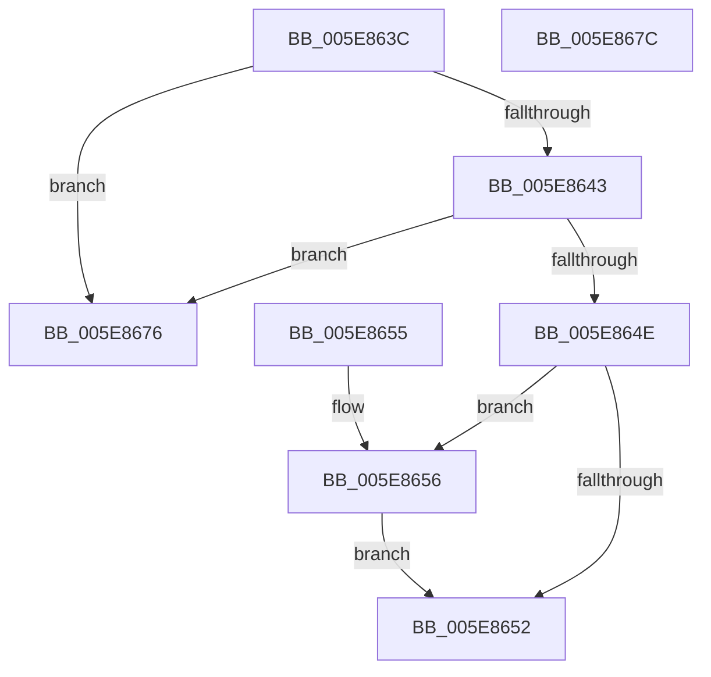

# RtlpCopyKernelCetChunk

- RVA: `0x005E863C`–`0x005E867D` (길이 `65` bytes)
- VA: `0x00000001405E863C`
- 실행 섹션: `.text`
- PDB 이름 있음: `예`; PDB Function 태그: `아니요`
- unwind 정보 RVA: `0x000DB714`
- 디코드: `20`개 명령, `65/65` bytes 표시
- 미해석 바이트: `0` (있으면 어셈블리에 `.byte`로 보존)

> 이 문서는 커널 이미지의 기계어와 PDB 기호를 분석해 생성했습니다. 4번과 5번은 함수 원형과 자료형을 바이너리 사용 방식에서 추정한 C 해석이며 원본 소스 복구 결과는 아닙니다.

## 1. Dependencies

- 직접 호출 지점: **0**; 고유 호출 대상: **0**
- 직접 호출자로 확인된 함수: **2**
- RIP 상대 이미지 참조: **0**

### Outgoing calls
- 직접 디코드된 call 명령이 없습니다.

### Direct callers
- [sub_003F518A](../3F/Unknown_function_003F518A.md) at `0x003F51BA`
- [RtlCopyContext](../../page/8D/RtlCopyContext_function_008D5940.md) at `0x008D5AF3`

### Static image references
- 디코드된 RIP-relative 메모리 참조가 없습니다.

## 2. Other-region calls and transfers

- 다른 실행 섹션으로 향하는 call: **0**
- 별도 외부 분기/꼬리 이동을 확인하지 못했습니다.

## 3. Assembly (complete function range)

```asm
005E863C  41 83 78 1C 18                  cmp dword ptr [r8 + 0x1c], 0x18
005E8641  72 33                           jb 0x1405e8676
005E8643  48 8B 44 24 28                  mov rax, qword ptr [rsp + 0x28]
005E8648  83 78 1C 18                     cmp dword ptr [rax + 0x1c], 0x18
005E864C  72 28                           jb 0x1405e8676
005E864E  84 C9                           test cl, cl
005E8650  75 04                           jne 0x1405e8656
005E8652  33 C0                           xor eax, eax
005E8654  C3                              ret
005E8655  CC                              int3
005E8656  48 63 40 18                     movsxd rax, dword ptr [rax + 0x18]
005E865A  49 63 48 18                     movsxd rcx, dword ptr [r8 + 0x18]
005E865E  42 0F 10 04 08                  movups xmm0, xmmword ptr [rax + r9]
005E8663  0F 11 04 11                     movups xmmword ptr [rcx + rdx], xmm0
005E8667  F2 42 0F 10 4C 08 10            movsd xmm1, qword ptr [rax + r9 + 0x10]
005E866E  F2 0F 11 4C 11 10               movsd qword ptr [rcx + rdx + 0x10], xmm1
005E8674  EB DC                           jmp 0x1405e8652
005E8676  B8 05 00 00 80                  mov eax, 0x80000005
005E867B  C3                              ret
005E867C  CC                              int3
```

## 4. C-style interpretation (structured pseudocode)

```c
__int64 __fastcall RtlpCopyKernelCetChunk(unsigned __int8 a1, __int64 a2, __int64 a3, __int64 a4, __int64 a5)
{
    __int64 result;

    if ((*(unsigned int *)(a3 + 28)) < 24) goto loc_005E8676;
    if ((*(unsigned int *)(a5 + 28)) < 24) goto loc_005E8676;
    if (a1 != 0) goto loc_005E8656;
loc_005E8652:
    result = 0;
    return result;
loc_005E8656:
    *(unsigned __int64 *)((int)(*(unsigned int *)(a3 + 24)) + a2 * 1) = v_xmm0;
    *(unsigned __int64 *)((int)(*(unsigned int *)(a3 + 24)) + a2 * 1 + 16) = v_xmm1;
    goto loc_005E8652;
loc_005E8676:
    return (unsigned int)(0x80000005ULL);
}
```

## 5. (Beta) C Style

```c
int64_t RtlpCopyKernelCetChunk(uint8_t Arg1, int64_t Arg2, void *Arg3, int64_t Arg4, void *Arg5)
{
    uint8_t *arg3 = (uint8_t *)Arg3;
    uint8_t *arg5 = (uint8_t *)Arg5;

    int64_t result;

    if ((*(uint32_t *)(arg3 + 0x1C)) < 24) goto loc_005E8676;
    if ((*(uint32_t *)(arg5 + 0x1C)) < 24) goto loc_005E8676;
    if (Arg1 != 0) goto loc_005E8656;
loc_005E8652:
    result = 0;
    return result;
loc_005E8656:
    *(uint64_t *)((int32_t)(*(uint32_t *)(arg3 + 0x18)) + Arg2 * 1) = v_xmm0;
    *(uint64_t *)((int32_t)(*(uint32_t *)(arg3 + 0x18)) + Arg2 * 1 + 0x10) = v_xmm1;
    goto loc_005E8652;
loc_005E8676:
    return (uint32_t)(0x80000005ULL);
}
```

### 관측된 메모리 오프셋

구조체 형식이 확인되지 않은 접근은 인자 기준의 오프셋으로만 기록했습니다.

| 기준 인자 | 오프셋 표현 | 폭 (bit) | 접근 |
|---|---:|---:|---|
| `Arg3` | `+ 0x18` | `32` | `R` |
| `Arg3` | `+ 0x1C` | `32` | `R` |
| `Arg5` | `+ 0x18` | `32` | `R` |
| `Arg5` | `+ 0x1C` | `32` | `R` |

## 6. Execution-region graph

[열기: 2D/3D 그래프와 함수 탐색 컨트롤 패널](../../../control-panel.html?section=text&rva=0x005E863C&view=graph)

- 2D 그래프는 위에서 아래로 흐르고, 3D 그래프는 빈 공간을 드래그해 회전합니다. Shift+드래그는 이동, 휠은 확대·축소, 함수 노드 선택은 대상 보고서 이동입니다.

### Static fallback


