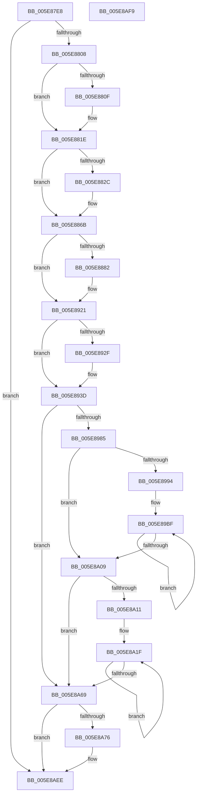

# RtlpCopyLegacyContextArm64

- RVA: `0x005E87E8`–`0x005E8AFA` (길이 `786` bytes)
- VA: `0x00000001405E87E8`
- 실행 섹션: `.text`
- PDB 이름 있음: `예`; PDB Function 태그: `아니요`
- unwind 정보 RVA: `0x000950EC`
- 디코드: `167`개 명령, `786/786` bytes 표시
- 미해석 바이트: `0` (있으면 어셈블리에 `.byte`로 보존)

> 이 문서는 커널 이미지의 기계어와 PDB 기호를 분석해 생성했습니다. 4번과 5번은 함수 원형과 자료형을 바이너리 사용 방식에서 추정한 C 해석이며 원본 소스 복구 결과는 아닙니다.

## 1. Dependencies

- 직접 호출 지점: **0**; 고유 호출 대상: **0**
- 직접 호출자로 확인된 함수: **2**
- RIP 상대 이미지 참조: **0**

### Outgoing calls
- 직접 디코드된 call 명령이 없습니다.

### Direct callers
- [sub_006EB35E](../6E/Unknown_function_006EB35E.md) at `0x006EB370`
- [sub_006EB37C](../6E/Unknown_function_006EB37C.md) at `0x006EB387`

### Static image references
- 디코드된 RIP-relative 메모리 참조가 없습니다.

## 2. Other-region calls and transfers

- 다른 실행 섹션으로 향하는 call: **0**
- 별도 외부 분기/꼬리 이동을 확인하지 못했습니다.

## 3. Assembly (complete function range)

```asm
005E87E8  48 89 5C 24 08                  mov qword ptr [rsp + 8], rbx
005E87ED  48 89 7C 24 10                  mov qword ptr [rsp + 0x10], rdi
005E87F2  41 8B C0                        mov eax, r8d
005E87F5  41 BA FF FF FF 67               mov r10d, 0x67ffffff
005E87FB  41 23 C2                        and eax, r10d
005E87FE  89 02                           mov dword ptr [rdx], eax
005E8800  84 C9                           test cl, cl
005E8802  0F 84 E6 02 00 00               je 0x1405e8aee
005E8808  41 0F BA E0 1E                  bt r8d, 0x1e
005E880D  73 0F                           jae 0x1405e881e
005E880F  41 8B 01                        mov eax, dword ptr [r9]
005E8812  8B C8                           mov ecx, eax
005E8814  41 33 C8                        xor ecx, r8d
005E8817  41 23 CA                        and ecx, r10d
005E881A  33 C8                           xor ecx, eax
005E881C  89 0A                           mov dword ptr [rdx], ecx
005E881E  B9 01 00 40 00                  mov ecx, 0x400001
005E8823  41 8B C0                        mov eax, r8d
005E8826  23 C1                           and eax, ecx
005E8828  3B C1                           cmp eax, ecx
005E882A  75 3F                           jne 0x1405e886b
005E882C  49 8B 81 08 01 00 00            mov rax, qword ptr [r9 + 0x108]
005E8833  48 89 82 08 01 00 00            mov qword ptr [rdx + 0x108], rax
005E883A  49 8B 81 00 01 00 00            mov rax, qword ptr [r9 + 0x100]
005E8841  48 89 82 00 01 00 00            mov qword ptr [rdx + 0x100], rax
005E8848  41 8B 41 04                     mov eax, dword ptr [r9 + 4]
005E884C  89 42 04                        mov dword ptr [rdx + 4], eax
005E884F  49 8B 81 F0 00 00 00            mov rax, qword ptr [r9 + 0xf0]
005E8856  48 89 82 F0 00 00 00            mov qword ptr [rdx + 0xf0], rax
005E885D  49 8B 81 F8 00 00 00            mov rax, qword ptr [r9 + 0xf8]
005E8864  48 89 82 F8 00 00 00            mov qword ptr [rdx + 0xf8], rax
005E886B  B9 02 00 40 00                  mov ecx, 0x400002
005E8870  41 8B C0                        mov eax, r8d
005E8873  23 C1                           and eax, ecx
005E8875  BF 80 00 00 00                  mov edi, 0x80
005E887A  3B C1                           cmp eax, ecx
005E887C  0F 85 9F 00 00 00               jne 0x1405e8921
005E8882  41 0F 10 41 08                  movups xmm0, xmmword ptr [r9 + 8]
005E8887  0F 11 42 08                     movups xmmword ptr [rdx + 8], xmm0
005E888B  41 0F 10 49 18                  movups xmm1, xmmword ptr [r9 + 0x18]
005E8890  0F 11 4A 18                     movups xmmword ptr [rdx + 0x18], xmm1
005E8894  41 0F 10 41 28                  movups xmm0, xmmword ptr [r9 + 0x28]
005E8899  0F 11 42 28                     movups xmmword ptr [rdx + 0x28], xmm0
005E889D  41 0F 10 49 38                  movups xmm1, xmmword ptr [r9 + 0x38]
005E88A2  0F 11 4A 38                     movups xmmword ptr [rdx + 0x38], xmm1
005E88A6  41 0F 10 41 48                  movups xmm0, xmmword ptr [r9 + 0x48]
005E88AB  0F 11 42 48                     movups xmmword ptr [rdx + 0x48], xmm0
005E88AF  41 0F 10 49 58                  movups xmm1, xmmword ptr [r9 + 0x58]
005E88B4  0F 11 4A 58                     movups xmmword ptr [rdx + 0x58], xmm1
005E88B8  41 0F 10 41 68                  movups xmm0, xmmword ptr [r9 + 0x68]
005E88BD  0F 11 42 68                     movups xmmword ptr [rdx + 0x68], xmm0
005E88C1  41 0F 10 49 78                  movups xmm1, xmmword ptr [r9 + 0x78]
005E88C6  0F 11 4C 3A F8                  movups xmmword ptr [rdx + rdi - 8], xmm1
005E88CB  41 0F 10 44 39 08               movups xmm0, xmmword ptr [r9 + rdi + 8]
005E88D1  0F 11 44 3A 08                  movups xmmword ptr [rdx + rdi + 8], xmm0
005E88D6  41 0F 10 81 A0 00 00 00         movups xmm0, xmmword ptr [r9 + 0xa0]
005E88DE  0F 11 82 A0 00 00 00            movups xmmword ptr [rdx + 0xa0], xmm0
005E88E5  41 0F 10 89 B0 00 00 00         movups xmm1, xmmword ptr [r9 + 0xb0]
005E88ED  0F 11 8A B0 00 00 00            movups xmmword ptr [rdx + 0xb0], xmm1
005E88F4  41 0F 10 81 C0 00 00 00         movups xmm0, xmmword ptr [r9 + 0xc0]
005E88FC  0F 11 82 C0 00 00 00            movups xmmword ptr [rdx + 0xc0], xmm0
005E8903  41 0F 10 89 D0 00 00 00         movups xmm1, xmmword ptr [r9 + 0xd0]
005E890B  0F 11 8A D0 00 00 00            movups xmmword ptr [rdx + 0xd0], xmm1
005E8912  41 0F 10 81 E0 00 00 00         movups xmm0, xmmword ptr [r9 + 0xe0]
005E891A  0F 11 82 E0 00 00 00            movups xmmword ptr [rdx + 0xe0], xmm0
005E8921  B9 10 00 40 00                  mov ecx, 0x400010
005E8926  41 8B C0                        mov eax, r8d
005E8929  23 C1                           and eax, ecx
005E892B  3B C1                           cmp eax, ecx
005E892D  75 0E                           jne 0x1405e893d
005E892F  49 8B 81 98 00 00 00            mov rax, qword ptr [r9 + 0x98]
005E8936  48 89 82 98 00 00 00            mov qword ptr [rdx + 0x98], rax
005E893D  41 8B C0                        mov eax, r8d
005E8940  B9 04 00 40 00                  mov ecx, 0x400004
005E8945  23 C1                           and eax, ecx
005E8947  45 8B D0                        mov r10d, r8d
005E894A  41 81 CA C0 00 40 00            or r10d, 0x4000c0
005E8951  3B C1                           cmp eax, ecx
005E8953  45 0F 45 D0                     cmovne r10d, r8d
005E8957  45 8B C2                        mov r8d, r10d
005E895A  41 8B DA                        mov ebx, r10d
005E895D  41 81 E0 40 00 40 00            and r8d, 0x400040
005E8964  81 E3 80 00 40 00               and ebx, 0x400080
005E896A  81 FB 80 00 40 00               cmp ebx, 0x400080
005E8970  0F 95 C1                        setne cl
005E8973  41 81 F8 40 00 40 00            cmp r8d, 0x400040
005E897A  0F 95 C0                        setne al
005E897D  84 C8                           test al, cl
005E897F  0F 85 E4 00 00 00               jne 0x1405e8a69
005E8985  41 BB 02 00 00 00               mov r11d, 2
005E898B  41 81 F8 40 00 40 00            cmp r8d, 0x400040
005E8992  75 75                           jne 0x1405e8a09
005E8994  41 8B 81 10 03 00 00            mov eax, dword ptr [r9 + 0x310]
005E899B  49 8D 89 10 01 00 00            lea rcx, [r9 + 0x110]
005E89A2  89 82 10 03 00 00               mov dword ptr [rdx + 0x310], eax
005E89A8  45 8B C3                        mov r8d, r11d
005E89AB  41 8B 81 14 03 00 00            mov eax, dword ptr [r9 + 0x314]
005E89B2  89 82 14 03 00 00               mov dword ptr [rdx + 0x314], eax
005E89B8  48 8D 82 10 01 00 00            lea rax, [rdx + 0x110]
005E89BF  0F 10 01                        movups xmm0, xmmword ptr [rcx]
005E89C2  0F 11 00                        movups xmmword ptr [rax], xmm0
005E89C5  0F 10 49 10                     movups xmm1, xmmword ptr [rcx + 0x10]
005E89C9  0F 11 48 10                     movups xmmword ptr [rax + 0x10], xmm1
005E89CD  0F 10 41 20                     movups xmm0, xmmword ptr [rcx + 0x20]
005E89D1  0F 11 40 20                     movups xmmword ptr [rax + 0x20], xmm0
005E89D5  0F 10 49 30                     movups xmm1, xmmword ptr [rcx + 0x30]
005E89D9  0F 11 48 30                     movups xmmword ptr [rax + 0x30], xmm1
005E89DD  0F 10 41 40                     movups xmm0, xmmword ptr [rcx + 0x40]
005E89E1  0F 11 40 40                     movups xmmword ptr [rax + 0x40], xmm0
005E89E5  0F 10 49 50                     movups xmm1, xmmword ptr [rcx + 0x50]
005E89E9  0F 11 48 50                     movups xmmword ptr [rax + 0x50], xmm1
005E89ED  0F 10 41 60                     movups xmm0, xmmword ptr [rcx + 0x60]
005E89F1  0F 11 40 60                     movups xmmword ptr [rax + 0x60], xmm0
005E89F5  48 03 C7                        add rax, rdi
005E89F8  0F 10 49 70                     movups xmm1, xmmword ptr [rcx + 0x70]
005E89FC  48 03 CF                        add rcx, rdi
005E89FF  0F 11 48 F0                     movups xmmword ptr [rax - 0x10], xmm1
005E8A03  49 83 E8 01                     sub r8, 1
005E8A07  75 B6                           jne 0x1405e89bf
005E8A09  81 FB 80 00 40 00               cmp ebx, 0x400080
005E8A0F  75 58                           jne 0x1405e8a69
005E8A11  48 8D 82 10 02 00 00            lea rax, [rdx + 0x210]
005E8A18  49 8D 89 10 02 00 00            lea rcx, [r9 + 0x210]
005E8A1F  0F 10 01                        movups xmm0, xmmword ptr [rcx]
005E8A22  0F 11 00                        movups xmmword ptr [rax], xmm0
005E8A25  0F 10 49 10                     movups xmm1, xmmword ptr [rcx + 0x10]
005E8A29  0F 11 48 10                     movups xmmword ptr [rax + 0x10], xmm1
005E8A2D  0F 10 41 20                     movups xmm0, xmmword ptr [rcx + 0x20]
005E8A31  0F 11 40 20                     movups xmmword ptr [rax + 0x20], xmm0
005E8A35  0F 10 49 30                     movups xmm1, xmmword ptr [rcx + 0x30]
005E8A39  0F 11 48 30                     movups xmmword ptr [rax + 0x30], xmm1
005E8A3D  0F 10 41 40                     movups xmm0, xmmword ptr [rcx + 0x40]
005E8A41  0F 11 40 40                     movups xmmword ptr [rax + 0x40], xmm0
005E8A45  0F 10 49 50                     movups xmm1, xmmword ptr [rcx + 0x50]
005E8A49  0F 11 48 50                     movups xmmword ptr [rax + 0x50], xmm1
005E8A4D  0F 10 41 60                     movups xmm0, xmmword ptr [rcx + 0x60]
005E8A51  0F 11 40 60                     movups xmmword ptr [rax + 0x60], xmm0
005E8A55  48 03 C7                        add rax, rdi
005E8A58  0F 10 49 70                     movups xmm1, xmmword ptr [rcx + 0x70]
005E8A5C  48 03 CF                        add rcx, rdi
005E8A5F  0F 11 48 F0                     movups xmmword ptr [rax - 0x10], xmm1
005E8A63  49 83 EB 01                     sub r11, 1
005E8A67  75 B6                           jne 0x1405e8a1f
005E8A69  B8 08 00 40 00                  mov eax, 0x400008
005E8A6E  44 23 D0                        and r10d, eax
005E8A71  44 3B D0                        cmp r10d, eax
005E8A74  75 78                           jne 0x1405e8aee
005E8A76  41 0F 10 81 38 03 00 00         movups xmm0, xmmword ptr [r9 + 0x338]
005E8A7E  0F 11 82 38 03 00 00            movups xmmword ptr [rdx + 0x338], xmm0
005E8A85  41 0F 10 89 48 03 00 00         movups xmm1, xmmword ptr [r9 + 0x348]
005E8A8D  0F 11 8A 48 03 00 00            movups xmmword ptr [rdx + 0x348], xmm1
005E8A94  41 0F 10 81 58 03 00 00         movups xmm0, xmmword ptr [r9 + 0x358]
005E8A9C  0F 11 82 58 03 00 00            movups xmmword ptr [rdx + 0x358], xmm0
005E8AA3  41 0F 10 89 68 03 00 00         movups xmm1, xmmword ptr [r9 + 0x368]
005E8AAB  0F 11 8A 68 03 00 00            movups xmmword ptr [rdx + 0x368], xmm1
005E8AB2  41 0F 10 81 18 03 00 00         movups xmm0, xmmword ptr [r9 + 0x318]
005E8ABA  0F 11 82 18 03 00 00            movups xmmword ptr [rdx + 0x318], xmm0
005E8AC1  41 0F 10 89 28 03 00 00         movups xmm1, xmmword ptr [r9 + 0x328]
005E8AC9  0F 11 8A 28 03 00 00            movups xmmword ptr [rdx + 0x328], xmm1
005E8AD0  41 0F 10 81 80 03 00 00         movups xmm0, xmmword ptr [r9 + 0x380]
005E8AD8  F3 0F 7F 82 80 03 00 00         movdqu xmmword ptr [rdx + 0x380], xmm0
005E8AE0  49 8B 81 78 03 00 00            mov rax, qword ptr [r9 + 0x378]
005E8AE7  48 89 82 78 03 00 00            mov qword ptr [rdx + 0x378], rax
005E8AEE  48 8B 5C 24 08                  mov rbx, qword ptr [rsp + 8]
005E8AF3  48 8B 7C 24 10                  mov rdi, qword ptr [rsp + 0x10]
005E8AF8  C3                              ret
005E8AF9  CC                              int3
```

## 4. C-style interpretation (structured pseudocode)

```c
__int64 __fastcall RtlpCopyLegacyContextArm64(unsigned __int8 a1, __int64 a2, int a3, __int64 a4)
{
    __int64 result;
    __int64 v_r10;
    __int64 v_r11;
    __int64 v_rbx;
    unsigned __int64 v_stack_p10;
    unsigned __int64 v_stack_p8;

    v_stack_p8 = v_rbx;
    v_stack_p10 = v_rdi;
    result = (unsigned int)(((unsigned int)(a3)) & ((unsigned int)((unsigned int)(0x67FFFFFFULL))));
    *(unsigned int *)(a2) = (unsigned int)(result);
    if (a1 == 0) goto loc_005E8AEE;
    if (!(condition_is_above_or_equal)) {
        result = *(unsigned int *)(a4);
        a1 = (unsigned int)(result);
        a1 = (unsigned int)((a1) ^ (a3));
        a1 = (unsigned int)((a1) & ((unsigned int)((unsigned int)(0x67FFFFFFULL))));
        a1 = (unsigned int)((a1) ^ ((unsigned int)(result)));
        *(unsigned int *)(a2) = a1;
    }
    result = (unsigned int)(((unsigned int)(a3)) & ((unsigned int)((unsigned int)(0x400001ULL))));
    if (((unsigned int)(result)) == ((unsigned int)((unsigned int)(0x400001ULL)))) {
        result = *(unsigned __int64 *)(a4 + 264);
        *(unsigned __int64 *)(a2 + 264) = result;
        result = *(unsigned __int64 *)(a4 + 256);
        *(unsigned __int64 *)(a2 + 256) = result;
        result = *(unsigned int *)(a4 + 4);
        *(unsigned int *)(a2 + 4) = (unsigned int)(result);
        result = *(unsigned __int64 *)(a4 + 240);
        *(unsigned __int64 *)(a2 + 240) = result;
        result = *(unsigned __int64 *)(a4 + 248);
        *(unsigned __int64 *)(a2 + 248) = result;
    }
    result = (unsigned int)(((unsigned int)(a3)) & ((unsigned int)((unsigned int)(0x400002ULL))));
    if (((unsigned int)(result)) == ((unsigned int)((unsigned int)(0x400002ULL)))) {
        *(unsigned __int64 *)(a2 + 8) = v_xmm0;
        *(unsigned __int64 *)(a2 + 24) = v_xmm1;
        *(unsigned __int64 *)(a2 + 40) = v_xmm0;
        *(unsigned __int64 *)(a2 + 56) = v_xmm1;
        *(unsigned __int64 *)(a2 + 72) = v_xmm0;
        *(unsigned __int64 *)(a2 + 88) = v_xmm1;
        *(unsigned __int64 *)(a2 + 104) = v_xmm0;
        *(unsigned __int64 *)(a2 + 128 * 1 - 8) = v_xmm1;
        *(unsigned __int64 *)(a2 + 128 * 1 + 8) = v_xmm0;
        *(unsigned __int64 *)(a2 + 160) = v_xmm0;
        *(unsigned __int64 *)(a2 + 176) = v_xmm1;
        *(unsigned __int64 *)(a2 + 192) = v_xmm0;
        *(unsigned __int64 *)(a2 + 208) = v_xmm1;
        *(unsigned __int64 *)(a2 + 224) = v_xmm0;
    }
    result = (unsigned int)(((unsigned int)(a3)) & ((unsigned int)((unsigned int)(0x400010ULL))));
    if (((unsigned int)(result)) == ((unsigned int)((unsigned int)(0x400010ULL)))) {
        result = *(unsigned __int64 *)(a4 + 152);
        *(unsigned __int64 *)(a2 + 152) = result;
    }
    result = (unsigned int)(((unsigned int)(a3)) & ((unsigned int)((unsigned int)(0x400004ULL))));
    v_r10 = (unsigned int)(((unsigned int)(a3)) | (0x4000C0ULL));
    if (((unsigned int)(result)) != ((unsigned int)((unsigned int)(0x400004ULL)))) { v_r10 = a3; }
    a3 = (unsigned int)(((unsigned int)((unsigned int)(v_r10))) & (0x400040ULL));
    v_rbx = (unsigned int)(((unsigned int)((unsigned int)(v_r10))) & (0x400080ULL));
    a1 = (((unsigned int)(v_rbx)) != 0x400080ULL) ? 1 : 0;
    result = (a3 != 0x400040ULL) ? 1 : 0;
    if ((((unsigned __int8)(result)) & (a1)) != 0) goto loc_005E8A69;
    if (a3 != 0x400040ULL) goto loc_005E8A09;
    *(unsigned int *)(a2 + 784) = (unsigned int)((unsigned int)(*(unsigned int *)(a4 + 784)));
    *(unsigned int *)(a2 + 788) = (unsigned int)((unsigned int)(*(unsigned int *)(a4 + 788)));
loc_005E89BF:
    *(unsigned __int64 *)(a2 + 272) = v_xmm0;
    *(unsigned __int64 *)(a2 + 272 + 16) = v_xmm1;
    *(unsigned __int64 *)(a2 + 272 + 32) = v_xmm0;
    *(unsigned __int64 *)(a2 + 272 + 48) = v_xmm1;
    *(unsigned __int64 *)(a2 + 272 + 64) = v_xmm0;
    *(unsigned __int64 *)(a2 + 272 + 80) = v_xmm1;
    *(unsigned __int64 *)(a2 + 272 + 96) = v_xmm0;
    result = (a2 + 272) + (128);
    a1 = (a4 + 272) + (128);
    *(unsigned __int64 *)(result - 16) = v_xmm1;
    a3 = (2) - (1);
    if (condition_is_not_equal) goto loc_005E89BF;
loc_005E8A09:
    if (((unsigned int)(v_rbx)) != 0x400080ULL) goto loc_005E8A69;
loc_005E8A1F:
    *(unsigned __int64 *)(a2 + 528) = v_xmm0;
    *(unsigned __int64 *)(a2 + 528 + 16) = v_xmm1;
    *(unsigned __int64 *)(a2 + 528 + 32) = v_xmm0;
    *(unsigned __int64 *)(a2 + 528 + 48) = v_xmm1;
    *(unsigned __int64 *)(a2 + 528 + 64) = v_xmm0;
    *(unsigned __int64 *)(a2 + 528 + 80) = v_xmm1;
    *(unsigned __int64 *)(a2 + 528 + 96) = v_xmm0;
    result = (a2 + 528) + (128);
    a1 = (a4 + 528) + (128);
    *(unsigned __int64 *)(result - 16) = v_xmm1;
    v_r11 = (2) - (1);
    if (condition_is_not_equal) goto loc_005E8A1F;
loc_005E8A69:
    v_r10 = (unsigned int)((v_r10) & ((unsigned int)((unsigned int)(0x400008ULL))));
    result = (unsigned int)(0x400008ULL);
    if (((unsigned int)(v_r10)) == ((unsigned int)((unsigned int)(0x400008ULL)))) {
        *(unsigned __int64 *)(a2 + 824) = v_xmm0;
        *(unsigned __int64 *)(a2 + 840) = v_xmm1;
        *(unsigned __int64 *)(a2 + 856) = v_xmm0;
        *(unsigned __int64 *)(a2 + 872) = v_xmm1;
        *(unsigned __int64 *)(a2 + 792) = v_xmm0;
        *(unsigned __int64 *)(a2 + 808) = v_xmm1;
        *(unsigned __int64 *)(a2 + 896) = v_xmm0;
        result = *(unsigned __int64 *)(a4 + 888);
        *(unsigned __int64 *)(a2 + 888) = result;
    }
    return result;
}
```

## 5. (Beta) C Style

```c
int64_t RtlpCopyLegacyContextArm64(uint8_t Arg1, void *Arg2, int32_t Arg3, void *Arg4)
{
    uint8_t *arg2 = (uint8_t *)Arg2;
    uint8_t *arg4 = (uint8_t *)Arg4;

    int64_t result;
    int64_t local_r10;
    int64_t local_r11;
    int64_t local_rbx;
    uint64_t v_stack_p10;
    uint64_t v_stack_p8;

    v_stack_p8 = local_rbx;
    v_stack_p10 = local_rdi;
    result = (uint32_t)(((uint32_t)(Arg3)) & ((uint32_t)((uint32_t)(0x67FFFFFFULL))));
    *(uint32_t *)(arg2) = (uint32_t)(result);
    if (Arg1 == 0) goto loc_005E8AEE;
    if (!(condition_is_above_or_equal)) {
        result = *(uint32_t *)(arg4);
        Arg1 = (uint32_t)(result);
        Arg1 = (uint32_t)((Arg1) ^ (Arg3));
        Arg1 = (uint32_t)((Arg1) & ((uint32_t)((uint32_t)(0x67FFFFFFULL))));
        Arg1 = (uint32_t)((Arg1) ^ ((uint32_t)(result)));
        *(uint32_t *)(arg2) = Arg1;
    }
    result = (uint32_t)(((uint32_t)(Arg3)) & ((uint32_t)((uint32_t)(0x400001ULL))));
    if (((uint32_t)(result)) == ((uint32_t)((uint32_t)(0x400001ULL)))) {
        result = *(uint64_t *)(arg4 + 0x108);
        *(uint64_t *)(arg2 + 0x108) = result;
        result = *(uint64_t *)(arg4 + 0x100);
        *(uint64_t *)(arg2 + 0x100) = result;
        result = *(uint32_t *)(arg4 + 0x4);
        *(uint32_t *)(arg2 + 0x4) = (uint32_t)(result);
        result = *(uint64_t *)(arg4 + 0xF0);
        *(uint64_t *)(arg2 + 0xF0) = result;
        result = *(uint64_t *)(arg4 + 0xF8);
        *(uint64_t *)(arg2 + 0xF8) = result;
    }
    result = (uint32_t)(((uint32_t)(Arg3)) & ((uint32_t)((uint32_t)(0x400002ULL))));
    if (((uint32_t)(result)) == ((uint32_t)((uint32_t)(0x400002ULL)))) {
        *(uint64_t *)(arg2 + 0x8) = v_xmm0;
        *(uint64_t *)(arg2 + 0x18) = v_xmm1;
        *(uint64_t *)(arg2 + 0x28) = v_xmm0;
        *(uint64_t *)(arg2 + 0x38) = v_xmm1;
        *(uint64_t *)(arg2 + 0x48) = v_xmm0;
        *(uint64_t *)(arg2 + 0x58) = v_xmm1;
        *(uint64_t *)(arg2 + 0x68) = v_xmm0;
        *(uint64_t *)(arg2 + 0x80 * 1 - 0x8) = v_xmm1;
        *(uint64_t *)(arg2 + 0x80 * 1 + 0x8) = v_xmm0;
        *(uint64_t *)(arg2 + 0xA0) = v_xmm0;
        *(uint64_t *)(arg2 + 0xB0) = v_xmm1;
        *(uint64_t *)(arg2 + 0xC0) = v_xmm0;
        *(uint64_t *)(arg2 + 0xD0) = v_xmm1;
        *(uint64_t *)(arg2 + 0xE0) = v_xmm0;
    }
    result = (uint32_t)(((uint32_t)(Arg3)) & ((uint32_t)((uint32_t)(0x400010ULL))));
    if (((uint32_t)(result)) == ((uint32_t)((uint32_t)(0x400010ULL)))) {
        result = *(uint64_t *)(arg4 + 0x98);
        *(uint64_t *)(arg2 + 0x98) = result;
    }
    result = (uint32_t)(((uint32_t)(Arg3)) & ((uint32_t)((uint32_t)(0x400004ULL))));
    local_r10 = (uint32_t)(((uint32_t)(Arg3)) | (0x4000C0ULL));
    if (((uint32_t)(result)) != ((uint32_t)((uint32_t)(0x400004ULL)))) { local_r10 = Arg3; }
    Arg3 = (uint32_t)(((uint32_t)((uint32_t)(local_r10))) & (0x400040ULL));
    local_rbx = (uint32_t)(((uint32_t)((uint32_t)(local_r10))) & (0x400080ULL));
    Arg1 = (((uint32_t)(local_rbx)) != 0x400080ULL) ? 1 : 0;
    result = (Arg3 != 0x400040ULL) ? 1 : 0;
    if ((((uint8_t)(result)) & (Arg1)) != 0) goto loc_005E8A69;
    if (Arg3 != 0x400040ULL) goto loc_005E8A09;
    *(uint32_t *)(arg2 + 0x310) = (uint32_t)((uint32_t)(*(uint32_t *)(arg4 + 0x310)));
    *(uint32_t *)(arg2 + 0x314) = (uint32_t)((uint32_t)(*(uint32_t *)(arg4 + 0x314)));
loc_005E89BF:
    *(uint64_t *)(arg2 + 0x110) = v_xmm0;
    *(uint64_t *)(arg2 + 0x110 + 0x10) = v_xmm1;
    *(uint64_t *)(arg2 + 0x110 + 0x20) = v_xmm0;
    *(uint64_t *)(arg2 + 0x110 + 0x30) = v_xmm1;
    *(uint64_t *)(arg2 + 0x110 + 0x40) = v_xmm0;
    *(uint64_t *)(arg2 + 0x110 + 0x50) = v_xmm1;
    *(uint64_t *)(arg2 + 0x110 + 0x60) = v_xmm0;
    result = (Arg2 + 272) + (128);
    Arg1 = (Arg4 + 272) + (128);
    *(uint64_t *)(result - 0x10) = v_xmm1;
    Arg3 = (2) - (1);
    if (condition_is_not_equal) goto loc_005E89BF;
loc_005E8A09:
    if (((uint32_t)(local_rbx)) != 0x400080ULL) goto loc_005E8A69;
loc_005E8A1F:
    *(uint64_t *)(arg2 + 0x210) = v_xmm0;
    *(uint64_t *)(arg2 + 0x210 + 0x10) = v_xmm1;
    *(uint64_t *)(arg2 + 0x210 + 0x20) = v_xmm0;
    *(uint64_t *)(arg2 + 0x210 + 0x30) = v_xmm1;
    *(uint64_t *)(arg2 + 0x210 + 0x40) = v_xmm0;
    *(uint64_t *)(arg2 + 0x210 + 0x50) = v_xmm1;
    *(uint64_t *)(arg2 + 0x210 + 0x60) = v_xmm0;
    result = (Arg2 + 528) + (128);
    Arg1 = (Arg4 + 528) + (128);
    *(uint64_t *)(result - 0x10) = v_xmm1;
    local_r11 = (2) - (1);
    if (condition_is_not_equal) goto loc_005E8A1F;
loc_005E8A69:
    local_r10 = (uint32_t)((local_r10) & ((uint32_t)((uint32_t)(0x400008ULL))));
    result = (uint32_t)(0x400008ULL);
    if (((uint32_t)(local_r10)) == ((uint32_t)((uint32_t)(0x400008ULL)))) {
        *(uint64_t *)(arg2 + 0x338) = v_xmm0;
        *(uint64_t *)(arg2 + 0x348) = v_xmm1;
        *(uint64_t *)(arg2 + 0x358) = v_xmm0;
        *(uint64_t *)(arg2 + 0x368) = v_xmm1;
        *(uint64_t *)(arg2 + 0x318) = v_xmm0;
        *(uint64_t *)(arg2 + 0x328) = v_xmm1;
        *(uint64_t *)(arg2 + 0x380) = v_xmm0;
        result = *(uint64_t *)(arg4 + 0x378);
        *(uint64_t *)(arg2 + 0x378) = result;
    }
    return result;
}
```

### 관측된 메모리 오프셋

구조체 형식이 확인되지 않은 접근은 인자 기준의 오프셋으로만 기록했습니다.

| 기준 인자 | 오프셋 표현 | 폭 (bit) | 접근 |
|---|---:|---:|---|
| `Arg2` | `- 0x10` | `128` | `R` |
| `Arg2` | `- 0x8 + rdi*1` | `128` | `R` |
| `Arg2` | `+ 0x0` | `32` | `W` |
| `Arg2` | `+ 0x0` | `128` | `R` |
| `Arg2` | `+ 0x4` | `32` | `W` |
| `Arg2` | `+ 0x8` | `128` | `R` |
| `Arg2` | `+ 0x8 + rdi*1` | `128` | `R` |
| `Arg2` | `+ 0x10` | `128` | `R` |
| `Arg2` | `+ 0x18` | `128` | `R` |
| `Arg2` | `+ 0x20` | `128` | `R` |
| `Arg2` | `+ 0x28` | `128` | `R` |
| `Arg2` | `+ 0x30` | `128` | `R` |
| `Arg2` | `+ 0x38` | `128` | `R` |
| `Arg2` | `+ 0x40` | `128` | `R` |
| `Arg2` | `+ 0x48` | `128` | `R` |
| `Arg2` | `+ 0x50` | `128` | `R` |
| `Arg2` | `+ 0x58` | `128` | `R` |
| `Arg2` | `+ 0x60` | `128` | `R` |
| `Arg2` | `+ 0x68` | `128` | `R` |
| `Arg2` | `+ 0x98` | `64` | `W` |
| `Arg2` | `+ 0xA0` | `128` | `R` |
| `Arg2` | `+ 0xB0` | `128` | `R` |
| `Arg2` | `+ 0xC0` | `128` | `R` |
| `Arg2` | `+ 0xD0` | `128` | `R` |
| `Arg2` | `+ 0xE0` | `128` | `R` |
| `Arg2` | `+ 0xF0` | `64` | `W` |
| `Arg2` | `+ 0xF8` | `64` | `W` |
| `Arg2` | `+ 0x100` | `64` | `W` |
| `Arg2` | `+ 0x108` | `64` | `W` |
| `Arg2` | `+ 0x110` | `64` | `R` |
| `Arg2` | `+ 0x210` | `64` | `R` |
| `Arg2` | `+ 0x310` | `32` | `W` |

추가 오프셋 50개는 표에서 생략했습니다.

## 6. Execution-region graph

[열기: 2D/3D 그래프와 함수 탐색 컨트롤 패널](../../../control-panel.html?section=text&rva=0x005E87E8&view=graph)

- 2D 그래프는 위에서 아래로 흐르고, 3D 그래프는 빈 공간을 드래그해 회전합니다. Shift+드래그는 이동, 휠은 확대·축소, 함수 노드 선택은 대상 보고서 이동입니다.

### Static fallback


